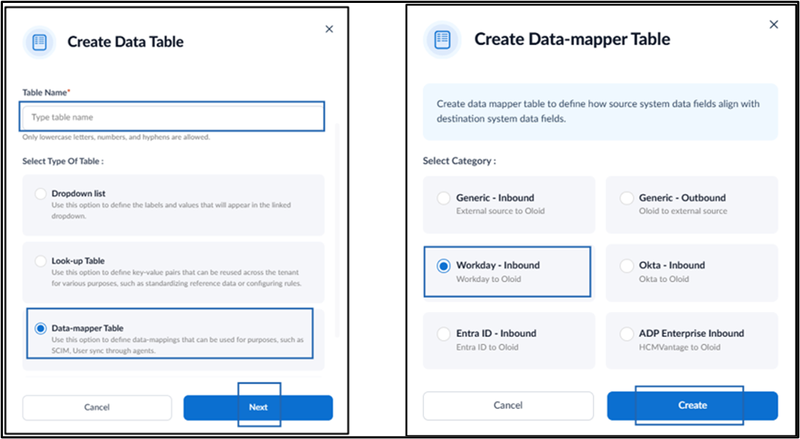
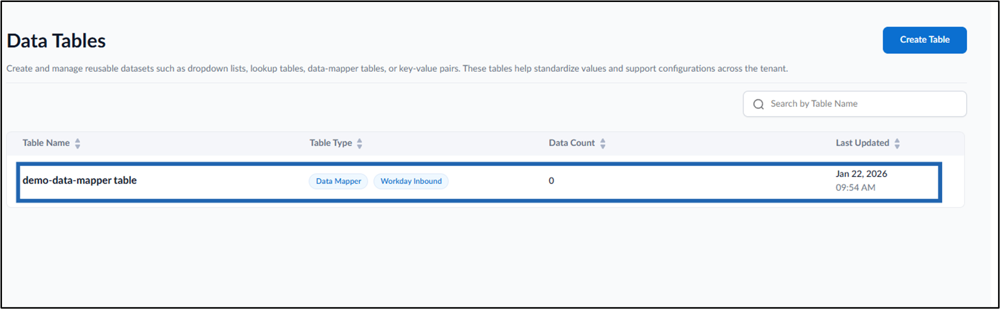

{/* Source: Intercom article 13457914 - https://oloid.help/en/articles/13457914-how-to-create-data-mapper-table-for-workday-inbound-in-the-tenant-admin-portal */}
{/* Generated by intercom_to_mintlify.py - re-running overwrites this file. */}

## Introduction

The Data Mapper Table in the Tenant Admin Portal allows admins to map employee data from external systems such as Workday - Inbound to Oloid. This document provides instructions on how to create the Data Mapper table for Workday - Inbound.

## Prerequisite

You must have access to the Tenant Admin Portal.

## Steps to Create Data Mapper Table

1. Log in to **Tenant Admin Portal**.
2. Go to **Agents** tab > click **Data Tables**.

   

   The Data Tables page is displayed.
3. Click **Create Table**.

   

   The **Create Data Table** pop-up box is displayed.
4. Do the following:
   1. Enter **Table Name**.
   2. Select **Data-mapper Table** in Type of Table.
   3. Click **Next**.
   4. Select **Workday - Inbound** as a Category.
   5. Click **Create**.

      

      The data mapper table is created successfully.

      

##### Related Article

[How to Configure Data Mapper Table for Workday - Inbound in the Tenant Admin Portal](/platform/tenant-admin-portal/tenant-admin-portal-how-to-configure-data-mapper-table-for-workday)
