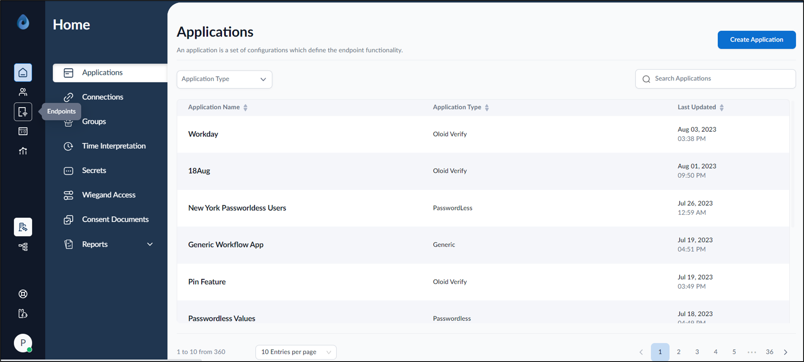
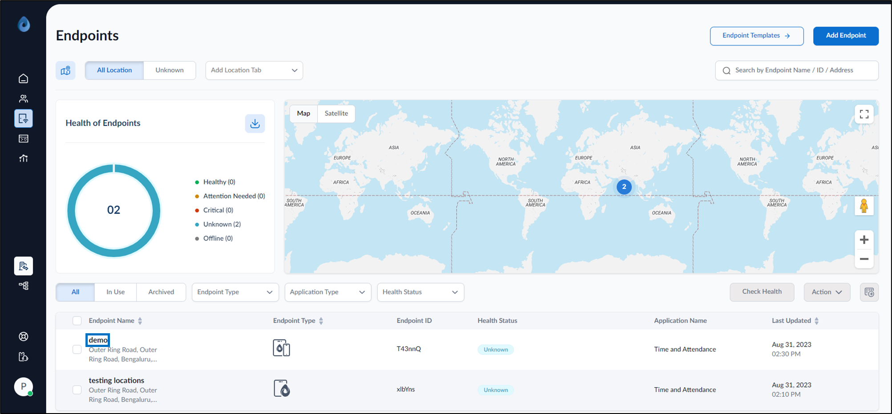
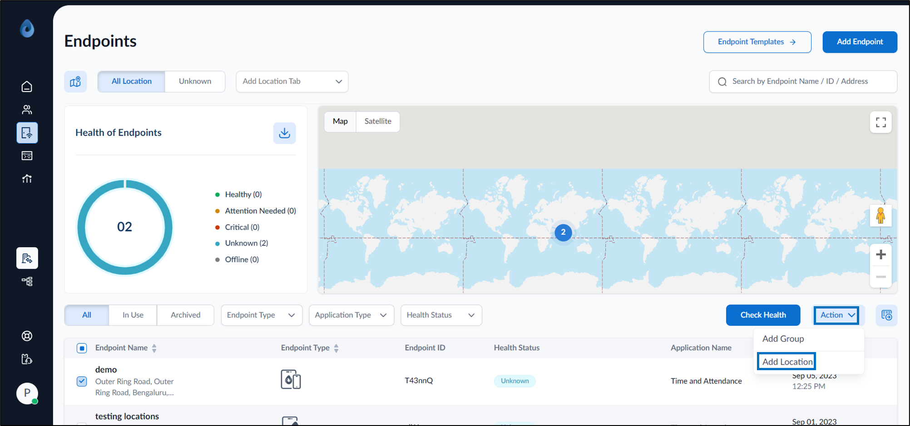
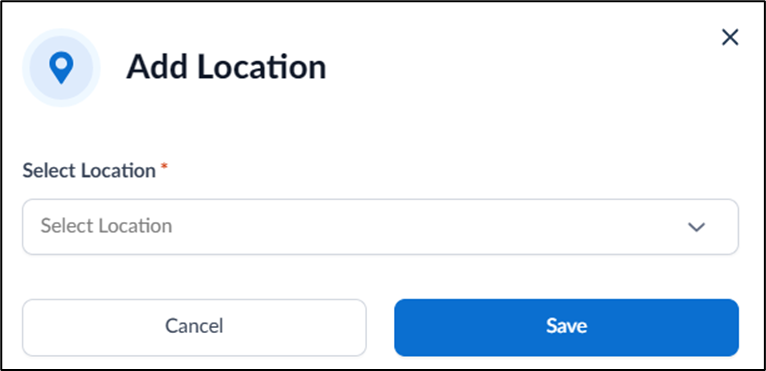
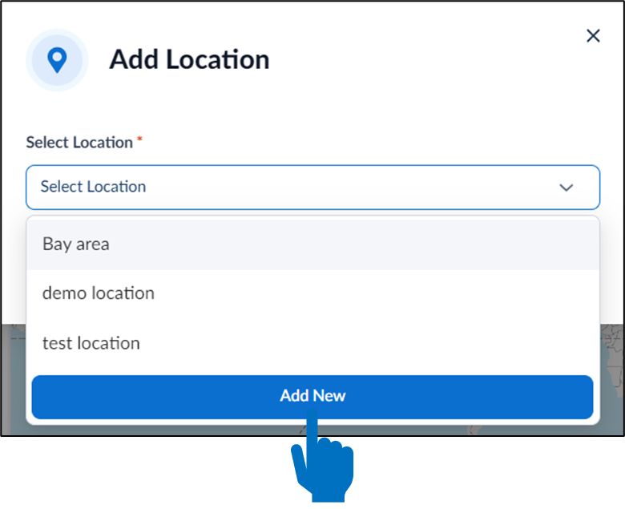
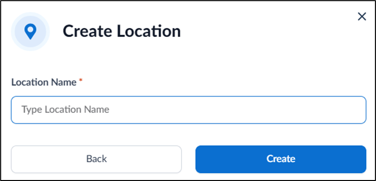
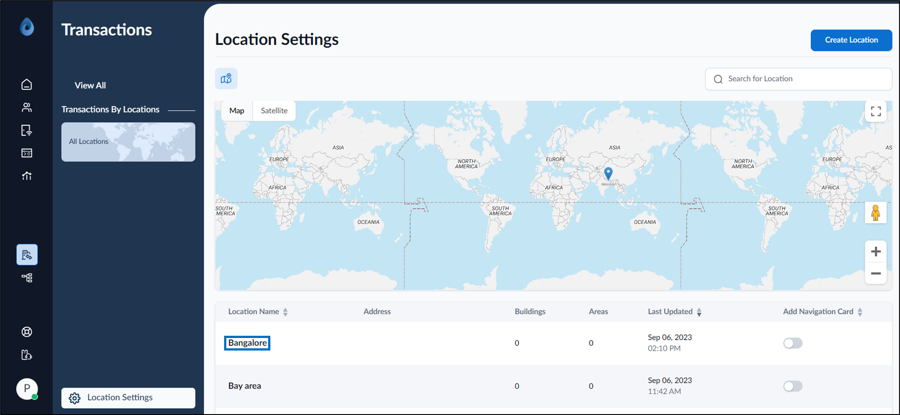

{/* Source: Intercom article 8498777 - https://oloid.help/en/articles/8498777-how-to-create-location-using-endpoint */}
{/* Generated by intercom_to_mintlify.py - re-running overwrites this file. */}

Steps to create a new location through endpoint:

1. Log in to the **Oloid Portal**.
2. On the home page of the portal, click **Endpoints** on the left menu panel.

   

   The **Endpoints** page is displayed.
3. Select endpoint name(s) from the listed endpoints.

   

4. Go to **Action** dropdown and select **Add Location**.

   

   The **Add Location** pop-up box is displayed.

   

5. On the pop-up box do the following:
   1. Click **Select Location** field.
      The search result lists existing locations.

      

   2. Click **Add New**.
      The **Create Location** pop-up box is displayed.

      

   3. Enter **Location Name**.
   4. Click **Create**.
      The location name is created and listed on the **Location Settings** page.

      

You can now add location details, for instructions on adding location details, see **[How to add location details](/platform/tenant-admin-portal/how-to-add-location-details)**.
