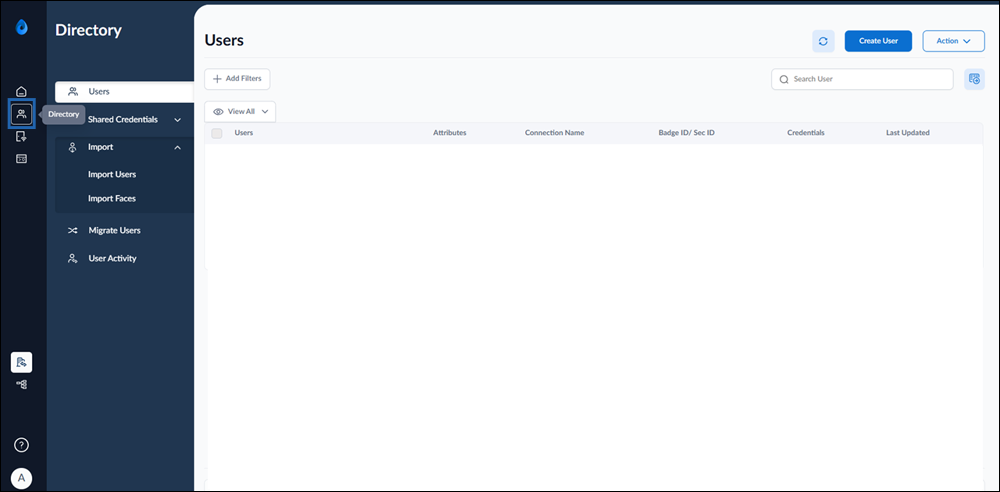
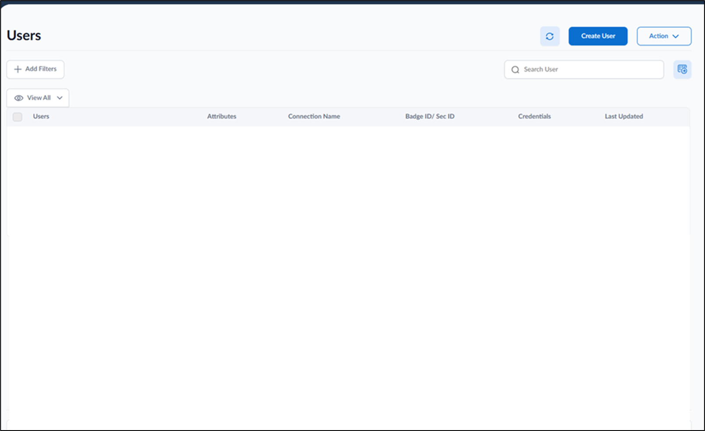
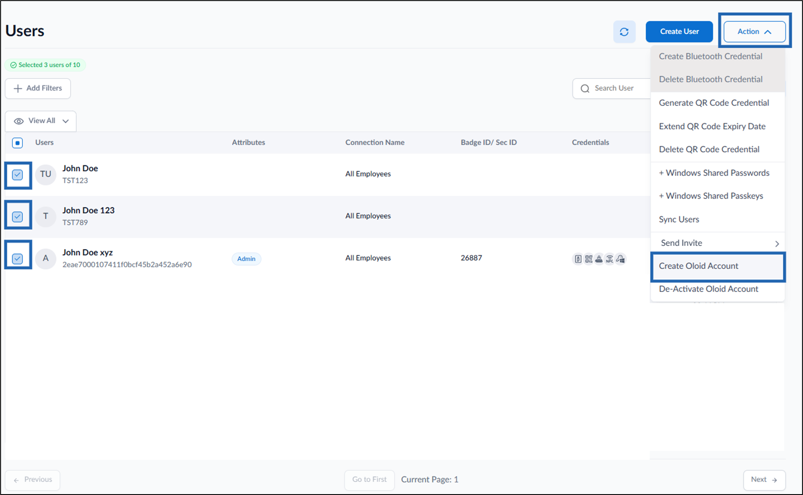
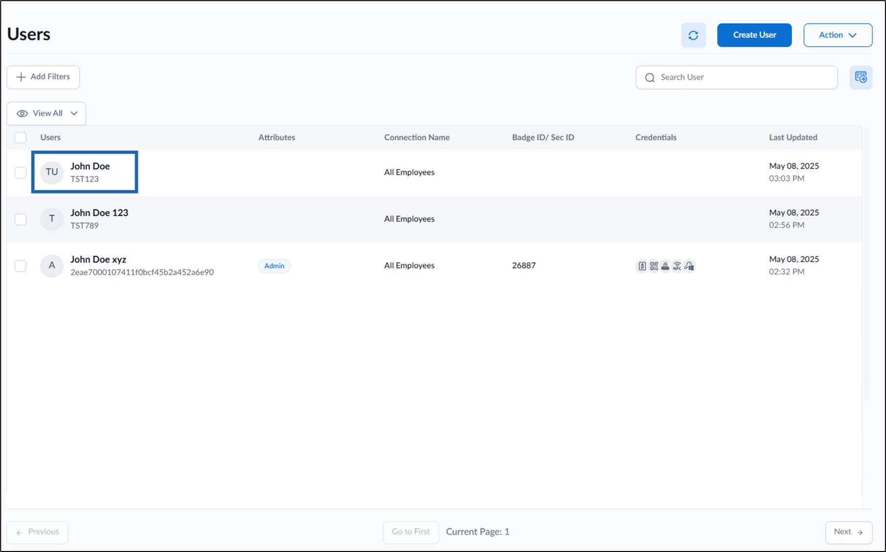
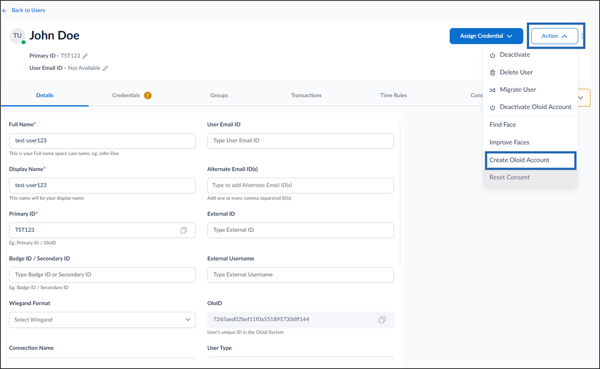

{/* Source: Intercom article 8347798 - https://oloid.help/en/articles/8347798-how-to-create-oloid-account-in-tenant-admin-portal */}
{/* Generated by intercom_to_mintlify.py - re-running overwrites this file. */}

**Introduction**

An Oloid account is a User's unique ID created within the Tenant Admin Portal, enabling users to access Oloid’s Applications.

**Pre-requisite:**

- You must provide your email address or phone number to create OloID Account.
- You must turn on **Enable OloID Account** toggle button on the Connection detail page. For more information, see**[How to Enable OloID account in Connection](/platform/tenant-admin-portal/tenant-admin-portal-how-to-enable-oloid-account-for-a-connection)**.

**Steps to Create Oloid Account:**

1. Log in to the **Tenant Admin Portal**.
2. On the home page of the portal, click **Directory** on the left menu panel.

   

   The **Users** page is displayed.

   

3. To create multiple user's Oloid account do the following:
   1. Select **User name(s**)> **Action** > **Create Oloid Account**.

      

4. To create single user's Oloid account do the following:
   1. Click User Name to edit.

      

   2. Go to **Action** > **Create Oloid Account**.
      The User details page is displayed.

      

      An Oloid account is successfully created. The user can now log in to Oloid Cloudkey app using their registered email id.
