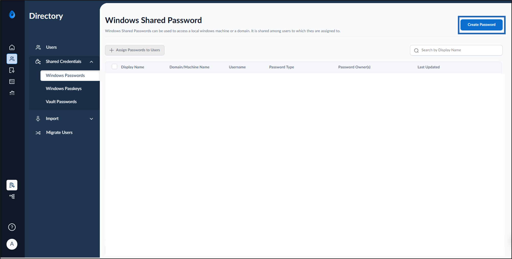
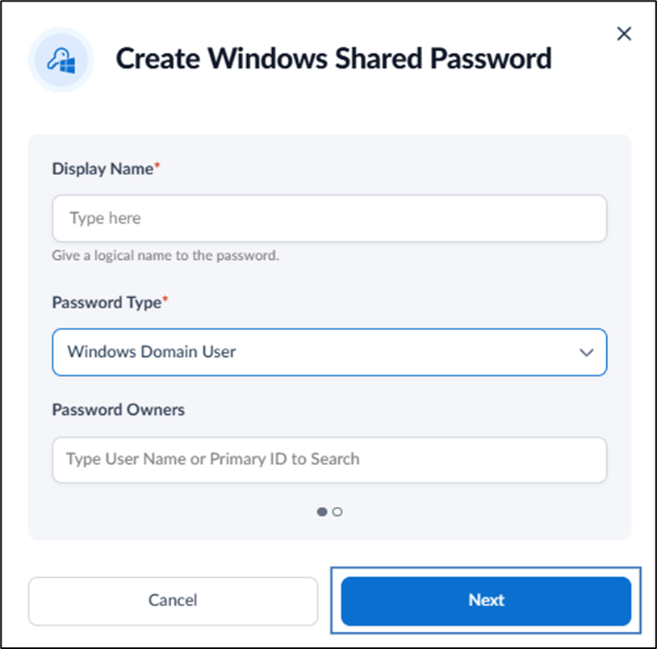
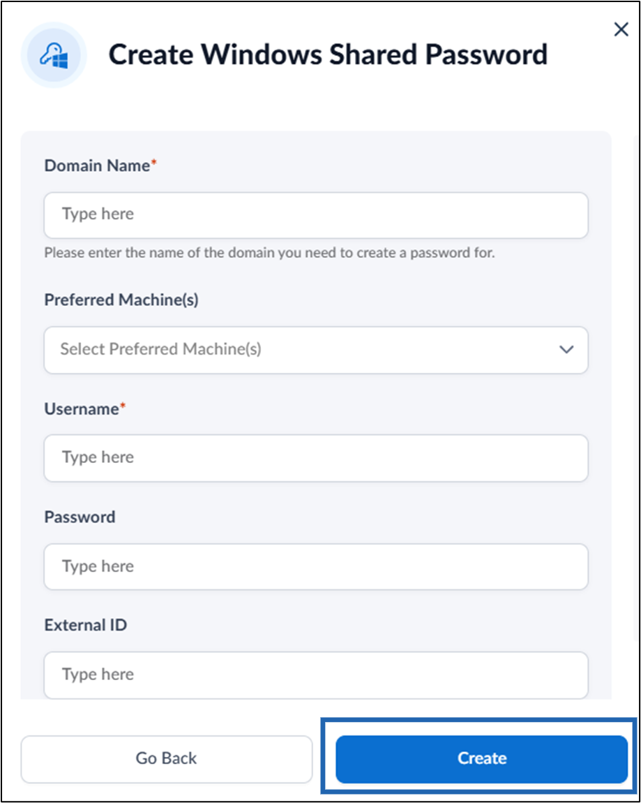
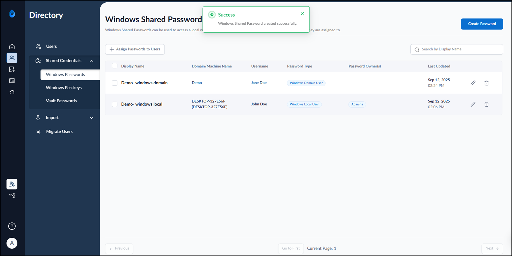
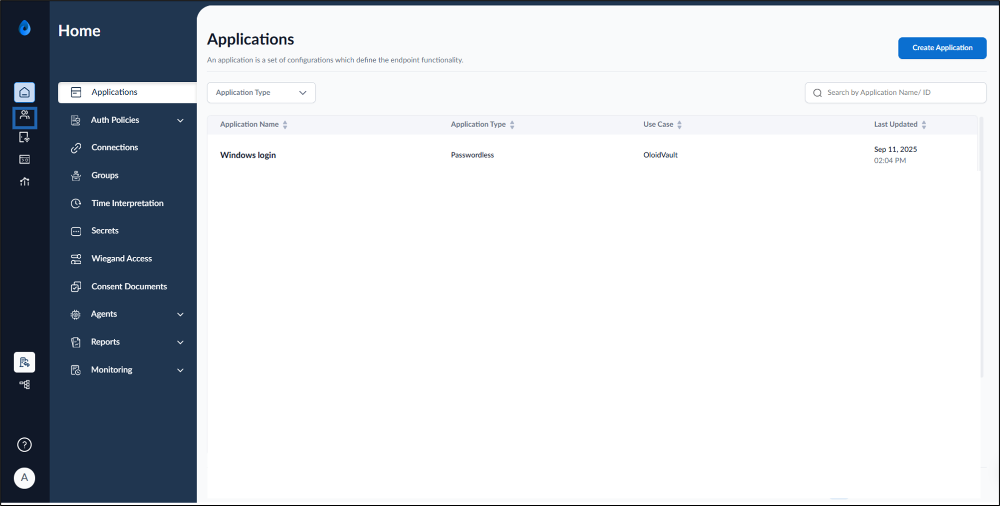
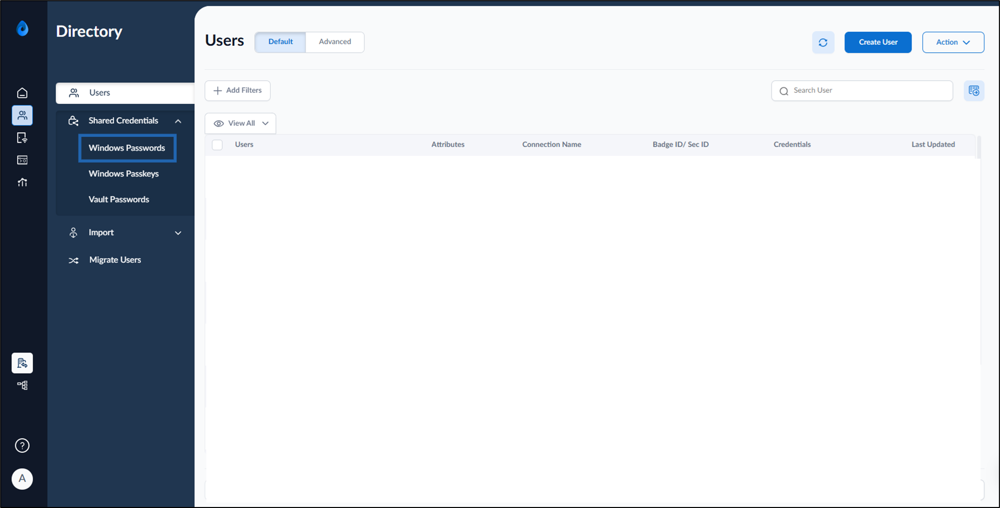
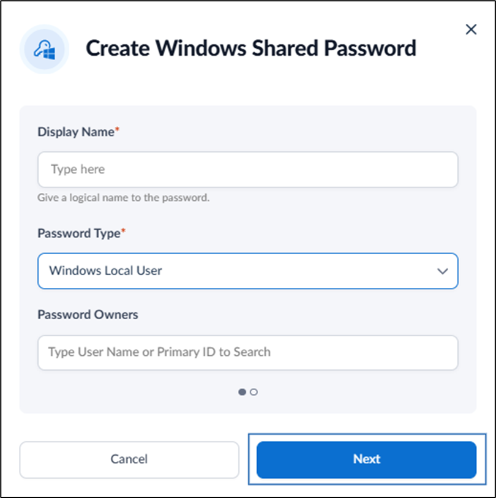
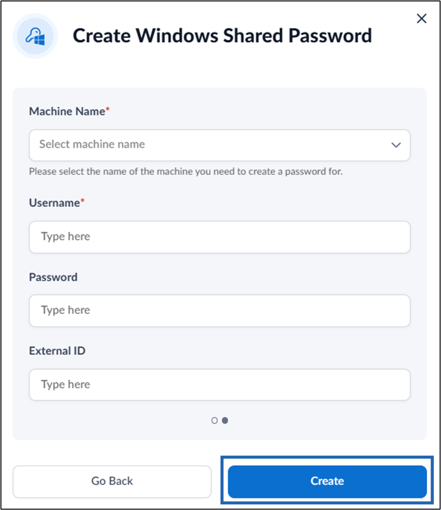
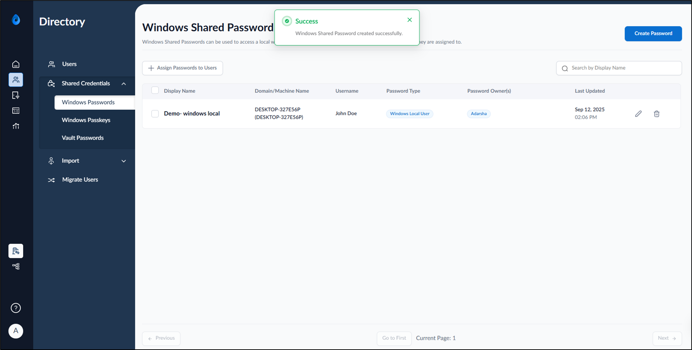
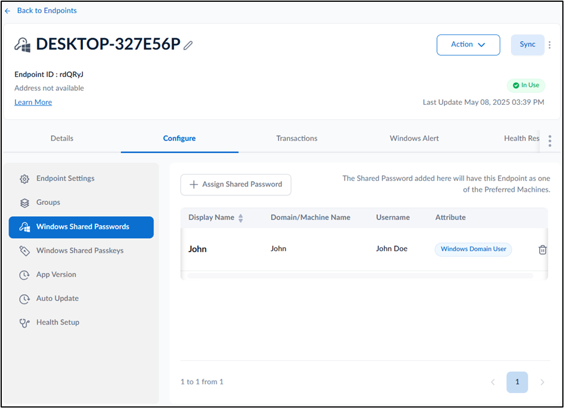

{/* Source: Intercom article 8472794 - https://oloid.help/en/articles/8472794-how-to-create-shared-password-for-windows-login-application-in-the-tenant-admin-portal */}
{/* Generated by intercom_to_mintlify.py - re-running overwrites this file. */}

## Introduction

Shared passwords are passwords that can be used to access a local windows machine or domain. It is shared among users to which they are assigned to. For more details refer [How to assign shared credential with users](/platform/tenant-admin-portal/tenant-admin-portal-how-to-assign-shared-password-for-windows-login).

This document comprises the following sections:

- [Create shared password for windows domain user](#steps-to-create-shared-password-for-windows-domain-user).
- [Create shared password for Windows local user](#steps-to-create-shared-password-for-windows-local-user).

### Steps to create shared password for windows domain user

1. Log in to the **Tenant Admin Portal**.
2. On the home page of the portal, click **Directory** on the left menu panel.

   

   The **Users** page is displayed.
3. Click **Shared Credentials > Windows Password** on the left menu panel.

   

   The **Windows Password** page is displayed.
4. On the top right, click **Create Password**.

   

   The **Create Windows Shared Password** pop-up box is displayed.
5. Do the following:
   1. Enter **Display Name**.
   2. Select user type as **Domain User** from **User Type** dropdown.
   3. Enter user name then select **Password Owner(s)** from the dropdown list.
   4. Select **Next**.

      

   5. Enter **Domain Name**.
   6. Select **Preferred Machine(s)**.
   7. Enter **Username** of your Windows Login.
   8. Enter **Password** of your Windows Login.
   9. Enter **External ID.**
   10. Click **Create.**

       

       The password is created and listed on the **Windows Shared Password** page.

       

### Steps to create shared password for windows local user

1. Log in to the **Tenant Admin Portal**.
2. On the home page of the portal, click **Directory** on the left menu panel.

   

   The **Users** page is displayed.
3. Click **Shared Credentials > Windows Password** on the left menu panel.

   

   The **Windows Shared Password** page is displayed.
4. On the top right, click **Create Password**.

   

   The **Create Windows Shared Password** pop-up box is displayed.
5. On the pop-up box do the following:
   1. Enter **Display Name** that displays on the Windows Login page.
   2. Select user type as **Windows Local User** from **Password Type** dropdown.
   3. Enter an existing user name, then select **Password Owner** from the dropdown list.
   4. Select **Next**.

      

   5. Enter **Machine Name**.

      <Note>
        **Note:** Enter your Windows device name.
      </Note>

   6. Enter **Username** of your Windows Login account.
   7. Enter **Password** of your Windows Login account.
   8. Enter **External ID.**
   9. Click **Create**.

      

      The password is created and listed successfully on the **Windows Shared Password** page.

      

<Note>
  **Note:** The domain shared password is also listed on the selected Endpoint details page.
</Note>

