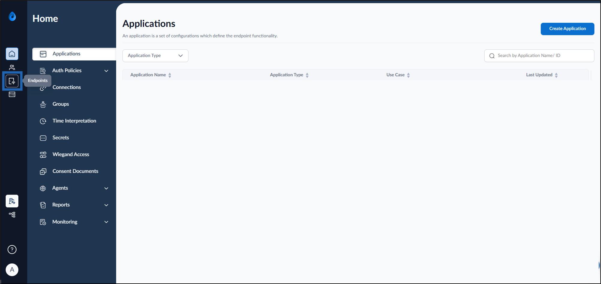
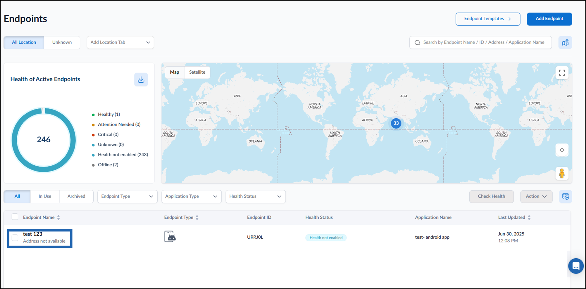
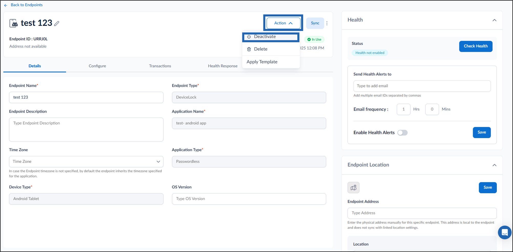
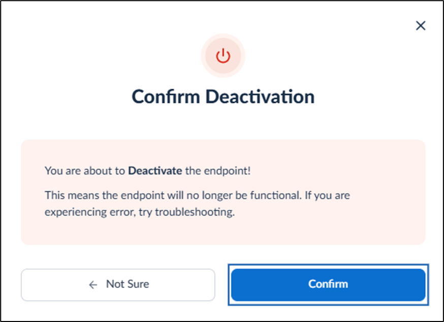
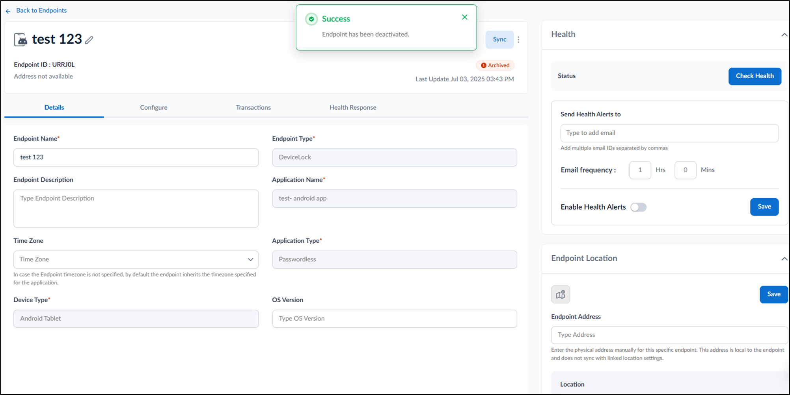

{/* Source: Intercom article 8463355 - https://oloid.help/en/articles/8463355-how-to-deactivate-endpoint-in-the-tenant-admin-portal */}
{/* Generated by intercom_to_mintlify.py - re-running overwrites this file. */}

**Steps to Deactivate Endpoint:**

1. Log in to the **Tenant Admin Portal**.
2. On the home page of the portal, click **Endpoints** on the left panel menu.

   

   The Endpoints page is displayed.
3. Select **Endpoint Name** to edit.

   

   The Endpointdetail page is displayed.
4. Go to **Action** dropdown > select **Deactivate**.

   

   The **Confirm Deactivation** pop-up box is displayed.

   

5. Click **Confirm**.
   The endpoint is deactivated and archived.

   
