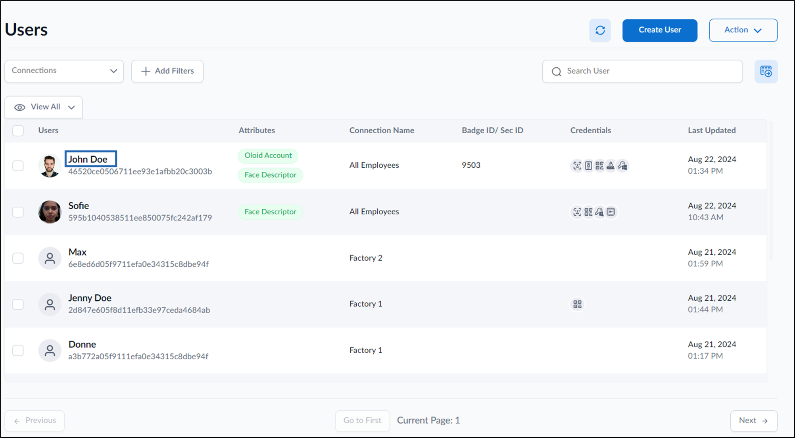
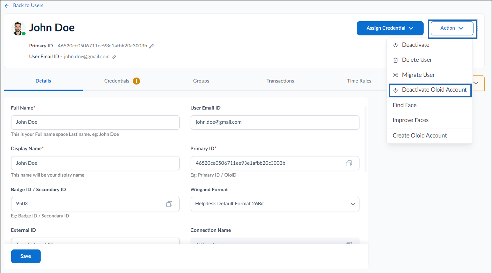
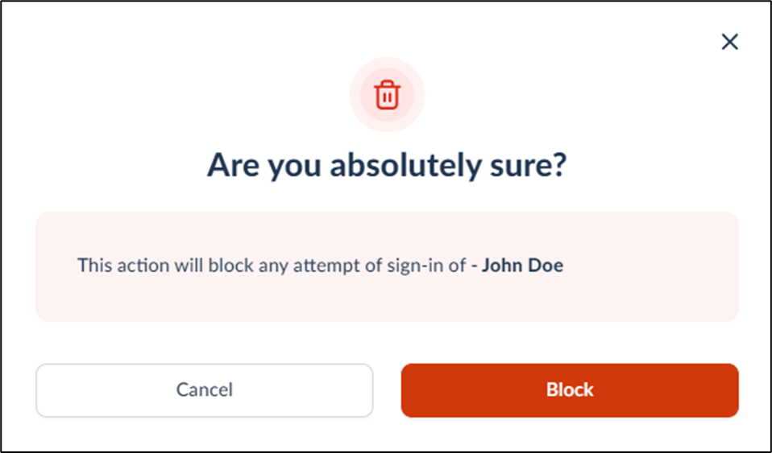
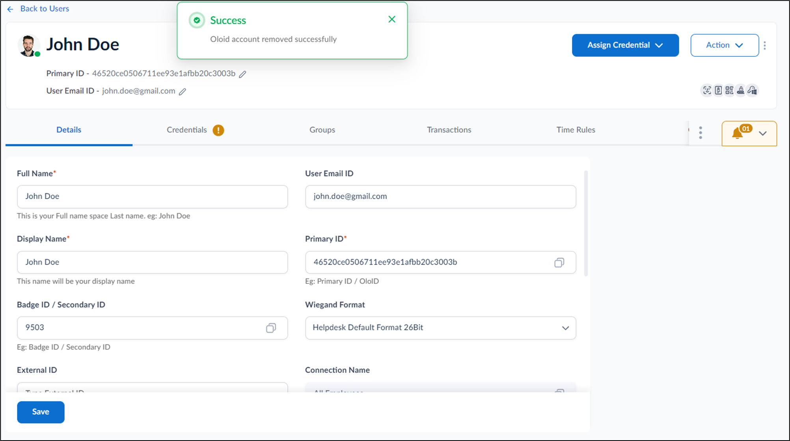

{/* Source: Intercom article 8394599 - https://oloid.help/en/articles/8394599-how-to-deactivate-oloid-account-of-a-user */}
{/* Generated by intercom_to_mintlify.py - re-running overwrites this file. */}

Steps to Deactivate OloID Account of an User:

1. Log in to the **Tenant Admin Portal**.
2. On the home page of the portal, click **Directory** on the left panel menu.

   

   The **Users** page is displayed.
3. Click **Username** to edit.

   

   The user details page is displayed.
4. On the top-right, go to **Action** > **Deactivate Oloid Account**.

   

   A confirmation pop-up box is displayed.

   

5. Select **Block**.
   The user's Oloid account is removed successfully.

   

   <Note>
     **Note:** To recover your account you must create Oloid account.
   </Note>

   For more information, see**[How to create OloID account](/platform/tenant-admin-portal/how-to-create-oloid-account-in-tenant-admin-portal)**.

## Video Tutorial

Watch the video[How to deactivate Oloid account of a user in the Tenant Admin Portal - Video Tutorial](/platform/tenant-admin-portal/videos/how-to-deactivate-oloid-account-of-a-user-in-the-tenant-admin-portal)
