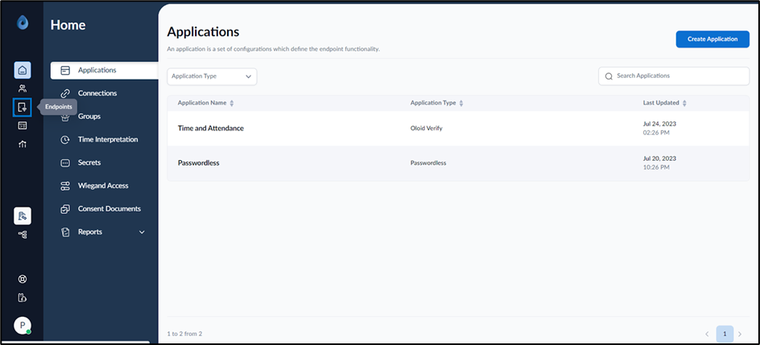
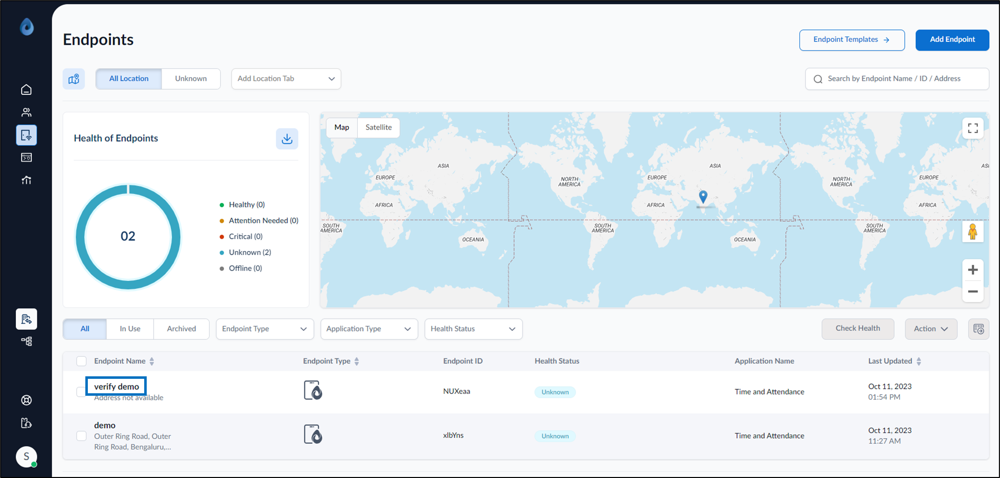
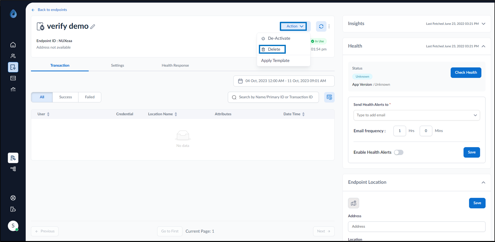
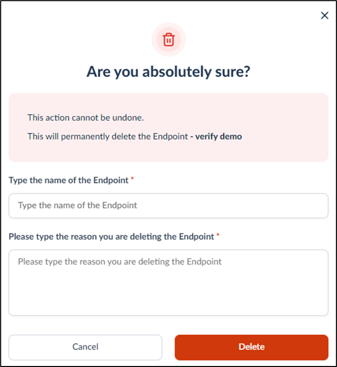

{/* Source: Intercom article 8463435 - https://oloid.help/en/articles/8463435-how-to-delete-endpoint */}
{/* Generated by intercom_to_mintlify.py - re-running overwrites this file. */}

Steps to Delete Endpoint

1. Log in to the **Oloid Portal**.
2. On the home page of the portal, click **Endpoints** on the left menu panel.

   

   The Endpoints page is displayed.
3. Select **Endpoint Name** to edit.

   

   The Endpointdetail page is displayed.
4. Go to **Action** dropdown and select **Delete**.

   

   A pop-up box is displayed to confirm your action.

   

5. On the pop-up box, click **Delete**.
   The endpoint is permanently deleted.
