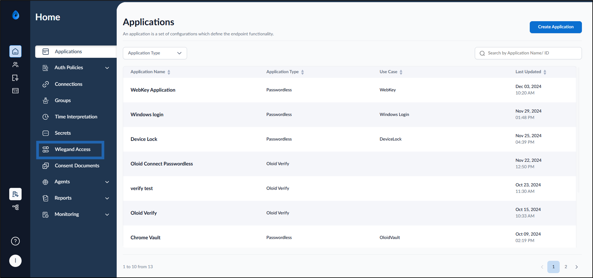
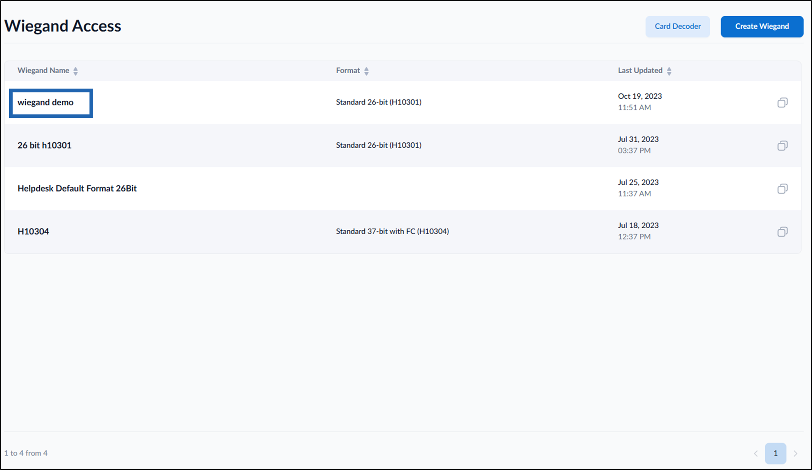
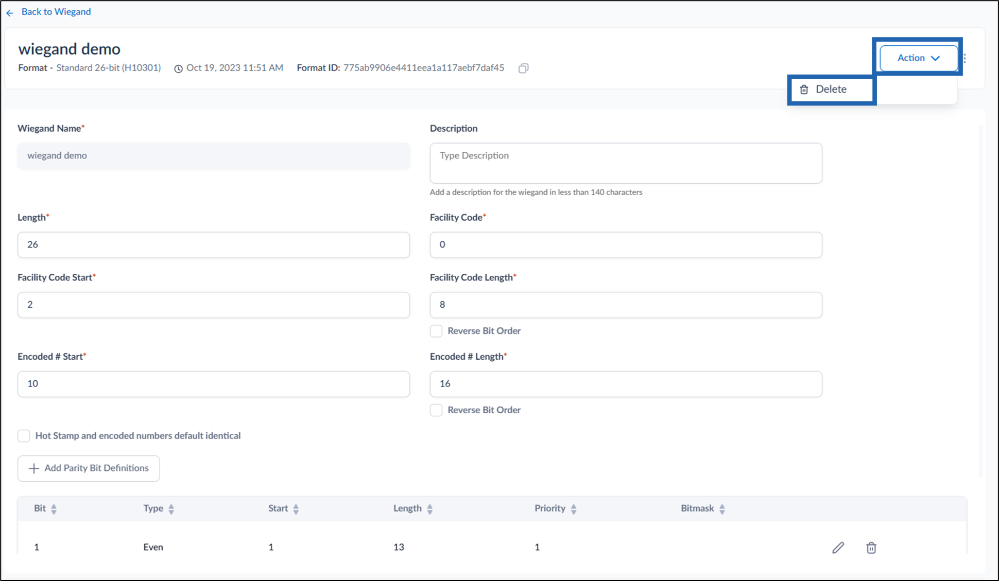
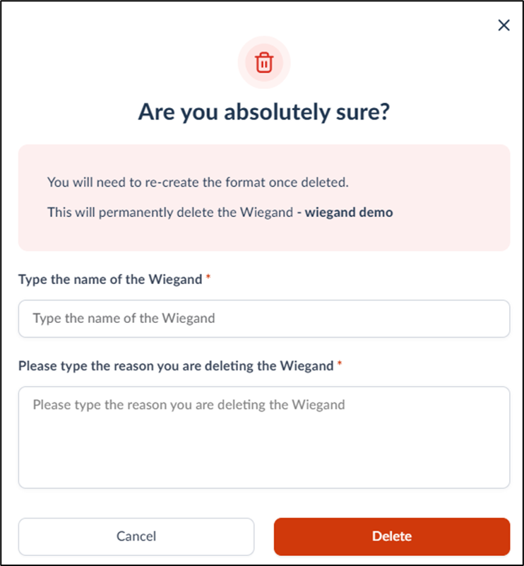
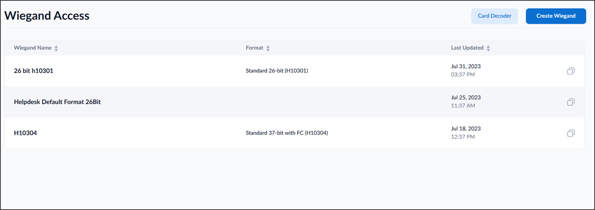

{/* Source: Intercom article 8492278 - https://oloid.help/en/articles/8492278-how-to-delete-wiegand-access */}
{/* Generated by intercom_to_mintlify.py - re-running overwrites this file. */}

Steps to Delete Weigand Access:

1. Log in to the **Oloid Portal**.
2. On the home page of the portal, select **Weigand Access** on the left panel menu.

   

   The **Weigand Access** page is displayed.
3. Select the Weigand Name to delete.

   

   The **Weigand details** page is displayed.
4. Go to **Action** dropdown and select **Delete**.

   

   The confirmation pop-up box is displayed.

   

5. Do the following:
   1. Enter Wiegand name in **Type the name of the Wiegand**.
   2. Enter the reason under **Please type the reason you are deleting the Wiegand**.
   3. Click **Delete**.
      The Weigand Access is permanently deleted.

      
