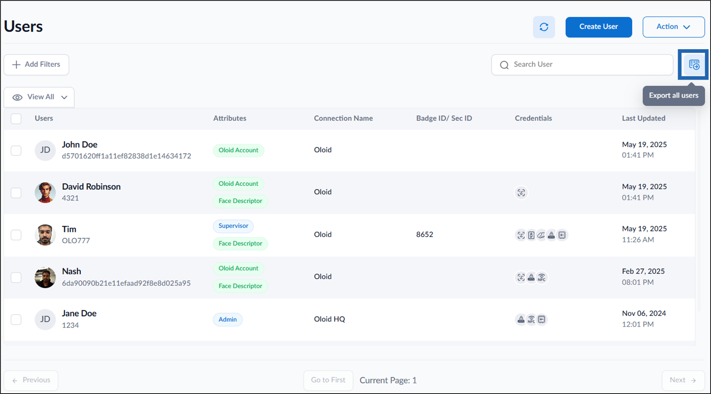
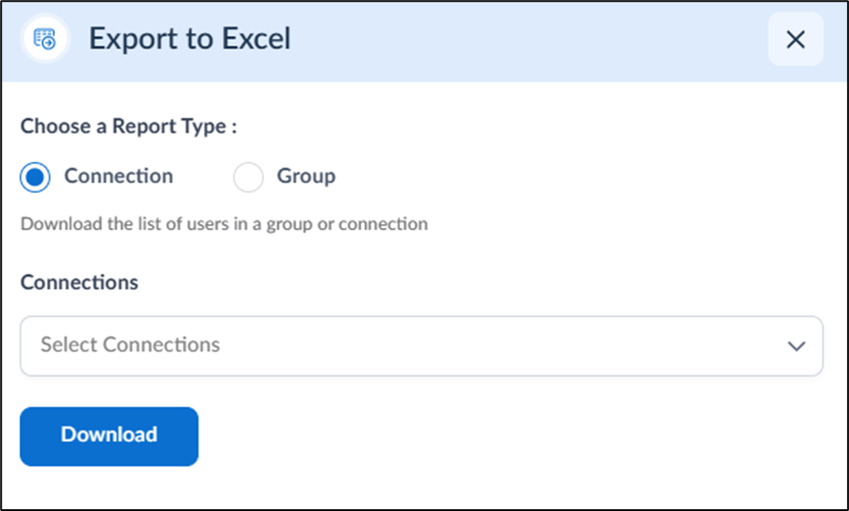
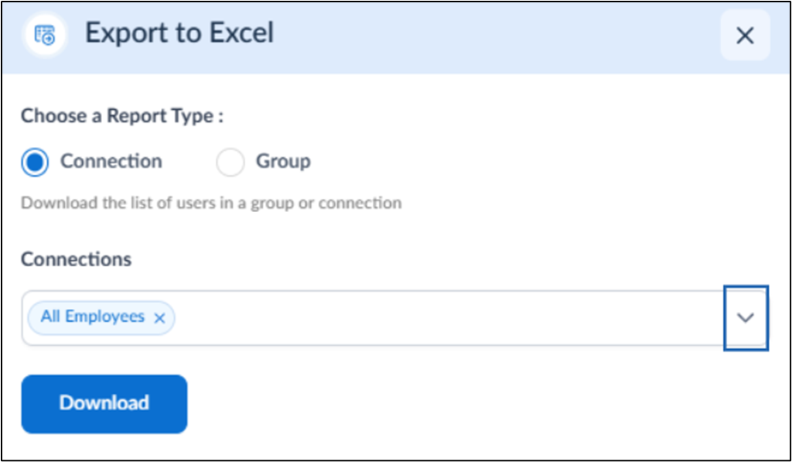
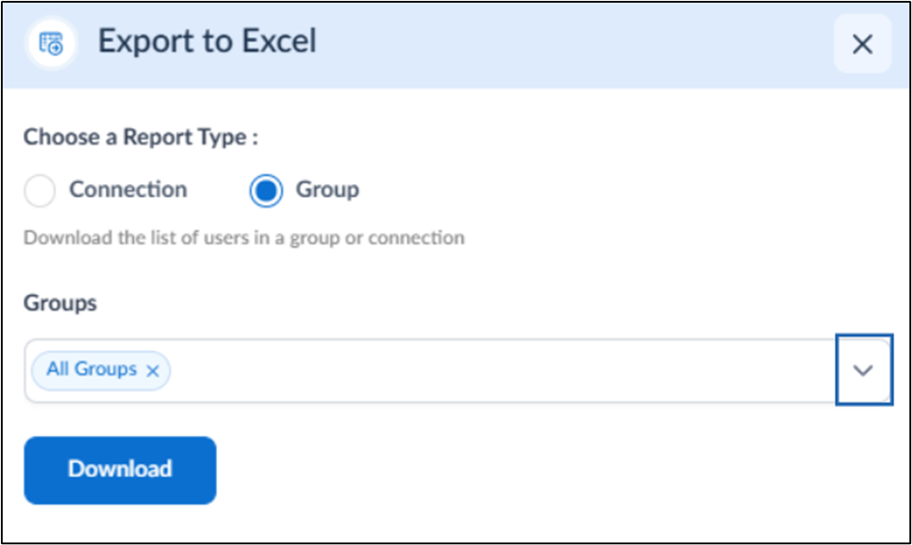

{/* Source: Intercom article 11401401 - https://oloid.help/en/articles/11401401-how-to-download-users-in-tenant-admin-portal */}
{/* Generated by intercom_to_mintlify.py - re-running overwrites this file. */}

Steps to download users:

1. Log in to the **Tenant Admin Portal**.
2. On the home page of the portal, click **Directory** on the left menu panel.

   

   The **Users** page is displayed.
3. Select **Export all users** icon to download users from connection or group.

   

   The **Export to Excel** pop-up box is displayed.

   

4. Do the following:
   - **Connection**: Select this option to export users associated with a specific connection.
     - Select the desired connection from the **Connections** drop-down.

       

       The selected connection is added in the Connections field.
   - **Group**: Export users associated with a specific group.
     - Select the desired group from the **Groups** drop-down.

       

       The selected group is added in the Groups field.
5. Click **Download**.

Click **Save**.

The report file is downloaded to your local device.

## Video Tutorial

6. Watch the video [How to Download Users in Tenant Admin Portal-Video Tutorial](/platform/tenant-admin-portal/videos/how-to-download-users-in-tenant-admin-portal-video-tutorial)
