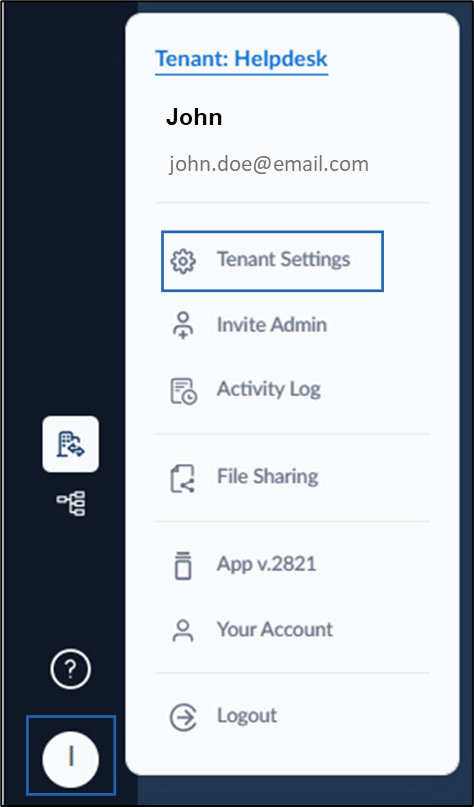
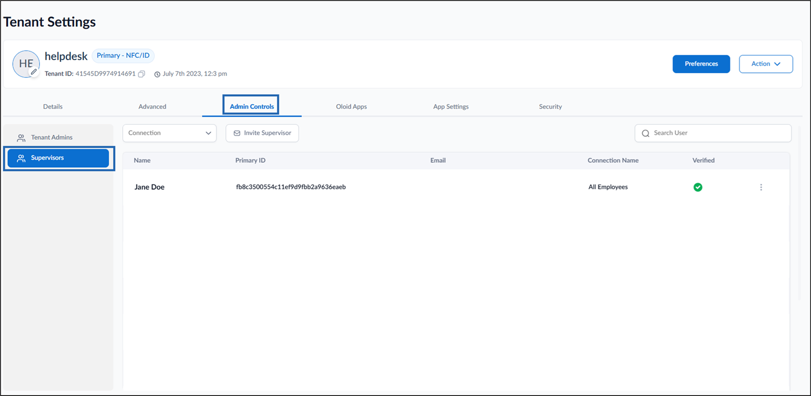
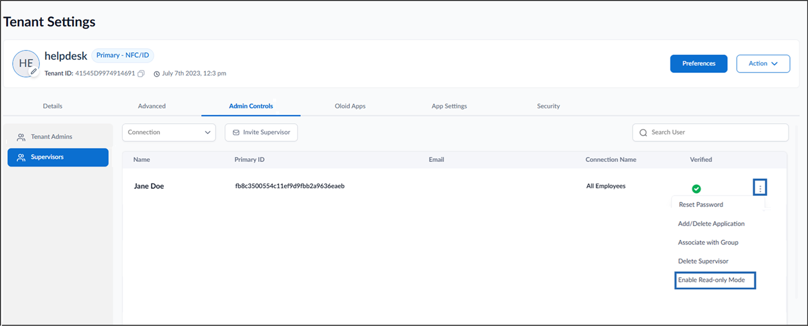
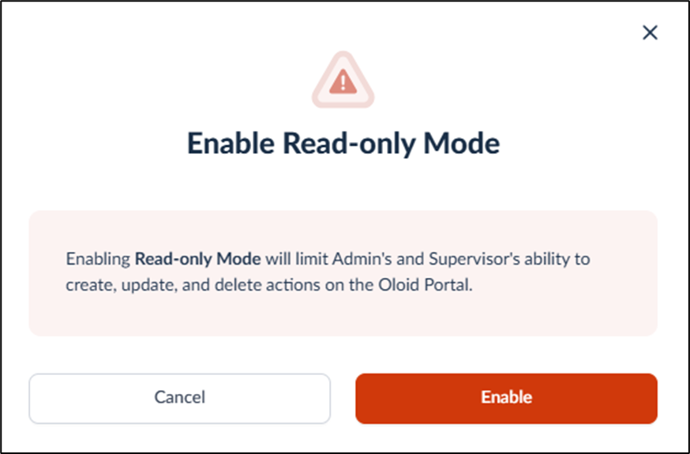
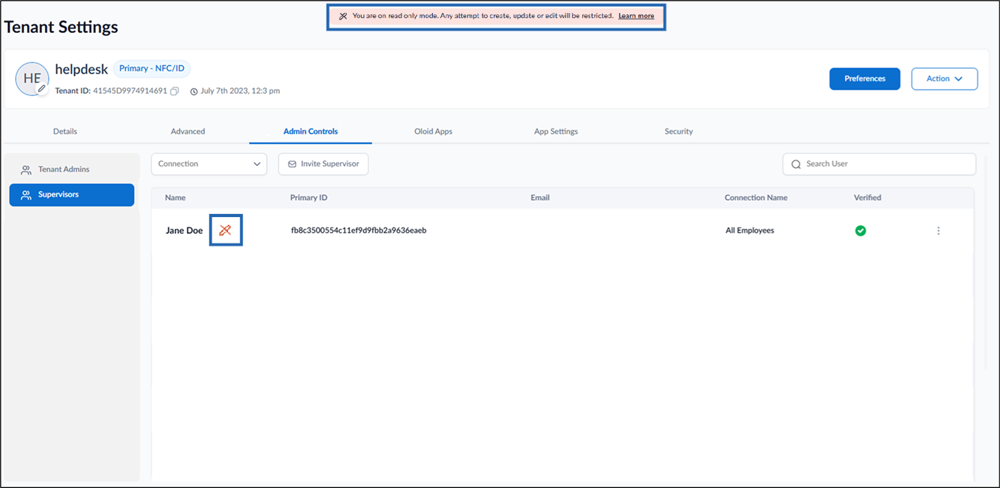
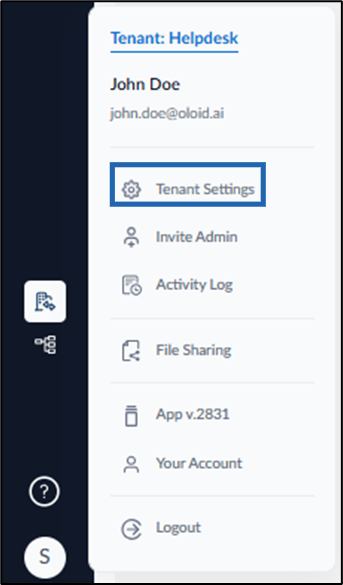
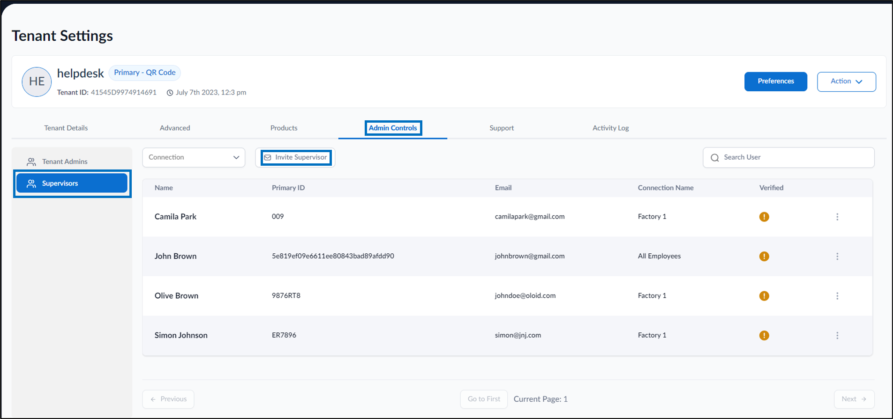
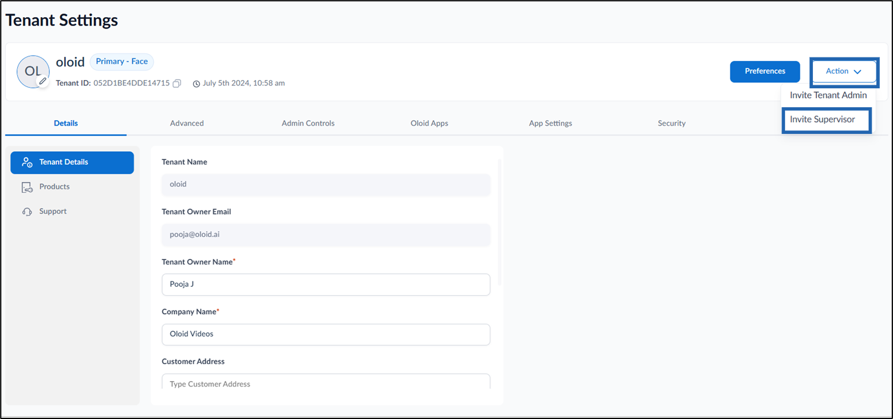
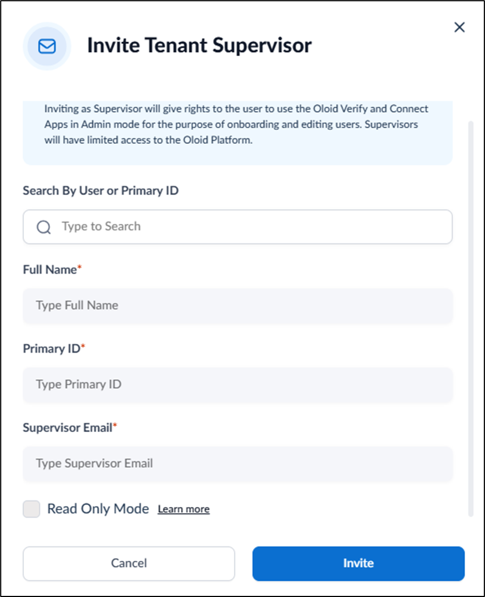
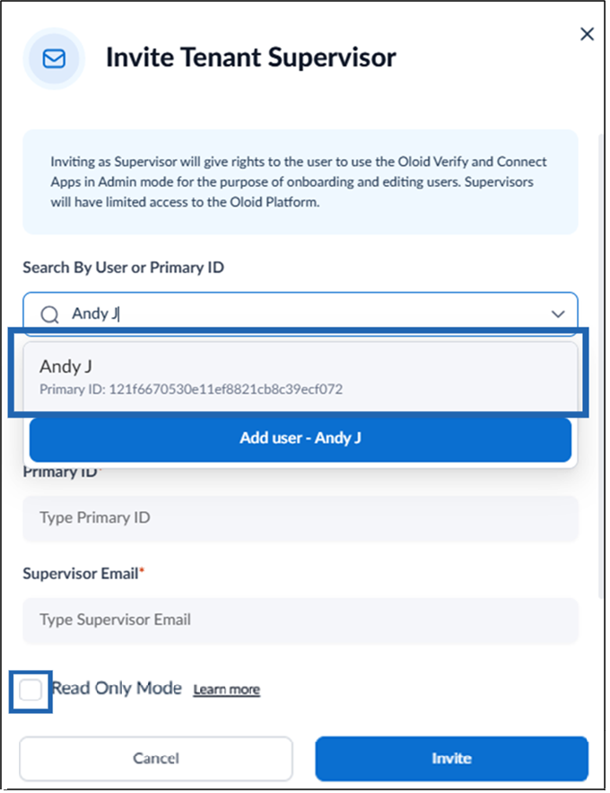

{/* Source: Intercom article 10650272 - https://oloid.help/en/articles/10650272-how-to-enable-read-only-mode-for-supervisors */}
{/* Generated by intercom_to_mintlify.py - re-running overwrites this file. */}

## Introduction

The Read-only Mode feature limits the Supervisor to viewing data in the Oloid Portal, restricting from performing any actions.

## Steps to enable Read-only Mode for existing Supervisor

1. Log in to the **Oloid Portal**.
2. On the homepage, go to **user profile icon** from the left panel > Select **Tenant Settings**.

   

   The **Tenant Settings** page is displayed.
3. Go to **Admin Controls** > select **Supervisors**.

   

4. Click **Kebab menu** ()> **Enable Read-only Mode**.

   

   The **Enable Read-only Mode** confirmation pop-up box is displayed.
5. Click **Enable**.

   

The Read-only Mode is enabled for the Supervisor.

<Note>
  **Note:** Once the Read-only Mode is enabled, the Supervisor cannot perform any action. A Read-only disclaimer is displayed at the top of every web page, and an editing disabled icon () is displayed next to the user name.
</Note>

## Steps to enable Read-only Mode while inviting a Supervisor

1. Log in to the **Oloid Portal**.
2. On the homepage of the portal, click **User profile icon** on the bottom left corner of the menu panel.

   

   The user profile menu is displayed.
3. Click **Tenant Settings**.

   

   The **Tenant Settings** page is displayed.
4. On the **Tenant Settings** page, do one of the following:
   1. Go to **Admin Controls** > **Supervisors** tab > **Invite Supervisor**.

      

   2. Click **Action** > **Invite Supervisor**.

      

      The **Invite Tenant Supervisor** pop-up box is displayed.

      

5. On the pop-up box, do the following:
   1. Enter **User name** or **Primary ID** of existing User in the search field.
   2. Select the accurate user name from the search list.

      

   3. Select **Read Only Mode** to restrict the Supervisor from performing any action.
   4. Click **Invite**.
      The user is successfully invited as a Tenant Supervisor with Read-only Mode enabled.

      

      <Note>
        **Note:** Once the Read-only Mode is enabled, the Supervisor cannot perform any action. A Read-only disclaimer is displayed at the top of every web page, and an editing disabled icon () is displayed next to the user name.
      </Note>
