{/* Source: Intercom article 9720607 - https://oloid.help/en/articles/9720607-how-to-find-the-card-type-and-card-format-using-the-rf-ideas-configurator-tool */}
{/* Generated by intercom_to_mintlify.py - re-running overwrites this file. */}

**Overview**

This article explains how to identify the card type and card format using the RF IDeas Configurator Tool, which is essential for accurate card configuration and integration.

**Introduction**

RF IDeas Configurator Tool allows access cards to be used as digital identifier throughout the workplace.

**Pre-requisite:**

- Download the latest "rf IDEAS Configuration Utility" from the [RF IDEAS website](https://www.rfideas.com/support/tools/downloads).

To find the card type and card format:

1. Launch the rf IDEAS Configuration Utility app.

   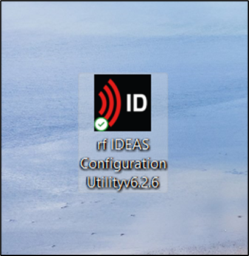

   The app opens.

   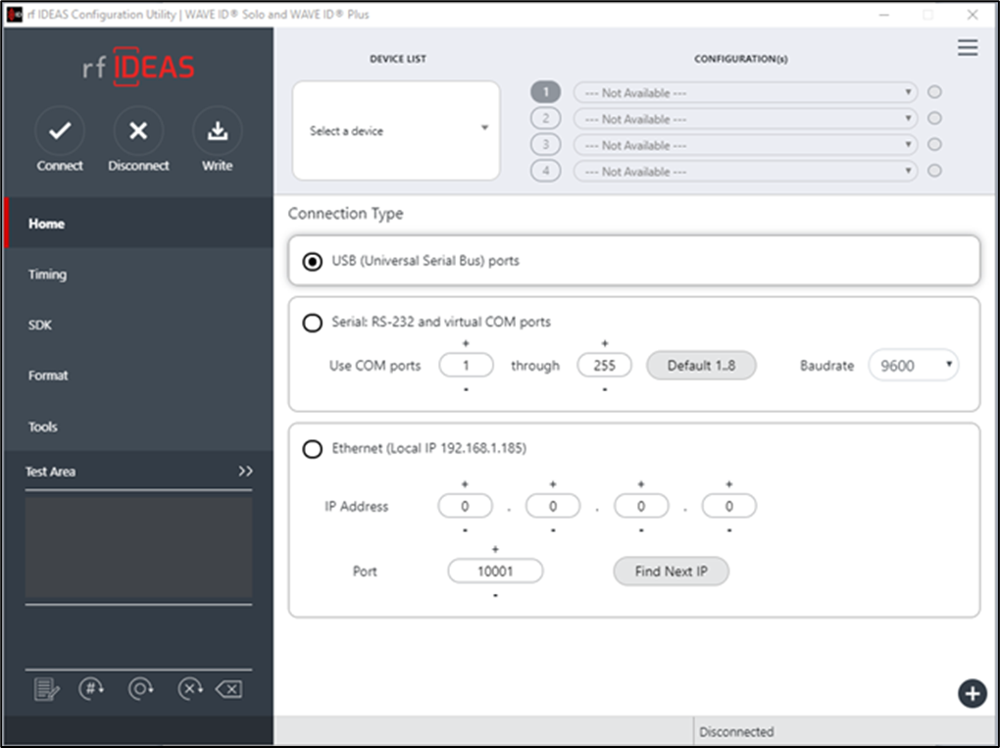

2. Make sure the card reader is connected to the system.
3. Select **Connect** from the left menu panel.

   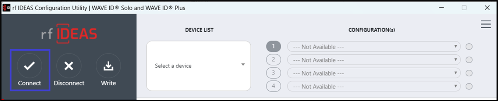

   The DEVICE LIST is configured and displayed.

   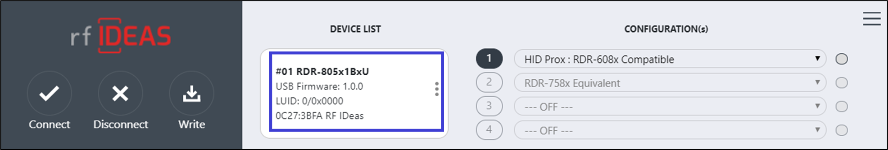

4. Select **Tools** from the left menu panel.

   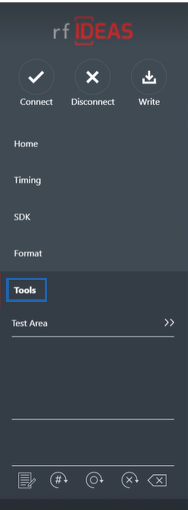

5. Go to **Card Analyzer** tab, and click **Start**.

   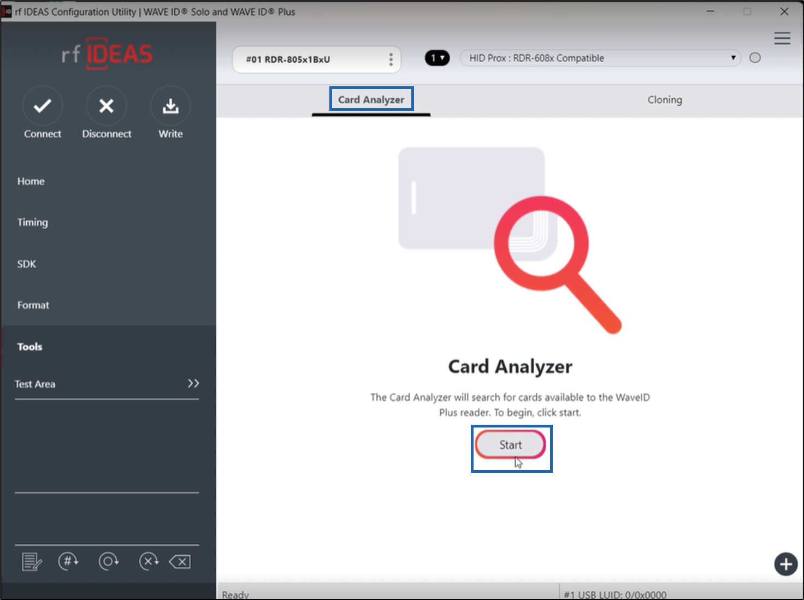

   The Welcome screen is displayed.
6. Select **Learn Card**.

   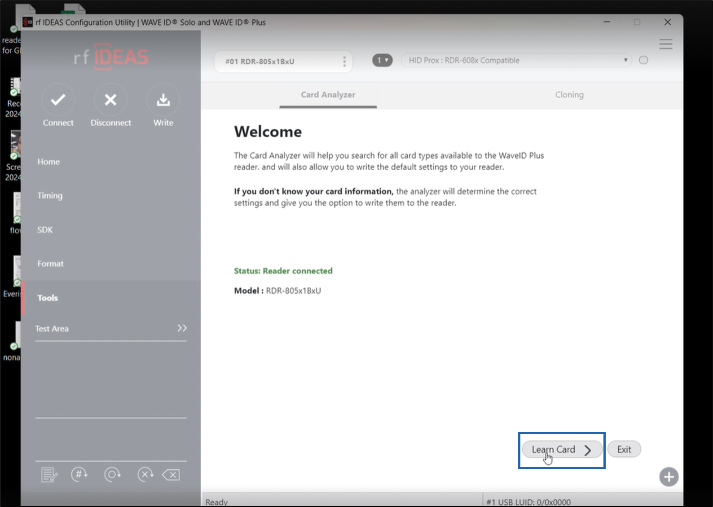

7. Place the card on the reader and leave it there, then click **Start Scan**.

   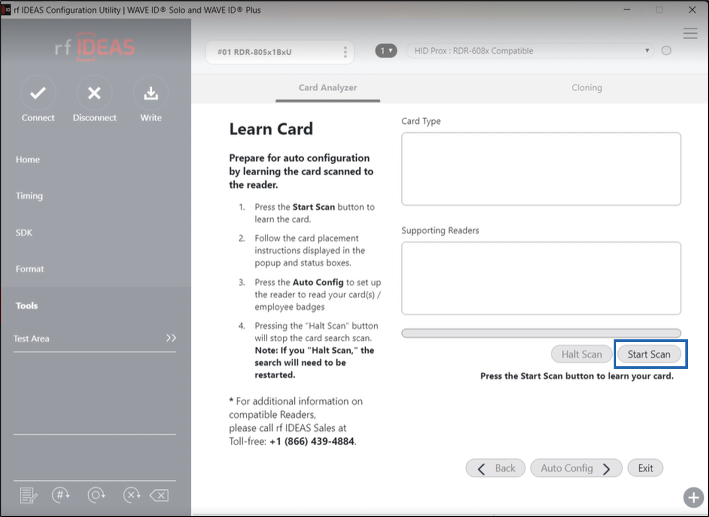

   As the scan runs, the Card Type and Supporting Readers are displayed. If it identifies a card type, it will beep and display the Card Type in the top box.

   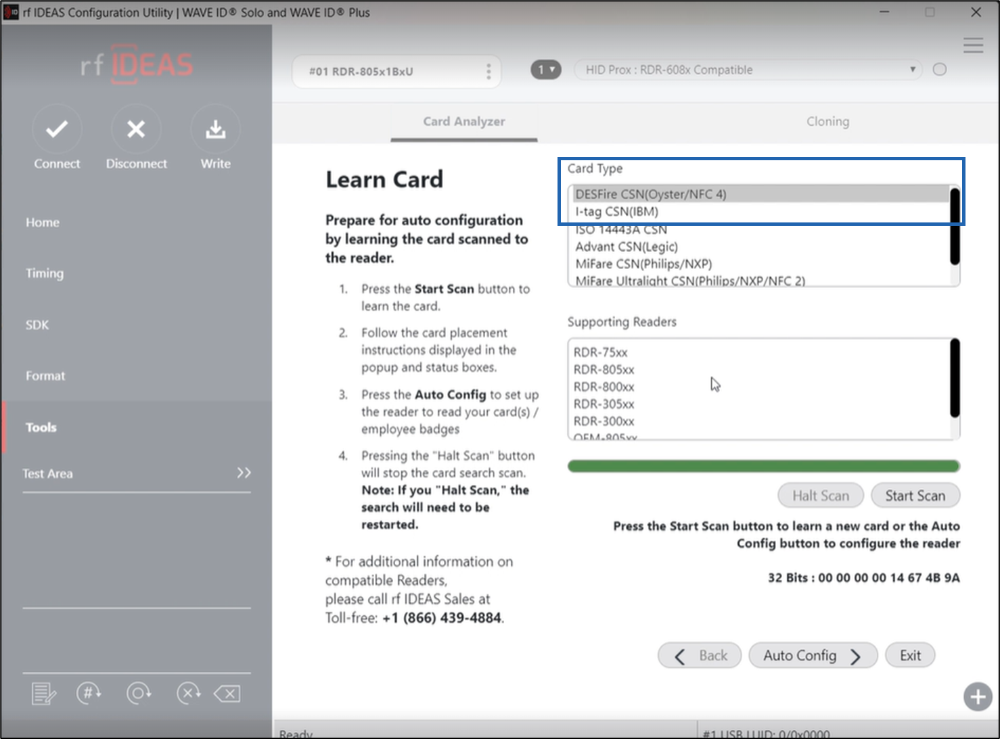

8. Once the status scan is complete, if you want to configure the reader, then click **Auto Config**.

   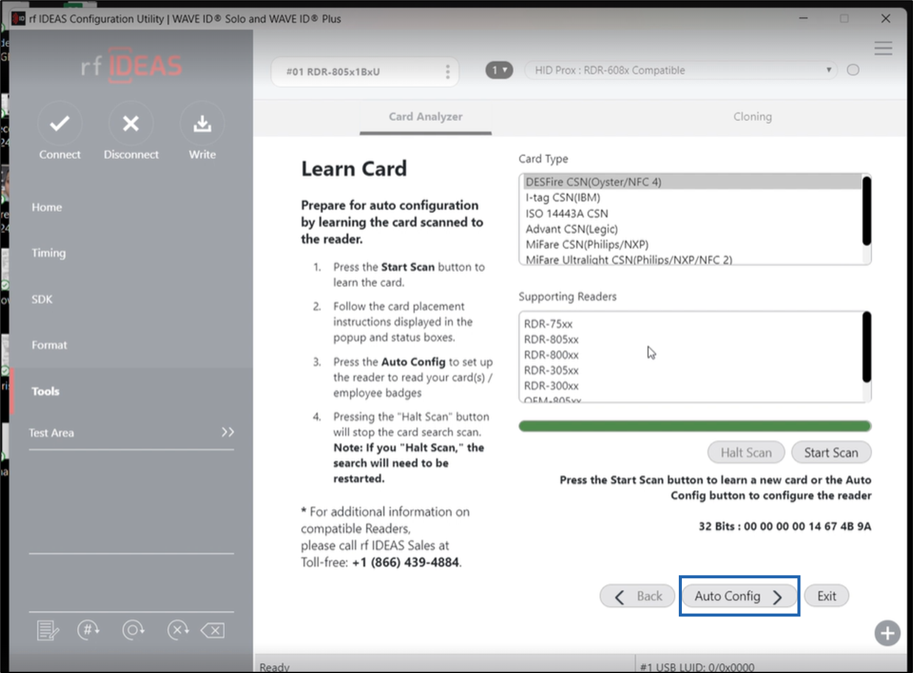

   The Auto Config screen is displayed.
9. To identify the card, view the card type and the card format information.

   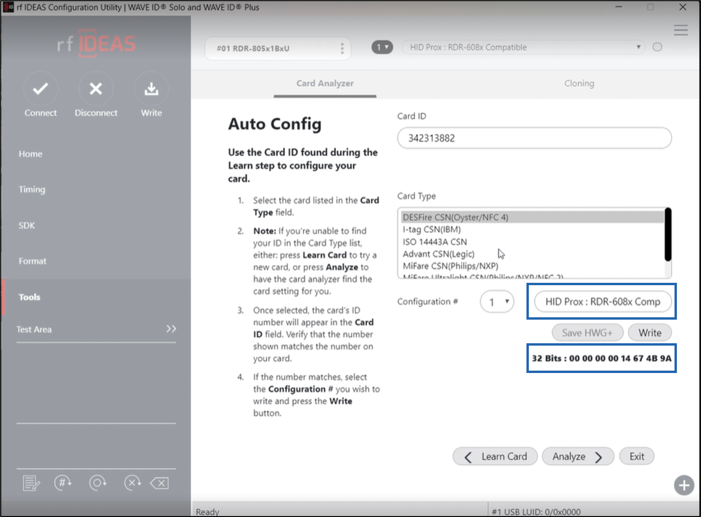

10. Click **Exit**.

    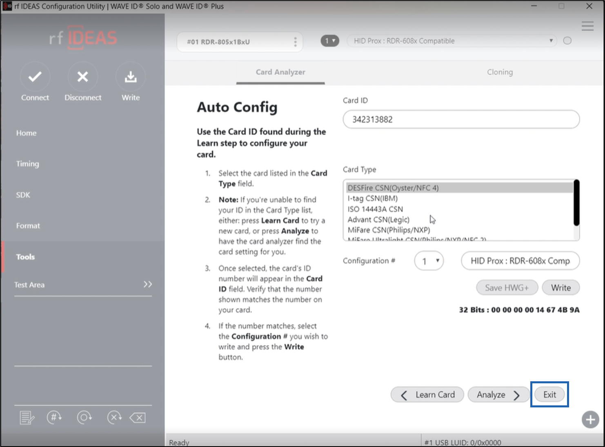
