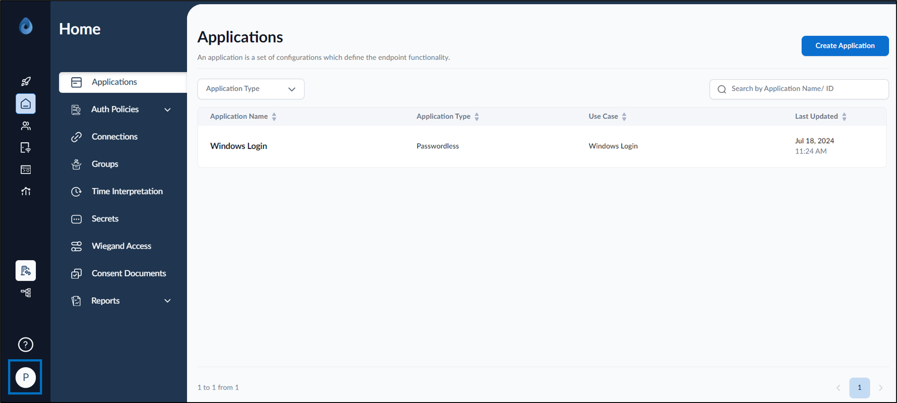
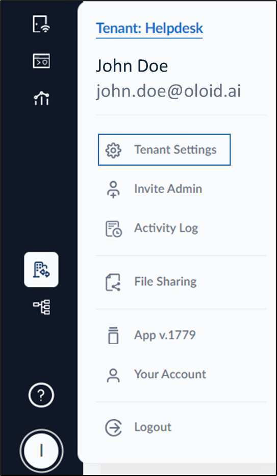
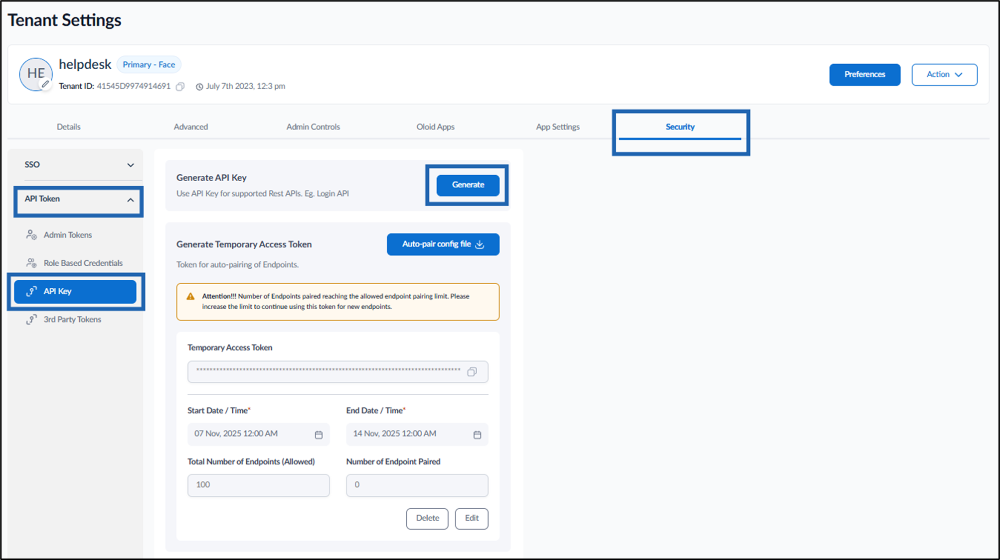
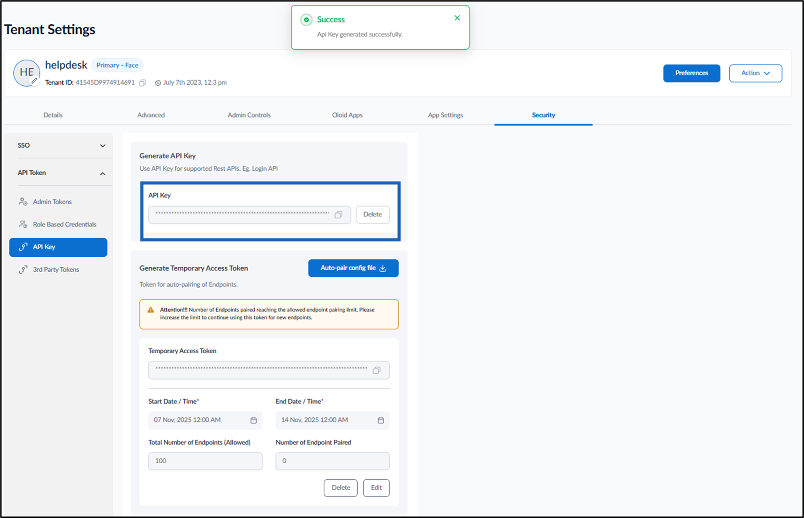

{/* Source: Intercom article 9823811 - https://oloid.help/en/articles/9823811-how-to-generate-application-programming-interface-api-key-in-tenant-admin-portal */}
{/* Generated by intercom_to_mintlify.py - re-running overwrites this file. */}

## Introduction

The API Key allows admin to securely authenticate and integrate external applications with the Oloid platform. Using the Tenant Admin Portal, you can easily generate an API key for authorized system-to-system communication.

## Prerequisite

You must have **Tenant Admin Access** to generate an API key.

## Steps to Generate API Key

1. Log in to the **Tenant Admin Portal**.
2. On the homepage of the portal, click **user profile icon** on the bottom left corner of the menu panel.

   

   The user profile menu is displayed.
3. Click **Tenant Settings**.

   

   The **Tenant Settings** page is displayed.
4. Go to **Security** tab > **API Token** > **API Key** > click **Generate**.

   

   The API key is generated successfully.

   
