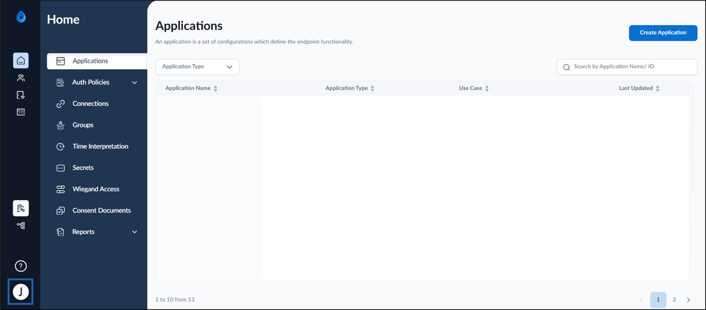
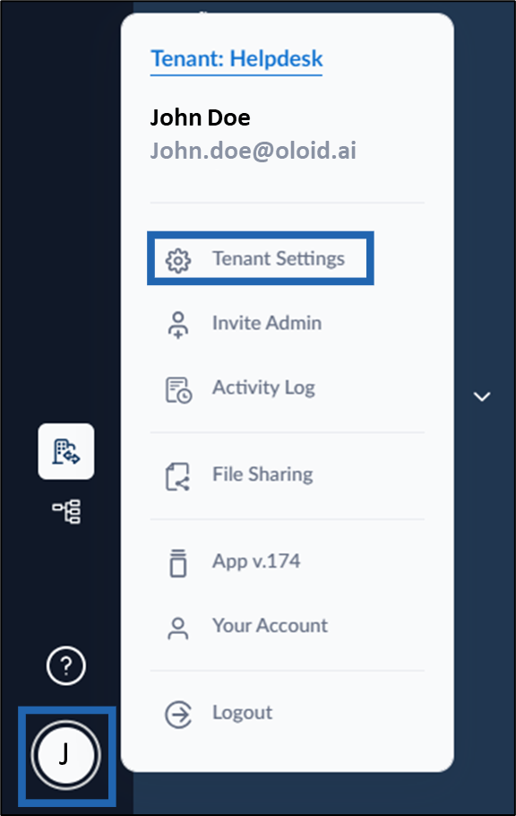
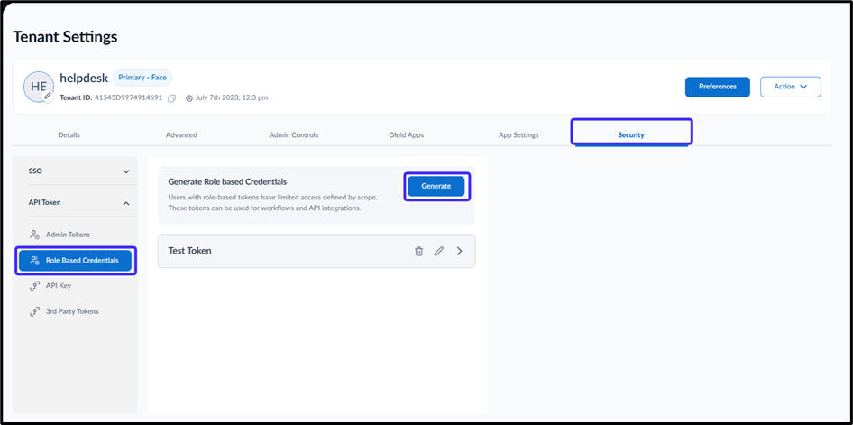
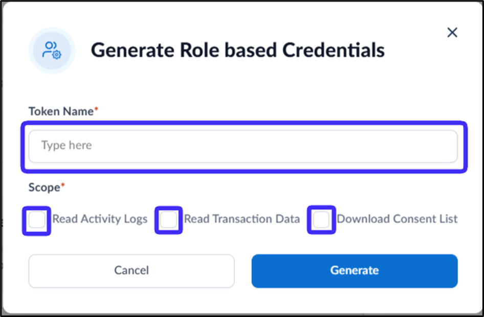

{/* Source: Intercom article 11659590 - https://oloid.help/en/articles/11659590-how-to-generate-role-based-credential-api-token-in-tenant-admin-portal */}
{/* Generated by intercom_to_mintlify.py - re-running overwrites this file. */}

## Introduction

In the Oloid Tenant Admin Portal, role-based Credential API tokens allow administrators to generate secure tokens that inherit permissions from predefined roles. This ensures that integrations and applications can access only the Oloid services appropriate for their intended function.

## Pre-Requisite

You must have a Tenant Admin account.

## Steps to generate Role based Credential API token

1. Log in to the **Tenant Admin Portal**.
2. On the homepage, click **User Profile** icon from the bottom left.

   

   The **user profile menu** is displayed.
3. Click **Tenant Settings**.

   

   The **Tenant Settings** page is displayed.
4. Go to **Security** tab > select **Role Based Credential** under **API Token** dropdown menu.
5. Click **Generate**.

   

   The **Generate Role based Credentials** pop-up box is displayed.
6. Do the following:
   1. Enter **Token Name.**
   2. Select **Read Activity Logs** to allow users to only view the activity log
   3. Select **Read Transaction Data** to allow users to only view the transaction data.
   4. Select **Download Consent List** to allow users to download the consent data.

Click **Generate**.

The Role Based Credential is generated successfully.
