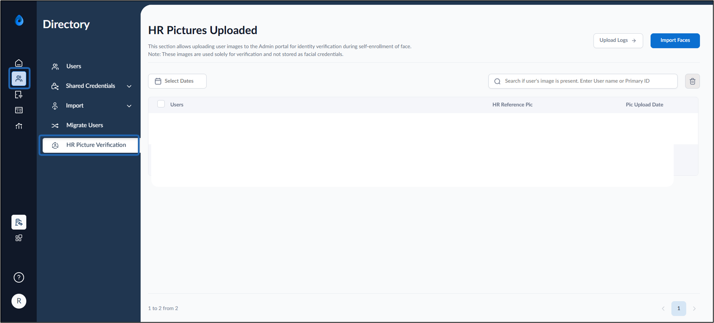
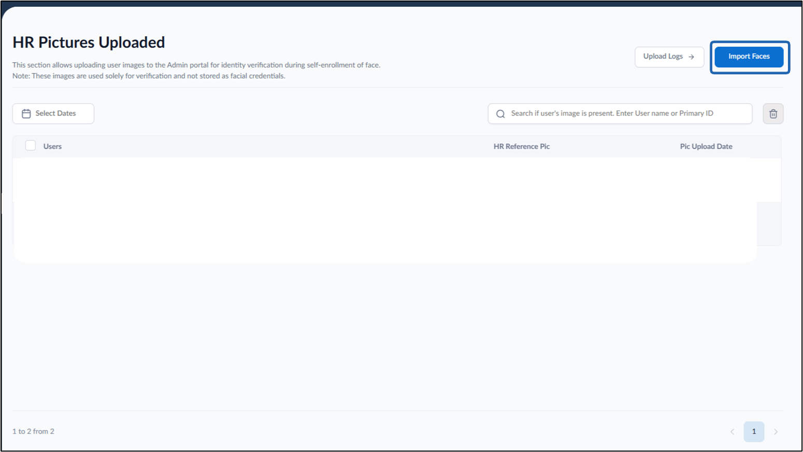
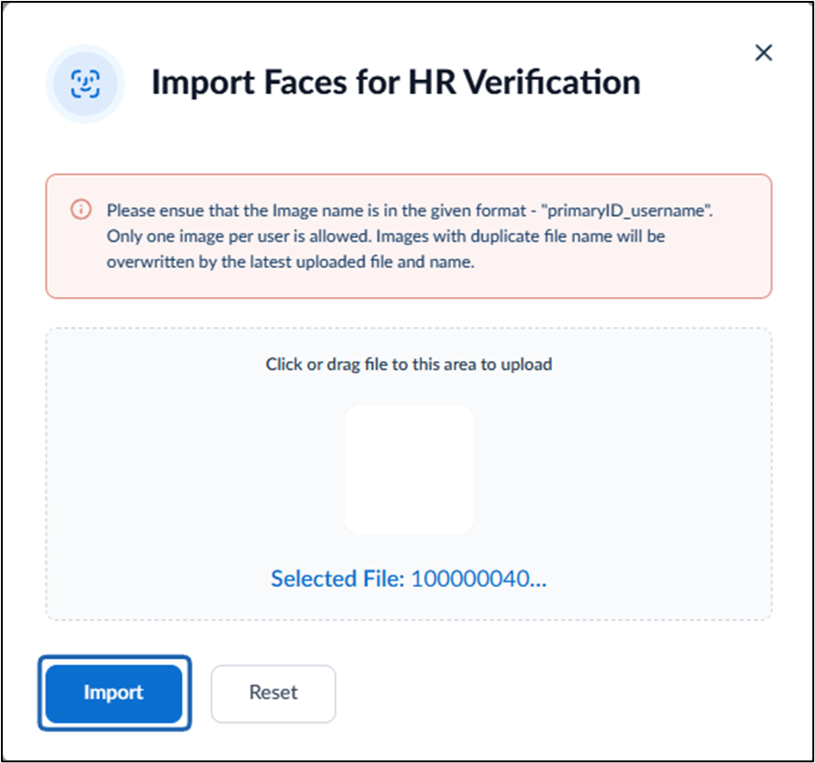
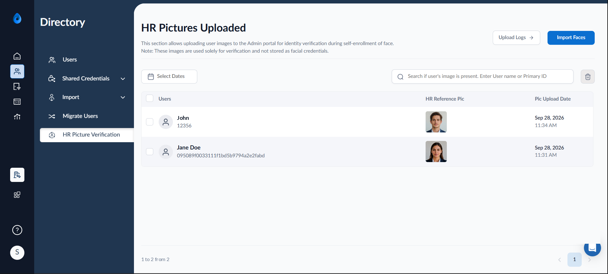

{/* Source: Intercom article 13524609 - https://oloid.help/en/articles/13524609-how-to-import-faces-for-hr-picture-verification */}
{/* Generated by intercom_to_mintlify.py - re-running overwrites this file. */}

## Introduction

The HR Picture Verification upload feature allows Admins to upload High Resolution facial images of users in bulk for identity verification.

## Pre-requisite

- You must have access to a Tenant Admin account.
- Ensure that the Image name is in the given format - "primaryID_username"

## Steps to Import faces

- Log in to the **Tenant Admin Portal**.
- On the home page of the portal, click **Directory** on the left panel menu.
- Click **HR Picture Verification**.

  

  The HR Picture Verification page is displayed.
- Click **Import Faces**.

  

  The **Import Faces** pop-up box is displayed.
- Upload the image file of the users.

  

Click **Import**.

The images are uploaded and listed on **Import Faces** page.

**Notes:**

1. To check the status of HR Picture Verification file upload check **Upload Logs.**
2. Please ensure that the Image name is in the given format - "primaryID_username". Only one image per user is allowed. Images with duplicate file name will be overwritten by the latest uploaded file and name.

---

**Keywords**

| Import user faces| HR Picture Verification| Upload facial images in Oloid Portal| Bulk face upload for users
