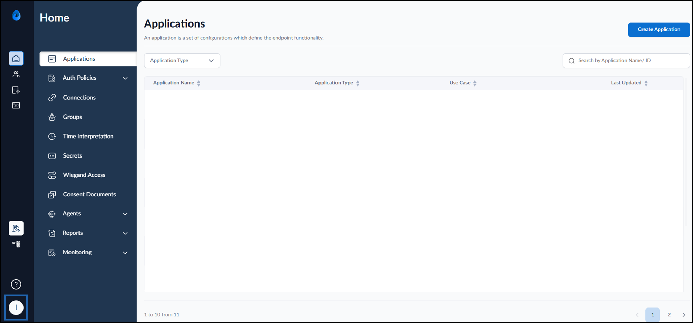
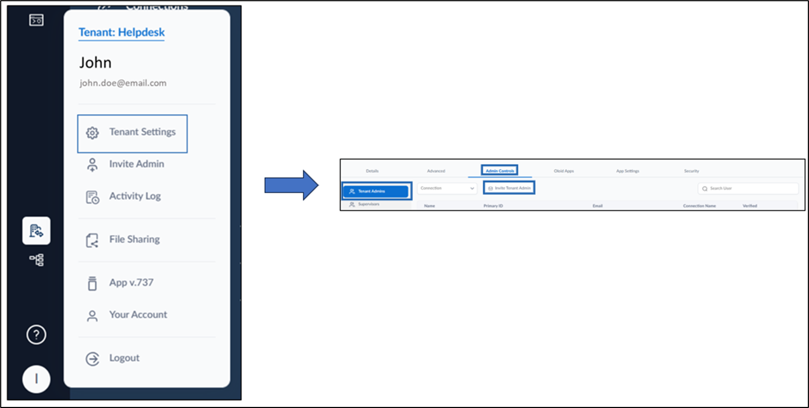
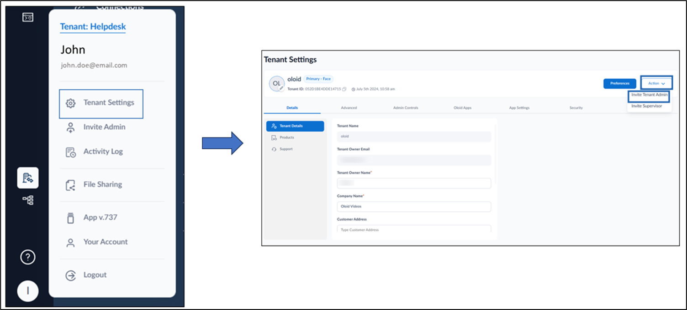
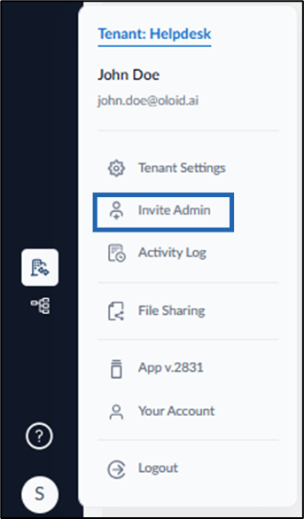
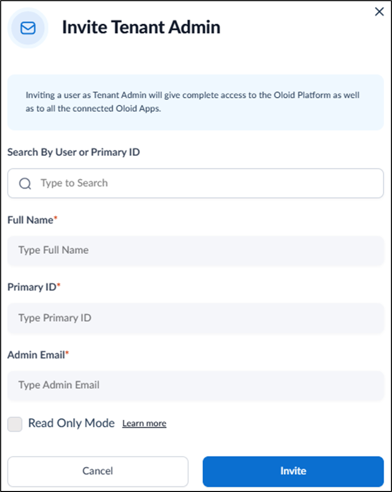
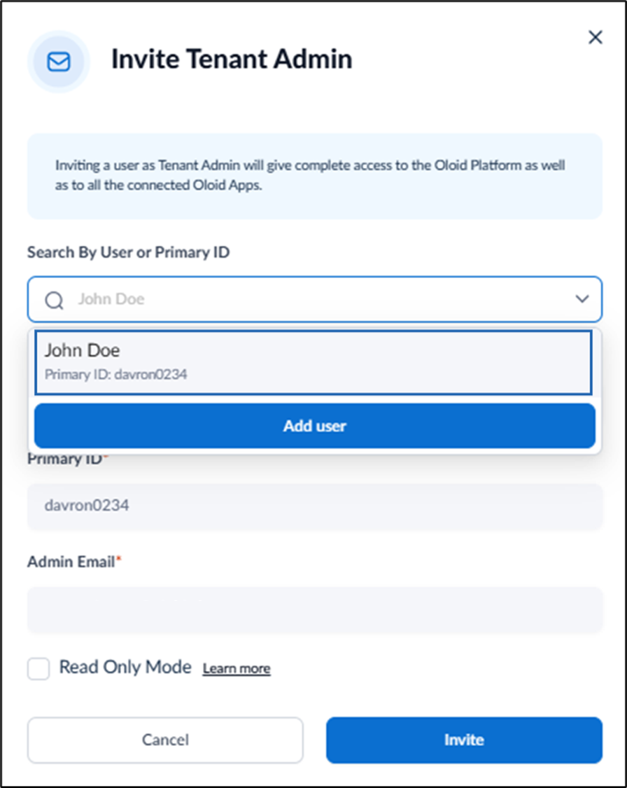
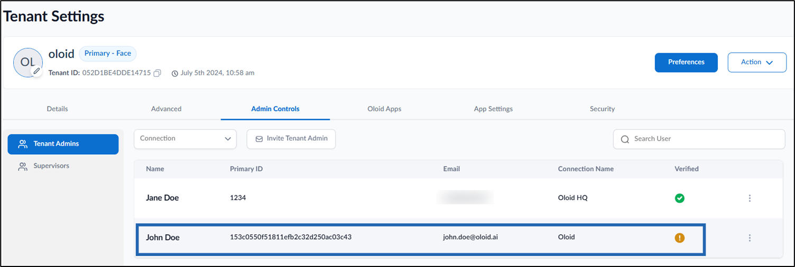

{/* Source: Intercom article 8236282 - https://oloid.help/en/articles/8236282-how-to-invite-a-tenant-admin */}
{/* Generated by intercom_to_mintlify.py - re-running overwrites this file. */}

**Introduction**

A Tenant Admin has complete access to Oloid platform and all the Oloid connected devices.

**Pre-requisite**

You must be a Tenant Admin to invite a new Tenant Admin.

The user you want to invite must already exist in the Tenant Admin Portal.

For adding a new user as a tenant admin, see [How to add and invite a Tenant Admin](/platform/tenant-admin-portal/how-to-add-and-invite-a-tenant-admin)

**Steps to invite a Tenant Admin**:

1. Log in to the **Oloid Portal**.
2. On the homepage of the portal, click **user profile icon** on the bottom left.

   

   The **user profile menu** is displayed.
3. Do one of the following:
   1. Go to **Tenant Settings** > **Admin Controls** tab >**Tenant admins** > **Invite Tenant Admins.**

      

      OR, go to **Tenant Settings** > **Action** > **Invite Tenant Admin.**

      

   2. Click **Invite Admin**.

      

      The **Invite Tenant Admin** pop-up box is displayed.

      

4. On the pop-up box, do the following:
   1. Enter **User name** or **Primary ID** of existing User in the search field.
   2. Select the accurate user name from the drop-down list.

      

   3. Select **Read Only Mode** to restrict the Admin from performing any action in the Oloid Portal. (Optional)
   4. Select **Invite.**

The Tenant Admin is listed on the **Tenant Admins** tab. An invite email is sent to the user for verification.

## Video Tutorial

   Watch the video [How to invite a Tenant Admin in Tenant Admin Portal-Video Tutorial](/platform/tenant-admin-portal/videos/how-to-invite-a-tenant-admin-in-tenant-admin-portal-video-tutorial)
