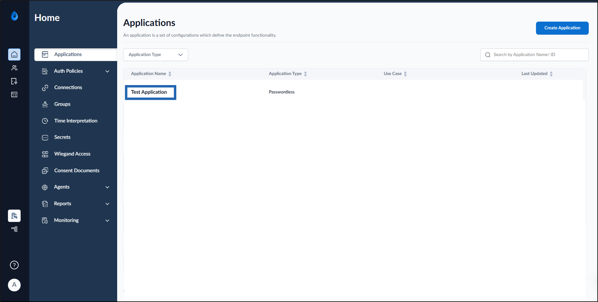
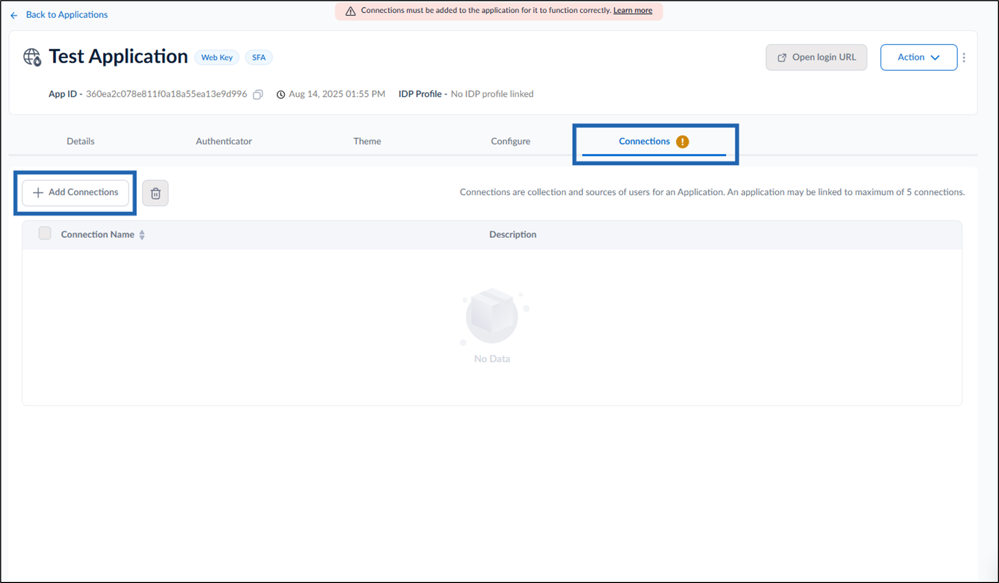
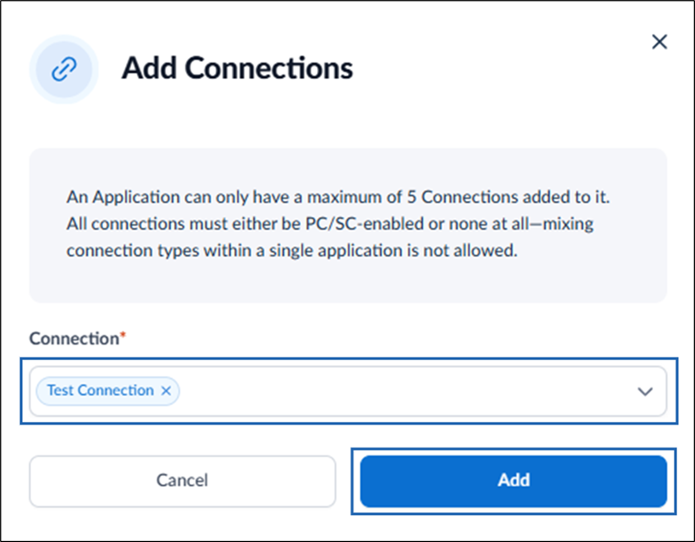
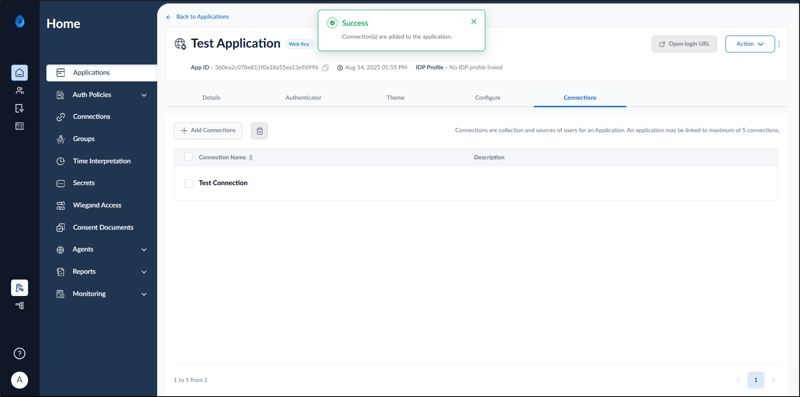

{/* Source: Intercom article 8304594 - https://oloid.help/en/articles/8304594-how-to-map-connections-to-an-application-in-the-tenant-admin-portal */}
{/* Generated by intercom_to_mintlify.py - re-running overwrites this file. */}

**Introduction**

In the Tenant Admin Portal, mapping a Connection to an Application allows the Application to use the Connection for authentication and access control. This process ensures seamless integration, enabling secure and efficient identity management. Before mapping, ensure that both the Application and Connection are created.

**Prerequisite**

- The Application must be created. To create Application, refer [How to create an application](/platform/tenant-admin-portal/tenant-admin-portal-how-to-create-an-application).
- The Connection must be created. To create Connection, refer [How to create a connection.](/platform/tenant-admin-portal/tenant-admin-portal-how-to-create-connection)

**Steps to Map Connection to Application:**

1. Log in to the **Tenant Admin Portal**.
   The **Applications** page is displayed.
2. Click **Application Name** to edit.

   

   The Application Details page is displayed.
3. Go to **Connections** tab > select **+ Add Connections.**

   

   The **Add Connections** pop-up box is displayed.
4. On the pop-up box, do the following:
   1. Select Connection(s) from the **Connection** dropdown list.
   2. Click **Add**.

      <Note>
        **Note:** An application can have up to 5 connections, all of which must be either PC/SC-enabled or none—mixing connection types is not allowed.
      </Note>

      

      The Connection is mapped to Application successfully.

      
