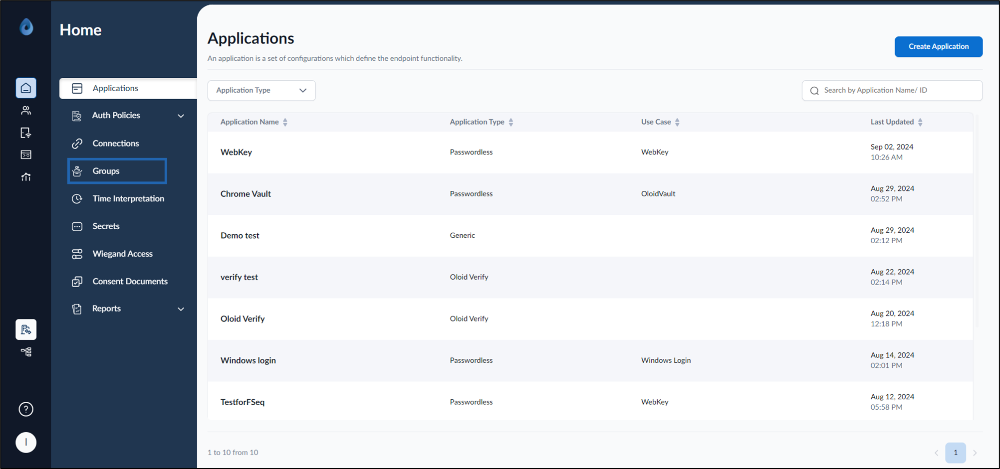
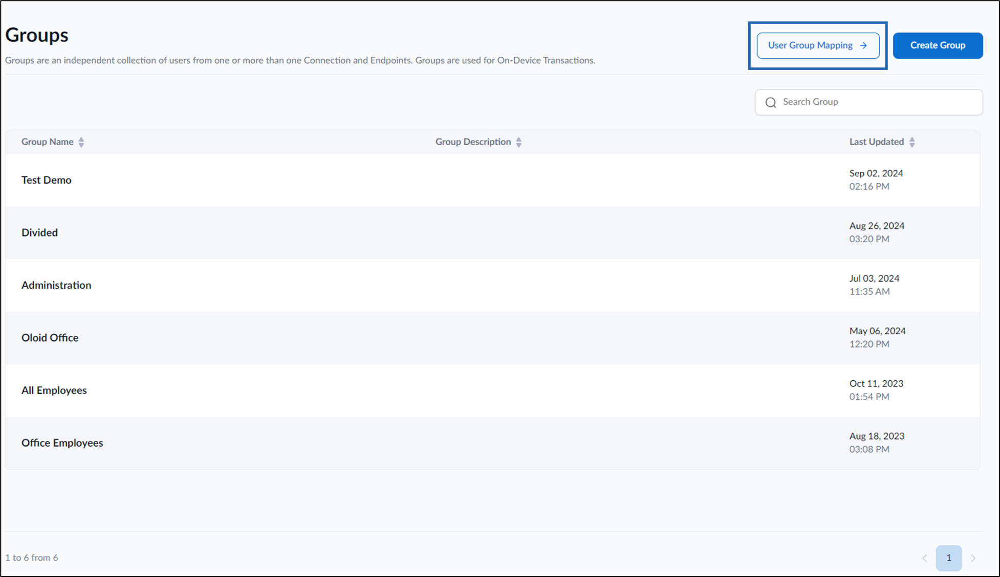
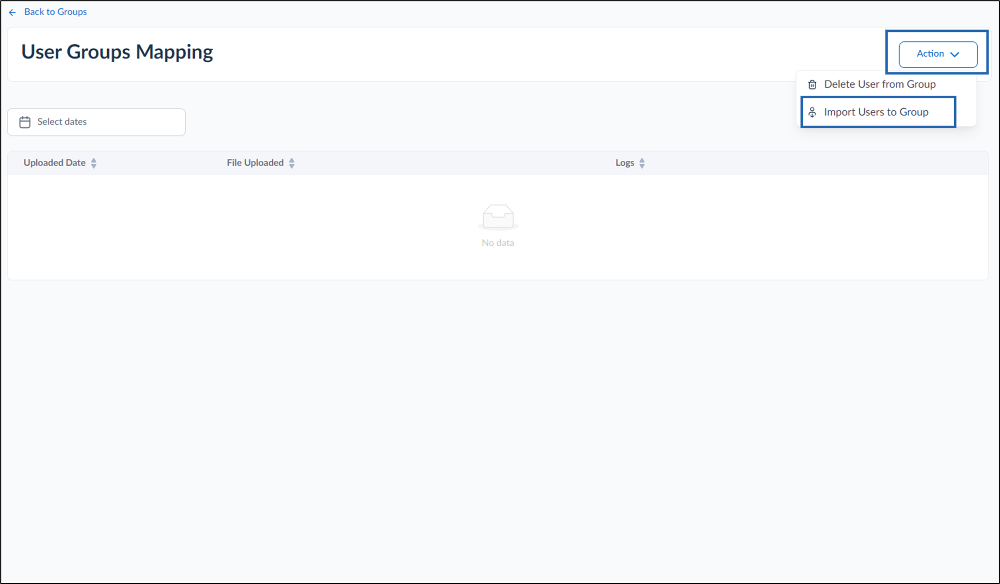
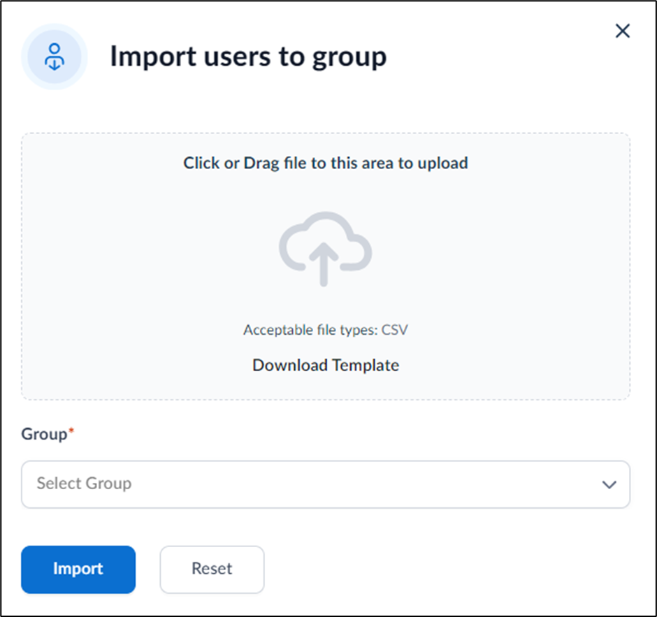
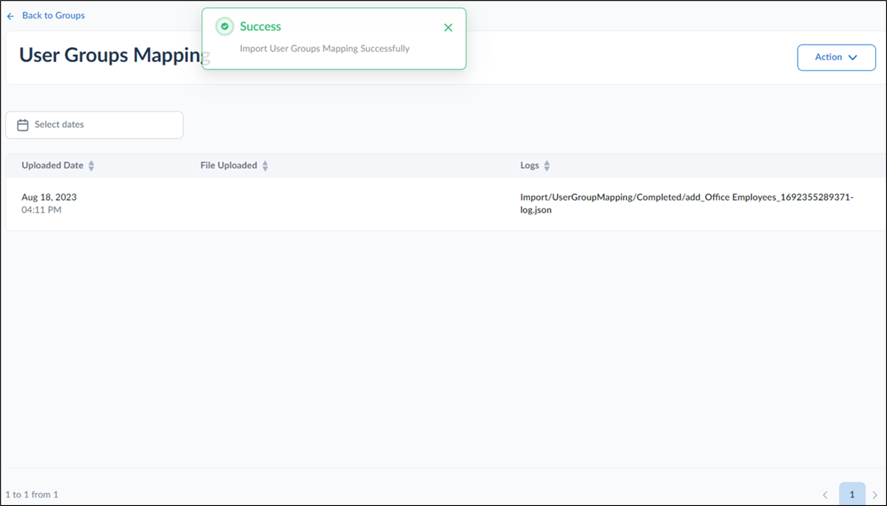

{/* Source: Intercom article 8272023 - https://oloid.help/en/articles/8272023-how-to-map-users-to-group-in-bulk */}
{/* Generated by intercom_to_mintlify.py - re-running overwrites this file. */}

Steps to map user to group in bulk:

1. Log in to the **Oloid Portal**.
2. On the home page of the portal, click **Groups** on the left panel menu.

   

   The **Groups** page is displayed.
3. Click **User Group Mapping** in the top right.

   

   The **User Groups Mapping** page is displayed.
4. Go to **Action > Import Users to Group**.

   

   The **Import users to group** pop-up box is displayed.

   

5. On the pop-up box, do the following:
   1. Upload or drag and drop the CSV file with user details.

      <Note>
        **Note:** You may click **Download template** to download the CSV file template and upload the file after updating the required fields.
      </Note>

   2. Select **Group** from select group dropdown list.
   3. Click **Import**.
6. The user log is uploaded and listed on the **User Group Mapping** page.

   

   You may verify the logs to see the user status.
