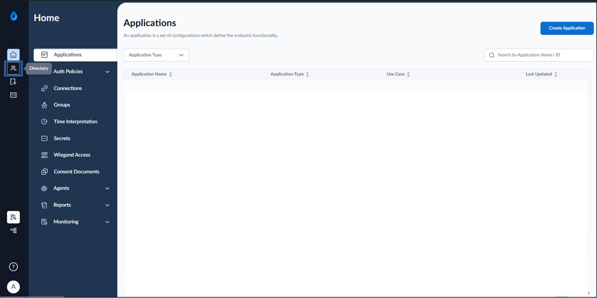
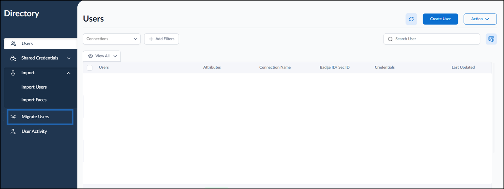
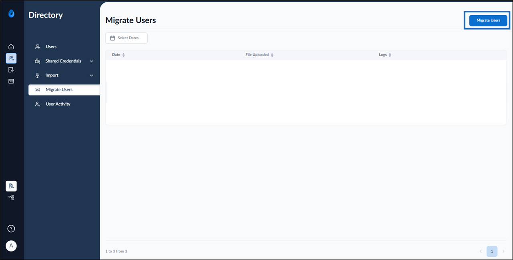
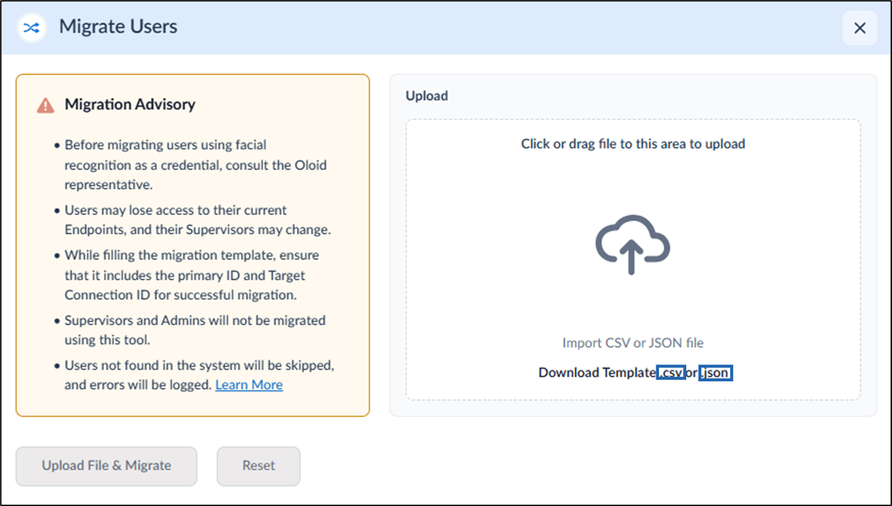
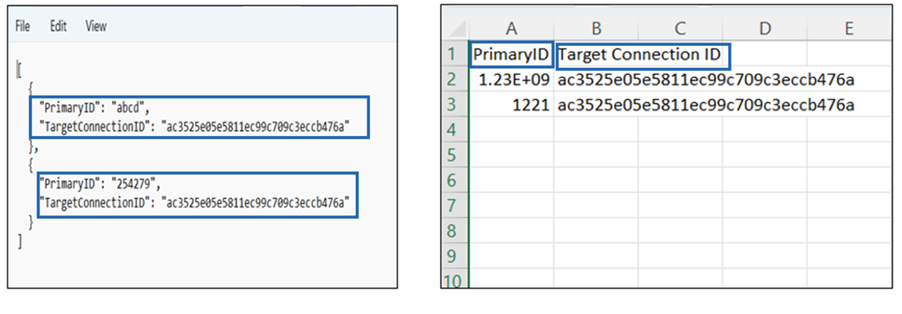
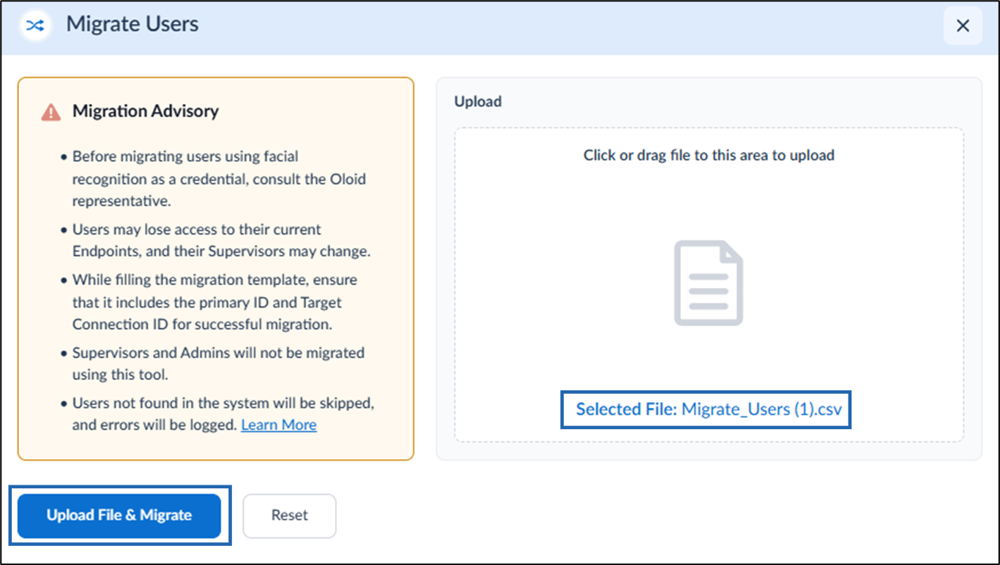
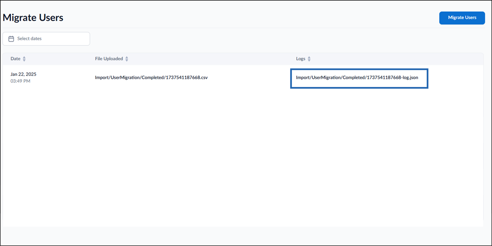
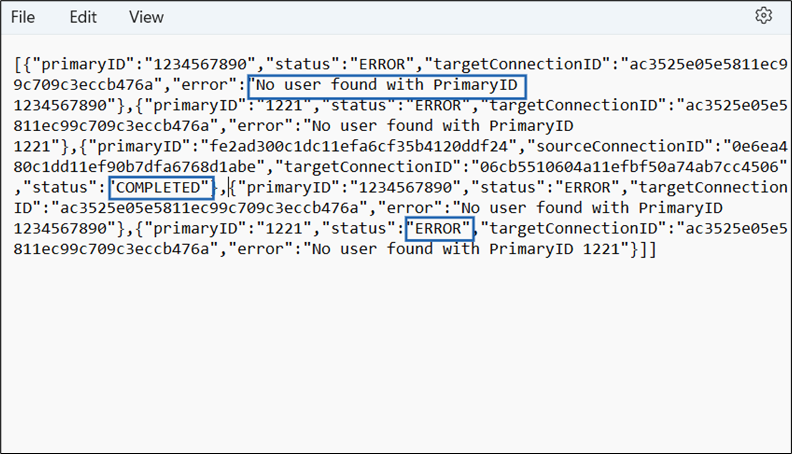

{/* Source: Intercom article 10435072 - https://oloid.help/en/articles/10435072-how-to-migrate-users-in-bulk-in-tenant-admin-portal */}
{/* Generated by intercom_to_mintlify.py - re-running overwrites this file. */}

**Pre-requisite:**

- You must be a Tenant Admin in Tenant Admin Portal.

<Note>
  **Note:**

  - Supervisors and Admins cannot be migrated to another connection.
  - Users with a facial credential uploaded in the portal cannot be migrated. The Admin must remove the user's facial credential before proceeding with migration.
  - Always consult Oloid Support before initiating the migration process to ensure all pre-requisites are met.
</Note>

**Steps to migrate user:**

1. Log in to the **Tenant Admin Portal**.
2. On the homepage, select **Directory** from the left menu panel.

   

   The **Users** page is displayed.
3. Select **Migrate Users** from the left menu panel.

   

   The **Migrate Users** page is displayed.
4. Click **Migrate Users** from the top right.

   

   The **Migrate Users** pop-up is displayed
5. Do the following:
   1. Click **Download Template**.
      You may download a **.csv** or **.json** file as per your requirement.

      

      The template is downloaded.
   2. Open the Template and fill the details.
      1. Enter **primary ID** of the user whom you want to migrate under **Primary ID field**.
      2. Enter **connection ID** of the connection to which you want to migrate the user to under **Target Connection ID** field.

         

         <Note>
           **Note:** You must ensure that the **Primary ID** and **Target Connection ID** fields are filled accurately with appropriate data.
         </Note>

      3. Save the File.
   3. Drag and drop or upload the file to the Migrate Users pop-up box.
   4. Click **Upload File & Migrate**.

      

The Users are migrated to the respective connections in bulk successfully. The file is listed in the Migrate Users page.

<Note>
  **Note:** After migration is completed:
</Note>

- Users lose access to their current endpoints.
- New Supervisors get assigned to the migrated users.

To check the status of the migration in the logs, click on the file link to download the file.

Find the following status for the migrated users.

- **No user found**- No user found is displayed when the user doesn't exists in the portal.
- **Completed**- Completed is displayed when the user exists and migrated to the respective connection successfully.
- **Error**- Error is displayed when the user is either a Tenant Admin or Supervisor or the user who has face uploaded as credential in the Portal.

  
