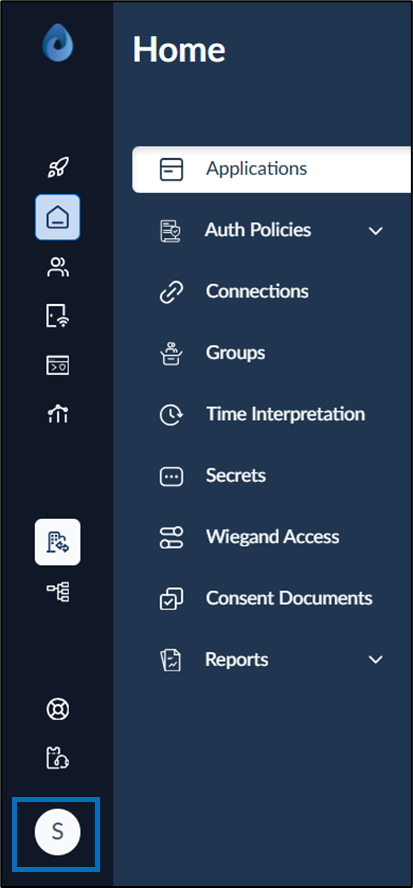
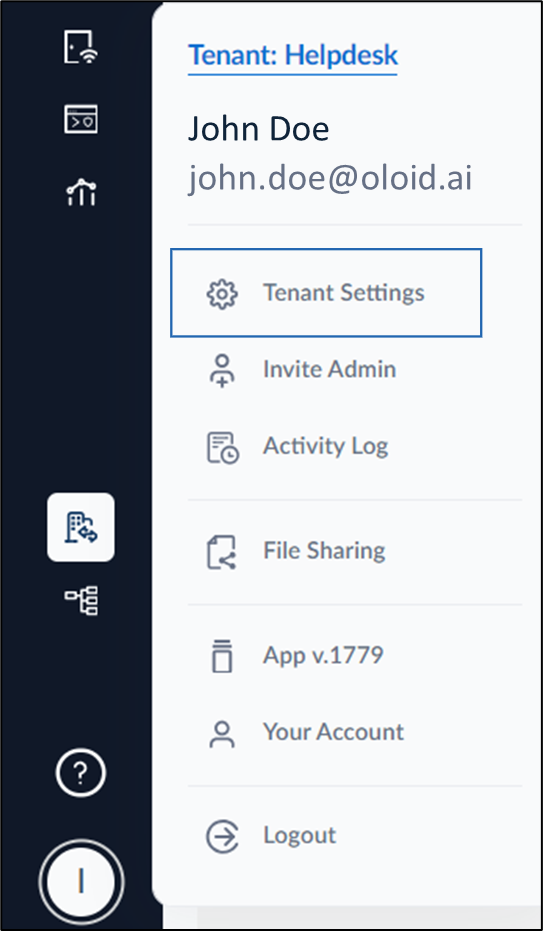
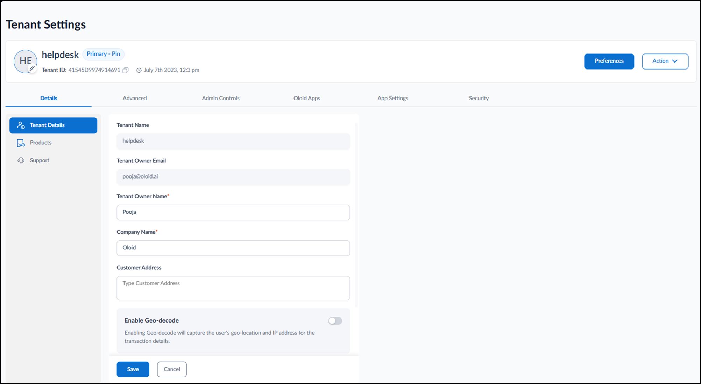
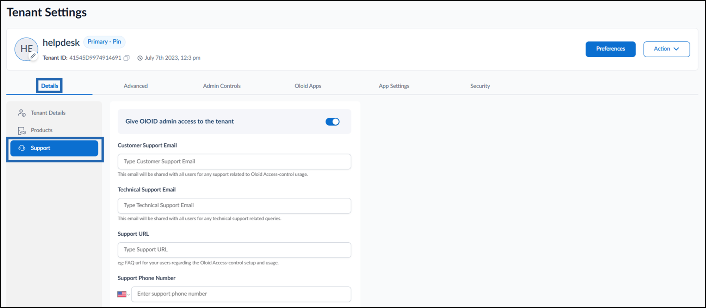

{/* Source: Intercom article 8811277 - https://oloid.help/en/articles/8811277-how-to-provide-oloid-admin-access-to-the-tenant */}
{/* Generated by intercom_to_mintlify.py - re-running overwrites this file. */}

To provide Oloid admin access, follow the below steps:

1. Log in to the **Oloid Portal**.
2. On the homepage of the portal, click **user profile icon** on the bottom left corner of the menu panel.

   

   The user profile menu is displayed.
3. Select **Tenant Settings**.

   

   The **Tenant Settings** page is displayed.

   

4. In **Details** tab, click **Support.**

   

   1. Enable **Give OLOID admin access to the tenant** to OLOID admin to provide access to Oloid portal.
   2. Enter **Technical Support Email.**
   3. Enter **Customer Support Email.**
   4. Enter **Support URL.**
   5. Enter **Support Phone Number.**
5. Click **Save**.
   The setting is saved successfully.
