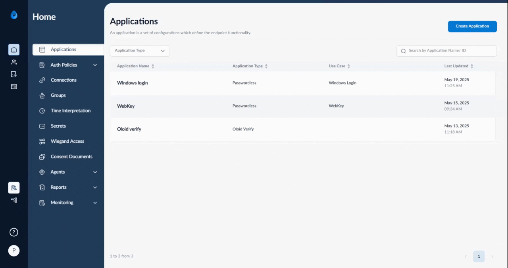
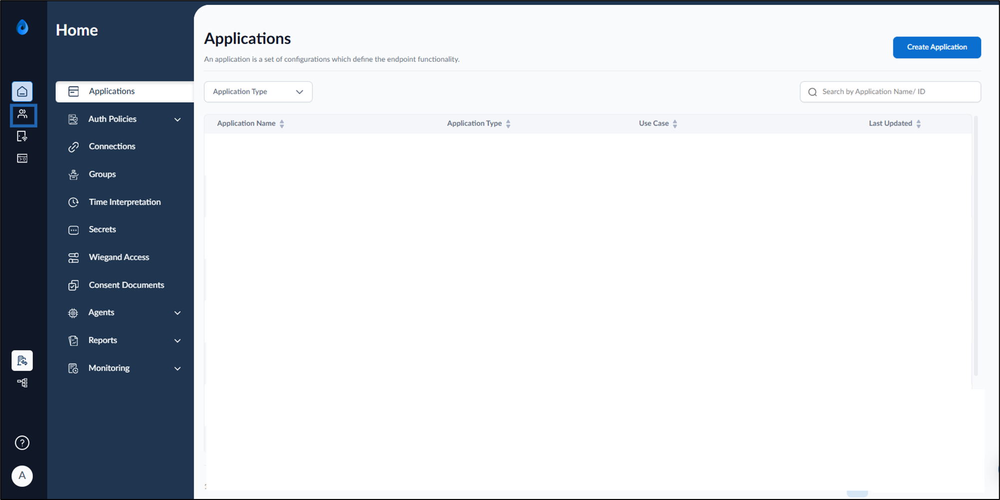
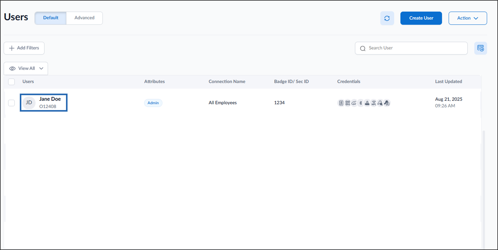
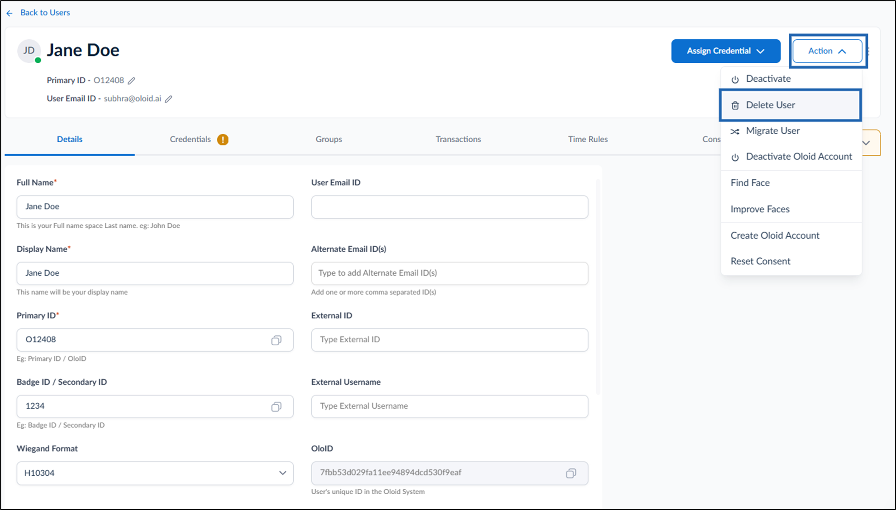
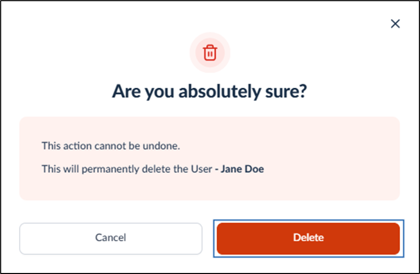
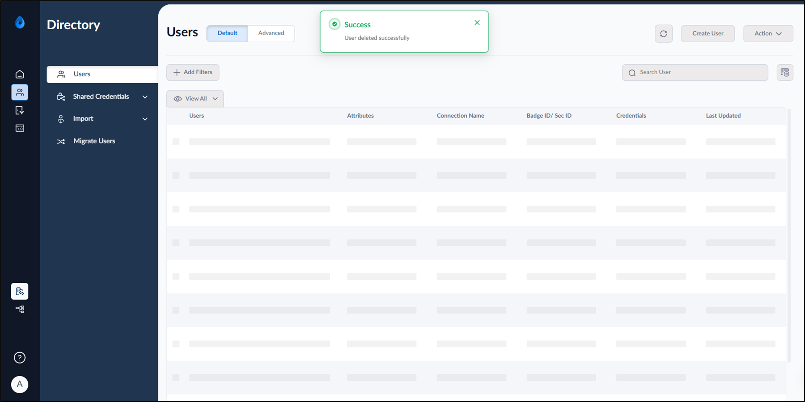

{/* Source: Intercom article 8424129 - https://oloid.help/en/articles/8424129-how-to-remove-user-in-the-tenant-admin-portal */}
{/* Generated by intercom_to_mintlify.py - re-running overwrites this file. */}

## Introduction

The Tenant Admin Portal enables administrators to manage user accounts by adding, updating, or removing users as needed. When a user is removed, their access to applications and resources associated with the Tenant Admin Portal is permanently revoked.

## Prerequisite

A User must be created. To create user refer [How to add Users in the Tenant Admin Portal](/platform/tenant-admin-portal/tenant-admin-portal-how-to-create-user).

## Steps to remove user

1. Log in to the **Tenant Admin Portal**.
2. On the home page of the portal, click **Directory** on the left menu panel.

   

   The **Users** page is displayed.
3. Click Username to edit.

   

   The user details page is displayed.
4. On the top-right, go to **Action** > select **Delete User**.

   

   A confirmation pop-up box is displayed.
5. Click **Delete**.

   

   The user is permanently deleted from the Tenant Admin Portal.

   

**Keywords**
| Remove User | Delete User | Tenant Admin Portal | User Management | User Account | User Removal | Delete User Account | Revoke User Access | Manage Users | Users Page | User Directory | Tenant Admin |
