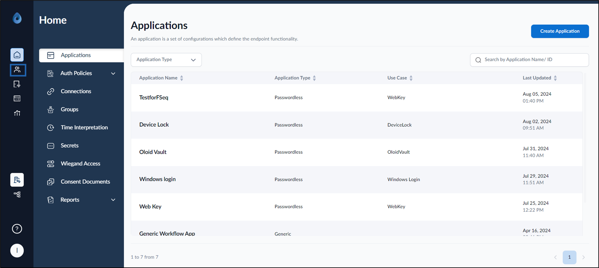
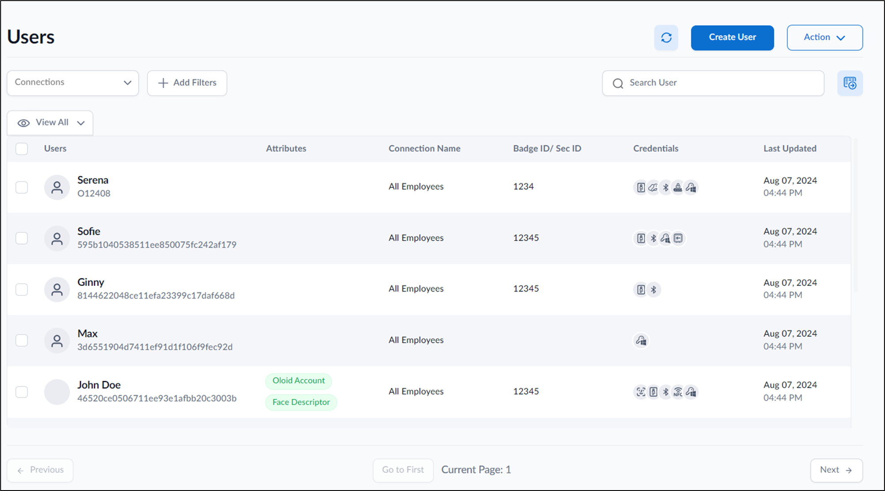
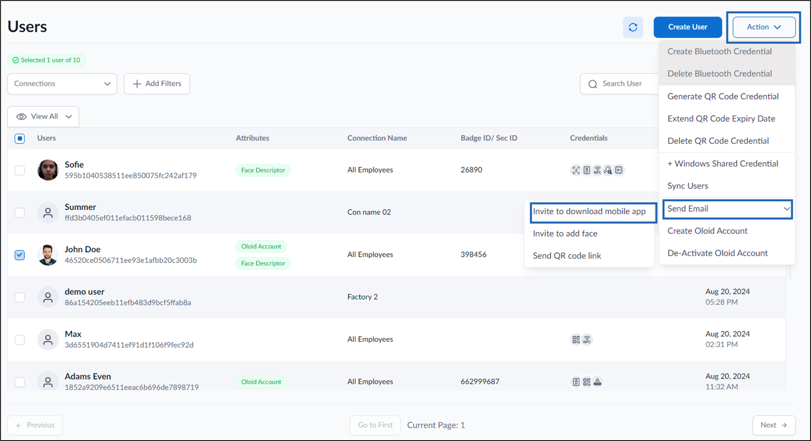

{/* Source: Intercom article 9716548 - https://oloid.help/en/articles/9716548-how-to-send-invite-to-download-mobile-app-using-oloid-portal */}
{/* Generated by intercom_to_mintlify.py - re-running overwrites this file. */}

Steps to send invite to download mobile app:

1. Log in to **Oloid Portal.**
2. On the homepage, click **Directory** from the left menu panel.

   

   The **Users** page is displayed.

   

3. Select user(s).
4. Click **Action** > **Send Email** > **Invite to download mobile app.**

   

   The invite to download mobile app is sent successfully.
