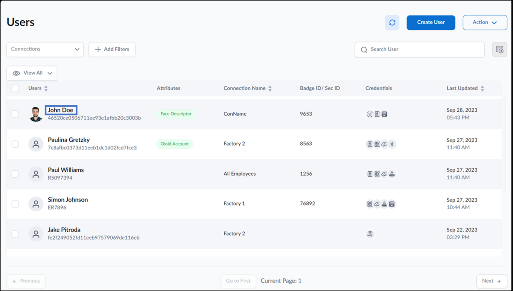
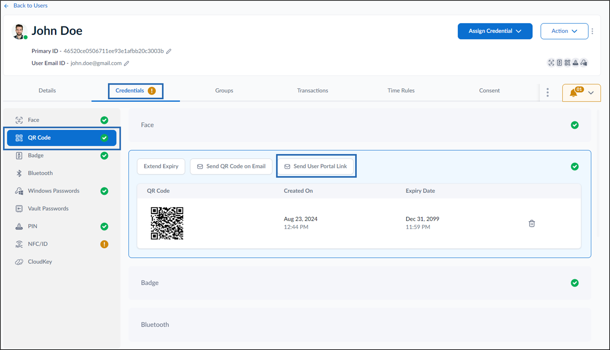
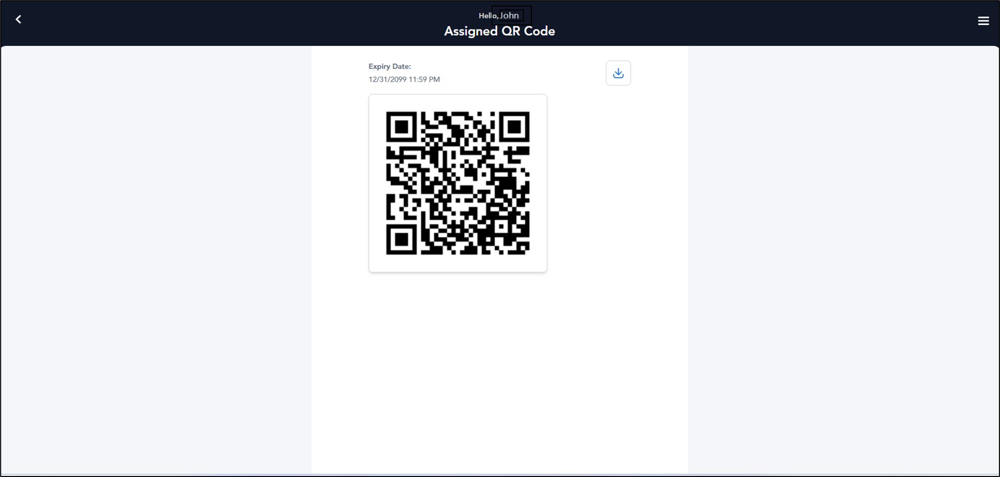

{/* Source: Intercom article 8850381 - https://oloid.help/en/articles/8850381-how-to-send-qr-code-credential-to-user-using-user-portal-link */}
{/* Generated by intercom_to_mintlify.py - re-running overwrites this file. */}

To send QR Code credential to user using user portal link:

1. Log in to the **Oloid Portal**.
2. On the home page of the portal, click **Directory** on the left panel menu.

   

   The **Users** page is displayed.
3. Click **Username** to edit.

   

   The User details page is displayed.
4. Go to **Credentials** tab > **QR Code** > select **Send User Portal Link**.

   

   The admin sends an email with the user portal link to view and scan the QR Code. The link navigates the user to the self-service portal where the user can perform QR Code transaction.

   
