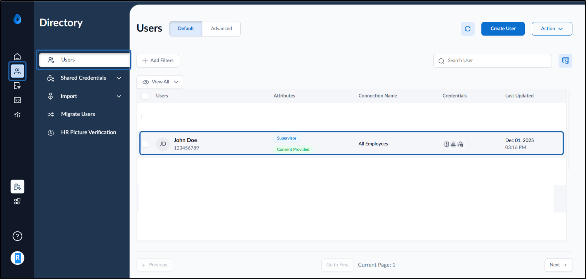
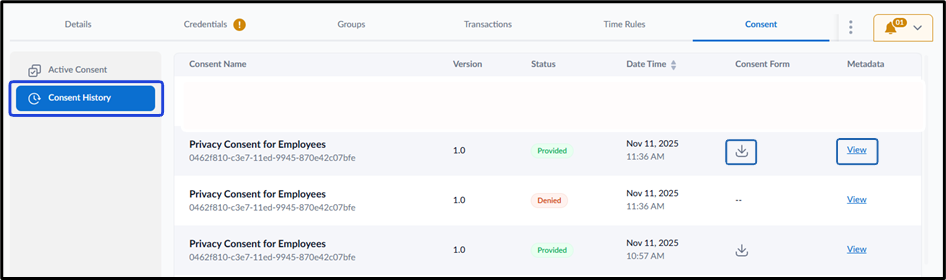

{/* Source: Intercom article 12990832 - https://oloid.help/en/articles/12990832-how-to-view-and-download-consent-history-of-a-user */}
{/* Generated by intercom_to_mintlify.py - re-running overwrites this file. */}

## Introduction

The Consent History feature in the Oloid Tenant Admin Portal allows administrators to review and manage all past consent actions provided or denied by a user. This enables clear tracking of a user’s consent decisions over time, supporting compliance, auditing, and verification requirements.

## Prerequisites

1. You must have a tenant admin account
2. User must be part of the connection.
3. User must have past consent either provided or denied. (If the User has never been asked to provide consent, this tab will show no details).

## Steps to view and download Consent History of a User

1. Log in to the **Tenant Admin Portal**.
2. On the homepage, select **Directory** from the left menu panel.

   

   The **Users** page is displayed.
3. Click user name to edit.
   The User details page is displayed.
4. Click the **Consent Tab** > **Consent History**.

   

   The **Consent History** page is displayed.
5. Click **download icon** to download the active consent of the user.
   The selected consent history is successfully saved to the device.
6. Click **View** to view the consent history details.

   <Note>
     **Note:** Consent Status are as follows:
   </Note>

   - Provided: The user has given consent to add their face data.
   - Denied: The user has rejected the consent request.
   - Pending: The user has received the consent request, and their action is pending.
   - Re-consent Pending: The user had previously provided consent, but a new consent request was issued and their action is pending.
