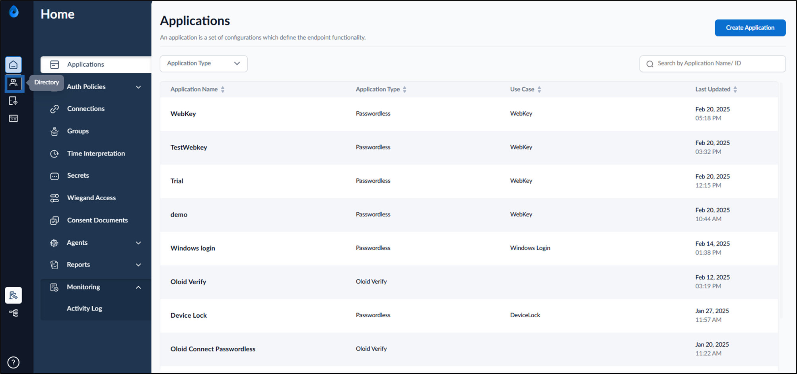
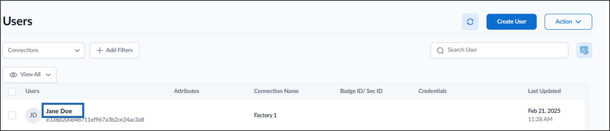
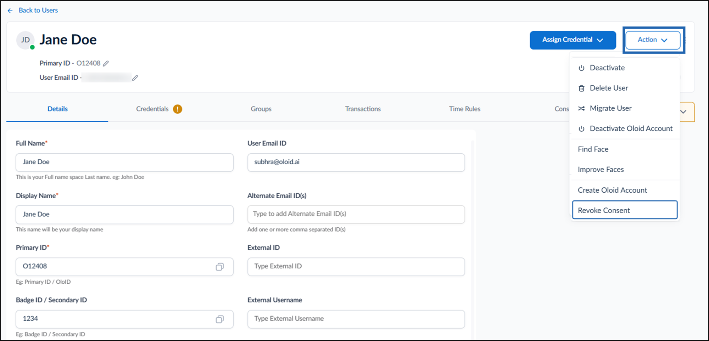
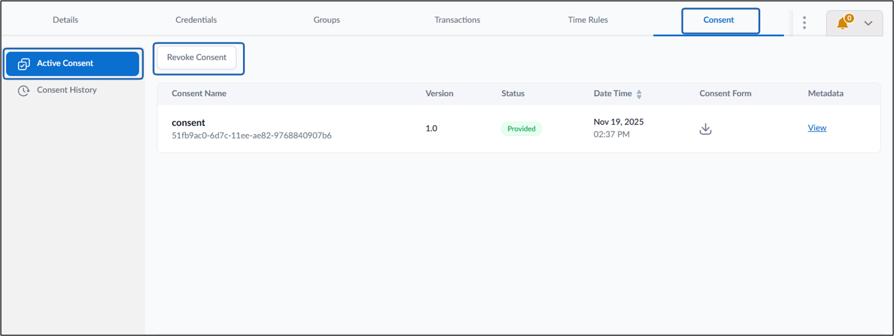
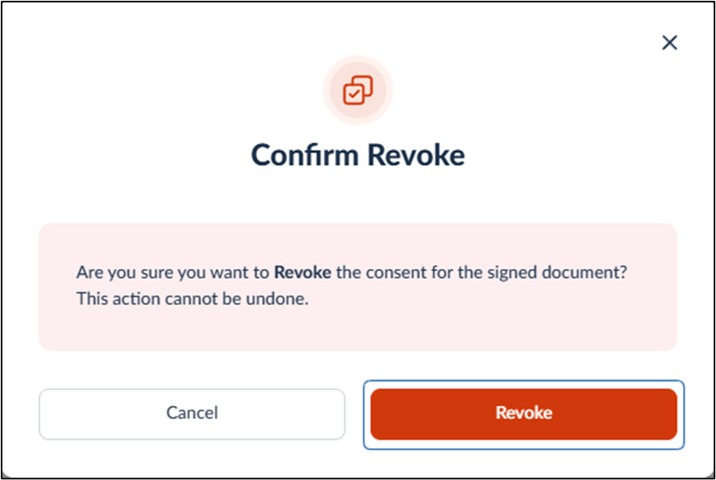
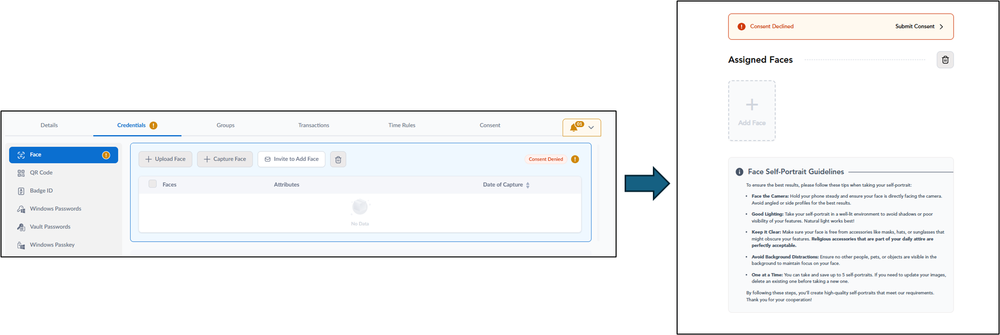
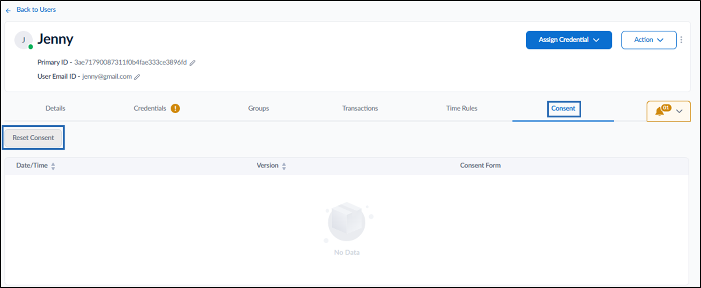

{/* Source: Intercom article 10615483 - https://oloid.help/en/articles/10615483-oloid-platform-how-to-revoke-consent-of-a-user */}
{/* Generated by intercom_to_mintlify.py - re-running overwrites this file. */}

## Introduction

The Revoke Consent feature allows admins to manage users' legal consent. When activated, it resets previously obtained consent, prompting users to provide consent again if the organization updates the legal agreement document.

## Prerequisite

- You must have a Tenant Admin Account.
- User must have an active consent.

## Steps to Revoke Consent

1. Log in to the **Tenant Admin Portal**.
2. On the homepage, select **Directory** from the left menu panel.

   

   The **Users** page is displayed.
3. Select **User** from the list.

   

   The **Details** page is displayed.
4. Do one of the following:
   1. Click **Action** dropdown at top right > select **Revoke Consent**.

      

      OR
   2. Go to **Consent** tab > **Active Consent >** click **Revoke Consent**.

      

      The Confirm Revoke Consent pop-up is displayed.
   3. Click **Confirm** Revoke Consent.

      

      The consent is revoked successfully. The Status of the consent is changed to **Consent Denied.**

      <Note>
        **Note:** The user is prompted to submit consent in the User Portal during face addition.
      </Note>

      

<Note>
  **Note:** Once activated, the Revoke Consent button is disabled until the user submits consent again.
</Note>

