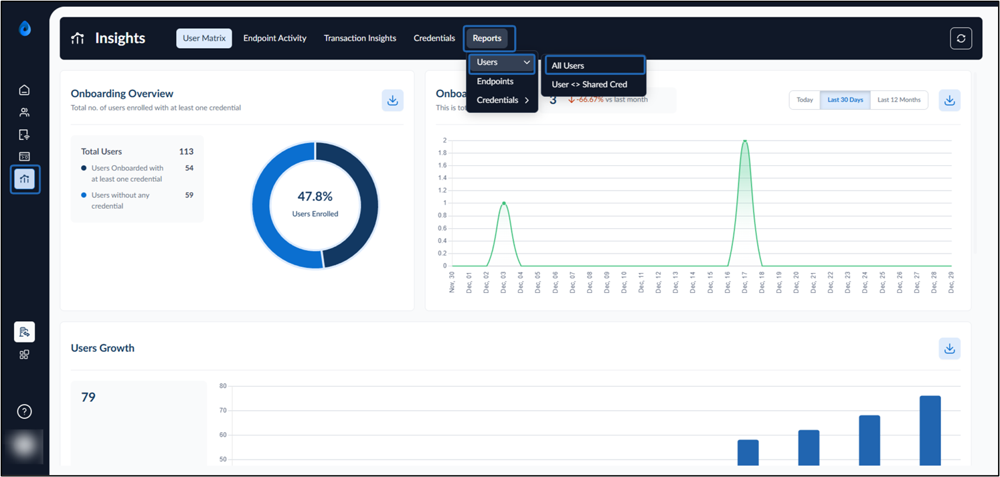
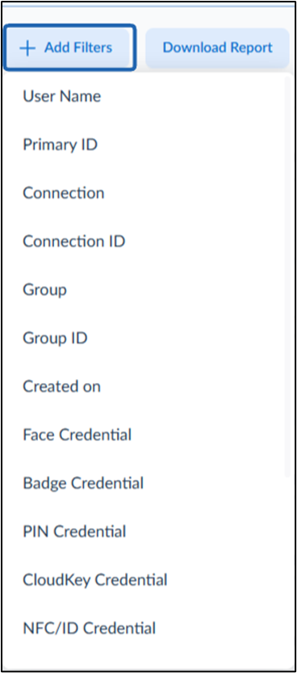
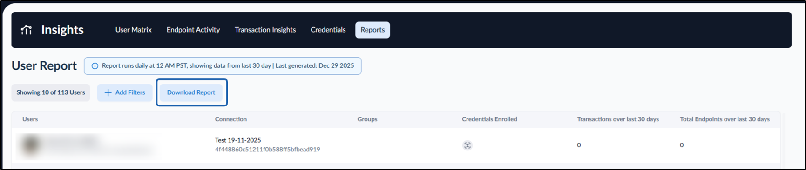

{/* Source: Intercom article 13256290 - https://oloid.help/en/articles/13256290-oloid-platform-insights-dashboard-reports-all-users-report */}
{/* Generated by intercom_to_mintlify.py - re-running overwrites this file. */}

## Introduction

The **User Report** under **Insights > Reports** allows to narrow down user data based on specific criteria and download targeted reports.

## Prerequisite

- You must have Tenant Admin account.

## How to view and download All Users Report

1. Log in to the Tenant Admin Portal.
2. From the left navigation menu click **Insights** icon.
3. Select the **Reports** tab > **Users** > **All Users.**

   

   The **User Report** page is displayed.

   

4. Click **Add Filters** to narrow down the report based on specific criteria.
5. Select filter from dropdown.

   

6. Click **Download Report**.
7. Enter the **Report name** and select the required table columns.
8. Click **Download.**
   The Report is successfully downloaded.

<Note>
  **Note:** Report Generation Details
</Note>

- The report runs **daily at 12:00 AM PST**.
- It displays data from the **last 30 days**.
- The **Last generated** date and time is shown at the top of the page.
- Use the pagination controls at the bottom of the page to navigate through multiple pages of users.
