{/* Source: Intercom article 9969120 - https://oloid.help/en/articles/9969120-oloid-user-portal-how-to-configure-oloid-user-portal-in-tenant-admin-portal */}
{/* Generated by intercom_to_mintlify.py - re-running overwrites this file. */}

## Introduction

You can configure the Oloid User Portal from the Tenant Admin Portal by selecting preferred login options, enabling Single Sign-On (SSO) providers, customizing the visual theme to enhance the end-user experience, and accessing the Oloid User Portal directly by clicking the User Portal link within the Tenant Admin Portal.

## **Prerequisite**

You must select the preferred credentials to be displayed in Oloid User Portal. Refer **Tenant Settings** > **[Preferences](/platform/tenant-admin-portal/tenant-admin-portal-how-to-set-credential-preferences-in-tenant-admin)**

## Steps to configure Oloid User Portal

1. Log in to the **Tenant Admin Portal**.
2. On the homepage, click **user profile** icon from the bottom left.

   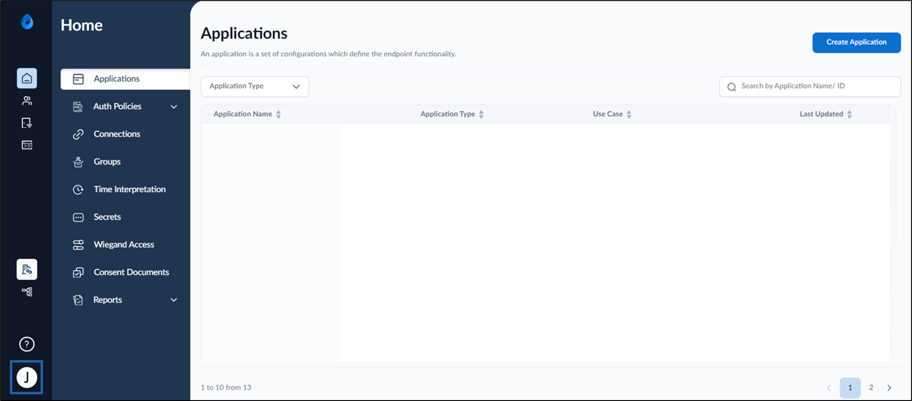

   The **User profile menu** is displayed.
3. Click **Tenant Settings**.

   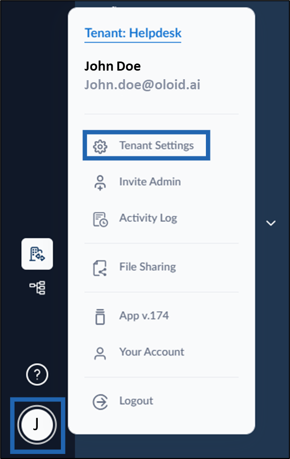

   The **Tenant Settings** page is displayed.
4. Go to **App Settings** > **User Portal**.

   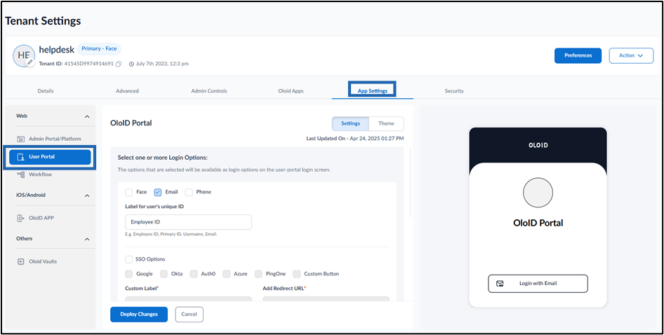

   The **Settings** and **Theme** sections are displayed. By default, **Settings** section is selected.
5. Do the following:
   1. [Login Page](#login-page)
   2. [Post Login Page](#post-login-page)
   3. Configure Settings section.
   4. [Configure Theme section](#configure-theme-section).
      The Oloid User Portal is configured. You can now view the Oloid User Portal and validate your changes. For more details refer [View Oloid User Portal](#view-oloid-user-portal)

### Login Page

You can select the preferred login options to be displayed on the Oloid User Portal login screen:

1. Enable **Login with Face** toggle.
2. Enter the **Label for user's unique ID** field.
   **Note: User unique ID** is displayed if **Face** is selected as a Login option. You can enter Employee ID, Primary ID, Username, Email as **user's unique ID**.

   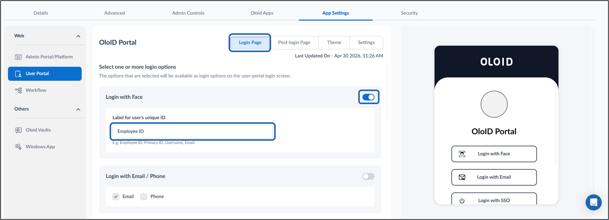

3. Enable **Email** / **Phone** to allow users to authenticate via an email ID, SMS or phone-based authentication.
   The selected option(s) is(are) displayed on the Oloid User Portal login screen.

   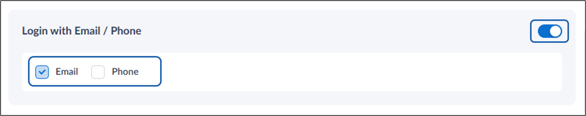

4. Enable **SSO options** toggle to log in to the Oloid User Portal.
5. Select one or more SSO providers for the Oloid User Portal by selecting the corresponding boxes. Once enabled, users can log in using their selected SSO provider(s).

   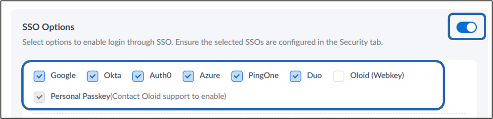

6. Select **Custom Button** to add any specific URL to log into the Oloid User Portal.
   1. Enter **Custom Label**.
   2. Enter **Add Redirect URL**.
7. **HR Picture Verification** enables the Verify button on the User Portal Login screen. This enables facial verification against HR-uploaded images. This option can also be used for self-onboarding of face credential by enabling the auto-enroll-face option.
   For more Information, refer: [How to Enable HR Picture Verification for User Portal](/platform/tenant-admin-portal/tenant-admin-portal-how-to-enable-hr-picture-verification-for-oloid)

### Post Login Page

The Custom Post-Login Page setting allows Tenant Admins to define the landing page users see after logging into the User Portal. For More information refer: [How to Configure Custom Post-Login Landing page for Oloid User Portal](/platform/user-portal/oloid-user-portal-how-to-configure-custom-post-login-landing-page)

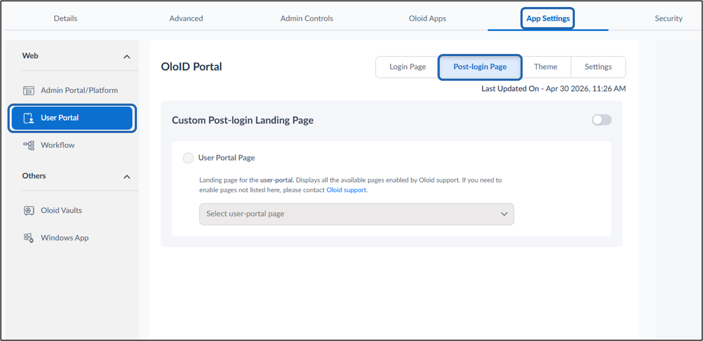

### Configure Theme section

The Customize Theme settings allow you to personalize the appearance of the User Portal by configuring branding elements such as the logo, colours, and header styles to match your organization's identity.

Do the following:

[Customize Theme](#configure-customize-theme)

[Configure Language Support](#configure-language-support).
Theme section is configured successfully.

##### Configure Customize Theme

Go to **Customize Theme** section and do the following:

1. Upload logo in **Customer Logo**.
2. Enter color code in **Widget Header/Footer Color**.
3. Enter color code for **Header Text Color.**
4. Enter color code for **Primary Color**.
5. Enter color code for **Secondary Color**.
6. Click **Deploy Changes**.

   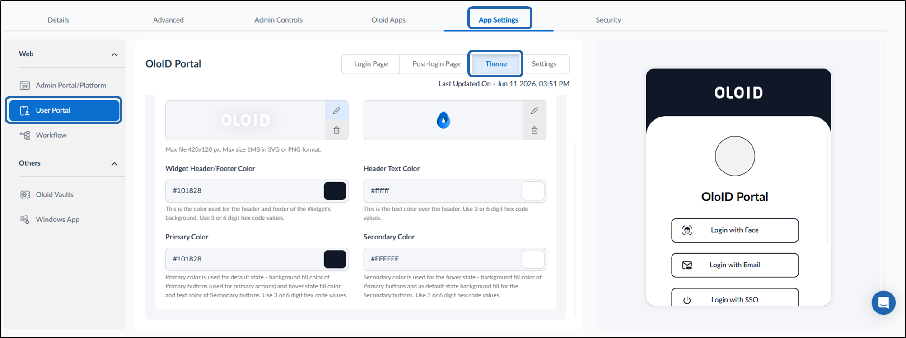

   The Confirm Update pop-up box is displayed.
7. Click **Update**.

   <Note>
     **Note:** You can see all your customized changes in the preview screen as well as in the User Portal. Follow next section for more details.
   </Note>

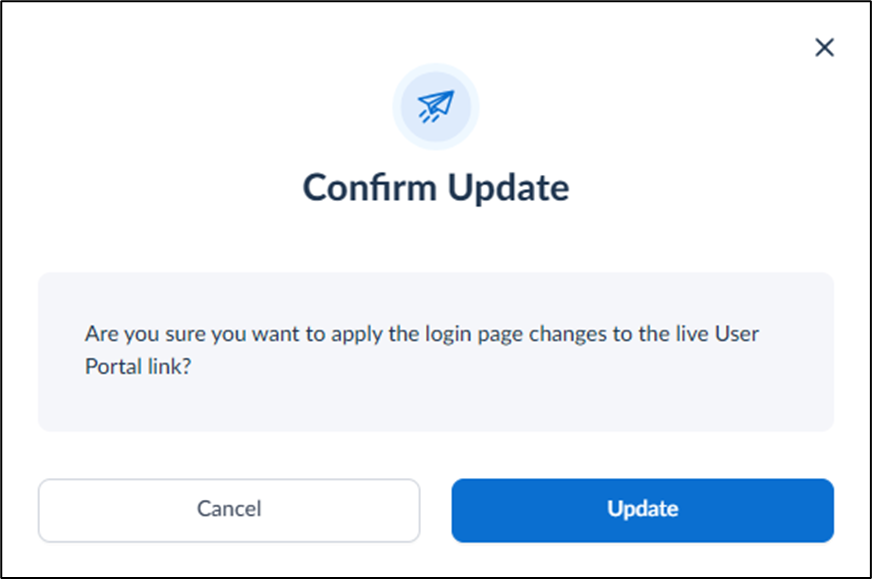

##### Configure Language Support

<Note>
  **Note:** The following Languages are currently supported: French, English, German, Portugese, and Spanish.
</Note>

1. Click **Language Support.**

   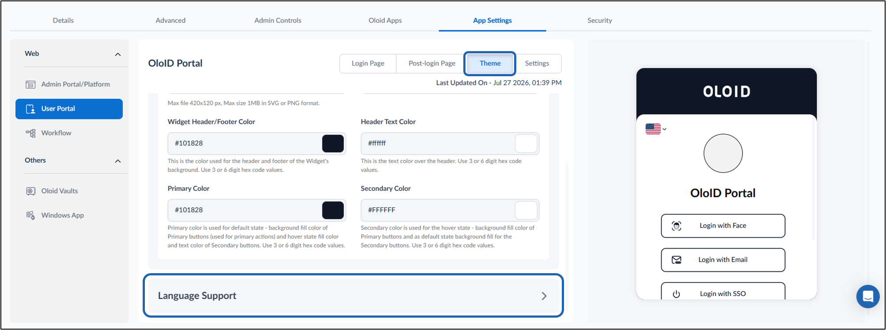

2. Select the **Default App Language** from dropdown.
   Choose the language that the application uses by default for all users unless another language is selected.
3. Select the **Use Browser Language as Default Language** checkbox. (Optional)
   Enable this option to automatically use the language configured in the user's web browser as the application's default language.
4. Select the **Show Language selection dropdown** checkbox. (Optional)
   Enable this option to display a language selector in the application, allowing users to switch between the configured languages.
5. Click **Deploy Changes**.

   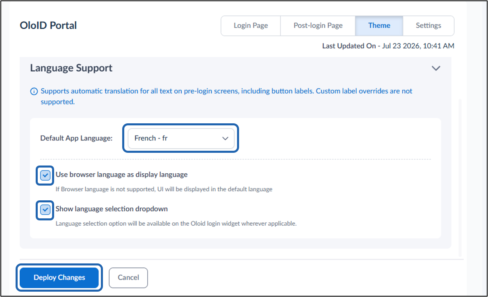

   The Confirm Update pop-up box is displayed.

   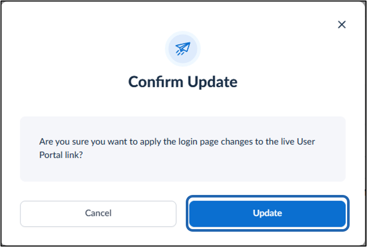

6. Click **Update**.

The Theme tab is customized successfully.

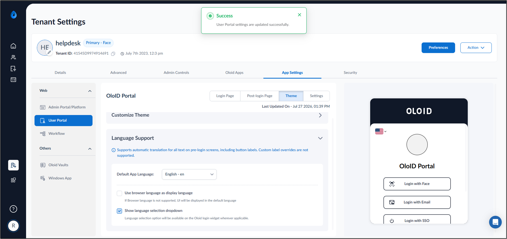

### Customize Settings Tab

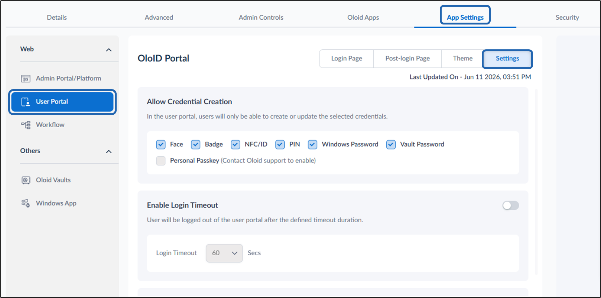

To Configure settings do the following:

1. Select credential(s) for **Allow Credential Creation**.

   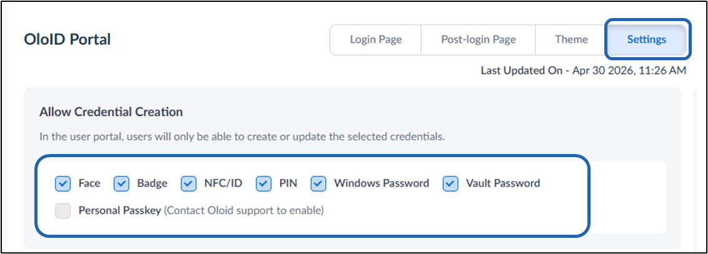

   The user can create or update the selected credential from the Oloid User Portal.
2. Enable Login Timeout: User will be logged out of the user portal after the defined timeout duration.
3. Click **Deploy Changes**.

   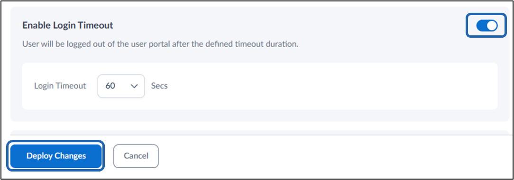

   The **Confirm Update** pop-up box is displayed.

Click **Update**.

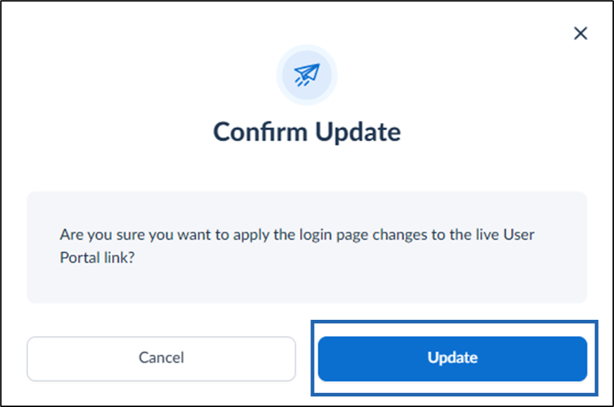

The Settings tab is configured successfully.

---

### View Oloid User Portal

1. Log in to the **Tenant Admin Portal**.
2. On the homepage, click **user profile** icon from the bottom left.
3. Click **Tenant Settings**.
4. Select **Oloid Apps** > **User Portal** app link.

   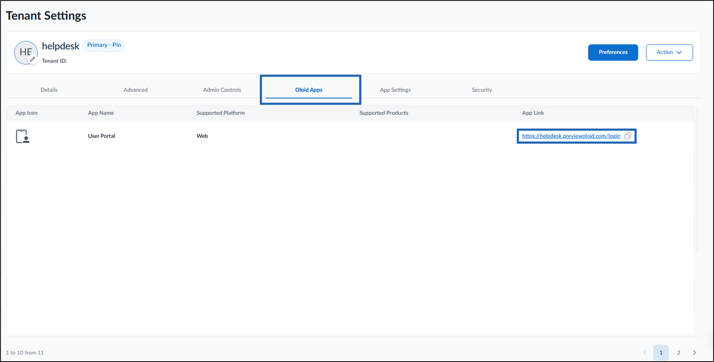

   The Oloid User Portal is displayed successfully.

   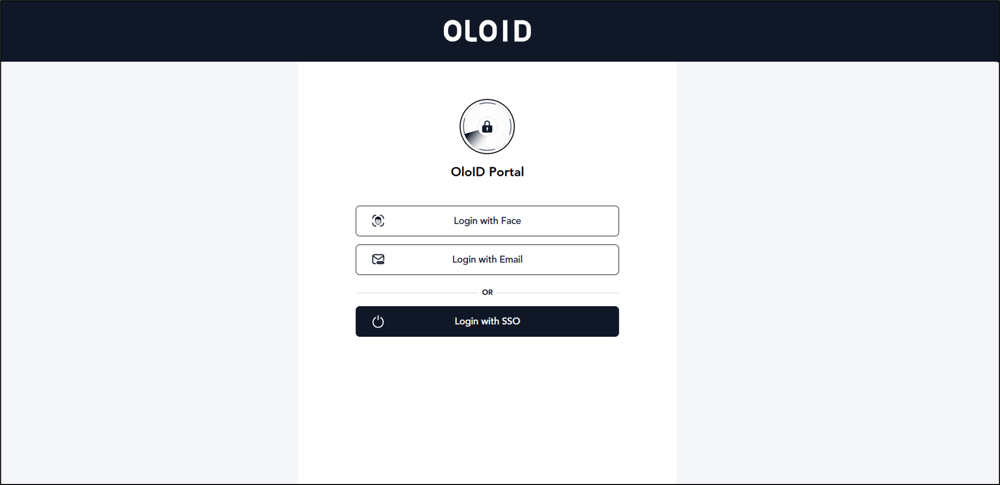
