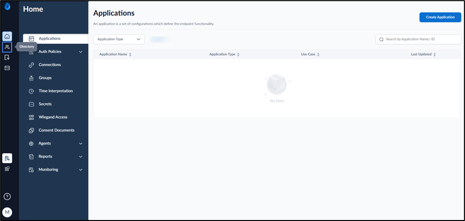
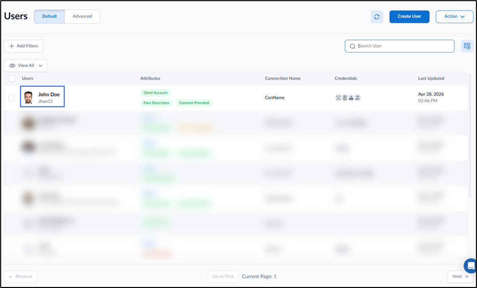
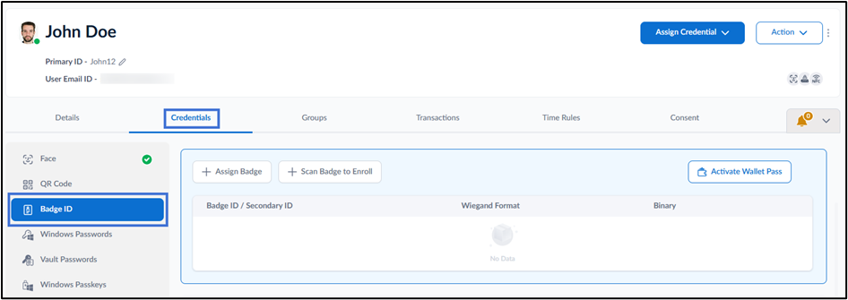
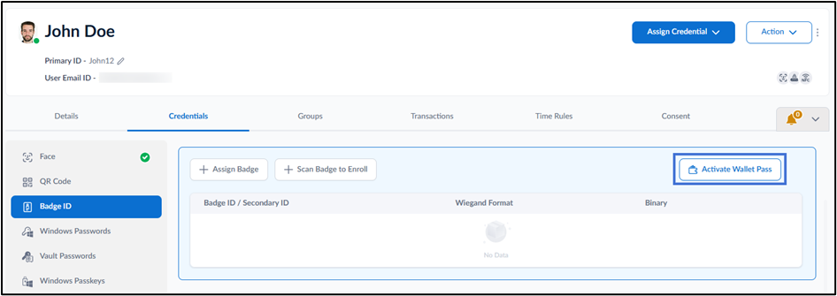
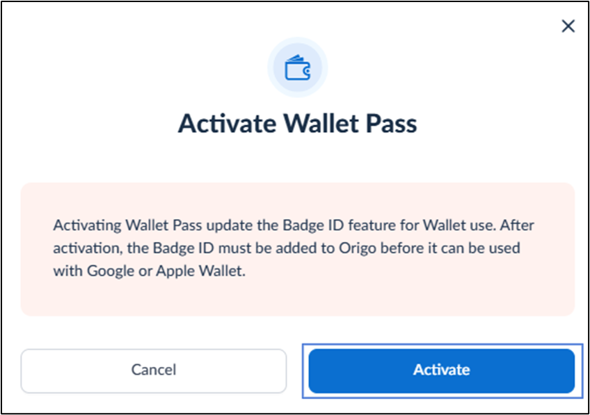
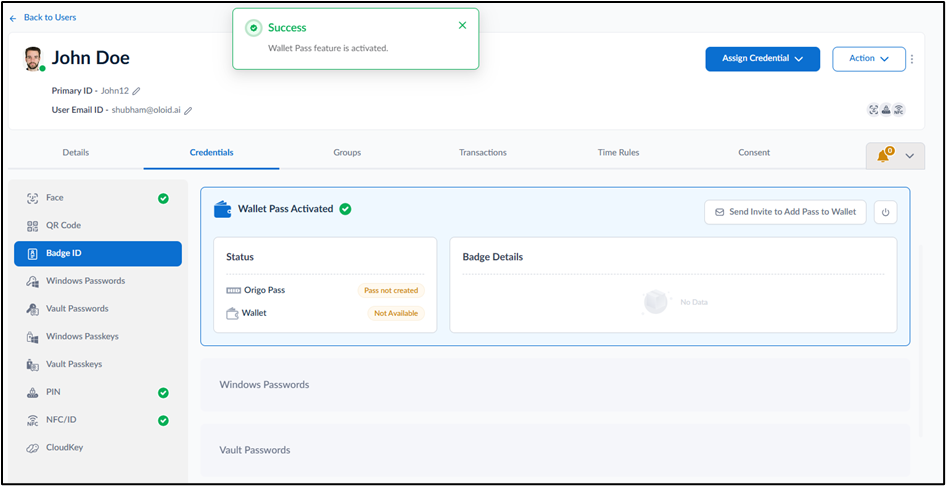
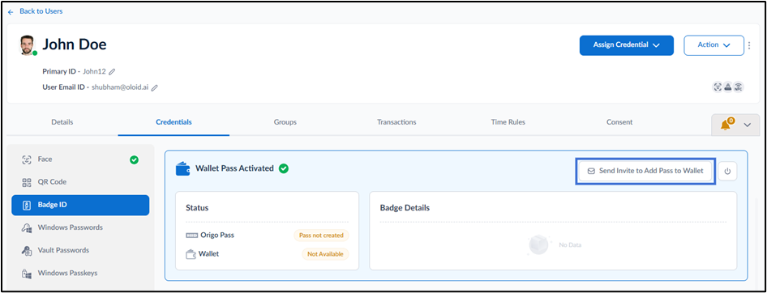
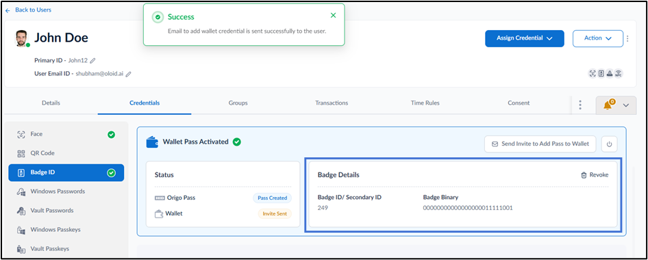

{/* Source: Intercom article 15174017 - https://oloid.help/en/articles/15174017-tenant-admin-portal-how-to-activate-and-send-wallet-pass-to-user */}
{/* Generated by intercom_to_mintlify.py - re-running overwrites this file. */}

## Introduction

This document provides step-by-step instructions to activate Wallet Pass for a user in the Tenant Admin Portal. Activating Wallet Pass enables users to add and access badge credential in supported mobile wallet applications.

## Prerequisites

- You must have admin access to the Tenant Admin Portal.
- You must enable wallet pass. For more, refer to [Tenant Admin Portal - How to Enable Wallet Pass](/platform/tenant-admin-portal/tenant-admin-portal-how-to-enable-wallet-pass)

## Steps toActivate and Send Wallet Pass

1. Log in to the **Tenant Admin Portal**.
2. On the homepage of the portal, click **Directory** on the left menu panel.

   

   The **Users** page is displayed.
3. Click **user name** to Activate Wallet Pass for User.

   

   The user details page is displayed.
4. Go to **Credentials > Badge.**

   

   The Badge credential page is displayed.
5. Click **Activate Wallet Pass**.

   

   The **Activate Wallet Pass** pop-up box is displayed.
6. Click **Activate**.

   

   The Wallet Pass activated successfully.

   

Click **Send Invite to Add Pass to Wallet**.

<Note>
  **Note:** Ensure that a valid email address is configured for the user before sending the wallet pass invitation.
</Note>

The wallet pass invitation email is sent to the user's configured email address, and the badge details are displayed successfully.

