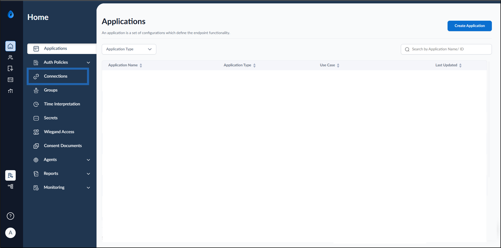
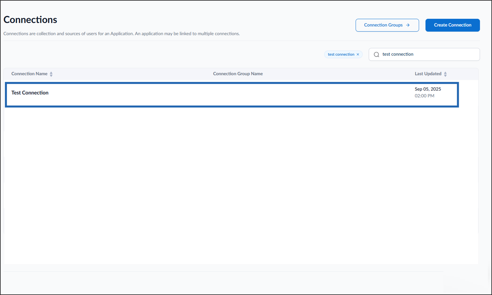
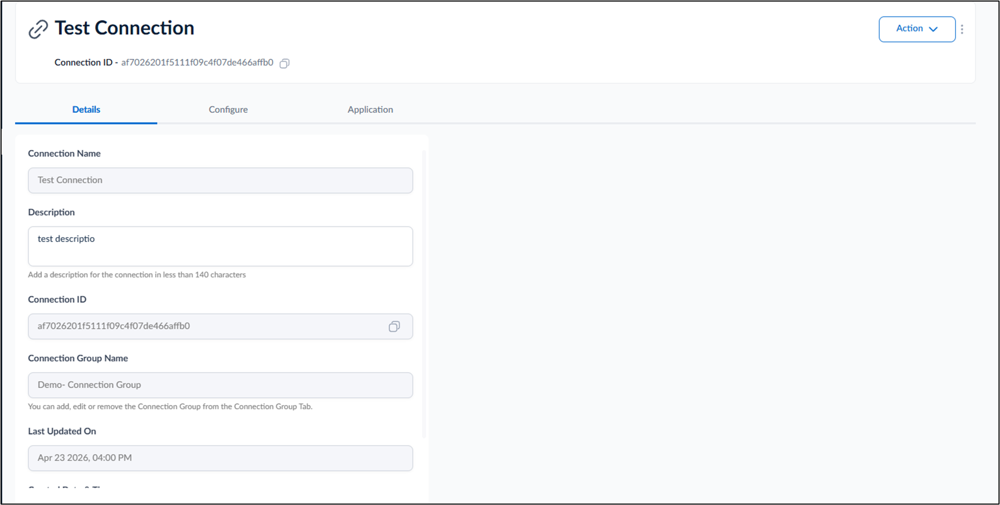
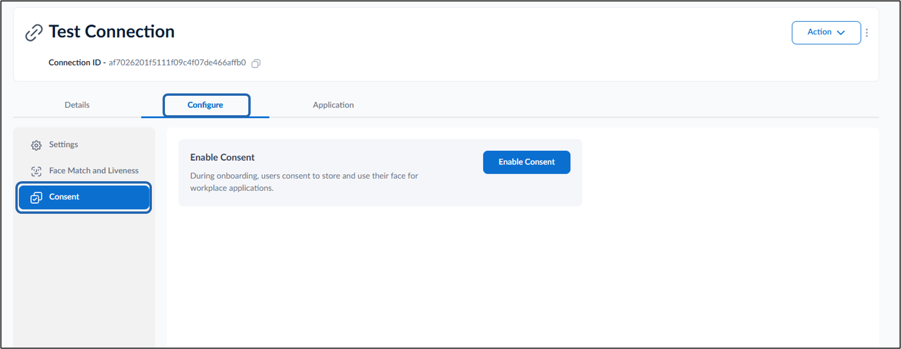
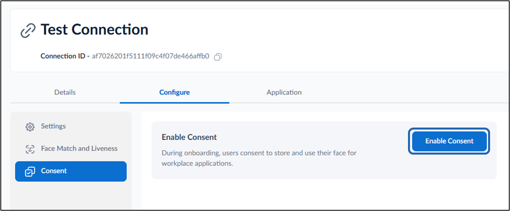
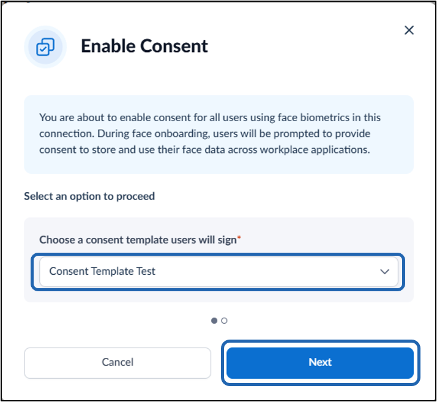
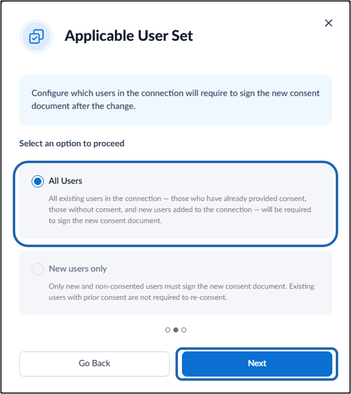
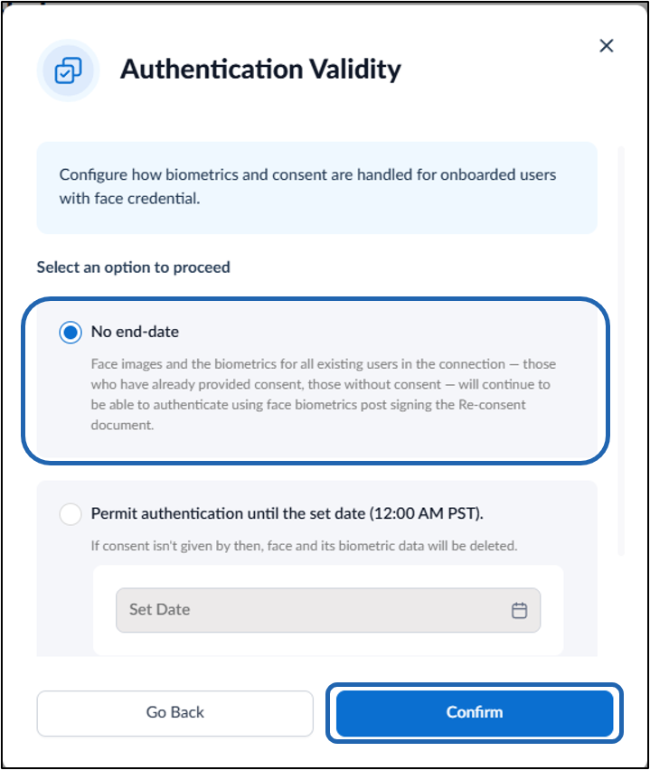
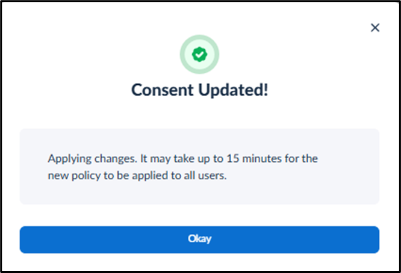
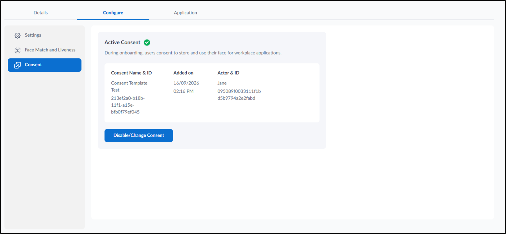

{/* Source: Intercom article 8237994 - https://oloid.help/en/articles/8237994-tenant-admin-portal-how-to-add-a-consent-template-to-a-connection-in-the-tenant-admin-portal */}
{/* Generated by intercom_to_mintlify.py - re-running overwrites this file. */}

## Introduction

The Tenant Admin Portal allows admins to configure a consent template to obtain user approval before capturing and storing facial data.

## Prerequisites

- You must have admin access to the Tenant Admin Portal.
- A consent template must already be created. For more information, refer to **[How to create a Consent Template](/platform/tenant-admin-portal/tenant-admin-portal-how-to-create-and-configure-consent-template)**.

## Steps to add Consent

1. Log in to the **Tenant Admin Portal**.
2. On the home page of the portal, click **Connections** on the left menu panel.

   

   The **Connections** page is displayed.
3. Select a connection name to edit.

   

   The Connection detail page is displayed.

   

4. Click **Configure** tab then select **Consent** tab.

   

5. Click **Enable Consent**.

   

   Enable Consent popup-box is displayed.
6. Do the following:
   1. Select the applicable **Consent Template** from the dropdown list.

      <Note>
        **Note:** To create a consent template, refer [How to create a Consent Template](/platform/tenant-admin-portal/tenant-admin-portal-how-to-create-and-configure-consent-template).
      </Note>

   2. Click **Next**.

      

      Applicable User Set screen is displayed.
   3. Select **All Users** > Click **Next**.

      

      Authentication validity pop-up box is displayed.
   4. Do one of the following:
      1. **No end-date:** Select this option to allow authentication without a defined end date. Face images and biometric data for all users in the connection whether they have already provided consent or have not yet provided will remain valid, and users will continue to authenticate using face biometrics after signing the re-consent document.
         OR
      2. **Permit authentication until the Set Date:** Select this option and enter the preferred date.

         <Note>
           **Note:** If consent is not provided by the selected date, the face data and associated biometric information will be deleted.
         </Note>

   5. Click **Confirm**.

      

   6. **Consent Updated** popup box is displayed.
   7. Click **Okay**.

      

      Consent is enabled for the connection.

      
