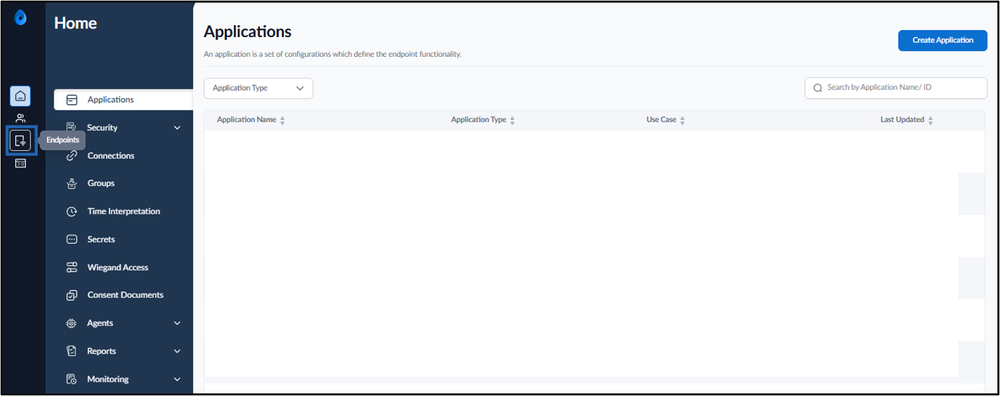
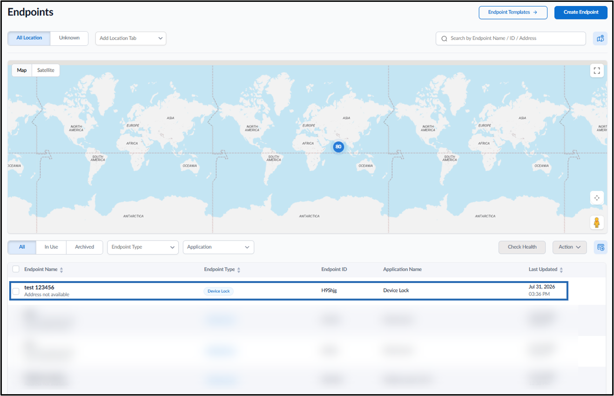
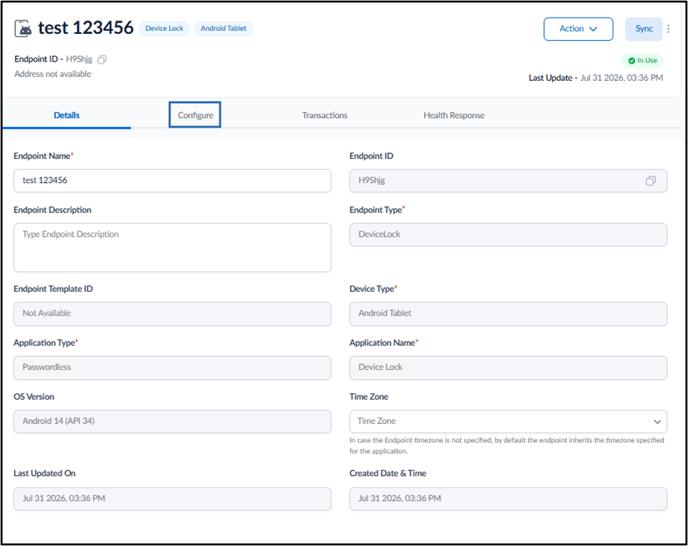
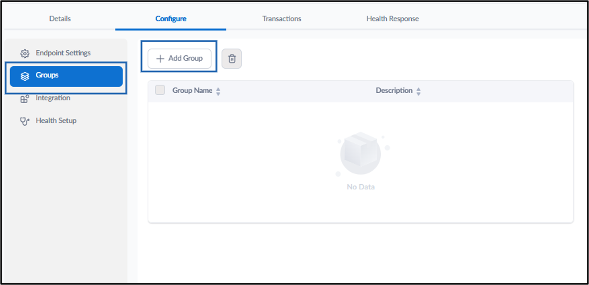
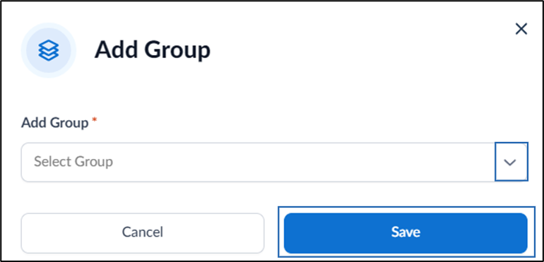
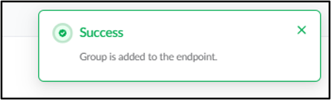

{/* Source: Intercom article 8463479 - https://oloid.help/en/articles/8463479-tenant-admin-portal-how-to-add-a-group-to-an-endpoint */}
{/* Generated by intercom_to_mintlify.py - re-running overwrites this file. */}

## Introduction

This document provides instructions to add a group to an endpoint in the Tenant Admin Portal.

## Prerequisites

- You must have Admin access to the Tenant Admin Portal.
- Ensure that the required group is already created in the Tenant Admin Portal.

## Steps to Add a Group to an Endpoint

1. Log in to the **Tenant Admin Portal**.
2. On the home page, click **Endpoints** from the left navigation panel.

   

   The **Endpoints** page is displayed.
3. Select the required endpoint from the list.

   

   The endpoint detail page is displayed.
4. Click **Configure**.

   

   The Configure screen is displayed.
5. Click **Groups** > **+ Add Group**.

   

   The **Add Group** pop-up box is displayed.
6. Select a group name from the **Select Group** drop-down list and then click **Save**.

   

   The selected group is added successfully

   
