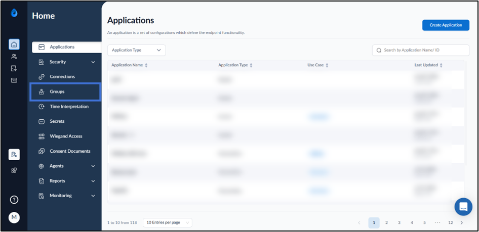
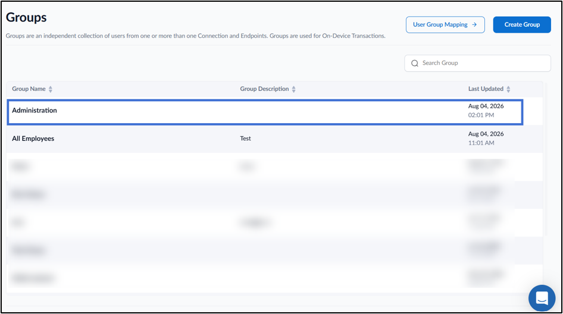
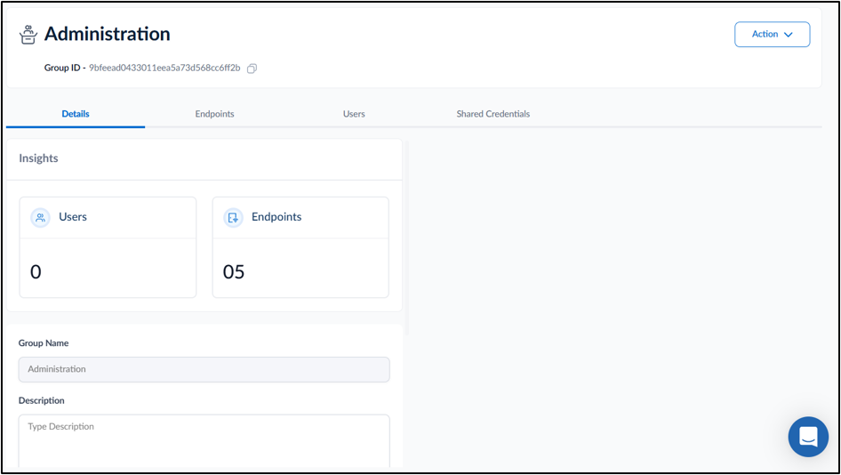
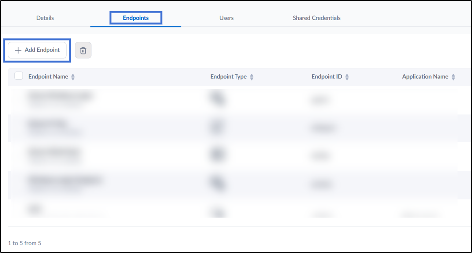
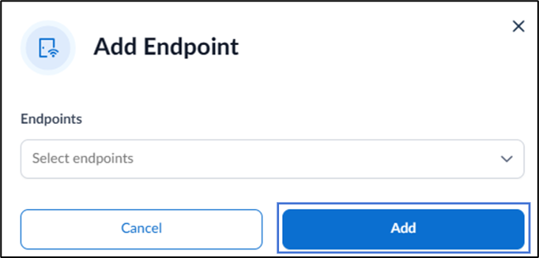
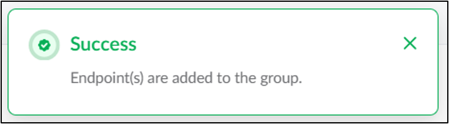

{/* Source: Intercom article 8315188 - https://oloid.help/en/articles/8315188-tenant-admin-portal-how-to-add-an-endpoint-to-a-group */}
{/* Generated by intercom_to_mintlify.py - re-running overwrites this file. */}

## Introduction

This document provides instructions to add an endpoint to an existing group in the Tenant Admin Portal.

<Note>
  **Note:** Adding Endpoint to a Group can be done in two ways. You can add group to an endpoint. For detailed instructions, see [How to add group to an endpoint](/platform/tenant-admin-portal/tenant-admin-portal-how-to-add-a-group-to-an-endpoint).
</Note>

## Prerequisites

- You must have Admin access to the Tenant Admin Portal.
- Ensure that the endpoint is already paired.
- Ensure that the group is already created.

## Steps to add Endpoint to a Group

1. Log in to the **Tenant Admin Portal**.
2. On the home page of the portal, click **Groups** on the left menu panel.

   

   The **Groups** page is displayed.
3. Click on a group name to edit from the listed groups.

   

   The Group detail page is displayed.

   

4. Go to **Endpoints** tab > Click **+ Add Endpoint**.

   

   The **Add Endpoint** pop-up box is displayed.
5. On the **Add Endpoint** pop-up box select endpoint from the **Select endpoints** dropdown list.

Click **Add**.

The endpoint is added and listed on the **Endpoints** tab.

