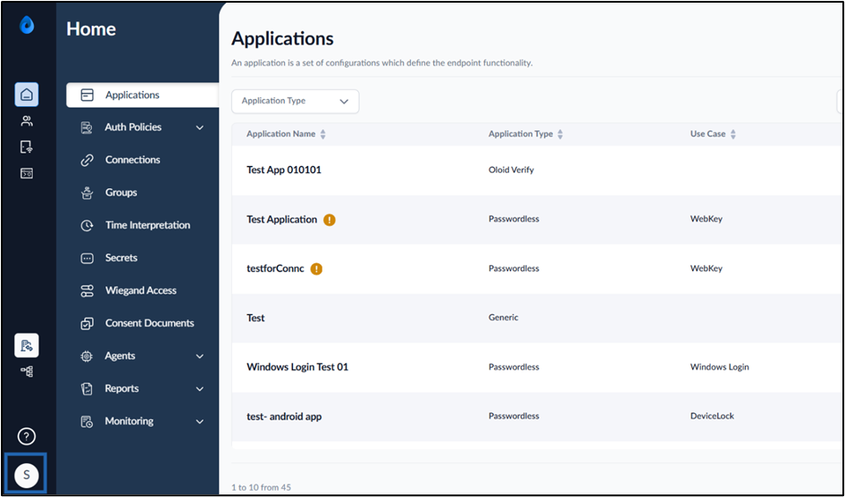
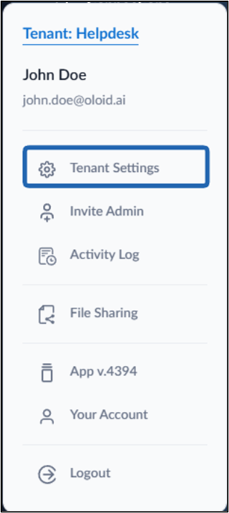
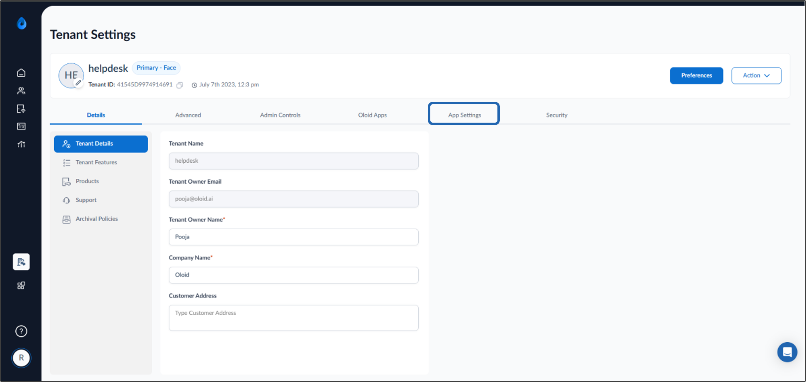
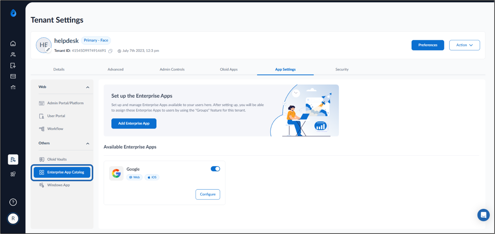
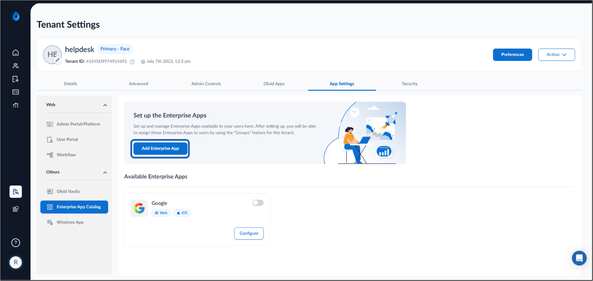
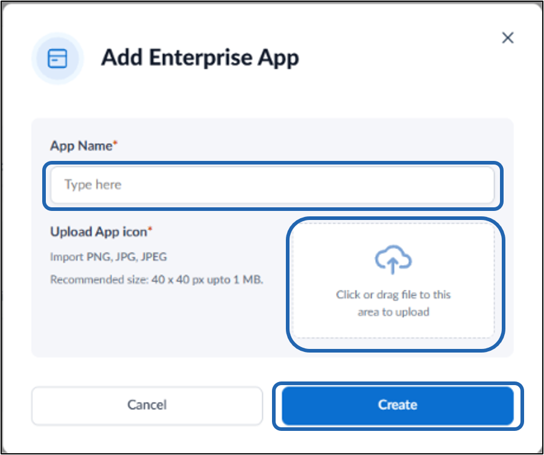
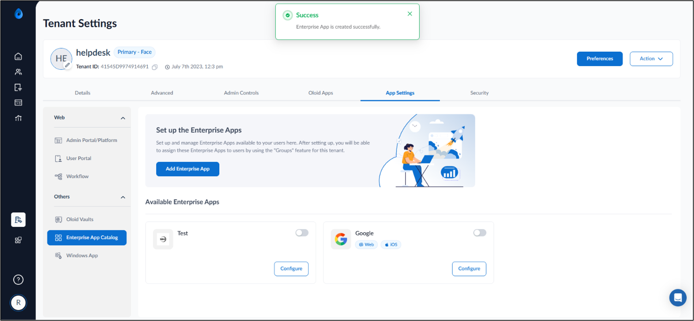
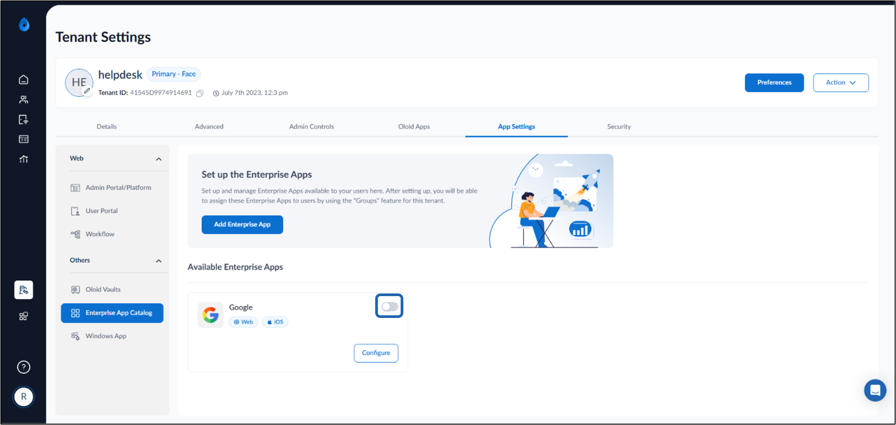

{/* Source: Intercom article 18295155 - https://oloid.help/en/articles/18295155-tenant-admin-portal-how-to-add-and-enable-enterprise-apps */}
{/* Generated by intercom_to_mintlify.py - re-running overwrites this file. */}

## Introduction

The Enterprise App Catalog in the Tenant Admin Portal lets Tenant Admins add the enterprise applications used in their organization and make them available in the Oloid platform. Each enterprise app is added with an app name and an icon.

## Prerequisites

- You must have a Tenant Admin account.
- You must have an icon image for the enterprise app ready to upload.

## Steps to Add and Enable Enterprise Apps

1. Log in to the **Tenant Admin Portal**.
2. On the homepage of the portal, click **Profile icon** on the bottom left corner of the menu panel.

   

   The user profile menu is displayed.
3. Click **Tenant Settings**.

   

   The **Tenant Settings** page is displayed.
4. On Tenant Settings page click **App Settings**.

   

5. Click **Enterprise App Catalog.**
   The Enterprise App page is displayed.

   

6. Do the following:
- [Add Enterprise App](#add-enterprise-app)
- [Enable Enterprise App](#enable-enterprise-app)

### Add Enterprise App

1. Click **Add Enterprise App** .

   

   The Add Enterprise App pop-up box is displayed.
2. Enter **App Name**.
3. Click or drag Icon to this area to upload.
4. Click **Create.**

   

   The Enterprise App is added.

   

### Enable Enterprise App

In the Available apps section, Turn on the toggle for the Enterprise App to use the Enterprise App.

<Note>
  **Note:** Each enterprise app has its own toggle. Adding an app does not enable it automatically.
</Note>

