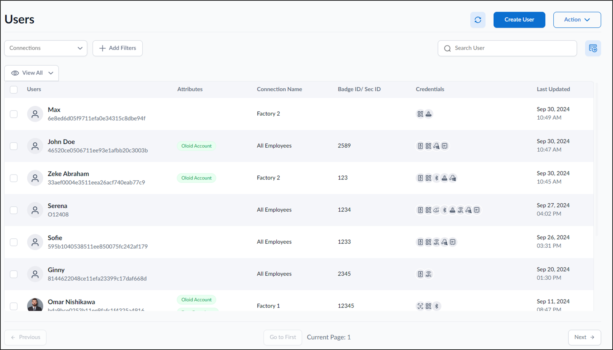
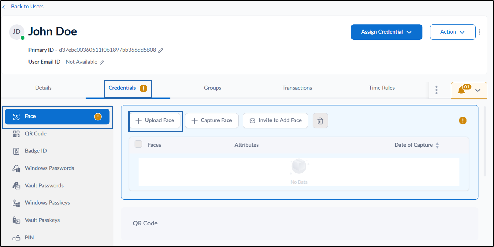
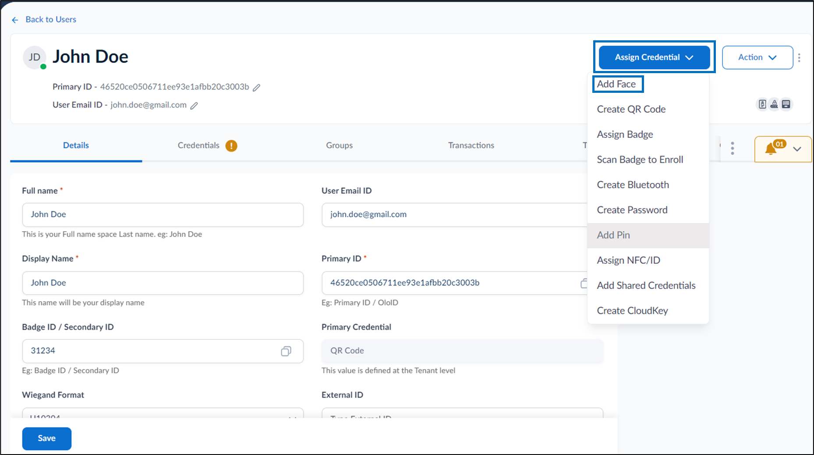
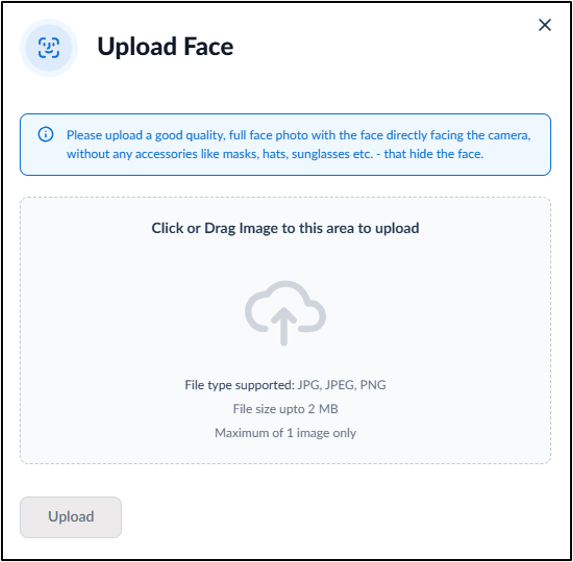
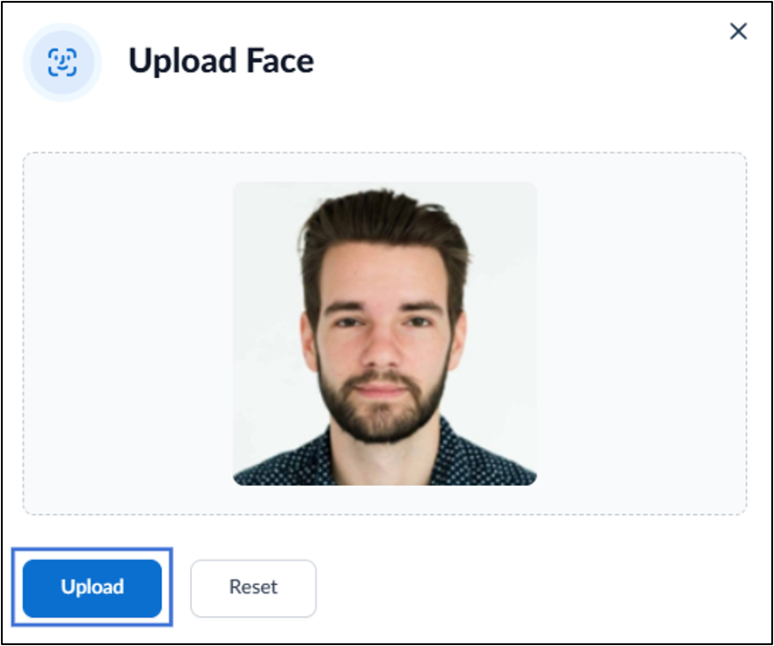
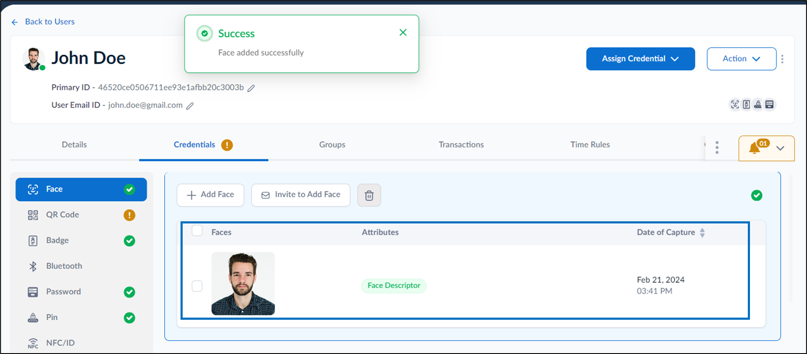

{/* Source: Intercom article 8181773 - https://oloid.help/en/articles/8181773-tenant-admin-portal-how-to-add-face-of-a-single-user */}
{/* Generated by intercom_to_mintlify.py - re-running overwrites this file. */}

## Introduction

This document provides instructions to add a face credential for a single user in the Tenant Admin Portal.

## Prerequisites

- You must have Tenant admin access to the Tenant Admin Portal.
- User must be created. For more, refer to[Tenant Admin Portal - How to Create User](/platform/tenant-admin-portal/tenant-admin-portal-how-to-create-user)

## Steps to Add Face of a Single User

1. Log in to the **Tenant Admin Portal**.
2. On the home page of the portal, click **Directory** on the left menu panel.

   

   The **Users** page is displayed.

   

3. Click Preferred **Username** to edit.

   

   The user details page is displayed.

   

4. Do one of the following:
   1. Go to **Credentials** > **Face** > +**Upload Face**.

      

   2. Go to **Assign Credential** > **Add Face**.

      

      The **Upload Face** pop-up box to upload image is displayed.
5. Click or Drag and Drop an image to be uploaded.

   <Note>
     **Note:** The supported file types are JPG, JPEG, and PNG. The maximum file size is 2 MB, and only one image can be uploaded at a time.
   </Note>

   

6. Click **Upload**.

   

   The user image is uploaded and listed on the **Face** tab.

   <Note>
     **Note:** You can add a maximum of five faces per user.
   </Note>

   
