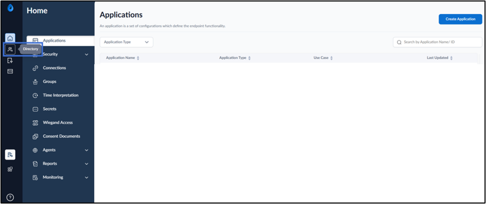
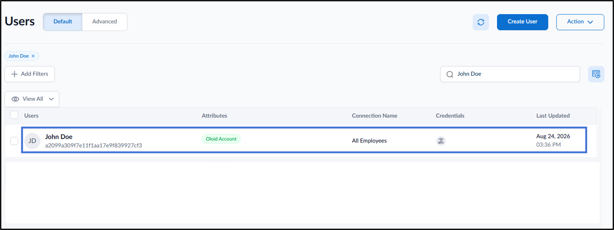
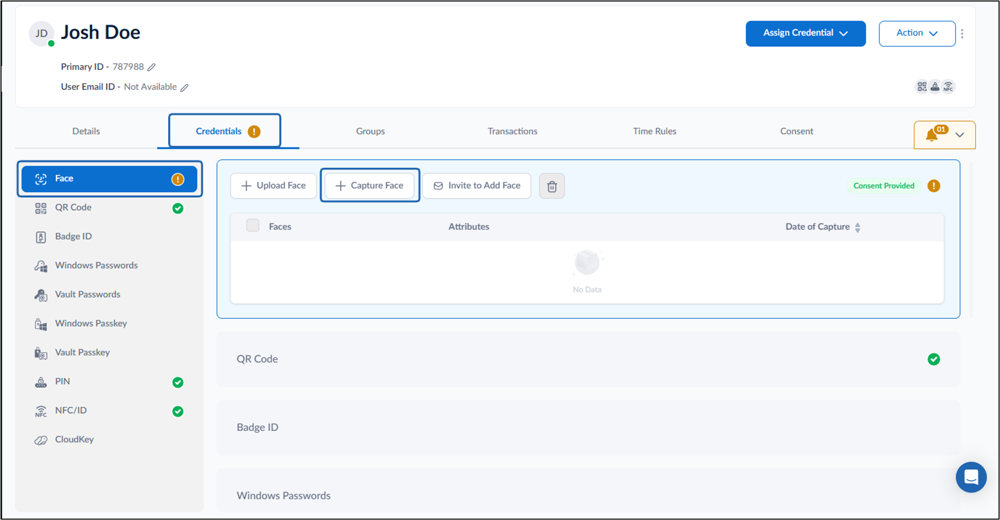
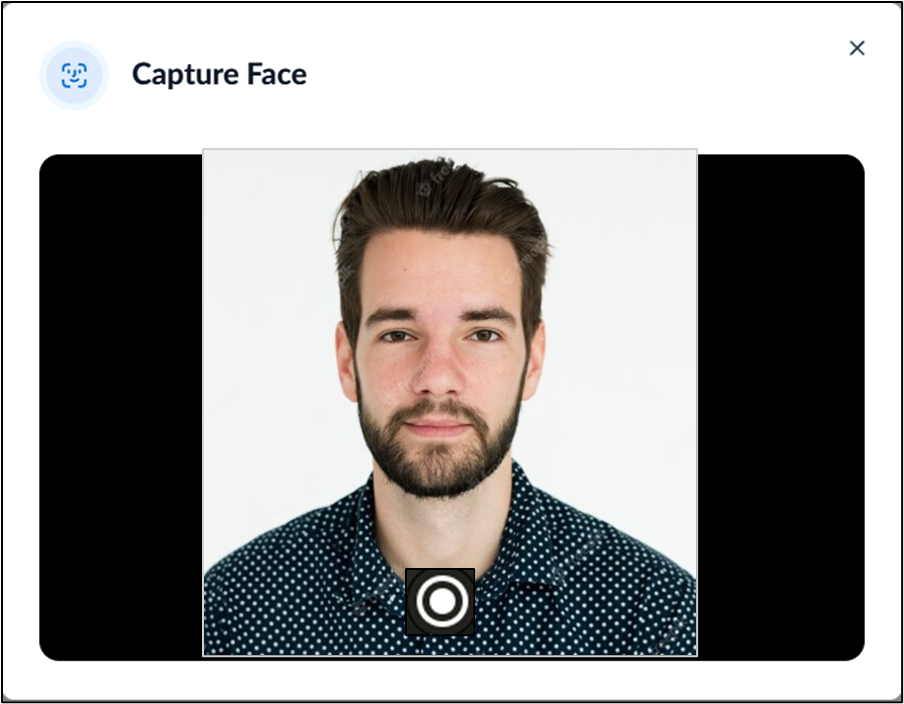
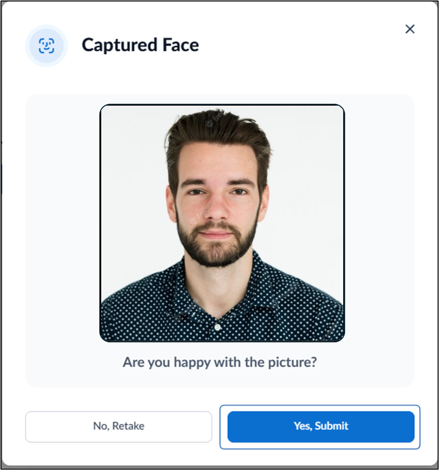
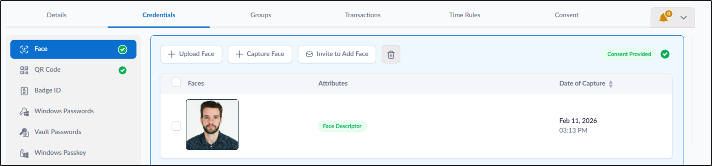

{/* Source: Intercom article 13700750 - https://oloid.help/en/articles/13700750-tenant-admin-portal-how-to-add-face-using-capture-face */}
{/* Generated by intercom_to_mintlify.py - re-running overwrites this file. */}

## Introduction

The **Capture Face** feature in the Tenant Admin Portal allows admins to enroll or add a user’s face by capturing it directly from the Tenant Admin Portal.

## Prerequisites

- You must have admin access to Tenant Admin Portal.
- User must be created. For more, refer to[Tenant Admin Portal - How to Create User](/platform/tenant-admin-portal/tenant-admin-portal-how-to-create-user)

## Steps to Capture Face

1. Log in to the **Tenant Admin Portal**.
2. On the home page of the portal, click **Directory**.

   

   The **Users** page is displayed.
3. Click user name to edit.

   

   The User details page is displayed.
4. Click **Credentials** tab > select **Face**.

   

5. Click **Capture Face.**
   The camera opens.

   <Note>
     **Note:** If the user’s consent status is **Denied**, the Capture Face button is disabled.
   </Note>

6. Position your face in front of the camera and click the **Capture** button to enroll your face.

   

   The Capture Face confirmation pop-up is displayed.
7. Do one of the following:
   1. Click **Yes- Submit** to submit the image.
      The face is submitted successfully and is displayed on the details screen.
   2. Click **No- Retake** to take the photo again.
      The camera turns on to retake the photo.

      <Note>
        **Note:** A maximum of five faces can be added.
      </Note>

      

      User Face is successfully added.

      

---

##### Related Video

[How to add face using Capture Face in the Tenant Admin Portal](/platform/tenant-admin-portal/videos/how-to-add-face-using-capture-face-in-the-tenant-admin-portal)
