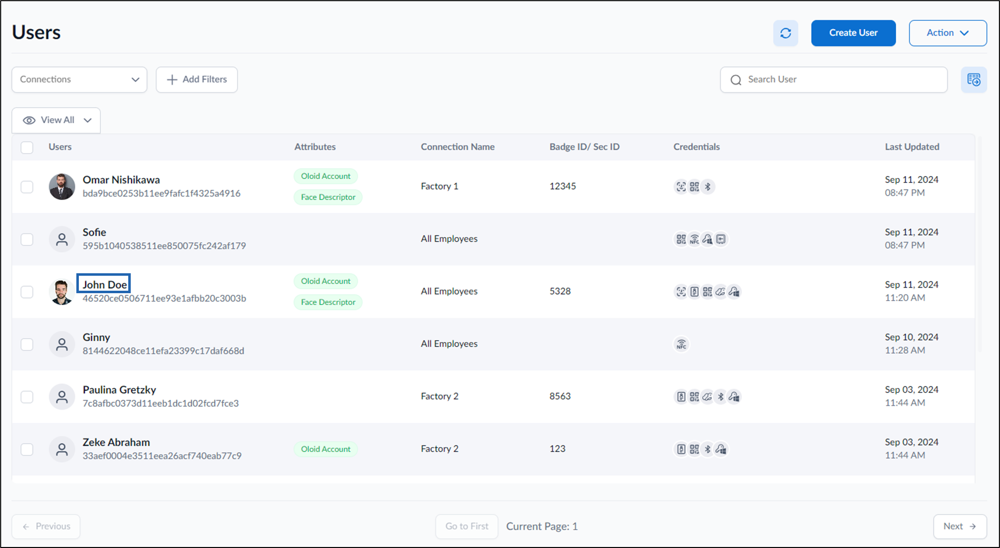
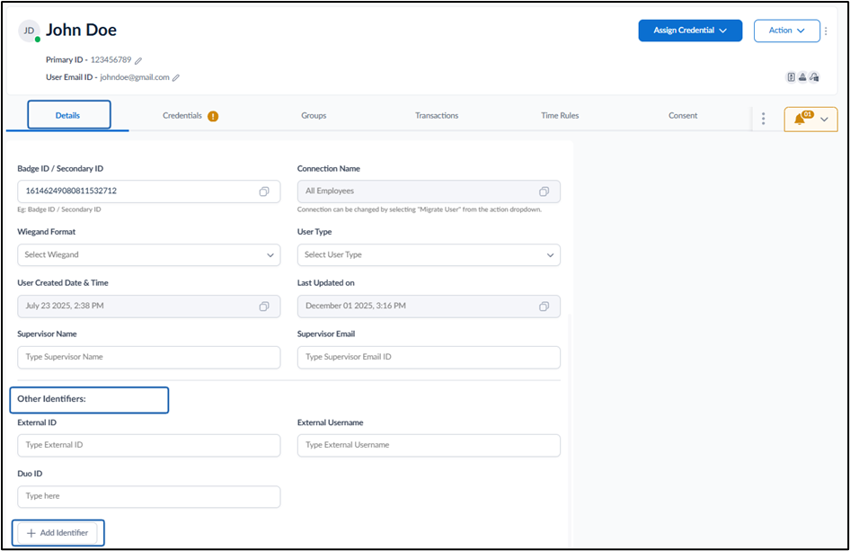
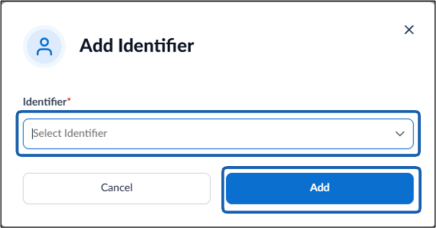
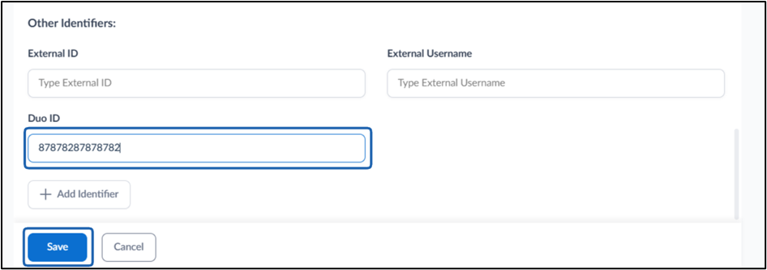
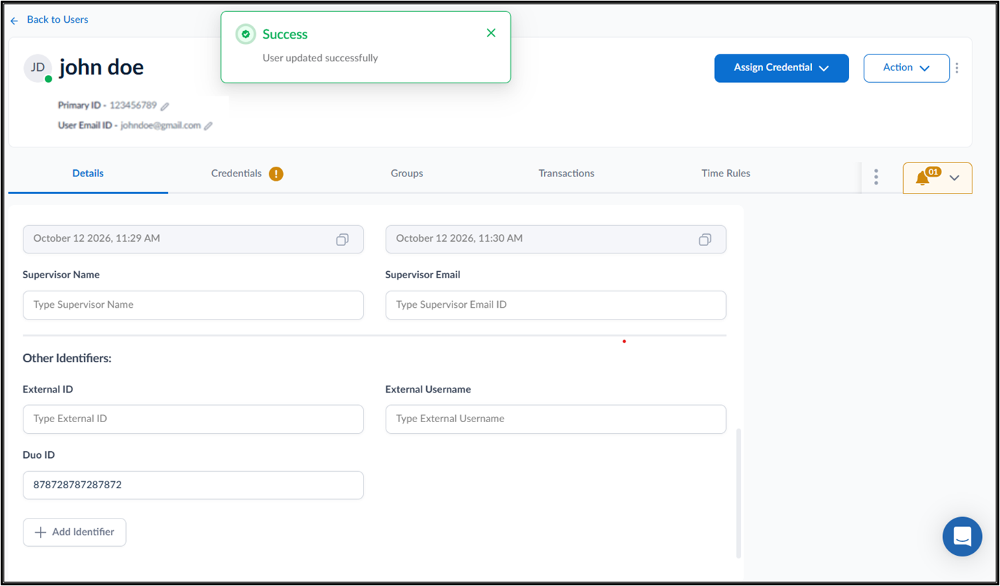

{/* Source: Intercom article 13009576 - https://oloid.help/en/articles/13009576-tenant-admin-portal-how-to-add-identifiers-in-the-tenant-admin-portal */}
{/* Generated by intercom_to_mintlify.py - re-running overwrites this file. */}

## Introduction

This document provides instructions to add other identifiers for a user in the Tenant Admin Portal. The Other identifiers link a user to their IDs in external identity providers, such as Duo, Okta or Ping.

## Prerequisites

- You must have admin access to the Tenant Admin Portal.
- The user must have identifier IDs created in the respective external systems.

## Steps to Add Identifiers

1. Log in to the **Tenant Admin Portal**.
2. On the home page of the portal, click **Directory** on the left menu panel.

   

   The **Users** page is displayed.
3. Click preferred **Username** to edit.

   

   The **user details** page is displayed.
4. In the **Other Identifiers** section, click **+ Add Identifier**.

   

   The **Add Identifier** pop-up box is displayed.
5. Select the identifier type from the drop-down list.

   <Note>
     **Note:** You can select **Duo ID**, **Okta ID**, or **Ping ID**.
   </Note>

6. Click **Add**.

   

   The field for the selected identifier type is added to the **Other Identifiers** section.
7. Enter the identifier ID.

   <Note>
     **Note:** The identifier ID is the user’s external ID. You can find it in the respective admin console, such as Ping ID, Okta ID or Duo ID.
   </Note>

8. Click **Save**.

   

The identifier is **added** successfully.

