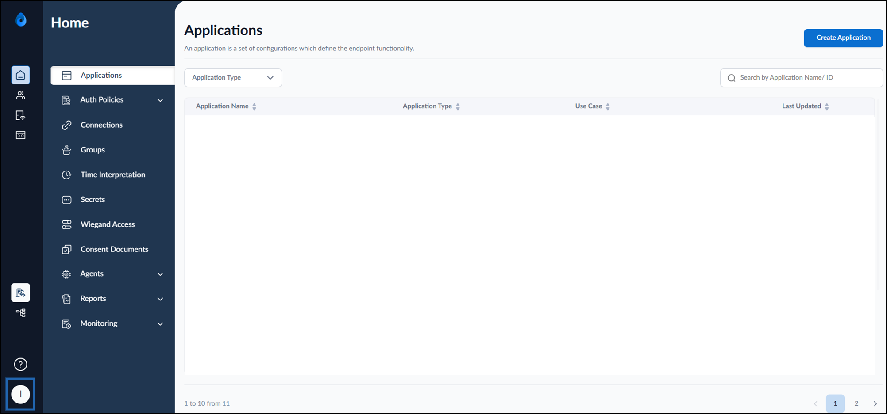
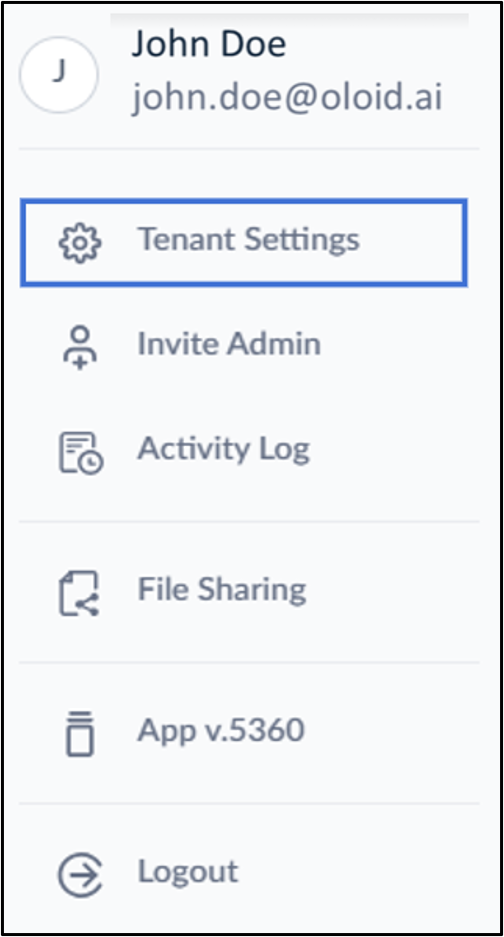
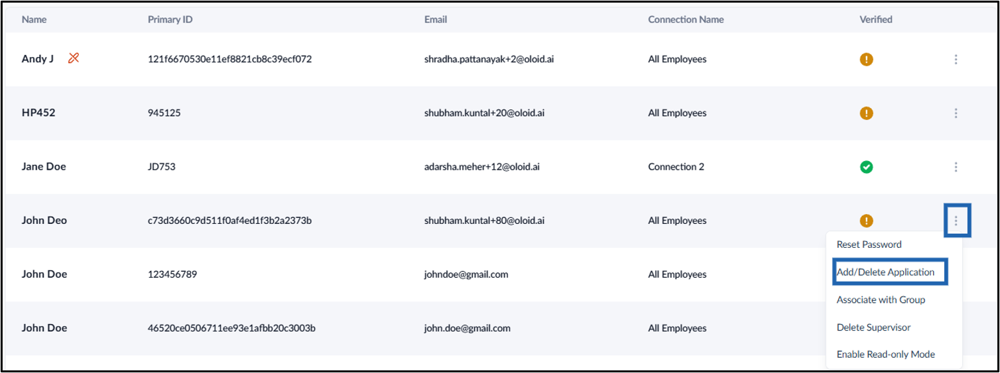
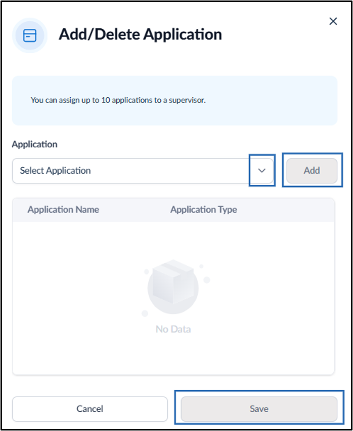
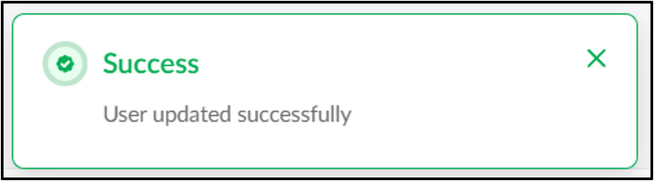
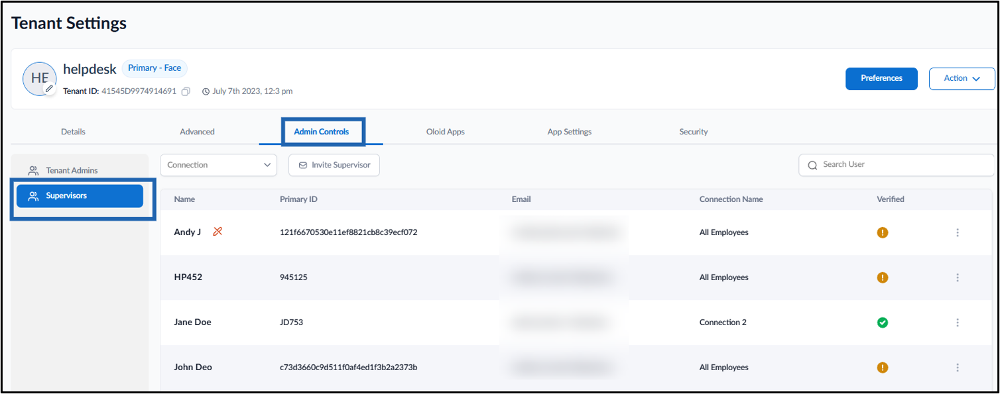
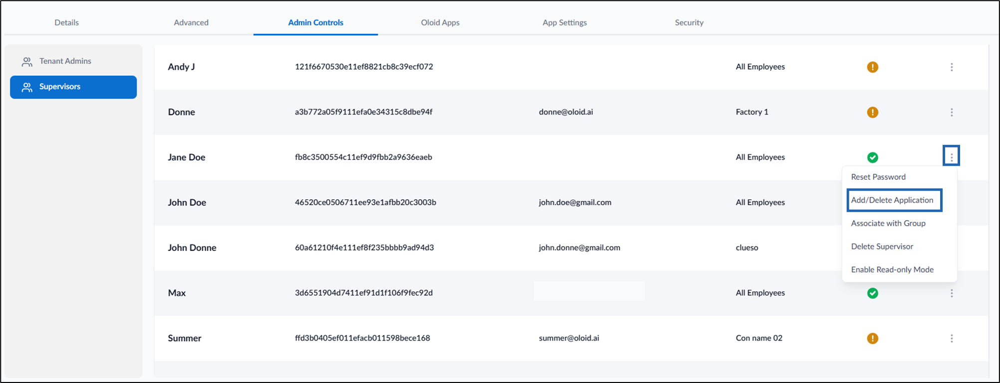
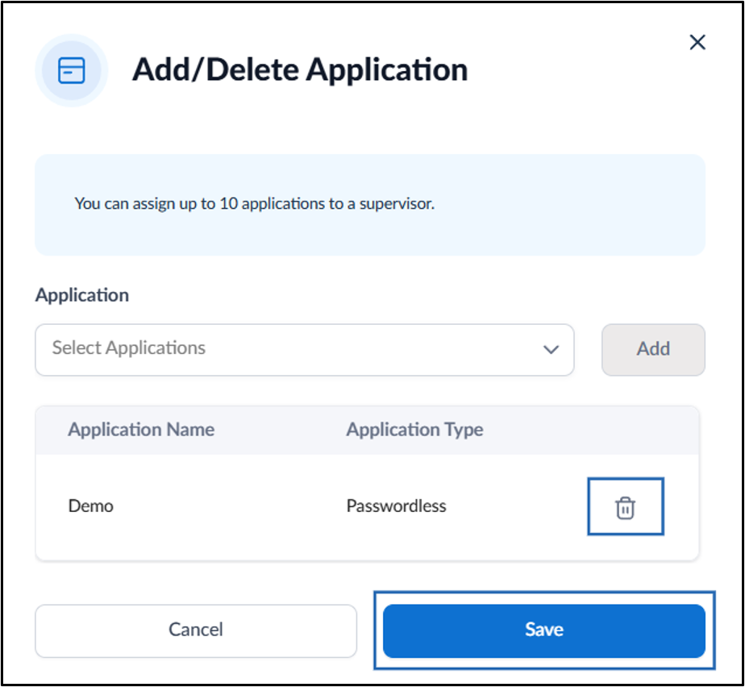

{/* Source: Intercom article 8442453 - https://oloid.help/en/articles/8442453-tenant-admin-portal-how-to-add-or-delete-applications-for-a-supervisor */}
{/* Generated by intercom_to_mintlify.py - re-running overwrites this file. */}

## Introduction

This document provides instructions to add or delete applications for a Supervisor in the Tenant Admin Portal.

## Prerequisite

You must have admin access to the Tenant Admin Portal.

## Steps to Assign Application to Supervisor

1. Log in to the **Tenant Admin Portal**.
2. On the homepage of the portal, click **user profile icon** on the bottom left.

   

   The **user profile menu** is displayed.
3. Click **Tenant Settings.**

   

   The **Tenant Settings** page is displayed.
4. Go to **Admin Controls** > **Supervisors**.

   

5. Go to **kebab menu** (three dots) of the selected Supervisor > click **Add/Delete Application.**

   

   The **Add/Delete Application** pop-up box is displayed.
6. Do the following:
   1. Select the Application from the drop-down.
   2. Click **Add**.
   3. Click **Save**

      

The application is assigned successfully to the Supervisor.

## Steps to Delete an Application

1. Log in to the **Tenant Admin Portal**.
2. On the homepage of the portal, click **user profile icon** on the bottom left.

   

   The **user profile menu** is displayed.
3. Click **Tenant Settings.**

   

   The **Tenant Settings** page is displayed.
4. Go to **Admin Controls** > **Supervisors**.

   

5. Go to **kebab menu** (three dots) of the selected Supervisor > click **Add/Delete Application.**

   

   The **Add/Delete Application** pop-up box is displayed.
6. Click Delete icon > click **Save**.

   

The application is removed from the Supervisor's access. The Supervisor can no longer view users associated with the application.

