{/* Source: Intercom article 8185203 - https://oloid.help/en/articles/8185203-tenant-admin-portal-how-to-add-users-in-bulk */}
{/* Generated by intercom_to_mintlify.py - re-running overwrites this file. */}

## Introduction

This document explains how to add users in bulk in the Tenant Admin Portal using a CSV or JSON file. It also includes the required formatting guidelines for preparing the upload file to ensure that user data is processed correctly and to prevent errors during import.

## Prerequisites

- You must have access to the Tenant Admin Portal.
- Use the provided CSV template and do not change the column headers.
- Do not use commas (,) in field values.
- Ensure all values are in the correct format (for example, a valid email address).
- Ensure the CSV file does not contain extra spaces or incorrect formatting.

## Steps to add users in bulk

1. Log in to the **Tenant Admin Portal**.
2. On the home page of the portal, click **Directory** on the left menu panel.

   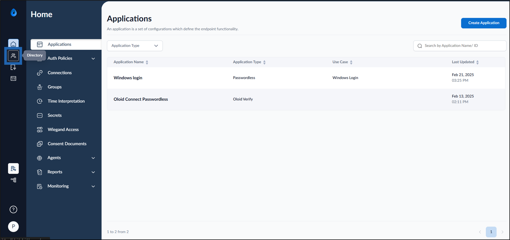

   The **Users** page is displayed.
3. On the Directory menu panel, click **Import** > **Import Users**.

   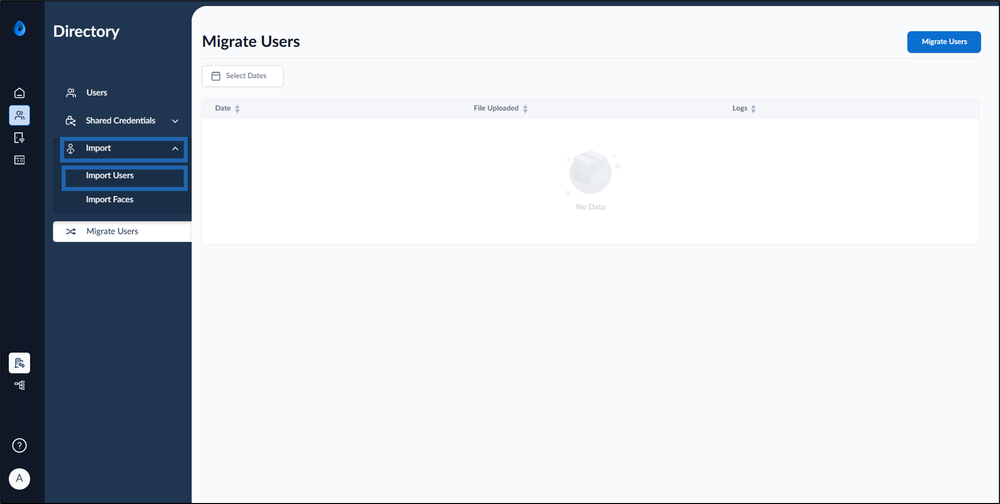

   The **Import Users** pageis displayed.

   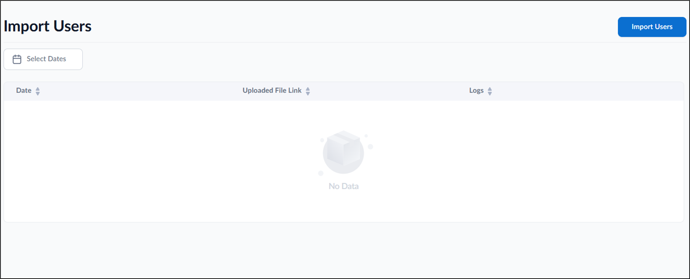

4. Click **Import Users** button on top-right corner of the page.

   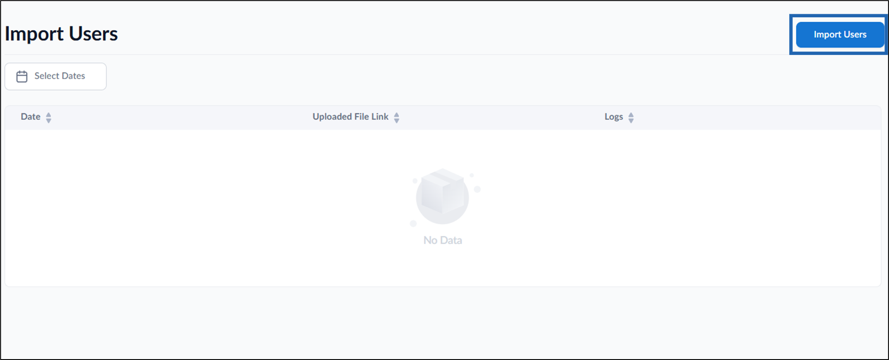

   The **Import User(s)** pop-up box is displayed.
5. In the **Upload** section, Do one of the following:
   1. Click **CSV** to download the CSV file template.
      Or
   2. Click **JSON** to download the JSON file template.

      <Note>
        **Note:** Please follow these guidelines when updating the downloaded template:
      </Note>

      - If **Primary ID** is blank, use `#&#123;&#123;oloid&#125;&#125;` to auto-generate it.
      - Add **custom fields** without the `#Oloid#_` prefix.
      - Keep only **PrimaryID**, **FullName**, and **Status**; you may delete other columns as required.
      - To **delete a user**, set the **Status** to `TERMINATED`.

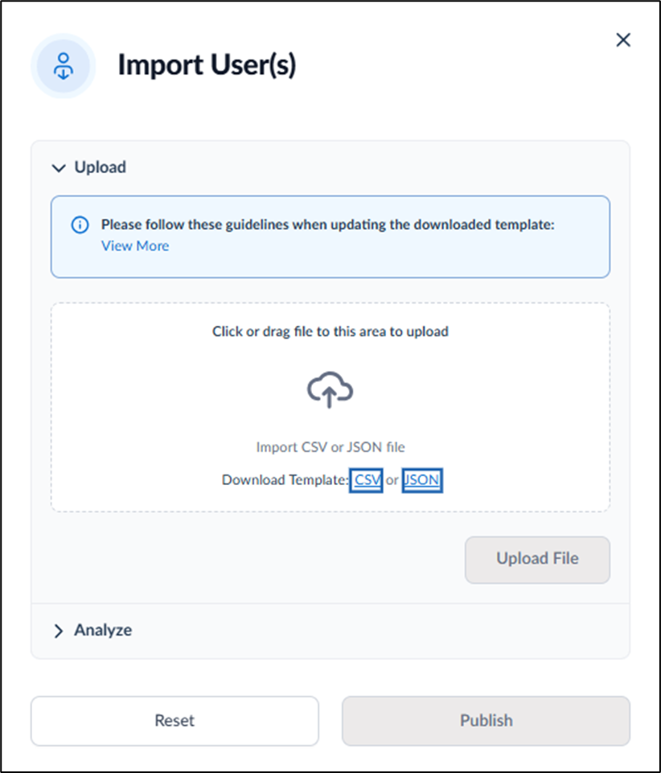

The CSV or JSON template file is downloaded to your system.

1. Prepare the CSV or JSON template file for upload.

   <Note>
     **Note:** To prepare the user upload template, refer [How to prepare User Upload Template](/platform/tenant-admin-portal/tenant-admin-portal-how-to-prepare-user-upload-template).
   </Note>

2. Drag and drop the file or click on the **Import CSV or JSON file** area to upload your prepared CSV or JSON file.

   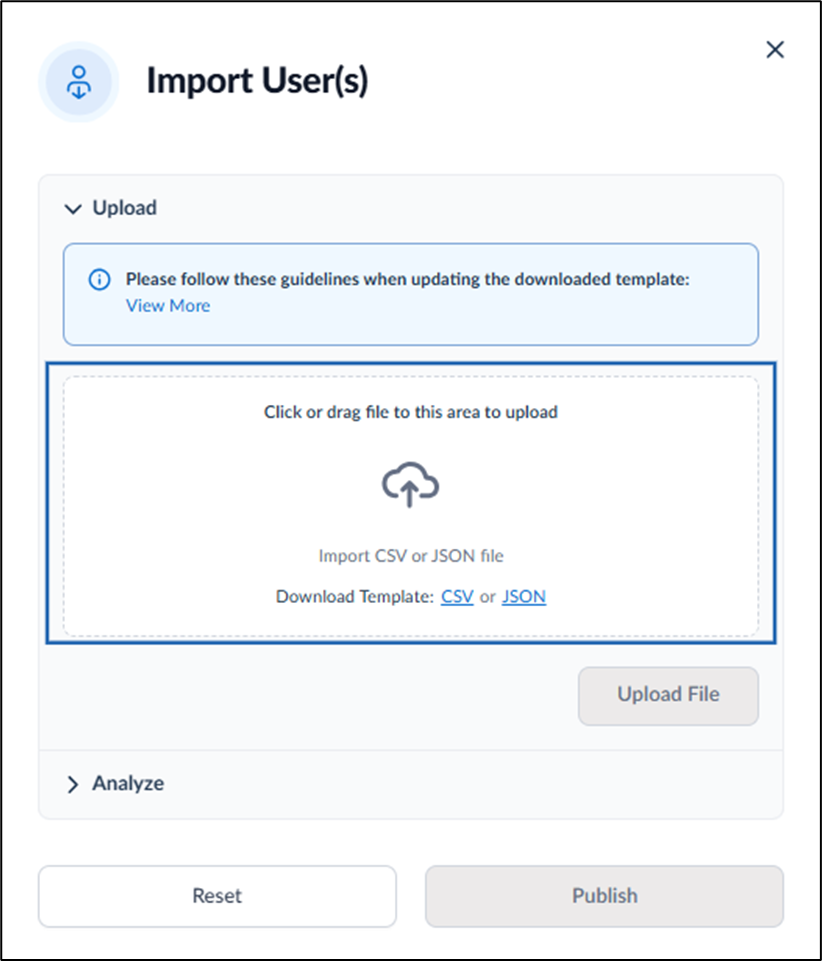

3. Select **Upload File**.

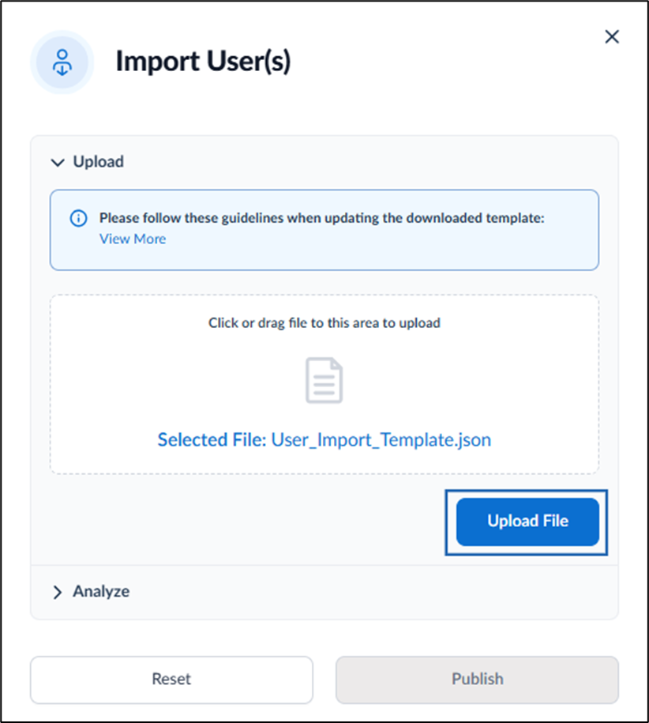

The file is uploaded in the **Upload** section.

1. In the **Analyze** section, do the following:
   1. Select preferred **Connection Name** from dropdown > click **Analyze**.

      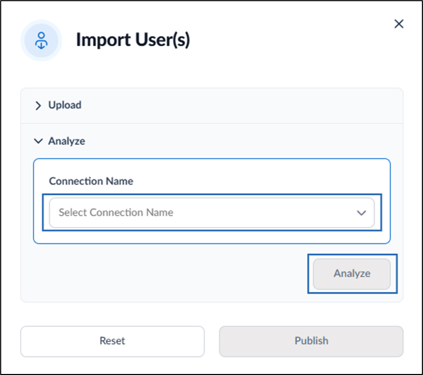

      You can review the imported data for any validation error.
   2. Click **Publish**.

      <Note>
        **Note:** You can click Reset to clear the current upload process.
      </Note>

      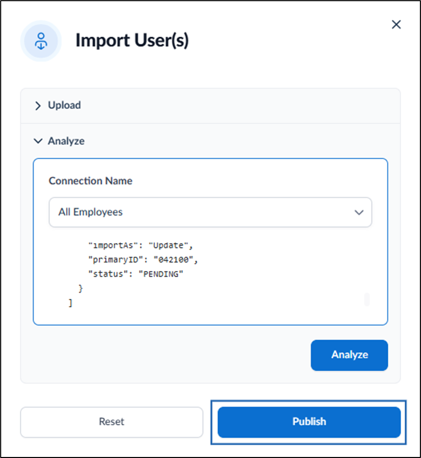

      The file is uploaded and listed on the Import Users page. The user and user details are added to the Tenant Admin Portal.

      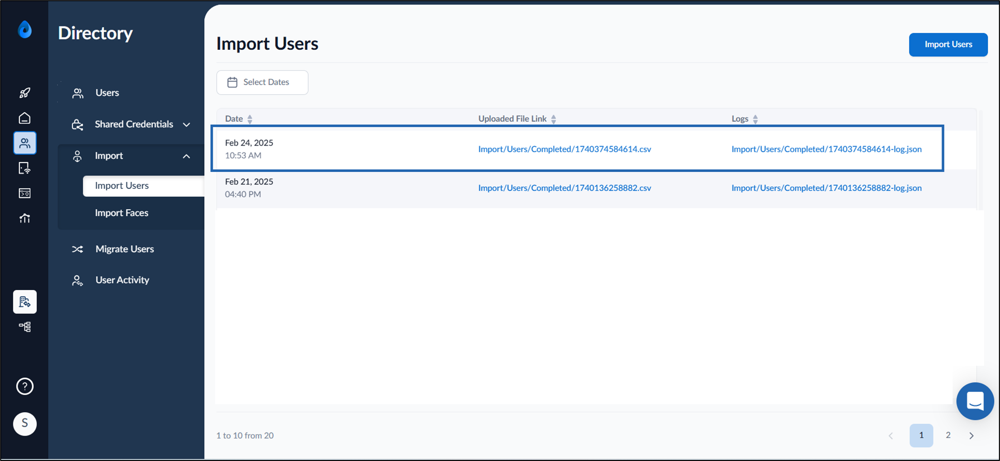

      <Note>
        **Note:** Check the logs to see the users’ status.
      </Note>

      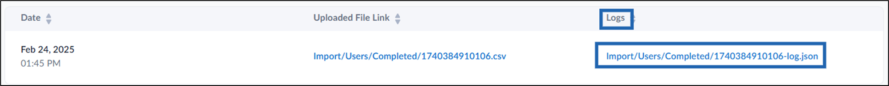

## Video Tutorial

Watch the video [How to add users in bulk in Tenant Admin Portal-Video Tutorial](/platform/tenant-admin-portal/videos/how-to-add-users-in-bulk-in-tenant-admin-portal-video-tutorial)
