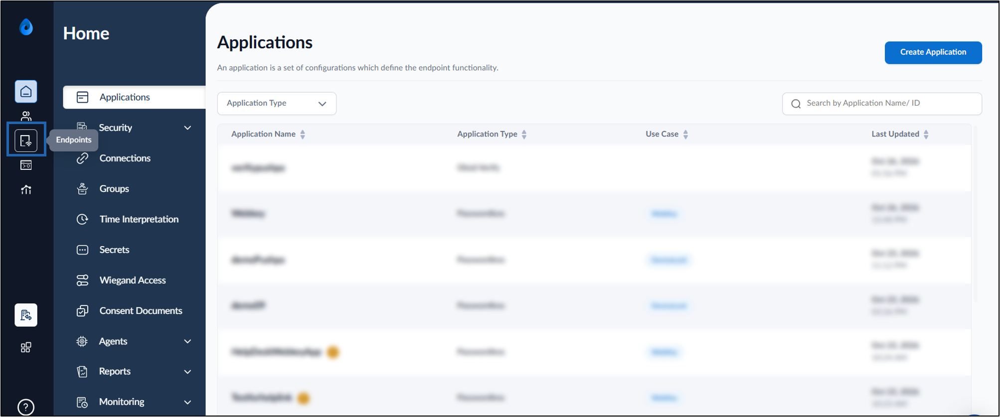
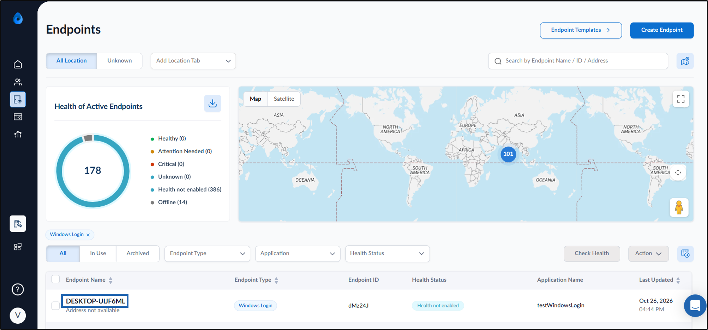
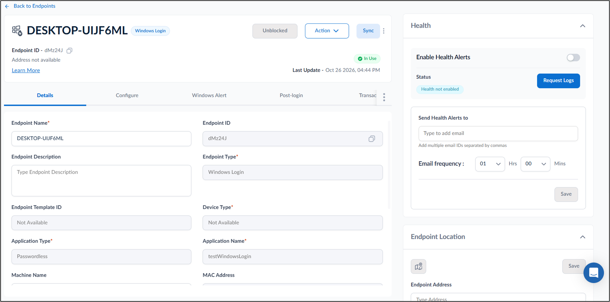
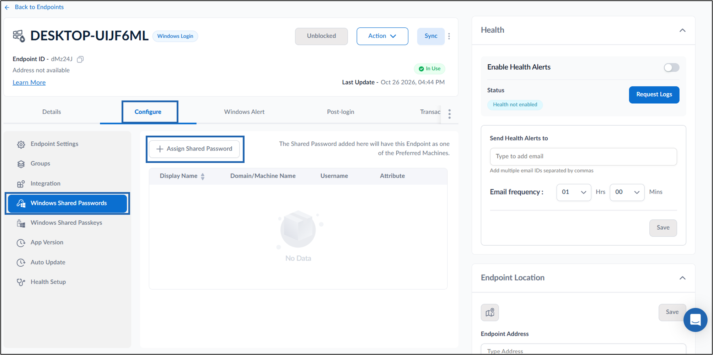
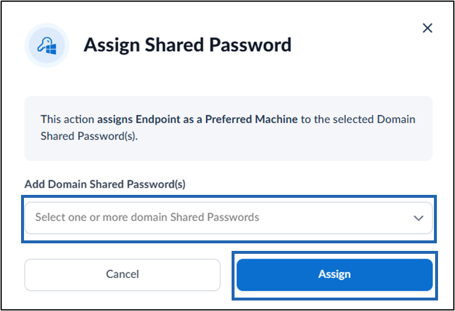
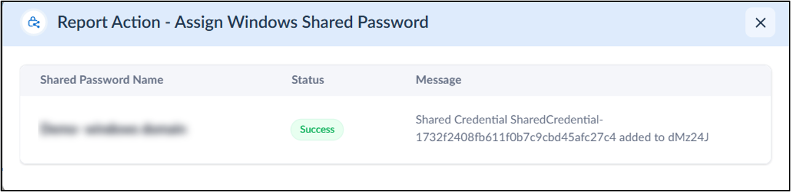
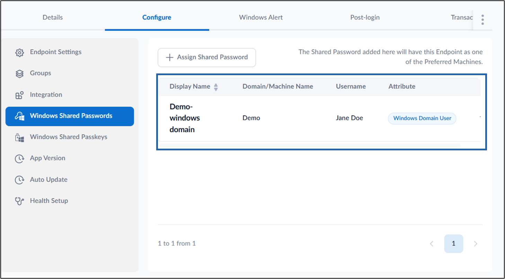

{/* Source: Intercom article 8717165 - https://oloid.help/en/articles/8717165-tenant-admin-portal-how-to-assign-shared-credentials-to-a-windows-login-endpoint */}
{/* Generated by intercom_to_mintlify.py - re-running overwrites this file. */}

## Introduction

This document provides instructions to assign shared credentials to an endpoint in the Tenant Admin Portal.

## Prerequisites

- You must have admin access to the Tenant Admin Portal.
- The endpoint must be paired with the Windows Login application.
- A shared credential with the credential type **Domain User** must be created. For more, refer to [How to create shared Password for Windows login application in the Tenant Admin Portal](/platform/tenant-admin-portal/how-to-create-shared-password-for-windows-login-application-in-the).

## Steps to Assign Shared Credential to an Endpoint

1. Log in to the **Tenant Admin Portal**.
2. On the Home page of the portal, click **Endpoints** on the left panel menu.

   

   The Endpoints page is displayed.
3. Click on an **Endpoint name** to edit from the listed endpoints.

   

   The Endpoint details page is displayed.

   

4. Go to **Configure** tab> **Windows Shared Passwords** > **+Assign Shared Password**.

   

   The **Assign Shared Password** pop-up box is displayed.
5. On the pop-up box, select **Domain Shared Password(s)** from the drop-down list.

Click **Assign**.

The **Report Action - Assign Windows Shared Password** pop-up is displayed with the assignment status.

The shared password is assigned to the endpoint successfully and listed on the **Windows Shared Passwords** page.

