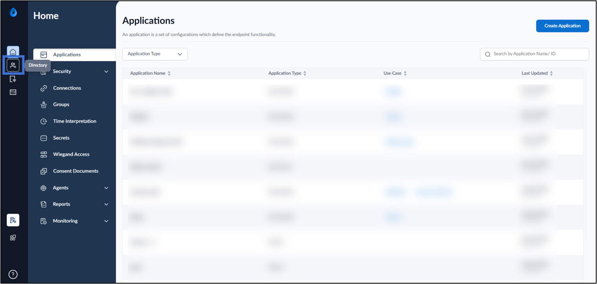
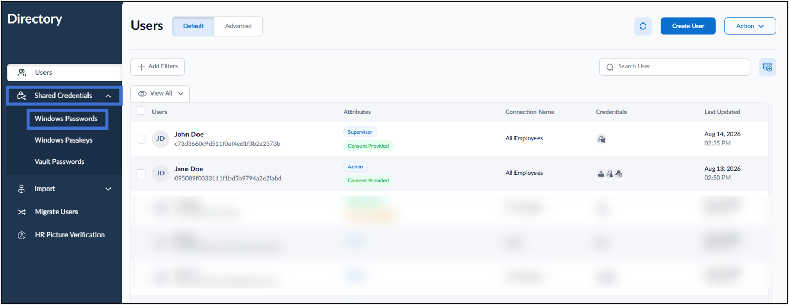
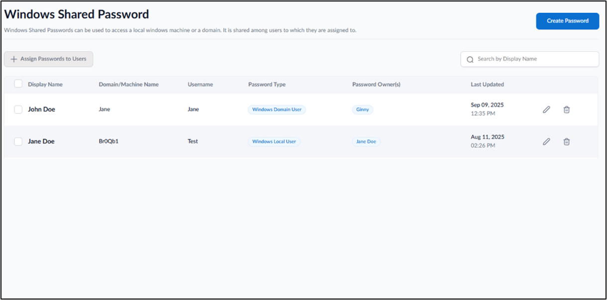
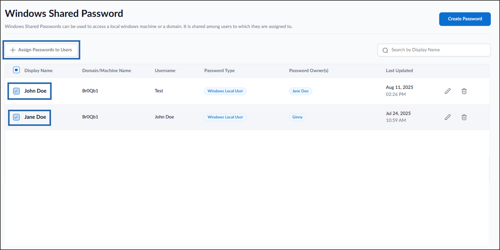
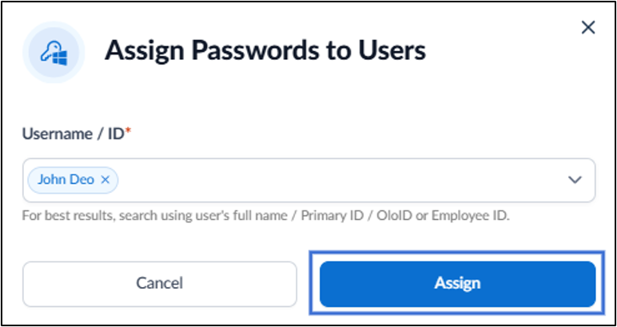
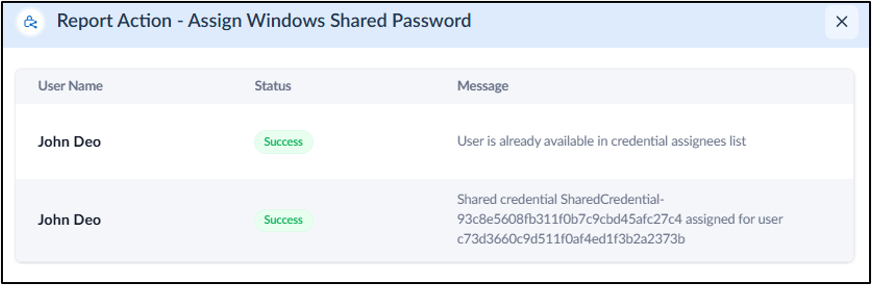

{/* Source: Intercom article 8504762 - https://oloid.help/en/articles/8504762-tenant-admin-portal-how-to-assign-shared-password-with-multiple-users */}
{/* Generated by intercom_to_mintlify.py - re-running overwrites this file. */}

## Introduction

Tenant Admin Portal allows the Admin to assign shared credentials, such as Windows Passwords, to multiple users at once. This feature helps streamline access management by enabling several users to securely share the same credential for specific applications or systems.

## Prerequisites

- The Shared password must be created. To create shared password refer [How to create shared Password for Windows login application in the Tenant Admin Portal](/platform/tenant-admin-portal/how-to-create-shared-password-for-windows-login-application-in-the).
- Users must be created. To create users refer [How to add Users in the Tenant Admin Portal](/platform/tenant-admin-portal/tenant-admin-portal-how-to-create-user).

## Steps to assign Shared Credential

1. Log in to the **Tenant Admin Portal**.
2. On the home page of the portal, click **Directory** on the left menu panel.

   

   The **Users** page is displayed.
3. Select **Shared Credentials >** select **Windows Password** on the left menu panel.

   

   The **Windows Shared Password** page is displayed.

   

4. Select password name(s) to assign users.
5. Select **+ Assign Credentials to Users**.

   

   The **Assign Users to Credentials** pop-up box is displayed.
6. On the pop-up box, enter user name(s) in the **Users** dropdown list.
7. Select **Assign**.

   

   The shared password is successfully assigned among the selected users.

   
