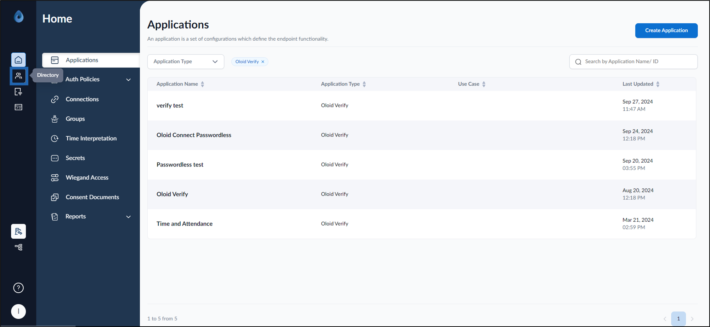
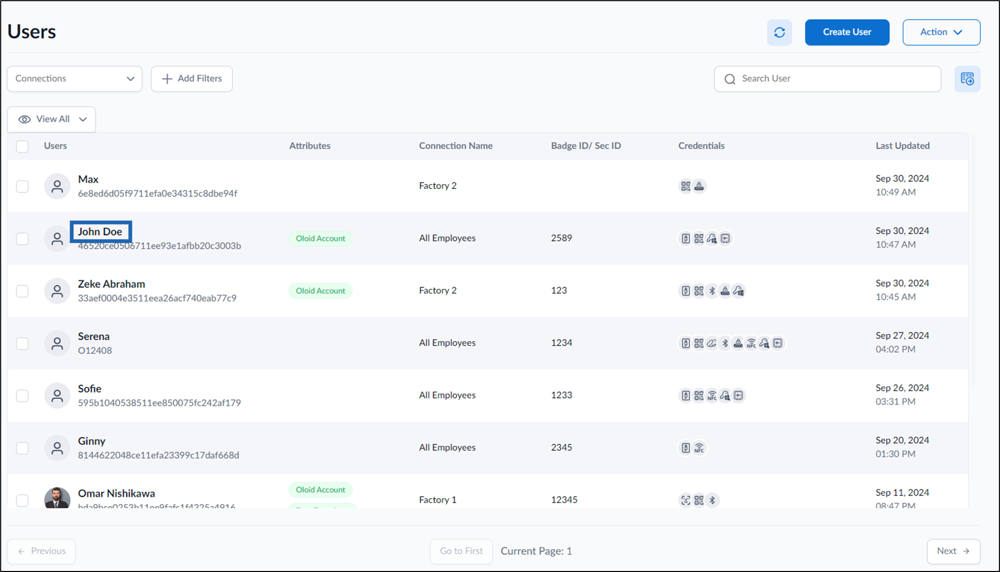
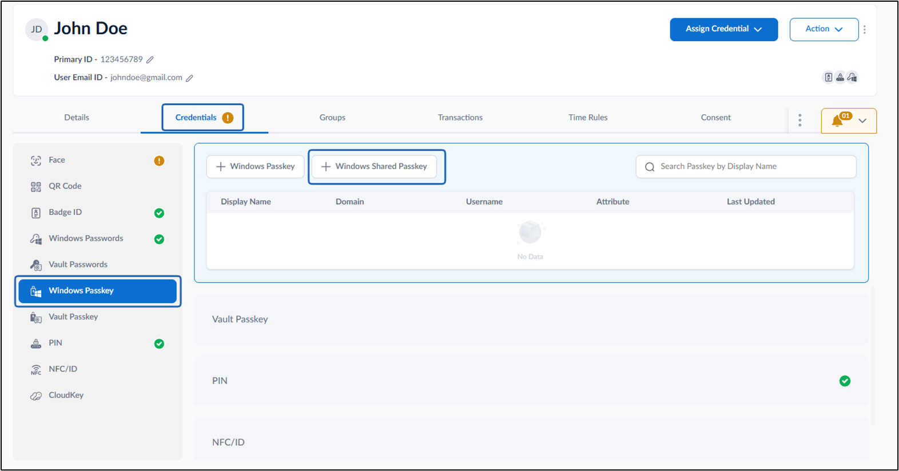
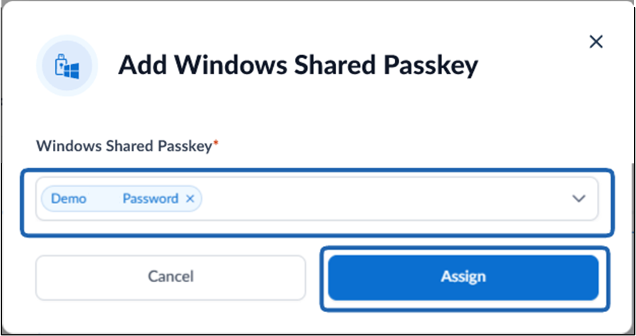
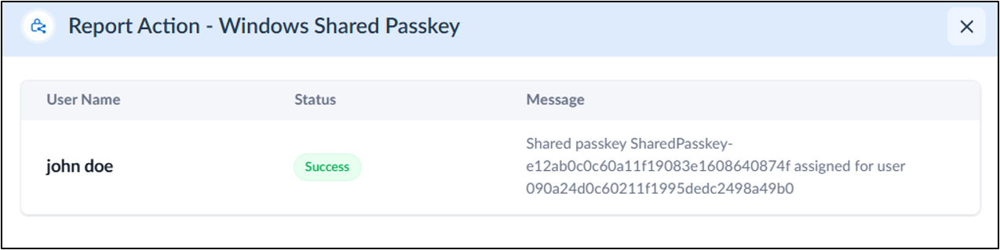
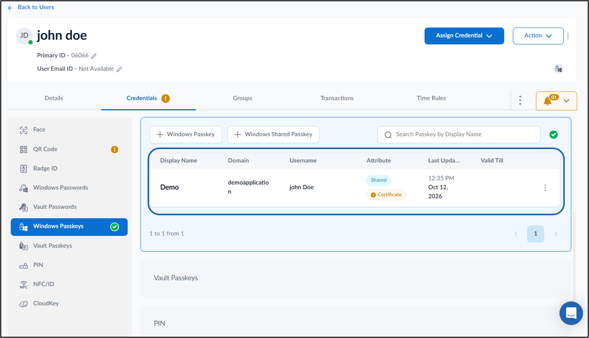

{/* Source: Intercom article 13305454 - https://oloid.help/en/articles/13305454-tenant-admin-portal-how-to-assign-windows-shared-passkey-for-a-user */}
{/* Generated by intercom_to_mintlify.py - re-running overwrites this file. */}

## Introduction

This document provides instructions to assign a Windows Shared Passkey to a user in the Tenant Admin Portal.

## Prerequisites

- You must have admin access to the Tenant Admin Portal.
- Windows Shared Passkey must be created. For more information, please refer [Oloid Platform - How to create Windows Passkey as credential for users in Tenant Admin Portal](/platform/tenant-admin-portal/tenant-admin-portal-how-to-create-windows-passkey-as-credential-for)

## Steps to Assign Windows Shared Passkey

1. Log in to the **Tenant Admin Portal**.
2. On the homepage, click **Directory** from the left menu panel.

   

   The **Users** page is displayed.
3. Click preferred **Username** to edit.

   

   The **User details** page is displayed.

   

4. Go to **Credential tab** > **Windows Passkey** > **+ Windows Shared Passkey**.

   

   Windows Shared Passkey pop-up is displayed.
5. Do the following:
   1. **Select** Windows Shared Passkey to Assign from the dropdown.
   2. Click **Assign**.

      

      Windows Shared Passkey successfully added message is displayed.

      <Note>
        **Note:** You can assign multiple Windows Shared Passkeys to a single user.
      </Note>

      

      Windows Shared Passkey is **assigned** to user.

      
