{/* Source: Intercom article 8305588 - https://oloid.help/en/articles/8305588-tenant-admin-portal-how-to-configure-a-connection-in-the-tenant-admin-portal */}
{/* Generated by intercom_to_mintlify.py - re-running overwrites this file. */}

## Introduction

The Tenant Admin Portal allows admin to configure connections for managing authentication, user onboarding, and security settings. You can customize parameters such as face quality checks, face match threshold, user termination limit, liveness check, etc. Proper configuration helps ensure secure and efficient identity management for your organization.

## Prerequisite

You must create a Connection in the Tenant Admin Portal. For more details, refer [How to create a Connection](/platform/tenant-admin-portal/tenant-admin-portal-how-to-create-connection).

## Steps to Configure a Connection

1. Log in to the **Tenant Admin Portal**.
2. On the home page of the portal, click **Connections** on the left menu panel.

   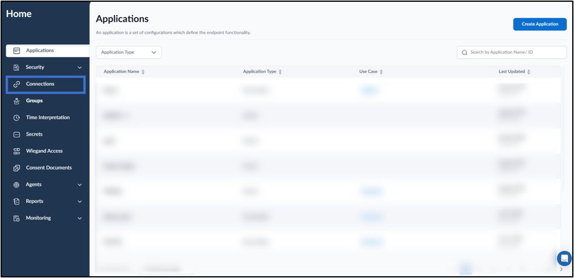

   The **Connections** page is displayed.
3. Click connection name to be configured from the listed connections.

   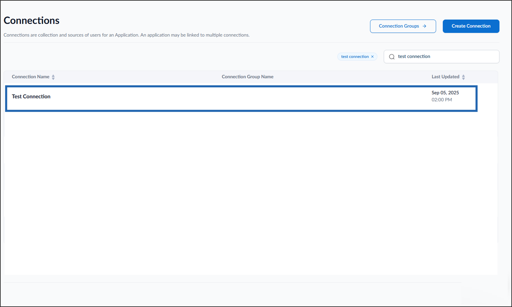

   The Connection Details page is displayed.

   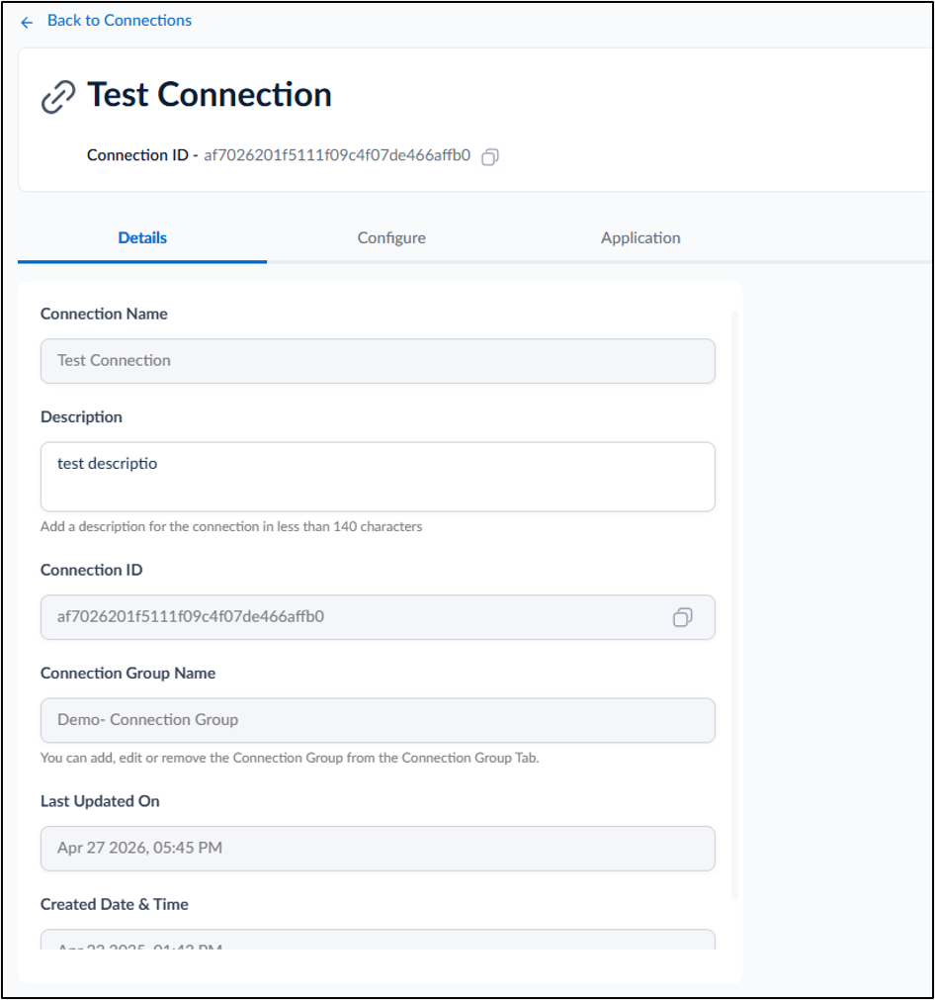

4. Configure the following tab:
   1. [Details Tab](#details-tab)
   2. [Configure Tab](#setup-configure-tab)
   3. [Application Tab](#application-tab)

### Details Tab

1. Go to **Details** tab, add a **Description** for the connection (optional).

   <Note>
     **Note:** The description should be **less than 140 characters**.
   </Note>

   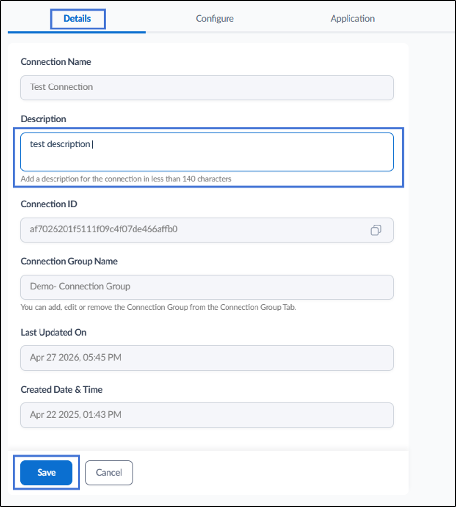

2. Click **Save**
   The description is added successfully.

   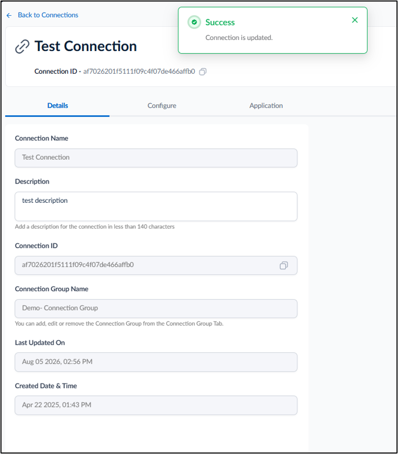

### Setup Configure Tab

Go to **Configure** tab and do the following:

- [Configure Settings](#configure-settings)
- [Configure Face Match and Liveness](#configure-face-match-and-liveness)
- [Configure Consent](#configure-consent)

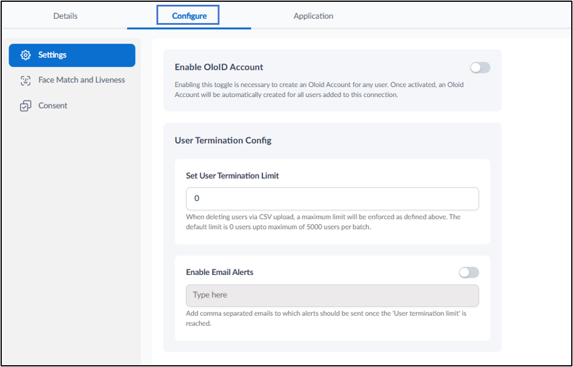

#### Configure Settings

1. On **Settings** section, do the following:
   1. Turn on **Enable OloID Account** toggle.

      <Note>
        **Note:** Enabling this toggle automatically creates Oloid Accounts for users added to this connection. Oloid Accounts are not generated for users without an email ID or phone number.
      </Note>

   2. Set a value in **Set User Termination Limit** field.

      <Note>
        **Note:** CSV user deletion is limited to the configured value. The default is 0 users and the maximum is 5000 users per batch.
      </Note>

   3. Turn on **Enable Email Alerts** toggle and enter the required email addresses to receive notifications.

      <Note>
        **Note:** Alerts are sent when the configured **User Termination Limit** is reached.
      </Note>

   4. Click **Save**.

      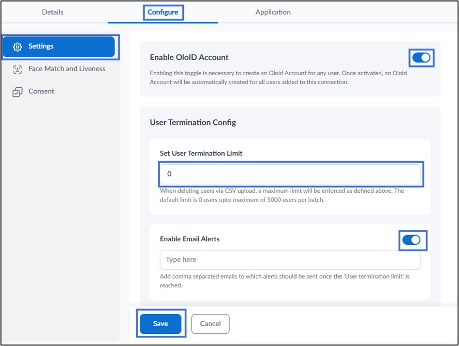

      The Settings menu is configured.

#### Configure Face Match and Liveness

1. On Face Match and Liveness section, do the following
   1. Turn on **Enable Face Quality Check** toggle.

      <Note>
        **Note:** Enabling this toggle ensures a face quality check is performed on the captured image before it is added as a user's face credential.
      </Note>

      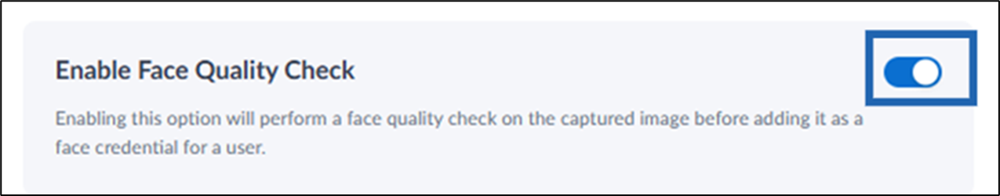

   2. Turn on **Face Match Threshold** toggle and adjust the slider or enter a value directly into the input box to set the face match threshold value. **(Oloid internal use)**

      <Note>
        **Note:** Enabling this toggle ensures that a face recognition transaction will only be successful if the captured image meets the minimum face match threshold.
      </Note>

      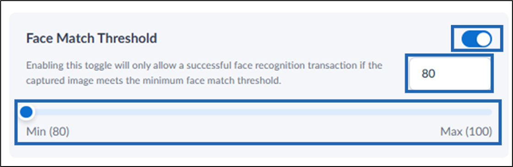

   3. Turn on **Enable Software Liveness Check for Adding new face** toggle.
      1. Set the **Minimum Liveness Probability** value, either drag the slider or enter a value directly into the input box.

         <Note>
           **Note:** This value defines the minimum probability threshold for considering a face as "live."
         </Note>

      2. Set the **Minimum Liveness Quality** value, either drag the slider or enter a value directly into the input box.

         <Note>
           **Note:** This value defines the minimum quality threshold for the captured face liveness detection.
         </Note>

      3. Click **Save**.

         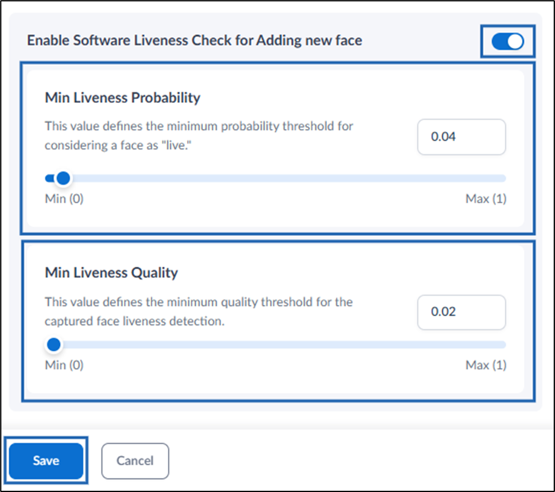

         The Configure Face Match and Liveness menu is configured.

#### Configure Consent

1. On Consent section, do the following:
   1. Click **Enable Consent**.

      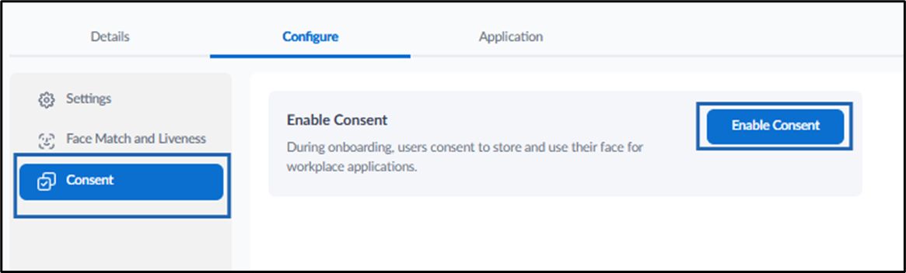

      Enable Consent popup-box is displayed.
   2. Select the applicable **Consent Template** from the dropdown list.

      <Note>
        **Note:** To create a consent template, refer [How to create a Consent Template](/platform/tenant-admin-portal/tenant-admin-portal-how-to-create-and-configure-consent-template).
      </Note>

   3. Click **Next**.

      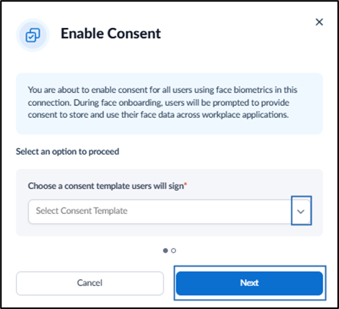

      Applicable User Set screen is displayed.
   4. Select **All Users** > Click **Next**.

      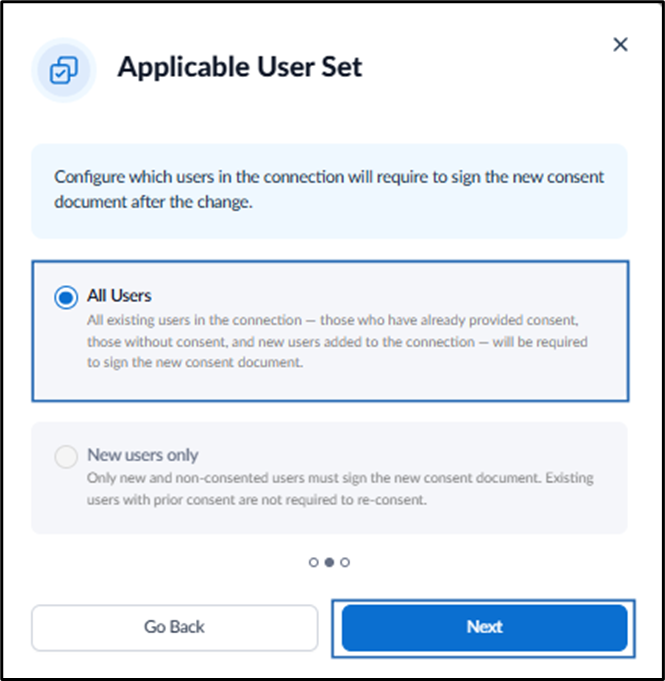

      Authentication validity pop-up box is displayed.
   5. Do one of the following:
      1. **No end-date:** Select this option to allow authentication without a defined end date. Face images and biometric data for all users in the connection whether they have already provided consent or have not yet provided will remain valid, and users will continue to authenticate using face biometrics after signing the re-consent document.
         OR
      2. **Permit authentication until the Set Date:** Select this option and enter the preferred date.

         <Note>
           **Note:** If consent is not provided by the selected date, the face data and associated biometric information will be deleted.
         </Note>

   6. Click **Confirm**.

      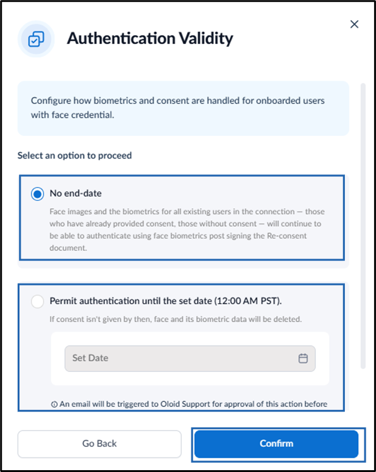

   7. **Consent Updated** popup box is displayed.
   8. Click **Okay**.

      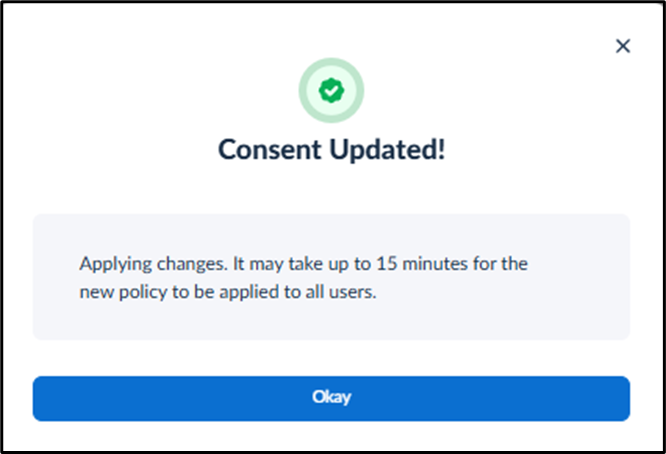

Consent is enabled and the connection is successfully configured.

#### Application Tab

   Go to **Application** tab to see the application(s) associated with the connection.

   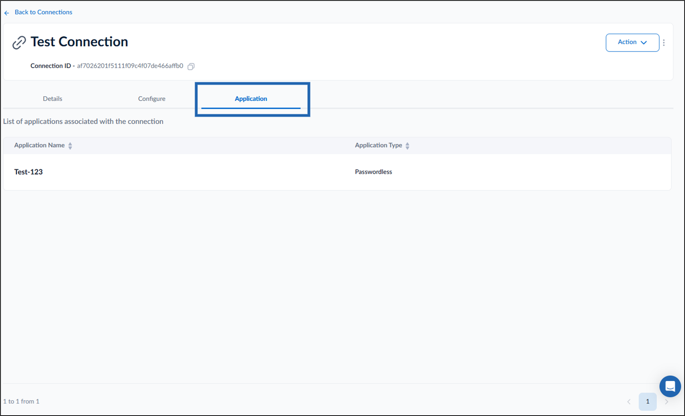

   **Related Documents**
   [How to create a consent template](/platform/tenant-admin-portal/tenant-admin-portal-how-to-create-and-configure-consent-template)
   [How to configure consent template](/platform/tenant-admin-portal/how-to-configure-consent-template-for-user-face-onboarding-in-the)
