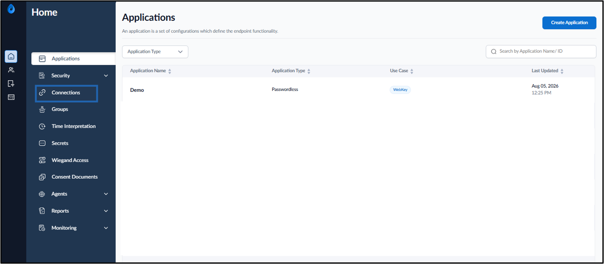
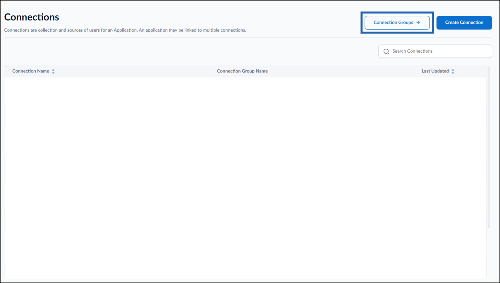
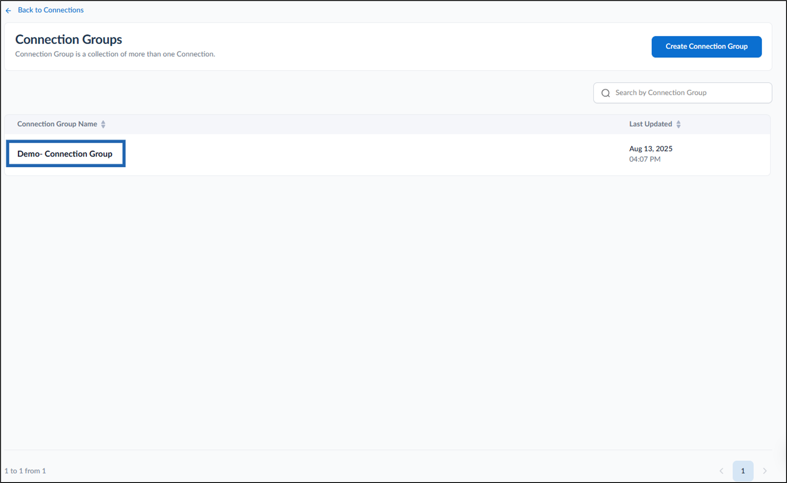
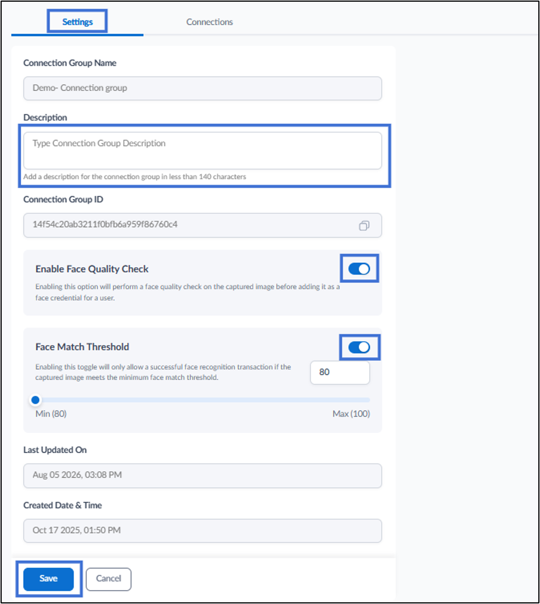
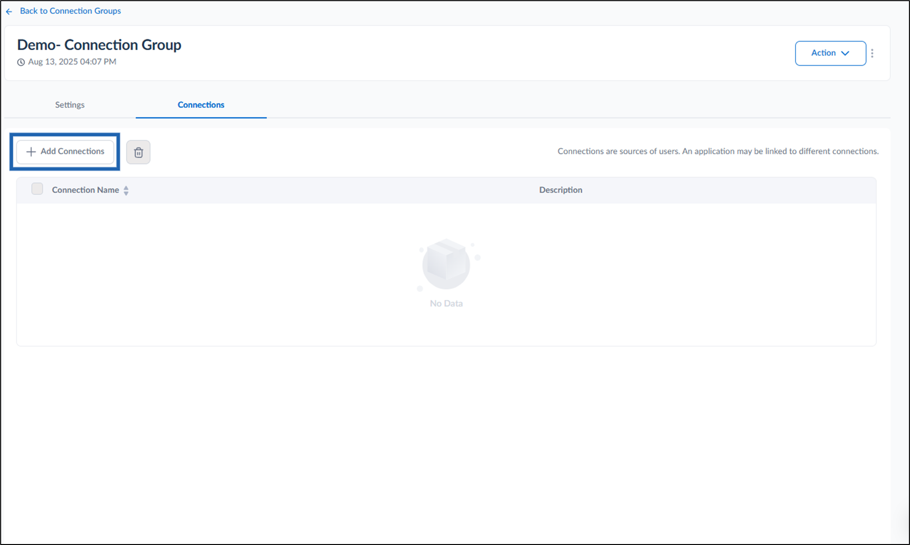
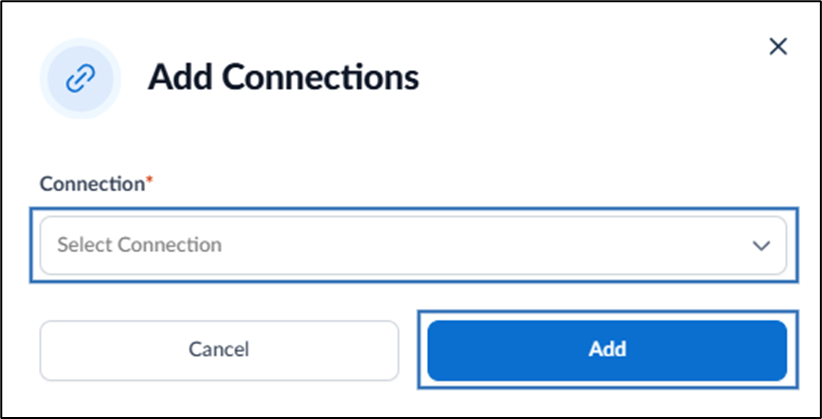
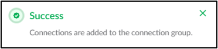

{/* Source: Intercom article 8947717 - https://oloid.help/en/articles/8947717-tenant-admin-portal-how-to-configure-connection-groups */}
{/* Generated by intercom_to_mintlify.py - re-running overwrites this file. */}

## Introduction

Connection Groups in the Tenant Admin Portal allow admin to group multiple connections together. This makes it easier to apply the same settings across connections and manage them more easily.

<Note>
  **Note:** A connection can belong to only one connection group. If you select a connection that is already assigned to another connection group, the connection can't be added.
</Note>

## Prerequisites

- You must create Connections. To create Connections, refer [How to create Connections in the Tenant Admin Portal](/platform/tenant-admin-portal/tenant-admin-portal-how-to-create-connection).
- You must create Connection Groups. To create Connection groups, refer [How to create Connection Groups in the Tenant Admin Portal](/platform/tenant-admin-portal/how-to-create-connection-groups-in-the-tenant-admin-portal).

## Steps to Configure connection groups

1. Log in to the **Tenant Admin Portal**.
2. On the home page of the portal, click **Connections** on the left menu panel.

   

   The **Connections** page is displayed.
3. Click **Connection Groups** on the top right corner of the page.

   

   The **Connection Groups** page is displayed.
4. Select a **Connection Group** name to be configured from the list.

   

   The **connection group** detail page is displayed.
5. Do the following:

   <Note>
     **Note:** These are one-time settings and all the default settings are recommended.
   </Note>

   1. **Settings** tab:
      1. Add **Description** for the connection (optional).

         <Note>
           **Note:** The description for the connection group is limited to 140 characters.
         </Note>

      2. **Enable Face Quality Check** toggle to perform a face quality check on the captured image before it is added as a user's face credential. **(Oloid internal use)**

         <Note>
           **Note:** By default, the **Enable Face Quality Check** toggle is turned on.
         </Note>

      3. Turn on **Face Match Threshold** toggle and adjust the slider or enter a value directly into the input box to set the face match threshold value. **(Oloid internal use)**

         <Note>
           **Note:** Enabling this toggle ensures that a face recognition transaction will only be successful if the captured image meets the minimum face match threshold.
         </Note>

      4. Click **Save**.

         

   2. **Connections** tab:
      1. Select **Add Connections** to add connections to the connection group.

         

         The **Add Connection** pop-up box is displayed.
      2. On the **Add Connections** pop-up box, do the following:
         1. Select connection name(s) from the **Connection** dropdown list.
         2. Click **Add**.

            

            The connection group is successfully configured.

            
