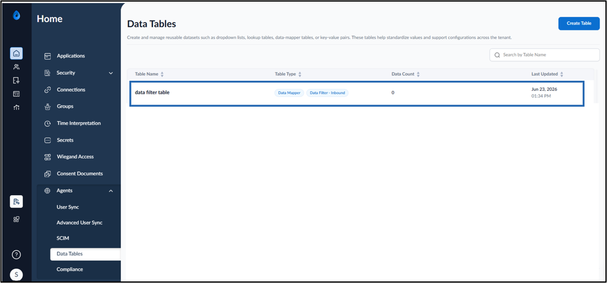
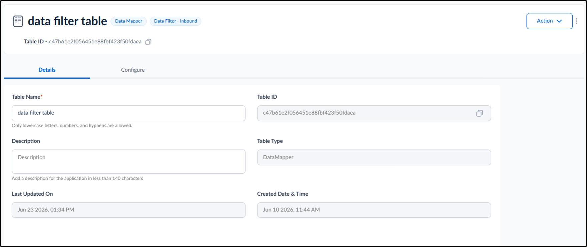
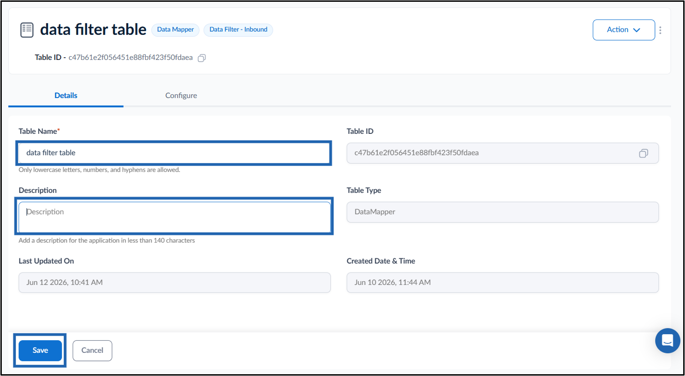
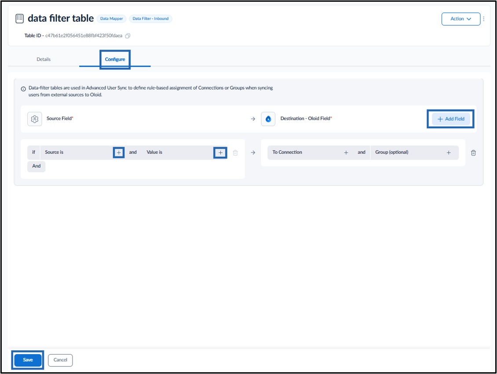

{/* Source: Intercom article 15441985 - https://oloid.help/en/articles/15441985-tenant-admin-portal-how-to-configure-data-mapper-table-for-data-filter-inbound */}
{/* Generated by intercom_to_mintlify.py - re-running overwrites this file. */}

## Introduction

This document describes how to configure a Data Filter Table in the Tenant Admin Portal. A Data Filter Table allows admin to define rule-based conditions that evaluate source data and automatically assign users to specific Connections and Groups during Advanced User Sync.

## Prerequisites

- You must have admin access to the Tenant Admin Portal.
- Data Mapper Table for Data Filter must be created. To create refer, [Tenant Admin Portal - How to Create Data Mapper Table for Data Filter Inbound](/platform/tenant-admin-portal/tenant-admin-portal-how-to-create-data-mapper-table-for-data-filter)

## Steps to Configure Data Filter Table

1. Log in to **Tenant Admin Portal**.
2. Go to **Agents** tab > click **Data Tables**.

   

   The Data Tables page is displayed.
3. Click preferred data filter table.

   

   The data filter table details page is displayed.
4. Do the following:
   1. [Configure Details Tab](#configure-details-tab)
   2. [Setup Configure Tab](#setup-configure-tab)

      

      After saving your changes, the Data Mapper Table for **Data Filter Inbound** is configured successfully.

### Configure Details Tab

This tab is used to view and edit basic information about the data mapper table.

Do the following:

1. Update the **Table Name** (Optional).
2. Enter **Description** (Optional).
3. Click **Save**.

   

   The details tab is configured successfully.

### Setup Configure Tab

The Configure tab is used to map source fields to Oloid fields and define rule-based assignments for connections or groups during Advanced User Sync.

Do the following:

1. Click **+Add Field**.
2. Under the source field section, configure the following:
   1. **Source is:** Select or enter the source attribute to evaluate. To add a source attribute, click the **+** icon, enter the required attribute name, and then press **Enter**.
   2. **Value is**: Select or enter the value to match. To add a value, click the **+** icon, enter the required value, and then press **Enter**.
      **Note:**
      1. For the **Value is** field, either select **Any Value** to match all values, or select **Custom** and enter the specific value to be matched.
      2. Click **And** button to add multiple source fields.
3. Under the destination section, configure the following:
   1. **To Connection:** Select the connection to assign when the rule condition is met.
   2. **Group (optional):** Select a group to assign within the selected connection, if required.

      <Note>
        **Note:** Use the **+** icon next to a field to add additional conditions or values to the rule.
      </Note>

4. Click **Save.**

   

   The configure tab is setup successfully.
