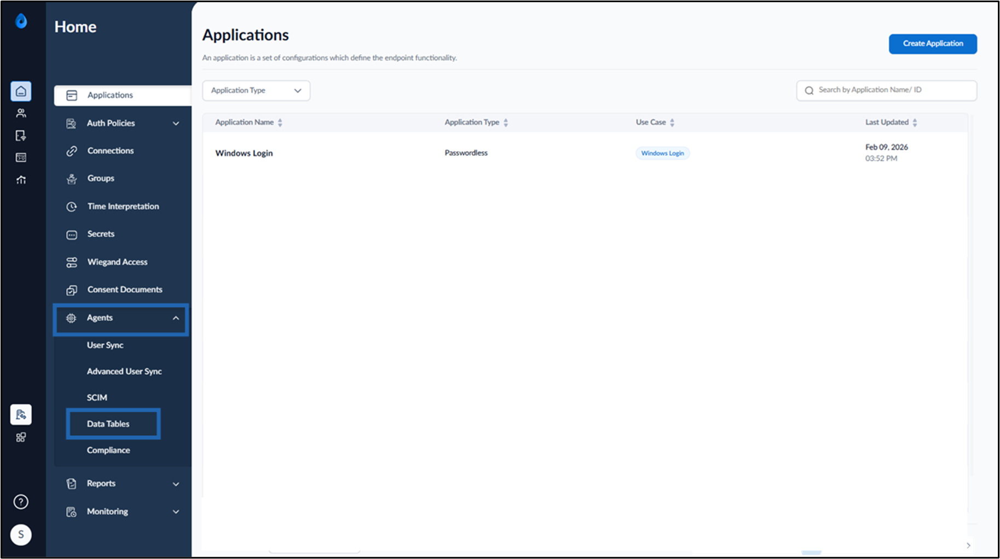
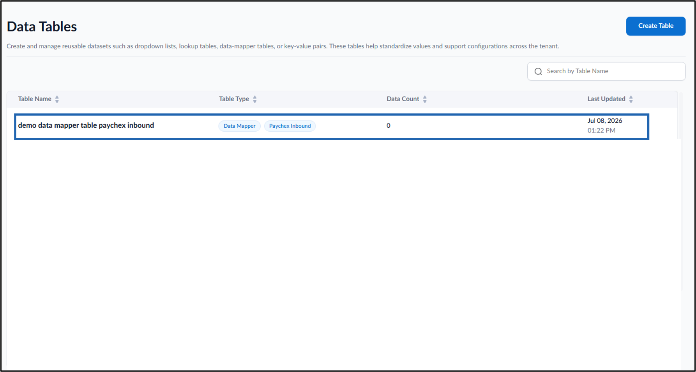
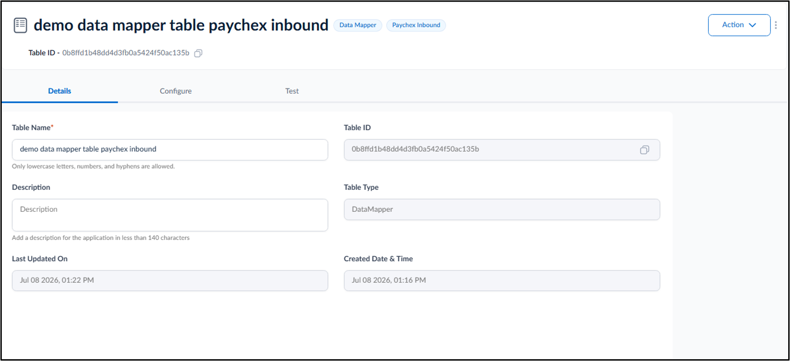
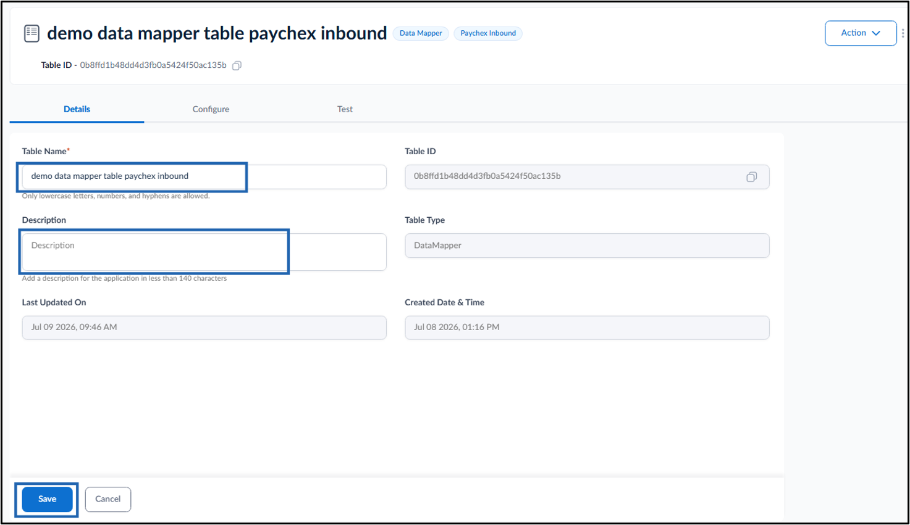
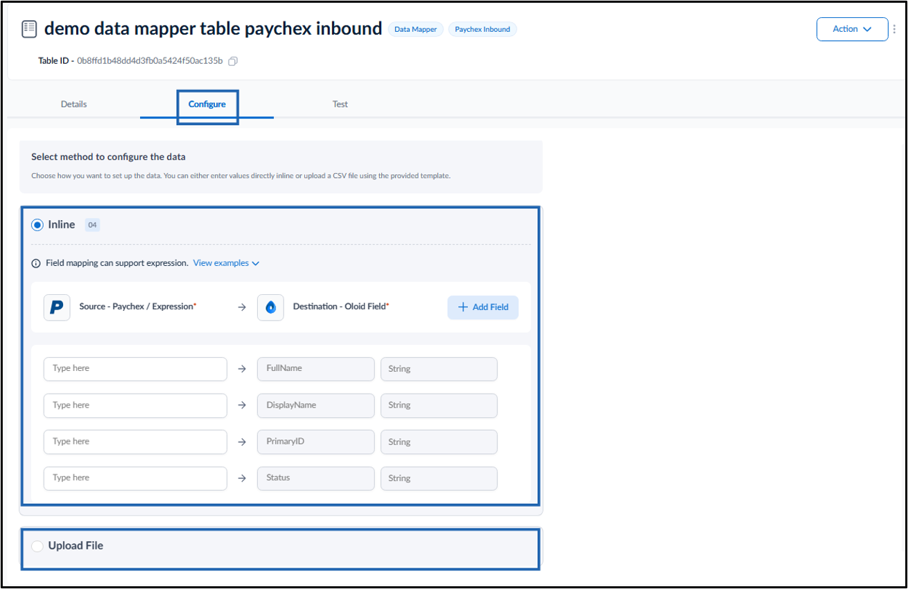
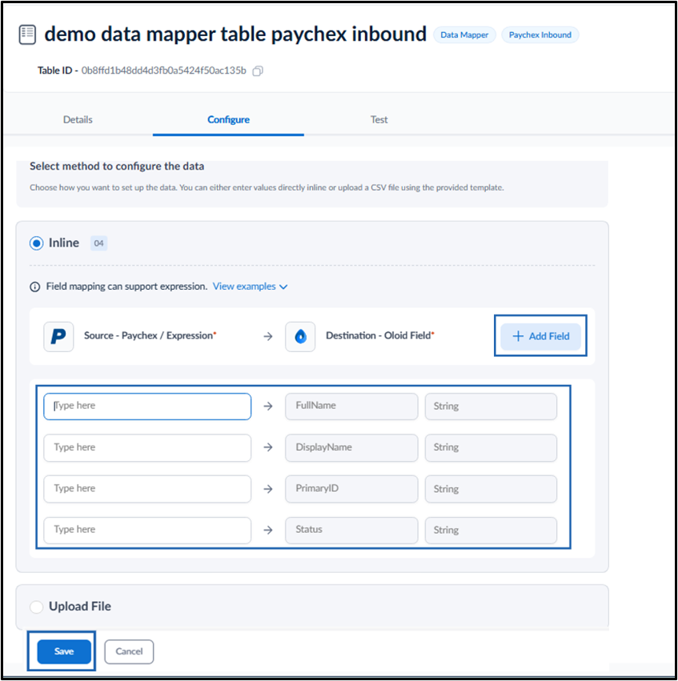
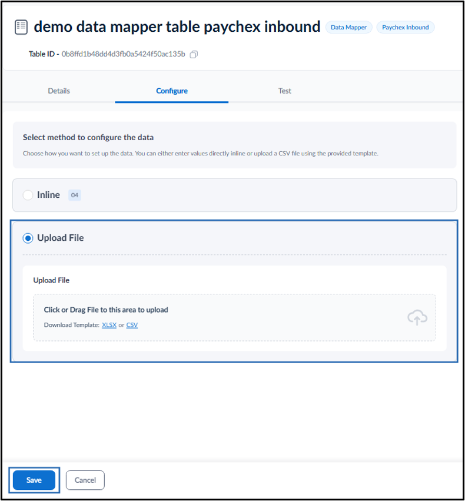
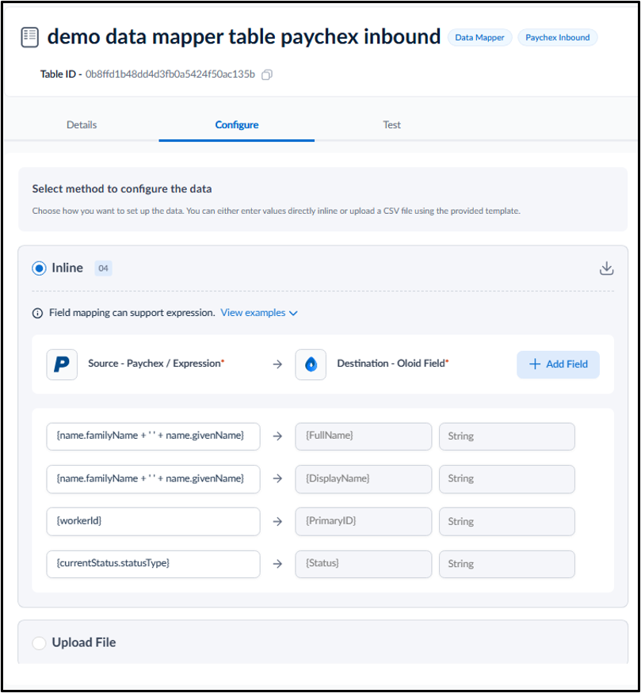

{/* Source: Intercom article 15869122 - https://oloid.help/en/articles/15869122-tenant-admin-portal-how-to-configure-data-mapper-table-for-paychex-inbound */}
{/* Generated by intercom_to_mintlify.py - re-running overwrites this file. */}

## Introduction

This document provides instructions on how to configure a Data Mapper Table for Paychex Inbound in the Tenant Admin Portal.

## Prerequisites

- You must have access to the **Tenant Admin Portal**.
- Data Mapper Table for Paychex Inbound must be created. To create refer,
  [Tenant Admin Portal - How to Create Data Mapper Table for Paychex Inbound](/platform/tenant-admin-portal/tenant-admin-portal-how-to-create-data-mapper-table-for-paychex)

## Steps to Configure Data Mapper Table for Paychex Inbound

1. Log in to the **Tenant Admin Portal**.
2. On the home page of the portal, go to **Agents > Data Tables**.

   

   The **Data Tables** page is displayed.
3. Click preferred data table.

   

   The data table details page is displayed.
4. Do the following:
   1. [Configure Details Tab](#configure-details-tab)
   2. [Setup Configure Tab](#setup-configure-tab)

      

      The Data Mapper Table for **Paychex Inbound** is configured successfully.

### Configure Details Tab

This tab is used to view and edit basic information about the data mapper table.

Do the following:

1. Update the **Table Name** (if required).
2. Enter **Description** (Optional).
3. Click **Save**.

   

   The details tab is configured successfully.

### Setup Configure Tab

This tab is used to configure data field mappings between Paychex and Oloid.

<Note>
  **Note:** The **FullName, DisplayName, PrimaryID, and Status** fields are mandatory and must be mapped to corresponding source fields or expressions before saving the configuration.
</Note>

Do one of the following:

- [Inline](#inline)
  **OR**
- [Upload File](#upload-file)

  

  The Configure tab is set up successfully.

#### Inline

In the **Inline** section, do the following:

1. **Source - Paychex / Expression:** Enter the Paychex field name or expression that provides the source value.
2. **Destination - Oloid Field:** Enter the Oloid field name to which the source value is mapped.
3. **Data Type:** Select the data type from the drop-down.
4. Click **Add field** to add more fields.

   <Note>
     **Note:** For mapping the table, refer **[Data Mapping Table](#data-mapping-table)**.
   </Note>

5. Click **Save**.

The Inline section is configured successfully.

#### Upload File

In the **Upload File** section, do the following:

1. Select **Upload File** and upload the mapping file.

   <Note>
     **Note:** The file format must be in **.XLSX** or **.CSV**.
   </Note>

2. Make sure the mapping file includes three columns: **Data Type**, **Source**, and **Target**.

   <Note>
     **Note:** Confirm that the **Source** column contains Paychex parameters and the **Target** column contain Oloid parameters.
   </Note>

3. Click **Save**.

   

   The Upload File section is configured successfully.
   The configure tab is set up successfully.

   

## Additional Information

### Data Mapping Table

Use the following fields to define data mappings when configuring the Data Mapper Table.

| Paychex Use Field | Oloid Use Field | Data Type |
| --- | --- | --- |
| &#123;workerId&#125; | PrimaryID | String |
| &#123;name.familyName + ' ' + name.givenName&#125; | DisplayName | String |
| &#123;name.familyName + ' ' + name.givenName&#125; | FullName | String |
| &#123;workerType&#125; | &#123;UserMetadata.WorkerType&#125; | String |
| &#123;currentStatus.statusType&#125; | Status | String |

<Note>
  **Note:** Contact **[Oloid support](mailto:support@oloid.ai)** if you need assistance while configuring the Data Mapper table.
</Note>

---

##### Related Articles

[Tenant Admin Portal - How to Create Data Mapper Table for Paychex Inbound](/platform/tenant-admin-portal/tenant-admin-portal-how-to-create-data-mapper-table-for-paychex)
