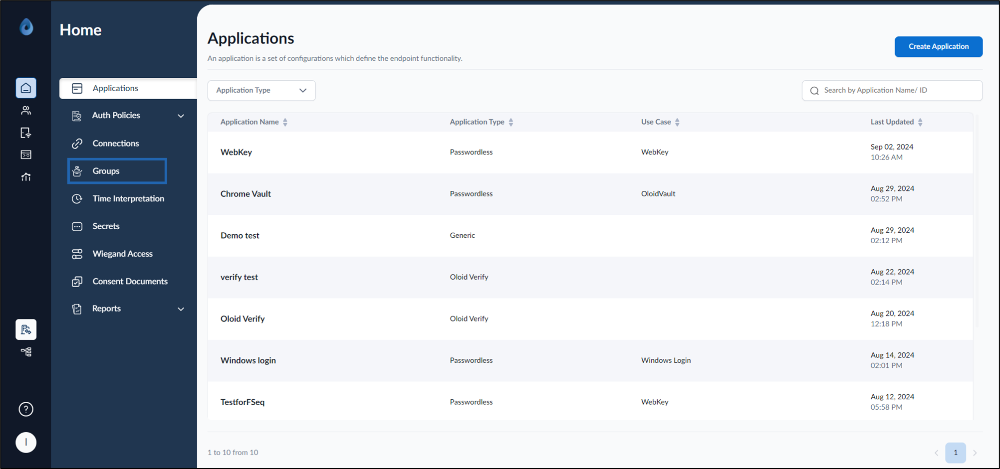
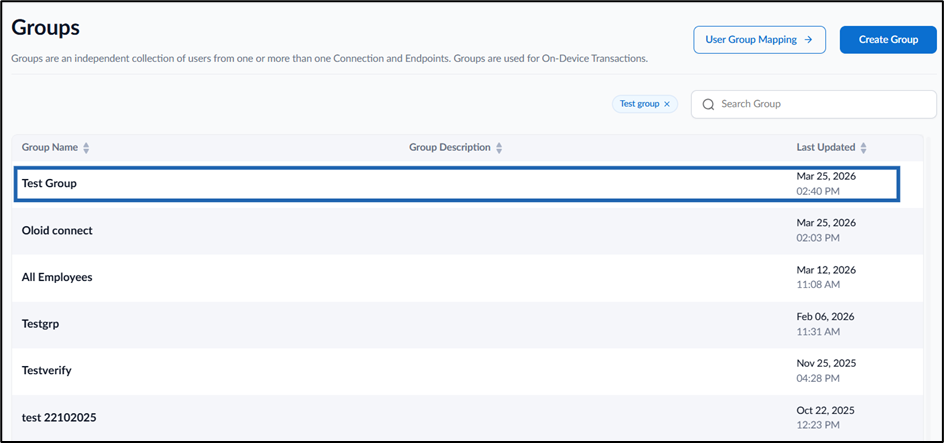
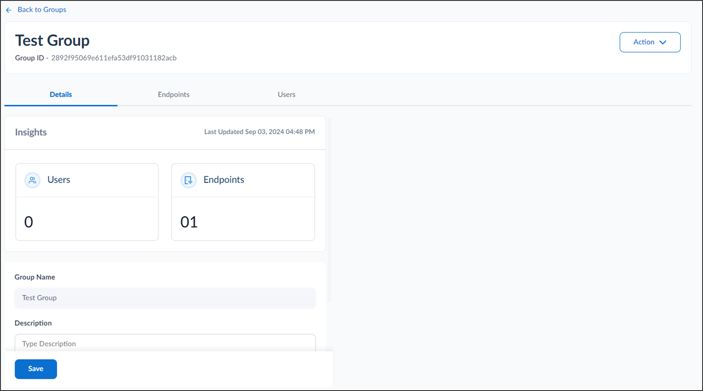
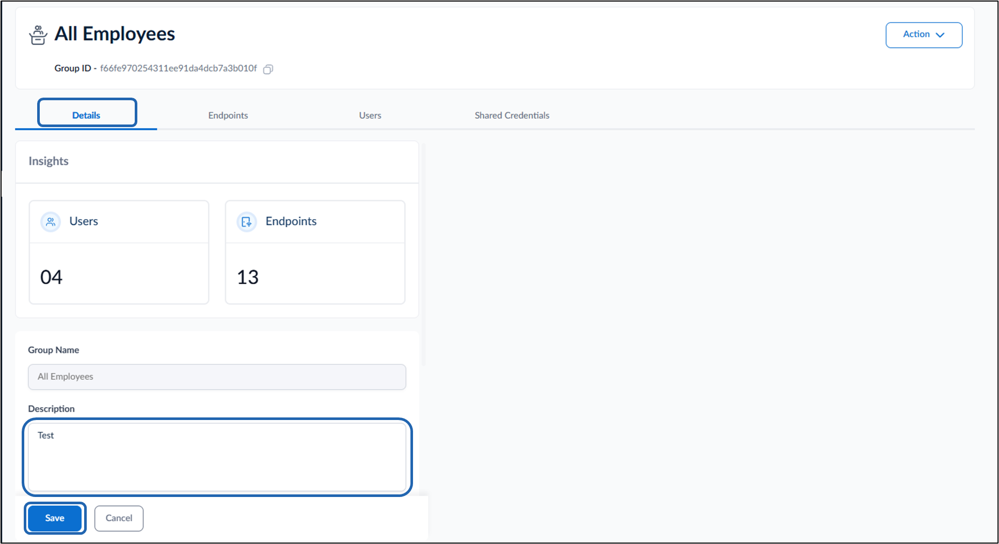
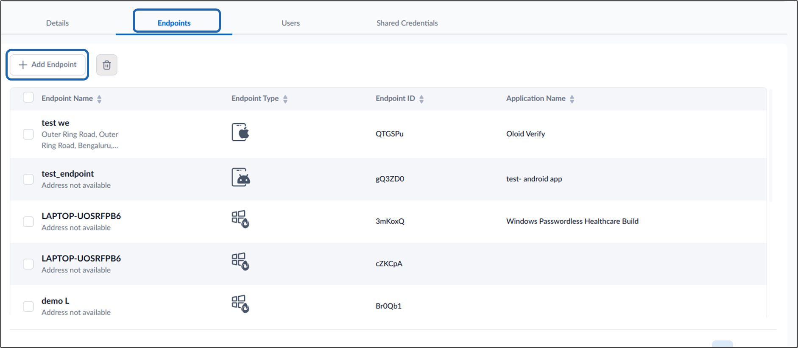
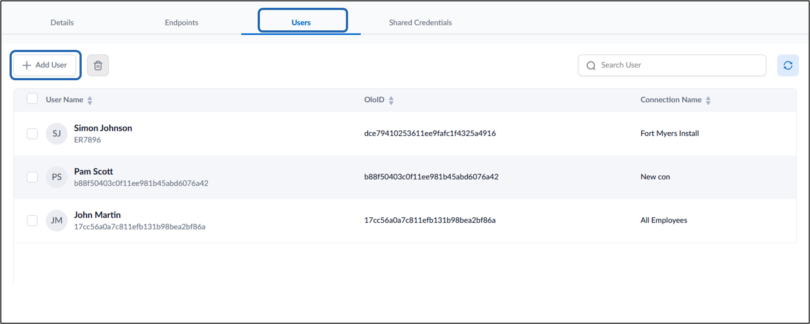
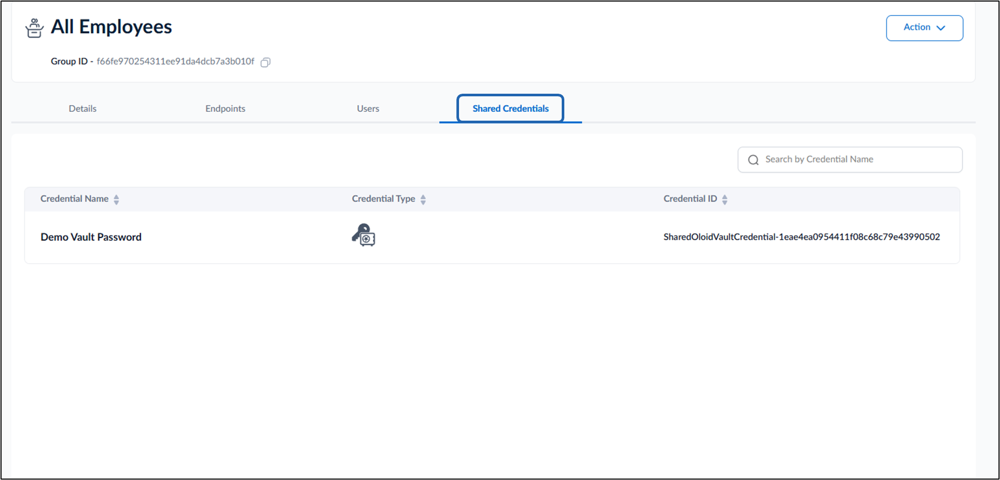
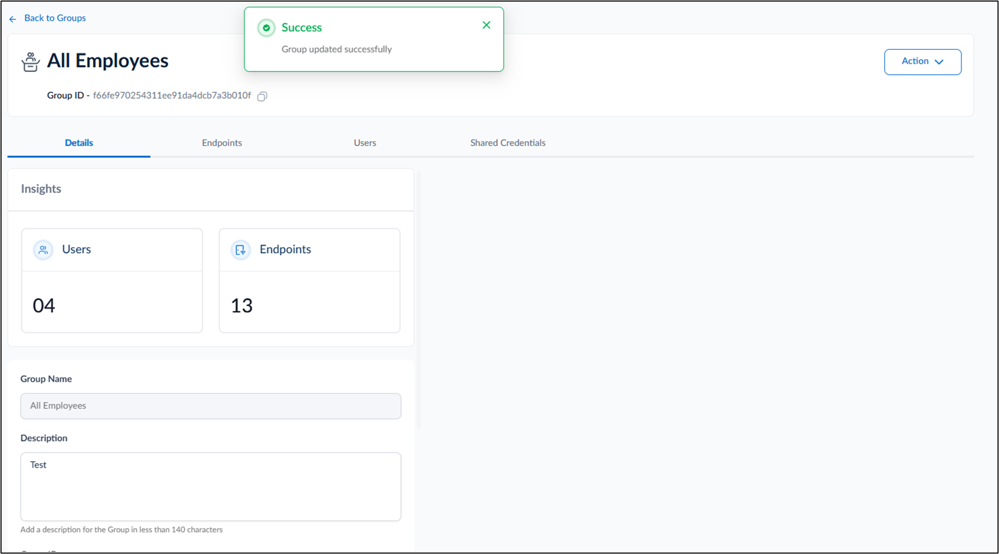

{/* Source: Intercom article 8311585 - https://oloid.help/en/articles/8311585-tenant-admin-portal-how-to-configure-group */}
{/* Generated by intercom_to_mintlify.py - re-running overwrites this file. */}

## Introduction

Groups provide a structured way to organize users, endpoints, and shared credentials. They help manage access and configurations more effectively by grouping related Users together.

## Prerequisites

- You must have access to a Tenant Admin account.
- Ensure that the Group is already created. For more information, please refer: **[How to create group](/platform/tenant-admin-portal/tenant-admin-portal-how-to-create-group)**

## Steps to configure a Group

1. Log in to the **Tenant Admin Portal**.
2. On the home page of the portal, click **Groups** on the left menu panel.

   

   The **Groups** page is displayed.
3. Click the **Group Name** to be configured from the listed groups.

   

   The **Group** details page is displayed.

   

4. Do the following:
   [Configure Details tab](#configure-details-tab)
   [Configure Endpoint Tab](#configure-endpoint-tab)
   [Configure Users Tab](#configure-users-tab)
   [View Shared Credentials](#view-shared-credentials)

### Configure Details Tab

1. On the **Detail**s page, enter **Description** (Optional)**.**
2. Click **Save**.

   

### Configure Endpoint Tab

1. Click **Add Endpoint button** to add endpoint to the group. For more information, refer to [How to Add Endpoint to a group](/platform/tenant-admin-portal/tenant-admin-portal-how-to-add-an-endpoint-to-a-group)

### Configure Users Tab

Click **Add User** to add user to the group. For more information, [How to Map Users to a Group](/platform/tenant-admin-portal/tenant-admin-portal-how-to-map-user-to-a-group)

### View Shared Credentials

The **Shared Credentials** tab within a group allows Tenant Admin to view all shared credentials assigned to that group.

<Note>
  **Note:** Shared Credentials tab only appears if any shared credential has been assigned to the group. For more information, refer: [How to Add a Group to Windows Shared Passwords](/platforms/windows/windows-login/windows-login-how-to-add-a-group-to-windows-shared-passwords)
</Note>

Click **Shared Credentials** tab to view shared credentials assigned to the group.

The Group is configured successfully.

