{/* Source: Intercom article 9215949 - https://oloid.help/en/articles/9215949-tenant-admin-portal-how-to-configure-oidc-okta-idp-profile */}
{/* Generated by intercom_to_mintlify.py - re-running overwrites this file. */}

## Introduction

This document explains how to configure an **OIDC - Okta** Identity Provider (IDP) profile in the Tenant Admin Portal.

## Prerequisites

- You must have admin access to the Tenant Admin Portal.
- Ensure that the Webkey application is created. To create Webkey application, refer [How to create and configure WebKey Application in Tenant Admin Portal](/platforms/web/webkey/webkey-how-to-create-and-configure-a-webkey-application-in-tenant).
- You must configure OKTA IDP and generate the required SSO configuration details in the **OKTA Administrator Console**. For instructions, see [How to Create and Configure Okta (OIDC) as an Identity Provider in Okta Admin Console](/platform/tenant-admin-portal/how-to-create-and-configure-okta-oidc-as-an-identity-provider-in-okta).

## Steps to Configure OIDC-Okta IDP Profile

1. Log in to the **Tenant Admin Portal**.
2. On the **Applications** page, click **Security** > **Identity Provider**.

   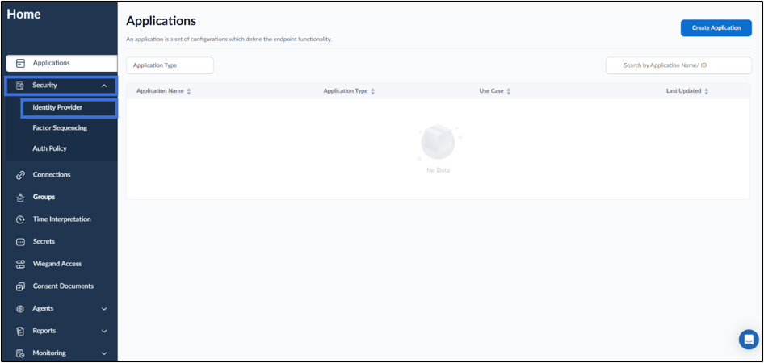

   The **Identity Provider Profiles** page is displayed.
3. Click the IDP application.

   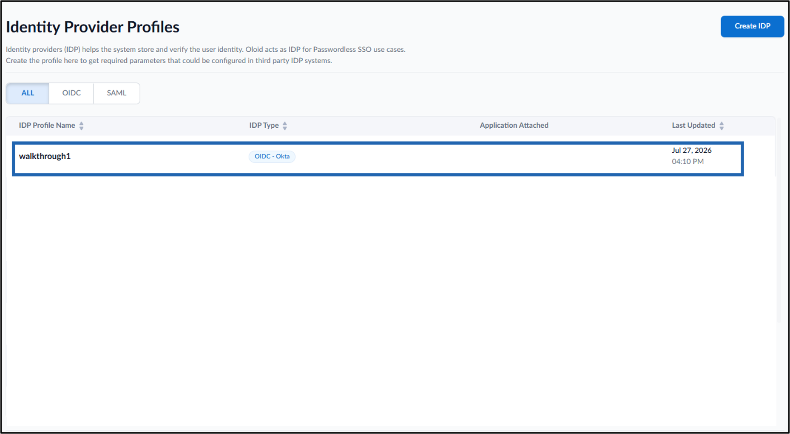

   The IDP application details page is displayed.
4. Do the following:
   1. [Configure Details tab](#configure-details-tab)
   2. [Integrate Oloid Metadata tab](#integrate-oloid-metadata-tab)
   3. [Configure IDP Settings tab](#configure-idp-settings-tab)
   4. [Configure Claims Tab](#configure-claims-tab-optional)
      The IDP Profile is configured successfully.

### Configure Details Tab

The Details tab is used to view and manage the basic information such as IDP Name, IDP Description, etc. for the identity provider configured in the Tenant Admin Portal.

To configure the Details tab, do the following:

1. Edit the **IDP Profile Name**. (Optional)

   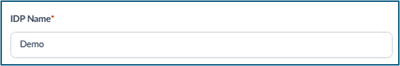

2. Enter **Description**. (optional)

   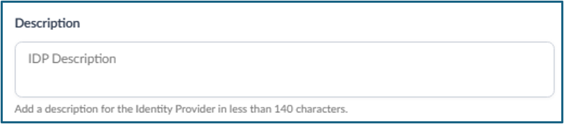

3. Do one of the following:
   1. Select the required WebKey application from the **Select WebKey Application** dropdown list.

      

      (OR)
   2. Click **Make Default** to set this IDP as the default. (Optional)

      <Note>
        **Note:** The **Make Default** button is enabled only when more than one IDP is added in the Tenant Admin Portal.
      </Note>

      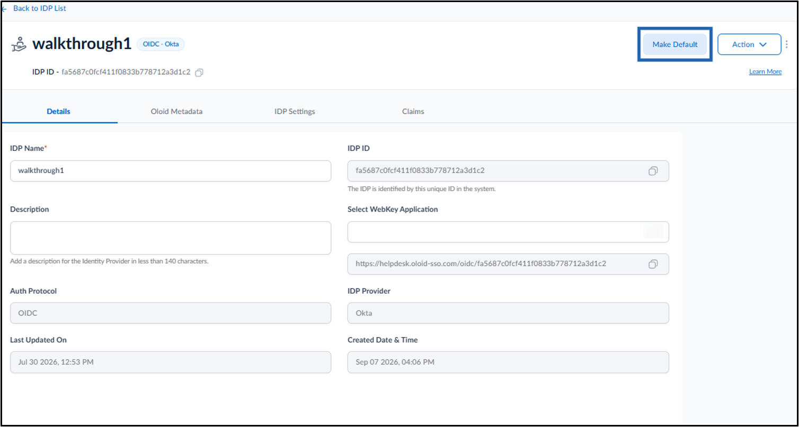

      The **Set this as Default IDP** pop-up box is displayed.
      1. Select the **Webkey Application**.
      2. Select **Set as Default**.

         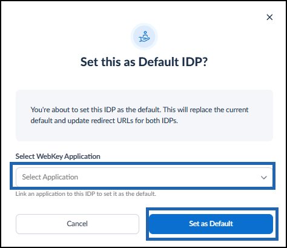

         The WebKey application is set as the default, and the application is linked to this IDP.
4. Click **Save**.

   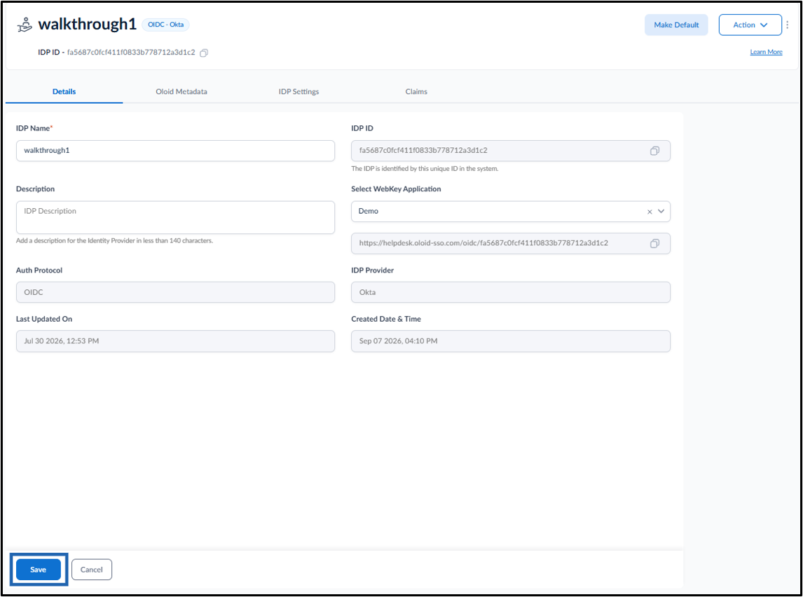

   <Note>
     **Note:** If another IDP is currently set as default, it will be replaced upon confirmation.
   </Note>

   - To make IdP as default, click **Make Default**. The confirmation box is displayed.
   - Click **Set as Default** to designate the preferred IDP as default.

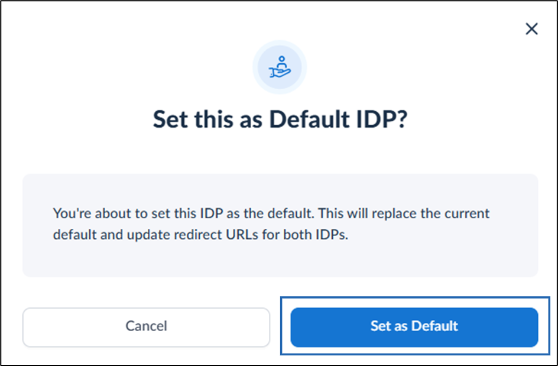

The Details tab is configured successfully.

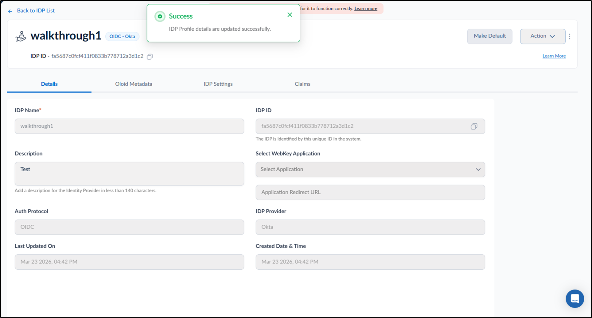

### Integrate Oloid Metadata Tab

The Metadata tab is used to provide the required information to configure OKTA settings and enable OKTA based authentication between the identity provider and the Tenant Admin Portal.

1. Click **Oloid Metadata**.
   The Oloid Metadata tab is displayed.

   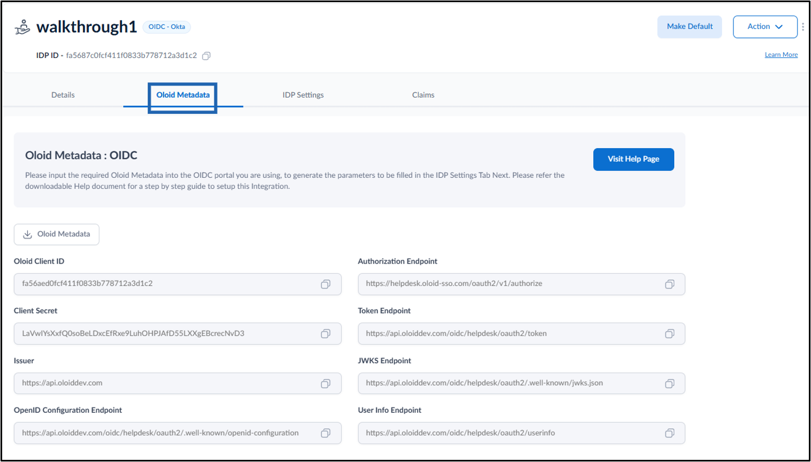

2. Click [Visit help page](/platform/tenant-admin-portal/how-to-create-and-configure-okta-oidc-as-an-identity-provider-in-okta) for the document to configure Okta settings for SSO login.
3. **Download Oloid Metadata:** Download the oloid metadata certificate and upload it to the **IDP Signature Certificate** field.

   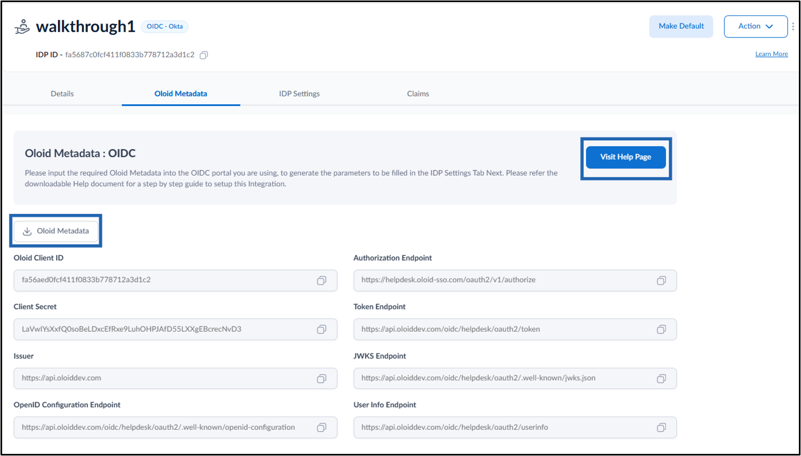

### Configure IDP Settings Tab

The **IDP Settings** tab is used to configure and upload the required OKTA details to enable authentication between the identity provider and Tenant Admin Portal.

To configure the IDP settings tab, do the following:

1. Click the **IDP Settings** tab.
   The IDP Settings page is displayed.

   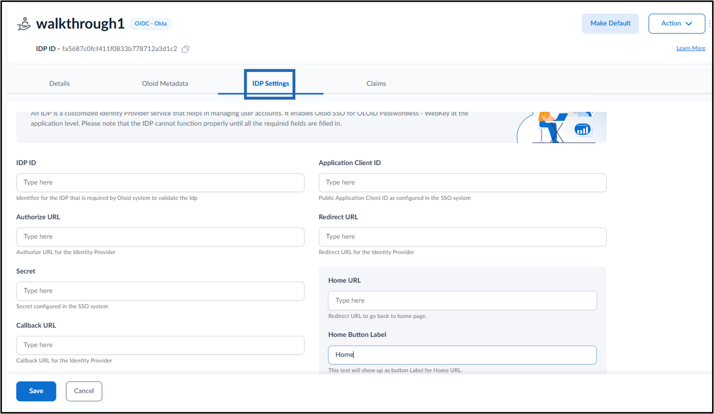

2. Do the following:
   1. Enter **IDP ID**.

      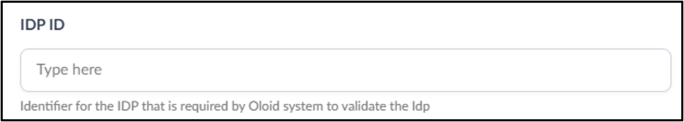

      <Note>
        **Note:** You can find the **IDP ID** from your OKTA Admin Console under **Security** > **Identity Providers** > select preferred Identity Provider from the list.
      </Note>

      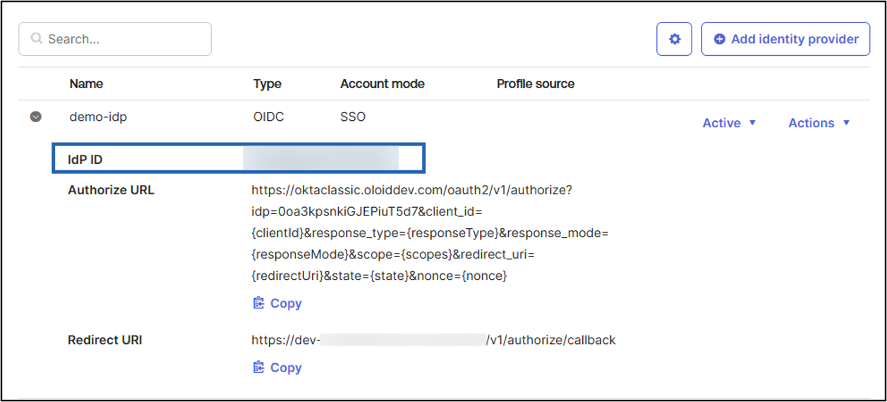

   2. Enter **Application Client ID**.

      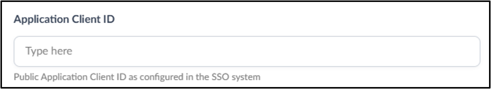

      <Note>
        **Note:** You can find the **Application Client ID** from your OKTA Admin Console under **Applications** > **Applications** > select preferred application > **General** tab > **Client Credentials** section.
      </Note>

      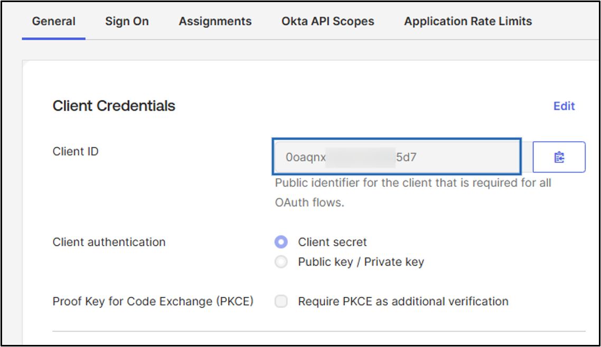

   3. Enter **Authorize URL**.

      <Note>
        **Note:** Enter **[https://&#123;user-id&#125;.okta.com/](https://%7Buser-id%7D.okta.com/)** in the **Authorize URL** field.
      </Note>

      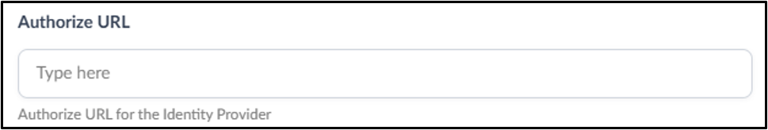

   4. Enter **Redirect URL**.

      <Note>
        **Note:** Enter **[https://&#123;user-id&#125;.okta.com/](https://%7Buser-id%7D.okta.com/)** in the **Redirect URL** field.
      </Note>

      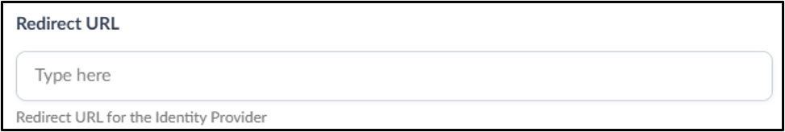

   5. Enter **Callback URL**.

      <Note>
        **Note:** To add multiple Callback URLs, click the **+** icon.
      </Note>

      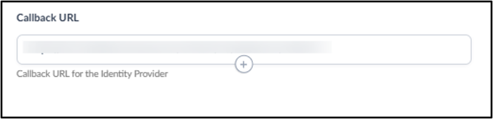

      <Note>
        **Note:** You can find the Callback URL as **Redirect URL** from your OKTA Admin Console under **Security** > **Identity Providers** > select preferred Identity Provider from the list.
      </Note>

      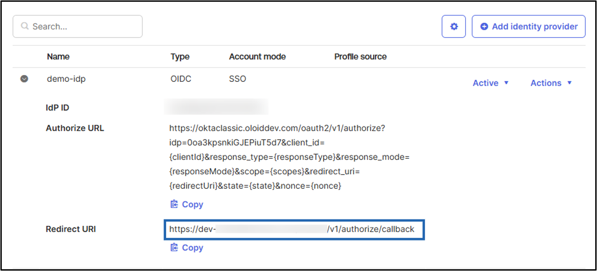

   6. Enter **Secret**.

      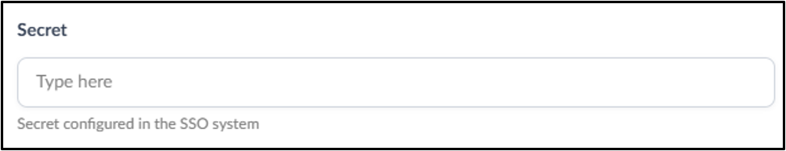

      <Note>
        **Note:** You can find the **Secret** from your OKTA Admin Console under **Applications**> **Applications** > select preferred application > **General** tab > Client Secret.
      </Note>

      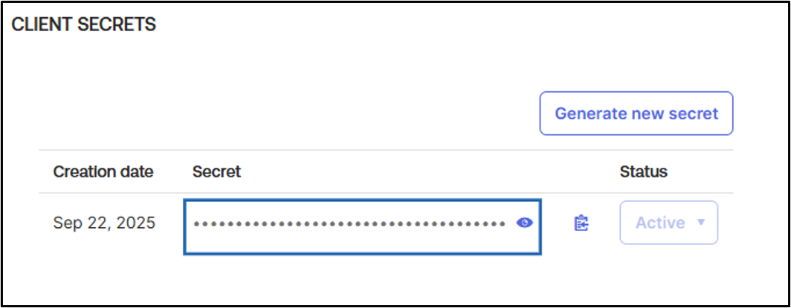

   7. **Home URL:** Enter the URL of the home page.
   8. **Home Label Button:** Enter the text displayed on the **Home** button.

      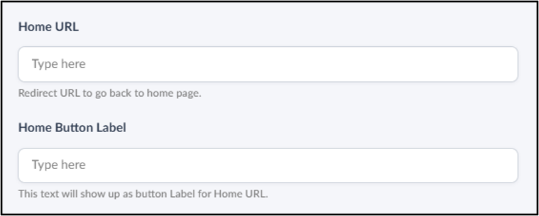

   9. Click **Save.**

      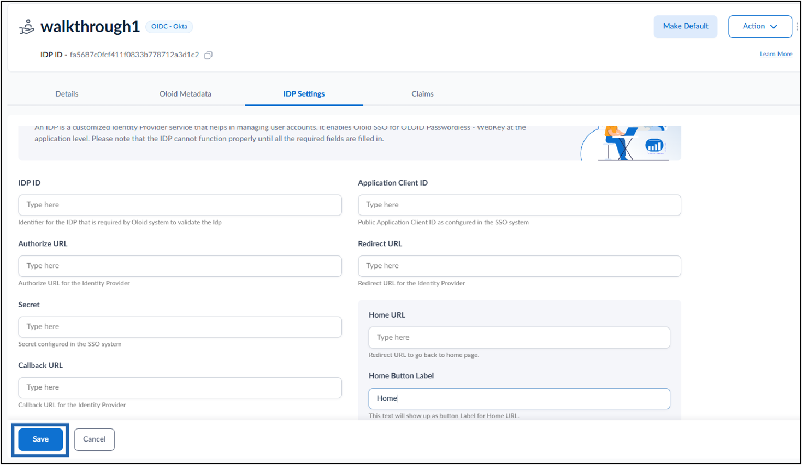

      The IDP settings tab is configured successfully.

### Configure Claims Tab (Optional)

The **Claims** tab is used to configure custom claims that pass user attributes from Oloid to the OIDC provider.

Do the following:

- [Custom Claims](#custom-claims)
- [Authentication Methods References (AMR) Claims](#authentication-methods-references-amr-claims)

  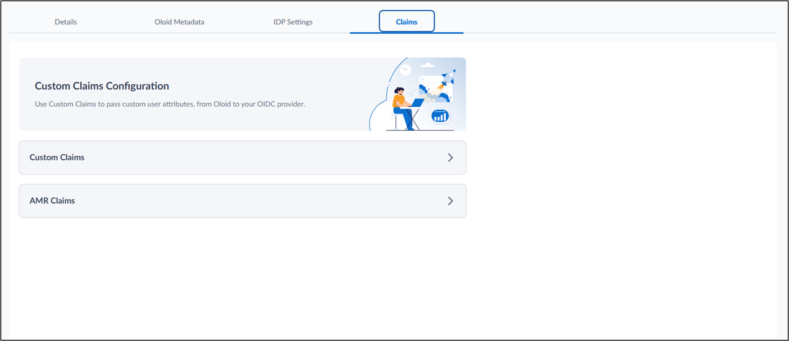

The Custom Claims tab is configured successfully.

#### Custom Claims

Custom Claims allow the admin to map Oloid user attributes to OIDC attributes.

Do the following:

1. In the **Custom Claims** tab, expand the **Custom Claims** section.
   The Custom Claims section is displayed.

   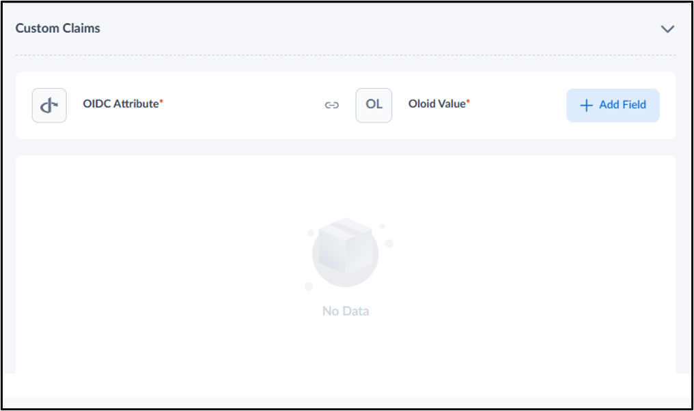

2. In the **Custom Claims** section, click **Add Field**.
3. In the **OIDC Attribute** field, enter the OIDC Attribute.
4. Select the Oloid Value from the **Oloid Value** dropdown.

   <Note>
     **Note:** Click **Add Field** to add additional claim.
   </Note>

5. Click **Save.**

   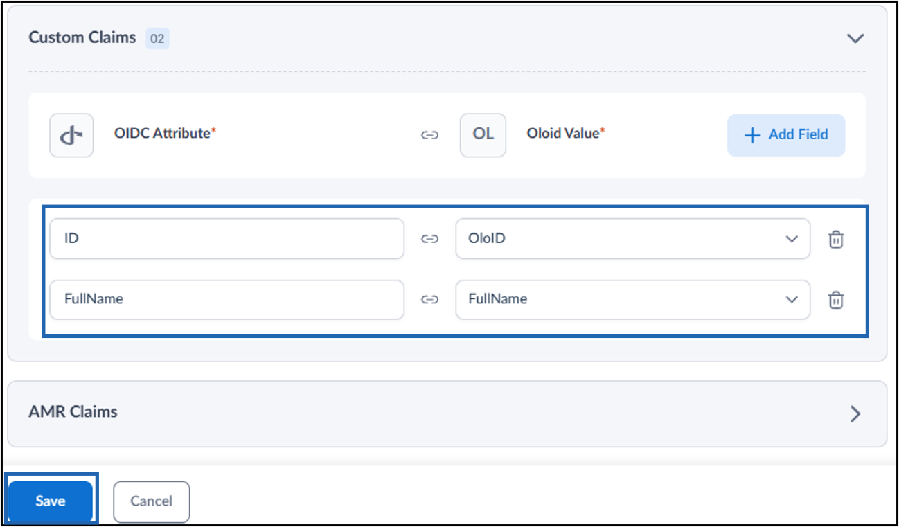

   The Custom claims are configured successfully.

   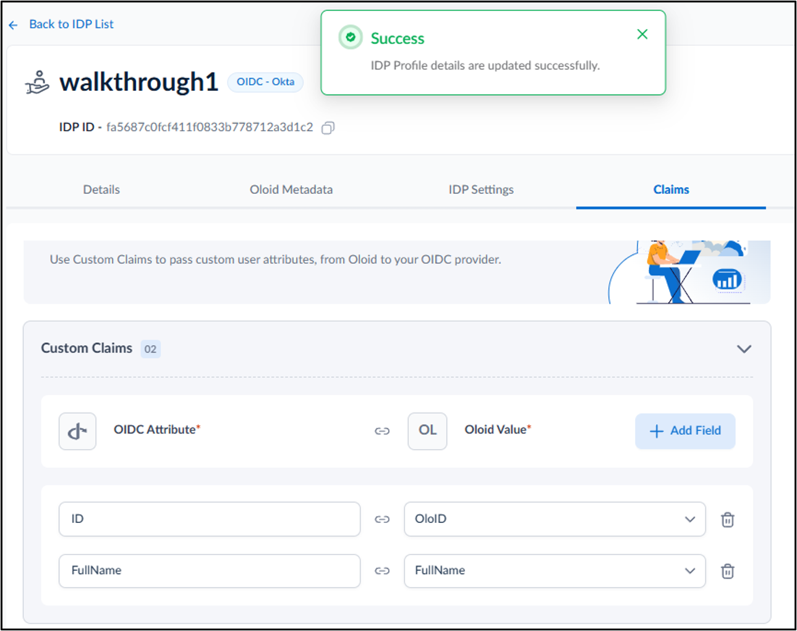

### Authentication Methods References (AMR) Claims

**AMR Claims** indicate **how a user was authenticated** during the login process.

1. In the **AMR Claims** tab, expand the **AMR Claims** section.
   The AMR Claims section is displayed.

   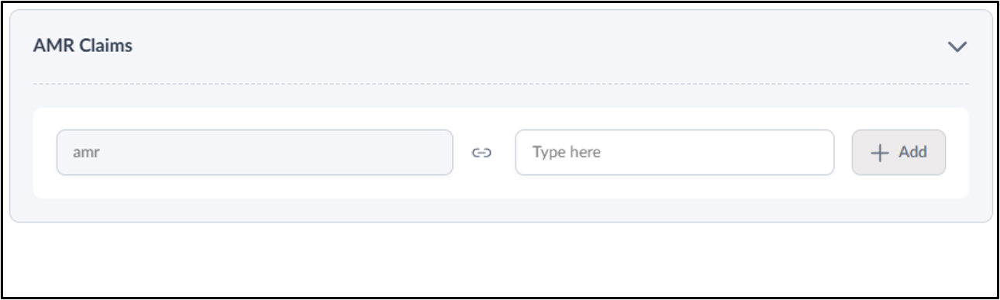

2. In the **AMR Claims** section enter the authentication method value.

   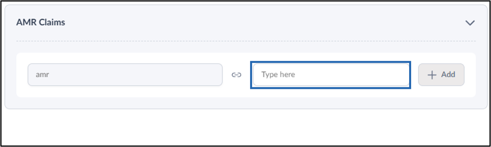

   <Note>
     **Note:** Click **Add** to add additional AMR claim items.
   </Note>

3. Click **Save.**

   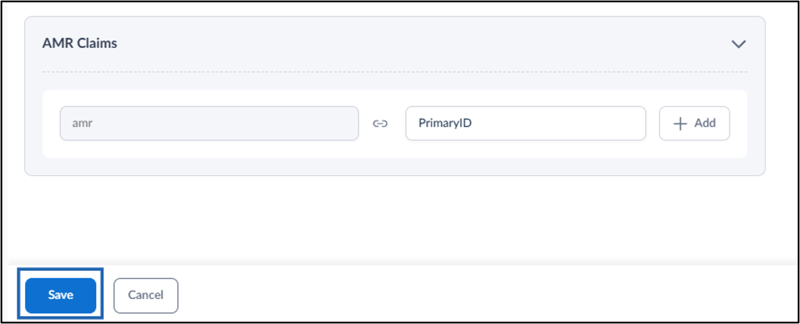

   The AMR section is configured successfully.

   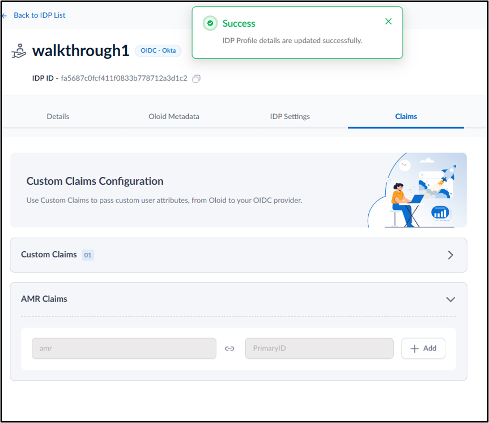

#### Related Article

[How to Create and Configure Okta (OIDC) as an Identity Provider in Okta Admin Console](/platform/tenant-admin-portal/how-to-create-and-configure-okta-oidc-as-an-identity-provider-in-okta)
