{/* Source: Intercom article 12840218 - https://oloid.help/en/articles/12840218-tenant-admin-portal-how-to-configure-security-assertion-markup-language-saml-okta-idp-profile */}
{/* Generated by intercom_to_mintlify.py - re-running overwrites this file. */}

## Introduction

This document provides instructions to configure the Security Assertion Markup Language (SAML) - Okta IDP profile in the Tenant Admin Portal.

## Prerequisites

- You must have admin access to the Tenant Admin Portal.
- Ensure that the **SAML IDP** application is created. To create SAML application, refer [How to Create IDP Profile for Security Assertion Markup Language (SAML) in the Tenant Admin Portal](/platform/tenant-admin-portal/tenant-admin-portal-how-to-create-idp-profile-for-security-assertion).
- The required Okta SAML parameters must be available in the Okta Admin Console. For more, refer to [How to Configure Security Assertion Markup Language (SAML) IDP in OKTA Admin Console](/platform/tenant-admin-portal/how-to-configure-security-assertion-markup-language-saml-idp-in-okta).
- A WebKey application must be created. For more, refer to [How to create and configure WebKey Application in Tenant Admin Portal](/platforms/web/webkey/webkey-how-to-create-and-configure-a-webkey-application-in-tenant).

## Steps to Configure SAML-Okta IDP Profile

1. Log in to the **Tenant Admin Portal**.
2. On the home page of the portal, click **Security** > **Identity Provider** on the left menu panel.

   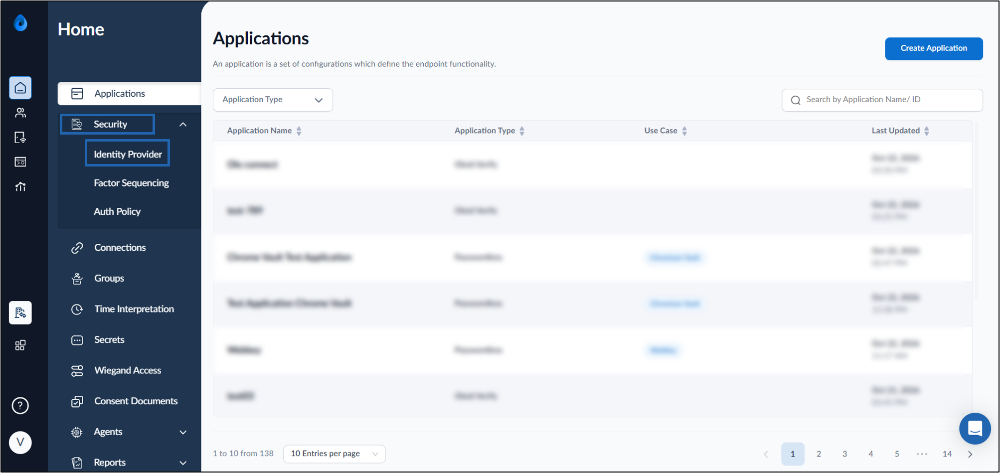

   The **Identity Provider Profiles** page is displayed.
3. Click preferred SAML-IDP application.

   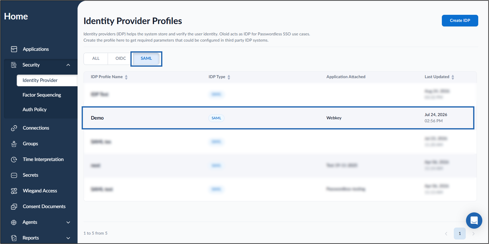

   The IDP details page is displayed.

   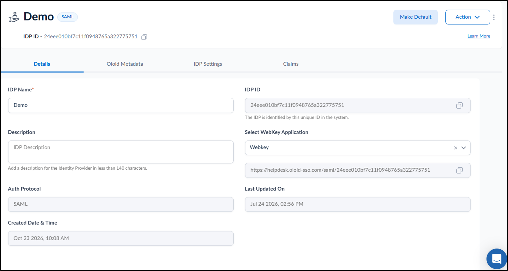

4. Do the following:
   1. [Configure Details tab](#configure-details-tab)
   2. [Integrate Metadata tab for Okta Settings](/platform/tenant-admin-portal/tenant-admin-portal-how-to-configure-oidc-okta-idp-profile)
   3. [Configure IDP Settings tab](/platform/tenant-admin-portal/tenant-admin-portal-how-to-configure-oidc-okta-idp-profile)
   4. [Configure Claims tab](#configure-claims-tab-optional)
      The IDP Profile is configured successfully.

### Configure Details Tab

The **Details** tab is used to view and manage the basic information for the Okta SAML identity provider configured in the Tenant Admin Portal.

To configure the Details tab, do the following:

1. Edit the **IDP Name** (if required).

   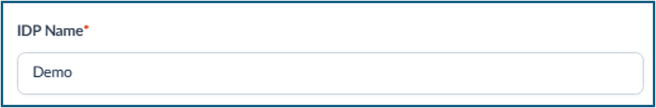

2. Enter **Description** (optional).

   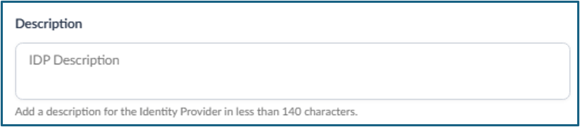

3. Do one of the following:
   1. Select the required WebKey application from the **Select WebKey Application** drop-down list.

      

      (OR)
   2. Click **Make Default**.

      <Note>
        **Note:** The **Make Default** button is enabled only when more than one IDP is added in the Tenant Admin Portal.
      </Note>

      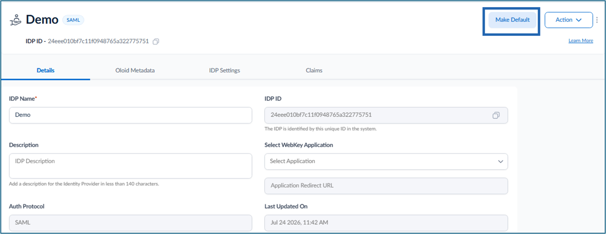

      The **Set this as Default IDP** pop-up box is displayed, do the following.
      - Select the **Webkey Application** from the drop-down.
      - Click **Set as Default**.

        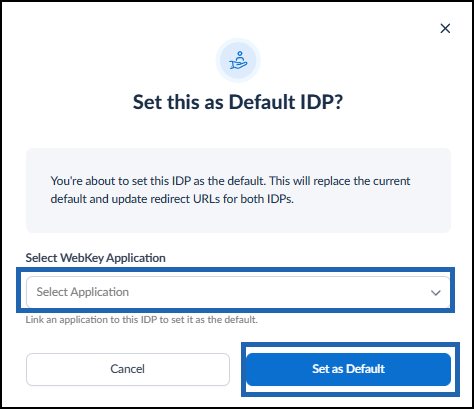

        <Note>
          **Note:** If another IDP is currently set as default, it will be replaced upon confirmation.
        </Note>

        - To make IDP as default, click **Make Default**. The confirmation pop-up box is displayed.
        - Click **Set as Default** to designate the preferred IDP as default.

          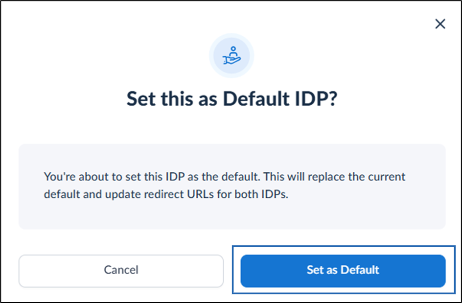

          The WebKey application is linked to the IDP.
4. Click **Save.**

   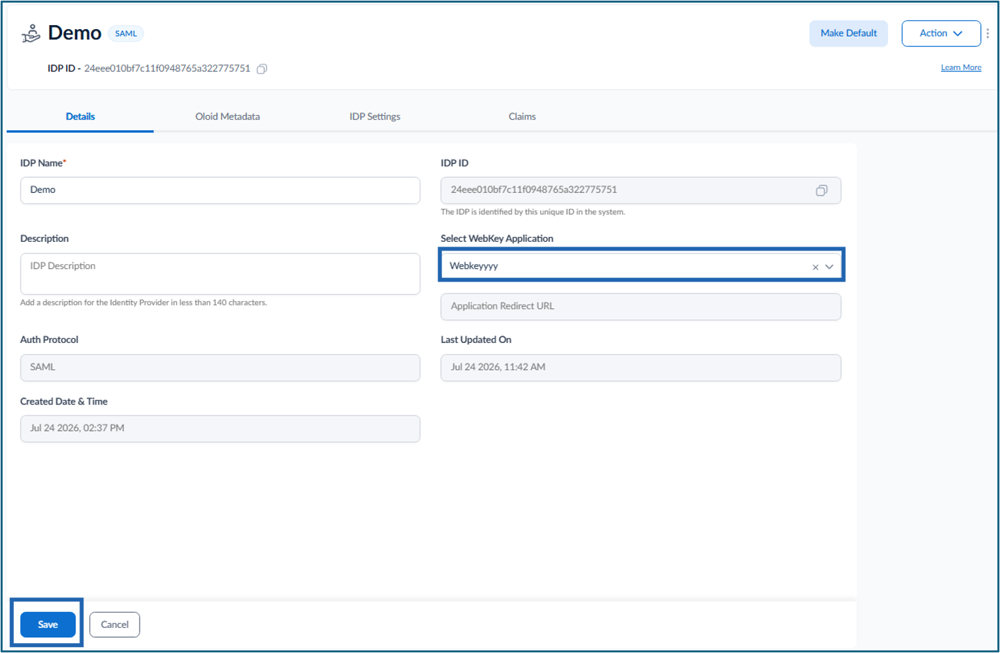

   The **Linking IDP to Application** pop-up box is displayed.
5. Click **Confirm Action**.

   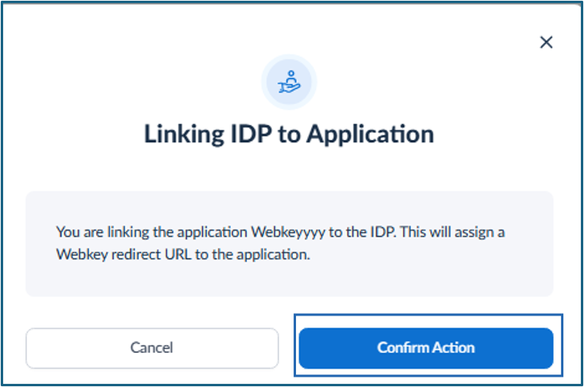

   The Details tab is **configured** successfully.

   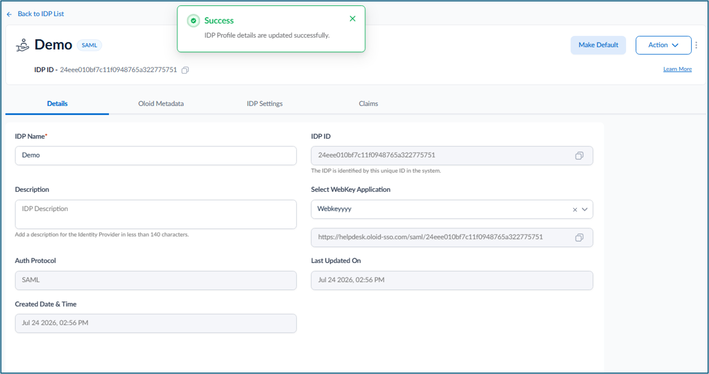

### Configure Oloid Metadata Tab

The **Oloid Metadata** tab is used to provide the required information to configure SAML settings and enable SAML-based authentication between the identity provider and the Tenant Admin Portal.

1. Click **Oloid Metadata** tab.
   The Oloid Metadata tab is displayed.

   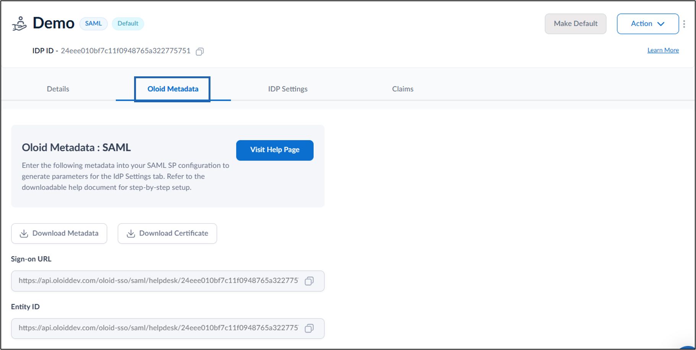

   <Note>
     **Note:** Click **[Visit help page](/platform/tenant-admin-portal/how-to-configure-security-assertion-markup-language-saml-idp-in-okta)** for the document to configure Okta settings for SSO login.
   </Note>

2. Do the following:
   1. **Download Certificate:** Download the certificate and upload it to the **IdP Signature Certificate** field.
   2. **Sign-On URL:** Copy the Sign-on URL and enter it in the **IdP Issuer URL** field.
   3. **Entity ID:** Copy the Entity ID and enter it in the **Sign-on URL** field.

      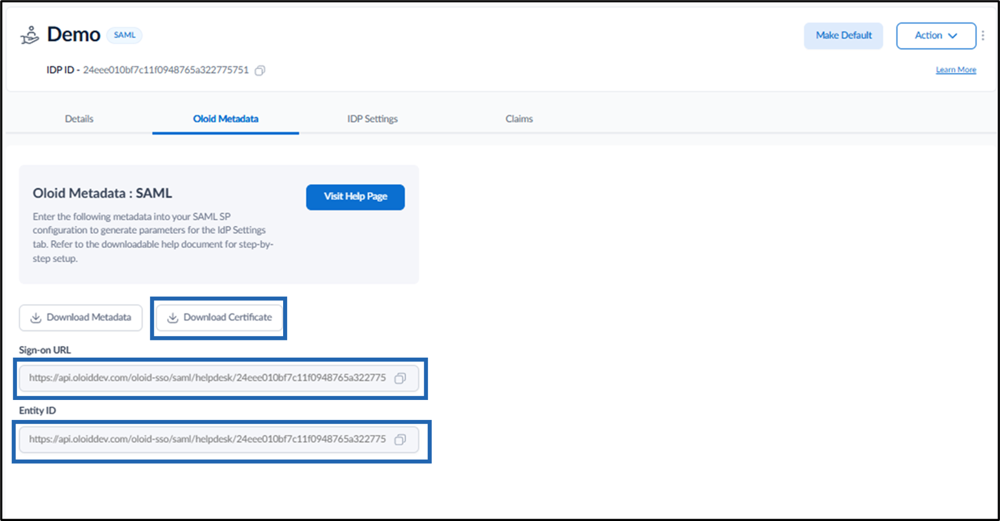

      <Note>
        **Note:** You can find the **IdP Signature Certificate, IdP Issuer URL** and **Sign-on URL** fields on the SAML protocol section on SAML in OKTA Admin Console. For more details, click **[here](/platform/tenant-admin-portal/how-to-configure-security-assertion-markup-language-saml-idp-in-okta)**.
      </Note>

      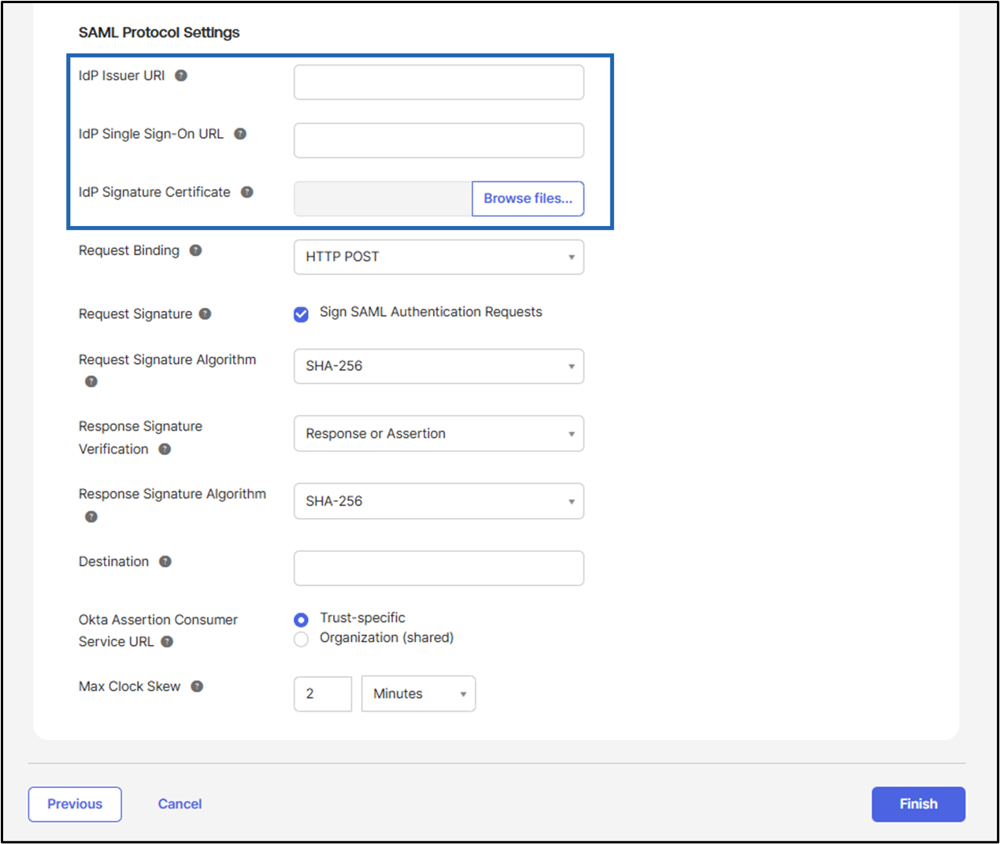

      The Okta settings are updated with the Oloid metadata.

### Configure IDP Settings Tab

The **IDP Settings** tab is used to configure and upload the required SAML details to enable authentication between the identity provider and Tenant Admin Portal.

To configure the IDP settings tab, do the following:

1. Click the **IDP Settings** tab.

   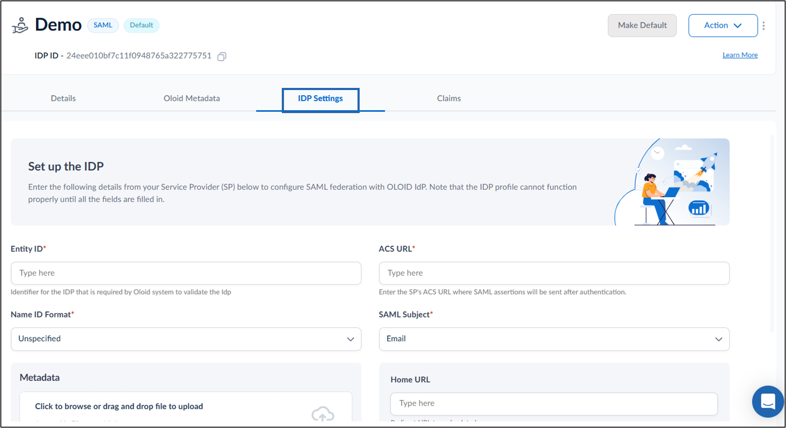

   The IDP Setting tab is displayed.
2. Do one of the following to configure the IDP Settings tab.
   1. Upload **Metadata** file.

      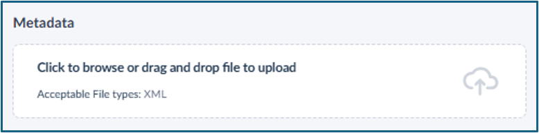

      OR
   2. Enter **Entity ID**.

      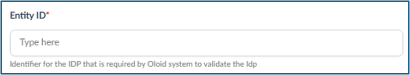

   3. Enter **ACS URL**.

      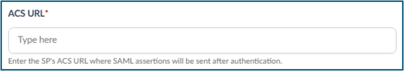

      <Note>
        **Note:** You can find the **Metadata file, Entity ID** and **ACS URL** on the SAML application details page. For details, click **[here](/platform/tenant-admin-portal/how-to-configure-security-assertion-markup-language-saml-idp-in-okta)**.
      </Note>

      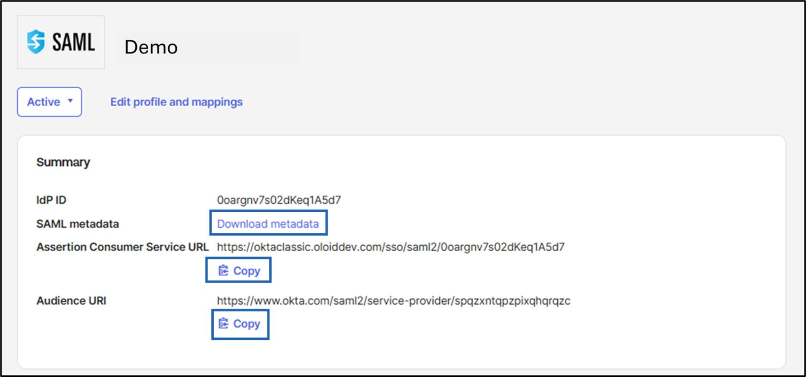

   4. Select **Name ID Format** from the drop-down.

      <Note>
        **Note:** By default, Email Address is selected.
      </Note>

      

   5. Select **SAML Subject** from the drop-down.

      <Note>
        **Note:** By default, Email is selected.
      </Note>

      

   6. Enter **Home URL:** Enter the URL of the home page.
   7. Enter **Home Button Label**: Enter the text displayed on the **Home** button.

      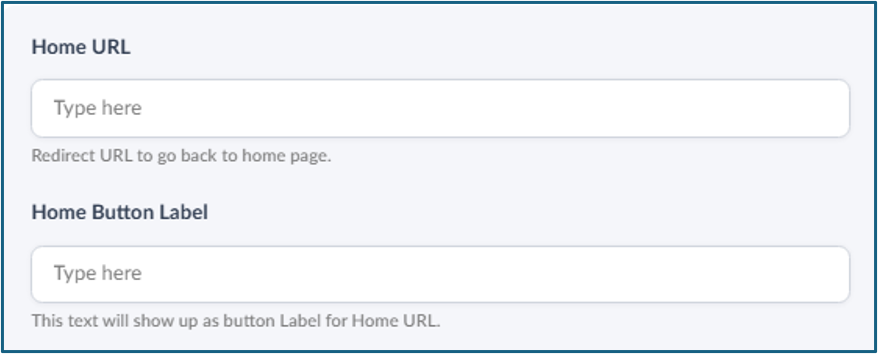

   8. Click **Save**.

      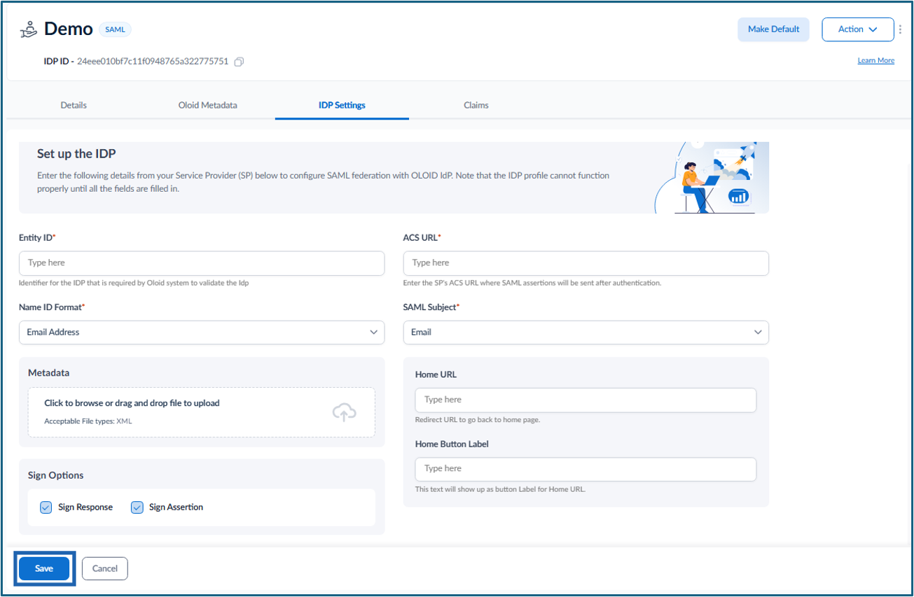

      IDP settings tab is **configured** successfully.

### Configure Claims Tab (Optional)

The **Claims** tab is used to configure custom claims that pass user attributes from Oloid to the SAML provider.

1. Click the **Claims** tab.
   The claims tab is displayed.
2. Do the following:
   - [Additional Claims](#additional-claims)
   - [Group Claims](#group-claims)

     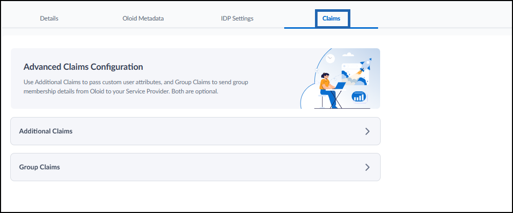

#### Additional Claims

Additional Claims allow the admin to map Oloid user attributes to SAML attributes.

Do the following:

1. In the **Additional Claims** section, click **Add Field**.

   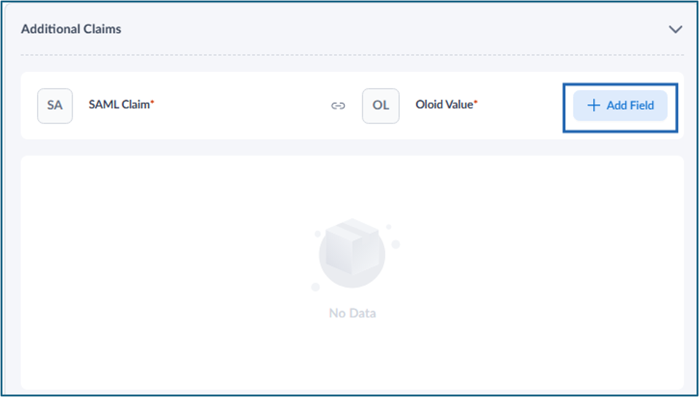

2. In the **SAML Claim** field, enter the claim name to be sent to the service provider.
3. Selectone of the following types.
   - **Basic:** Standard claim format.
   - **Unspecified:** No specific format defined.
   - **URI Reference:** Claim uses a URI-based format.
4. In the **Oloid Value** dropdown, select the corresponding Oloid attribute (for example, Oloid ID).

   <Note>
     **Note:** Click **Add Field** to add additional claim items.
   </Note>

5. Click **Save.**

   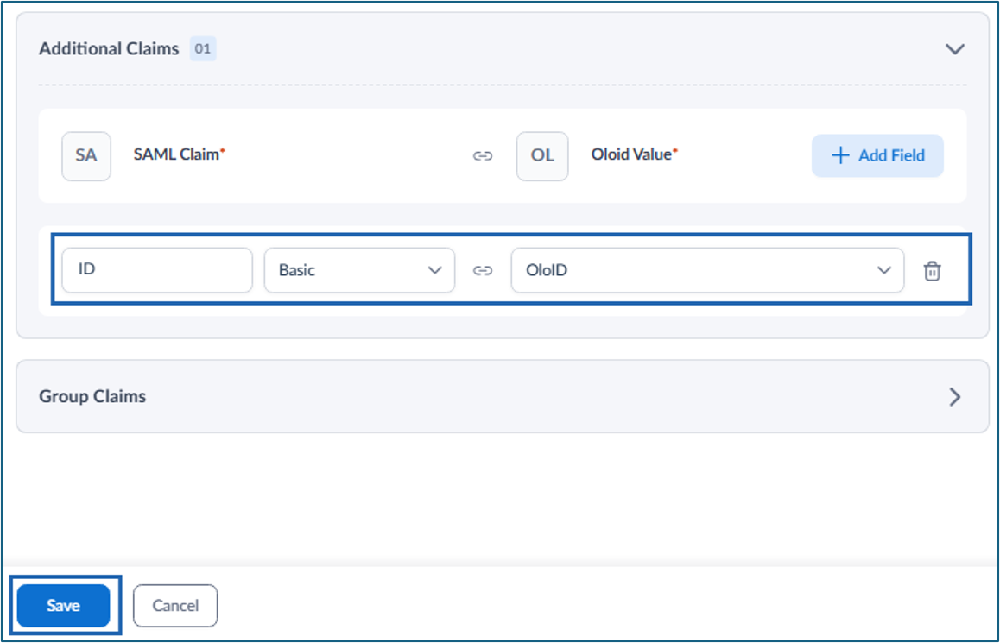

   The Additional claims section is configured successfully.

#### Group Claims

The **Group Claims** section allows you to pass user group-related attributes from Oloid to the Service Provider during authentication.

1. In the Group Claims, expand the Group Claims section.
   The Group Claims section is displayed.
2. Click **Add Field**.

   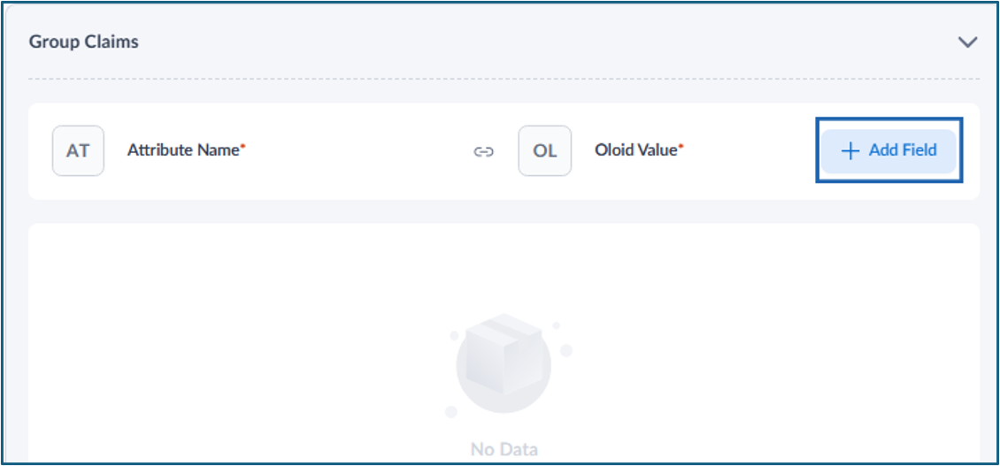

3. Enter the following details:
   1. **Attribute Name**: Enter the group attribute name to be sent to the Service Provider.
   2. **Type**: Select the claim format:
      1. **Basic**
      2. **Unspecified**
      3. **URI Reference**
   3. **Oloid Value**: Enter or select the group-related value.
   4. **Condition**: Select one of the following:
      1. **Contains**
      2. **Equal**
      3. **Starts With**
4. Click **Save**.

   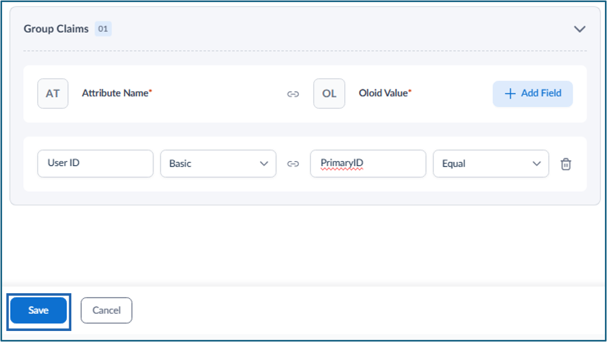

   The **Group Claims** section is configured successfully.

   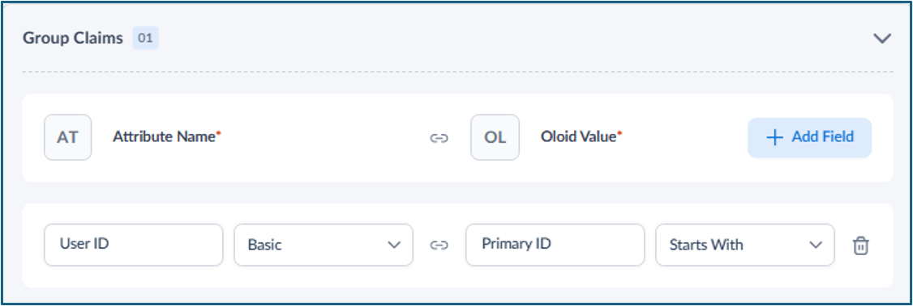

   The **SAML IDP** is successfully configured.

   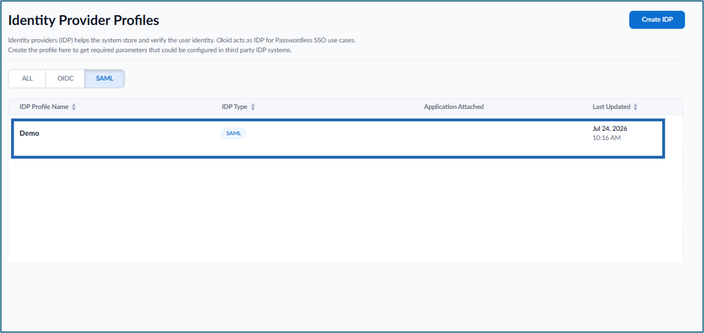
