{/* Source: Intercom article 8347344 - https://oloid.help/en/articles/8347344-tenant-admin-portal-how-to-configure-user-details */}
{/* Generated by intercom_to_mintlify.py - re-running overwrites this file. */}

## Introduction

The User Details page in the Tenant Admin Portal allows admins to update a user’s profile and to create, assign, and manage the user’s credentials, groups, and consent.

## Prerequisites

- You must have admin access to the Tenant Admin Portal.
- The user must be created. For more, refer to [Tenant Admin Portal - How to Create User](/platform/tenant-admin-portal/tenant-admin-portal-how-to-create-user)

## Steps to Configure User Details

1. Log in to the **Tenant Admin Portal**.
2. On the home page of the portal, click **Directory** icon on the left panel menu.

   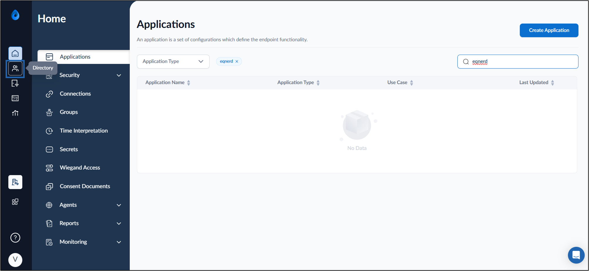

   The **Users** page is displayed.
3. Click on preferred **Username** to edit.

   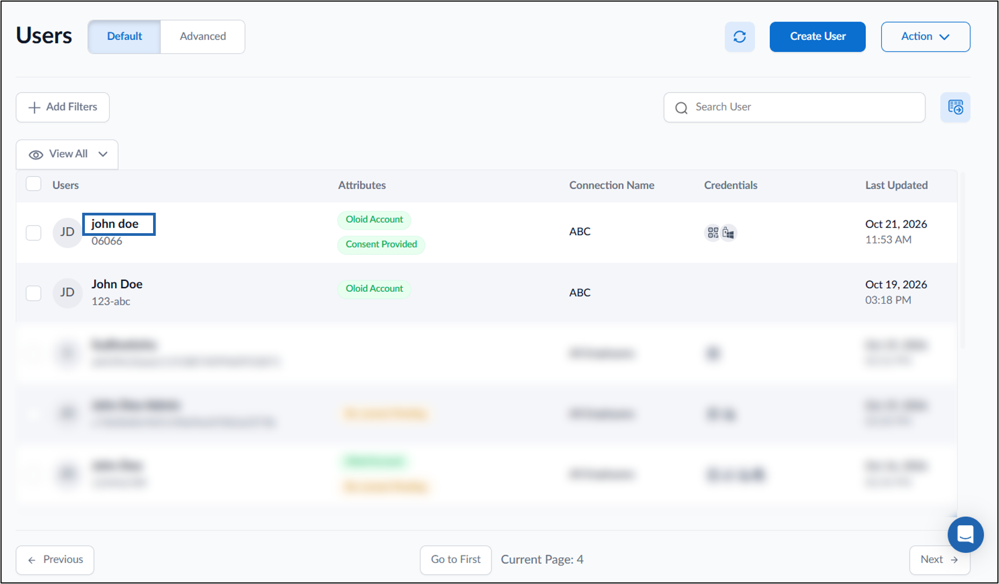

   The User details page is displayed.

Configure the following:

1. [Details tab](#configure-details-tab)
2. [Credentials tab](#configure-credentials-tab)
3. [Groups tab](#configure-groups-tab)
4. [Transactions tab](#configure-transactions-tab)
5. [Consent](#configure-consent-tab)

The User details are configured.

---

### Configure Details Tab

The **Details** tab allows you to view and update the user’s profile information.

Do the following:

1. Edit **Full Name**. (if required)
2. Enter **User Email ID**. (optional)
3. Enter **Badge ID/Secondary ID**. (optional)
4. Enter **Wiegand Format.** (optional)
5. Enter **External ID**. (optional)
6. Enter **Phone**. (optional)
7. Select **User Type** from the drop-down list. (optional)
8. Enter **Supervisor Name**. (optional)
9. Enter **Supervisor Email**.(optional)

Enter **Other Identifiers** (optional)

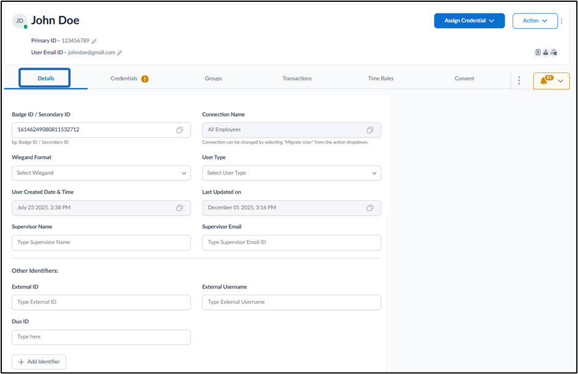

### How to Add Identifiers

10. 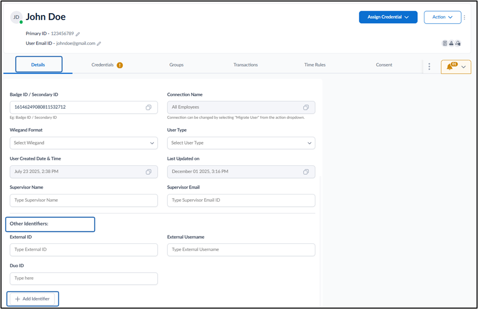

    <Note>
      **Note:** For more, refer to [Oloid Platform - How to Add Other Identifiers](/platform/tenant-admin-portal/tenant-admin-portal-how-to-add-identifiers-in-the-tenant-admin-portal)
    </Note>

11. Click **Save**.

The **Details** tab is configured successfully.

### Configure Credentials Tab

The **Credentials** tab allows you to create, assign, and manage the credentials the user can use to authenticate.

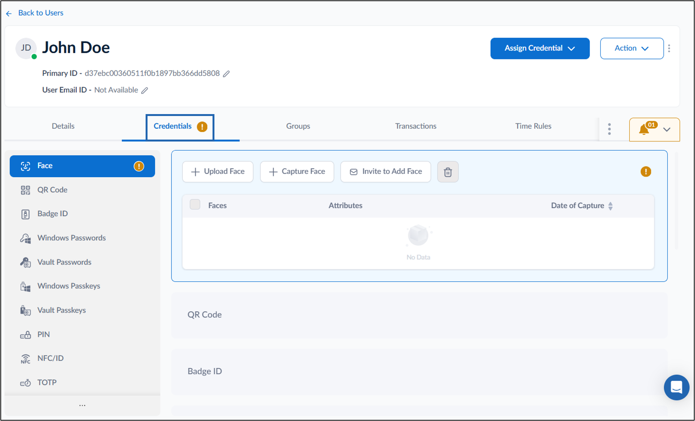

#### Face Tab

To use Face as credential, configure **Face** option. The **Face** tab allows you to add the user’s face or invite the user to add it for face authentication.

<Note>
  **Note:** The user’s face cannot be added until the user provides consent in the Oloid User Portal.
</Note>

Do the following:

- **Upload Face:** This option allows you to upload the user's face. For more, refer to [Tenant Admin Portal - How to Add Face of a Single User](/platform/tenant-admin-portal/tenant-admin-portal-how-to-add-face-of-a-single-user)
- **Capture Face:** This option allows you to capture the user's face. For further information, see How to capture face of a single user [Tenant Admin Portal - How to Add face using Capture Face](/platform/tenant-admin-portal/tenant-admin-portal-how-to-add-face-using-capture-face)
- **Invite to Add Face:** This option sends an email to the user with a link to upload their facial image. For further information, see[Tenant Admin Portal - How to Invite to Add Face via Email/SMS to User](/platform/tenant-admin-portal/tenant-admin-portal-how-to-invite-to-add-face-via-email-sms-to-user)

  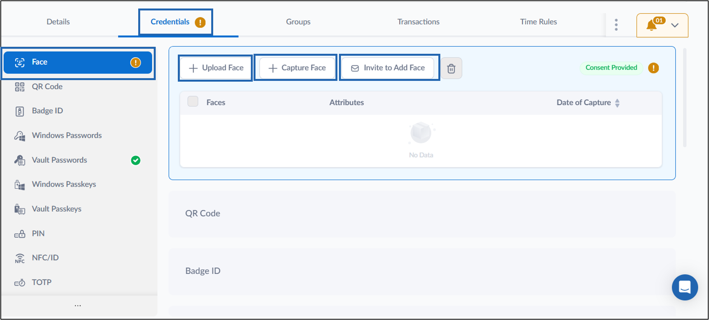

The face is configured successfully.

#### QR Code Tab

The **QR Code** tab allows you to create and share the user’s QR Code for QR Code authentication.

Do the following:

- **Create QR Code:** Select this option to create QR Code for the user. For further information, see **[How to create QR Code as credential for user](/platform/tenant-admin-portal/tenant-admin-portal-how-to-create-and-share-qr-code-credential-with)**
- **Send QR Code on Email:** Select this option to send the QR code to the user's registered email ID. For further information, see **[How to send QR Code on Email](/platform/tenant-admin-portal/tenant-admin-portal-how-to-send-qr-code-to-a-user-on-email)**
- **Send User Portal Link:** Select this option to send the user the User Portal Link via email, allowing them to manage their credentials, including viewing or downloading the QR code. For further information, see**[How to send QR Code credential to user using user portal link](/platform/tenant-admin-portal/how-to-send-qr-code-credential-to-user-using-user-portal-link)**

  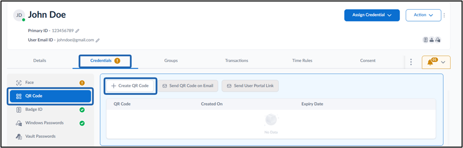

#### Badge ID Tab

To use badgeas credential, configure **Badge ID** option. The Badge ID tab allows you to assign or enroll a user's badge for authentication.

Do the following:

- **Assign Badge:** Select this option to manually assign a badge to the user. For further information, see **[How to assign Badge ID as credential to users](/platform/tenant-admin-portal/how-to-assign-badge-id-as-credential-to-users)**
- **Scan Badge to Enroll:** Select this option to scan or enter badge ID to enroll a new badge for the user. For further information, see **[How to enroll users using badge scan in Oloid Portal](/platform/tenant-admin-portal/tenant-admin-portal-how-to-enroll-a-badge-for-a-user)**

  <Note>
    **Note:** Changes here create temporary badges. Use 'Replace Badge' for permanent changes.
  </Note>

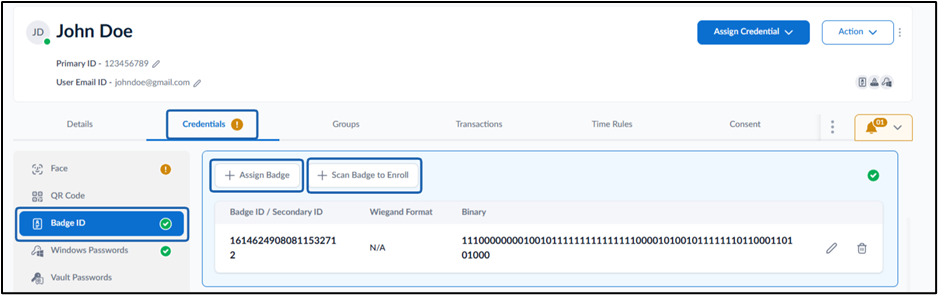

#### Windows Password Tab

To use Windows Passwordas credential, configure **Windows Password** option. The **Windows Passwords** tab allows the admin to create and manage the user's Windows login credentials.

Do the following:

- **Create Password:** Select this option to generate a new Windows password for the user. For further information, see **[How to create Password for Windows Login](/platform/tenant-admin-portal/how-to-create-password-for-windows-login)**
- **Add Windows Shared Password:** Select this option to add Windows shared credentials for Windows systems, which multiple users can access.For further information, see**[How to assign Shared Credentials to user](/platform/tenant-admin-portal/tenant-admin-portal-how-to-assign-shared-password-for-windows-login)**
- **Invite to add password:** Select this option to Invite users to Add Windows password for Windows systems.For further information, see**[How to send invite to add Password to a user](/platform/tenant-admin-portal/how-to-send-invite-to-add-password-to-a-user)**

  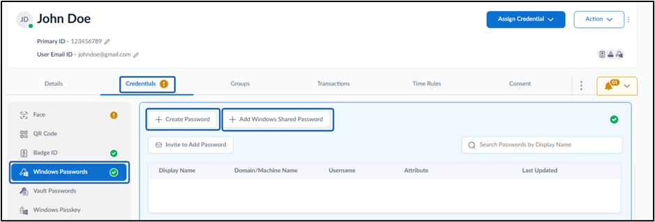

#### Vault Passwords Tab

To use Vault Password credential, configure **Vault Passwords** option. The Vault Passwords tab allows you to manage the user's web password credentials.

Do the following:

- **Create Password:** Select this option to create password for web (Chrome Vault) application. For further information, see **[How to create Vault Password for a user](/platform/tenant-admin-portal/tenant-admin-portal-how-to-create-vault-password-for-a-user)**.
- **Add Vault Shared Password:** Select this option to assign a shared password for web (Chrome Vault) application. Please refer: **[Chrome Vault: How to Add Vault Shared Password for a User in the Tenant Admin Portal](/platforms/web/vault/chrome/oloid-vault-chrome-chromium-how-to-add-vault-shared-password-for-a)**

  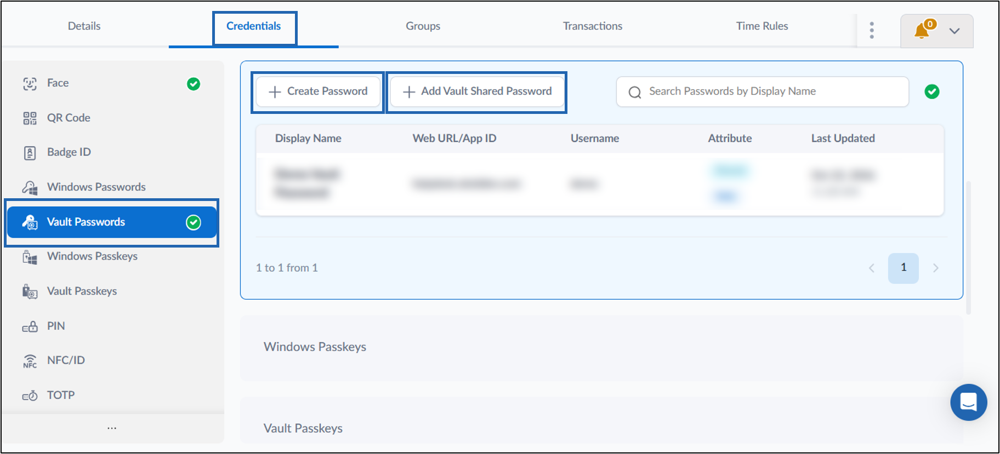

#### Windows Passkeys Tab

To use Windows Passkey credential, configure **Windows Passkey** option. Windows Passkey tab allows you to manage the user's windows passkey credentials.

Do the following:

- **Create Windows Passkey:** Select this option to create Windows Passkey for Window Login application. For further information, see **[How to create Passkey as credential for users in Oloid Portal.](/platform/tenant-admin-portal/tenant-admin-portal-how-to-create-windows-passkey-as-credential-for)**
- **Create Windows Shared Passkey:** Select this option to create Windows Shared Passkey for Window Login application. For further information, please refer: **[How to Assign Windows shared Passkey for a user in the Tenant Admin portal](/platform/tenant-admin-portal/tenant-admin-portal-how-to-assign-windows-shared-passkey-for-a-user)**

  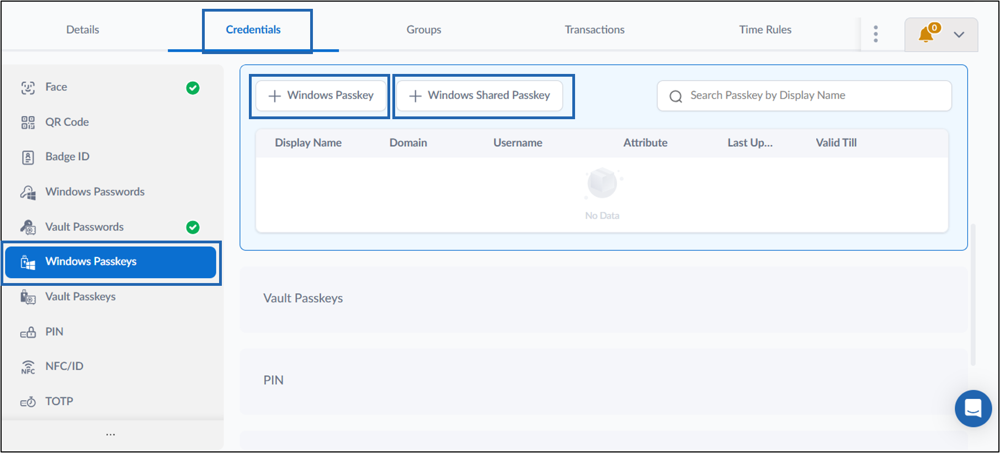

#### Vault Passkey

Vault Passkey is automatically created after passkey generation under the user profile. The Vault Passkey tab allows you to manage the user’s web passkey credentials. For information please refer: [Oloid Platform - How to View and Edit Vault Passkey (FIDO2 certificate)](/platform/tenant-admin-portal/tenant-admin-portal-how-to-view-and-edit-vault-passkey-fido2)

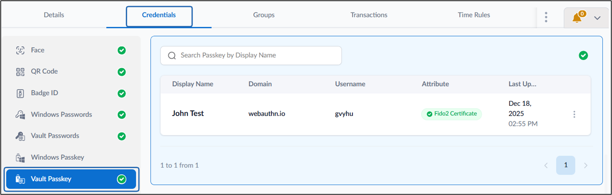

#### PIN Tab

To use PIN credential, configure **PIN** option. The PIN tab allows you to manage the user's PIN configuration.

Do the following:

- **Add PIN:** Select this option to add PIN to the user. For further information, see**[How to add PIN as credential to users](/platform/tenant-admin-portal/tenant-admin-portal-how-to-add-pin-credential-for-user).**
- **Send Reset PIN Email:** Select this option to allow users to Reset PIN. To add and configure PIN. For further information, see **[How to send invite to set Pin on Email to a user](/platform/tenant-admin-portal/tenant-admin-portal-how-to-send-set-pin-email-to-a-user)**.
- **Send PIN**: Select this option to send the PIN via Email or SMS to the registered users. For further information, see **[How to Send PIN to User via email in the Tenant Admin Portal](/platform/tenant-admin-portal/tenant-admin-portal-how-to-send-pin-via-email-sms-to-user).**
- **Lock PIN:** Select this option to Lock the PIN and prevent the user from authenticating. For further information, see **[Tenant Admin Portal - How to Lock PIN Credential for a User](/platform/tenant-admin-portal/tenant-admin-portal-how-to-lock-pin-credential-for-a-user)**

  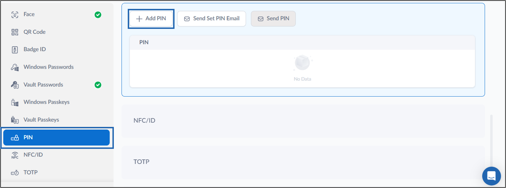

#### NFC/ID Tab

To use NFC/ID credential, configure **NFC/ID** option. The NFC/ID tab allows you to manage the user's NFC/ID configuration.

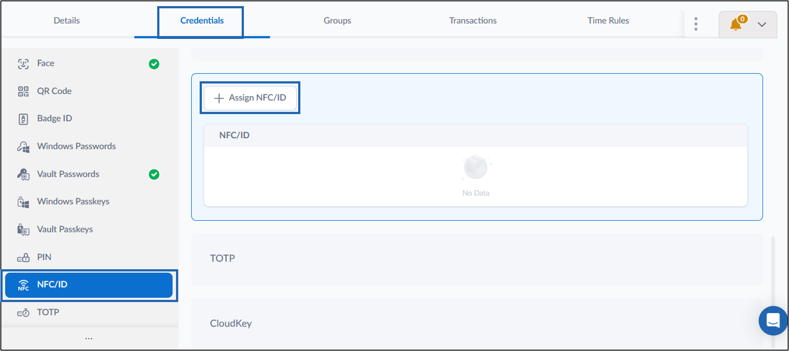

**Assign NFC/ID:** Select this option to assign NFC/ID to the user. For further information, see **[How to assign NFC/ID as a credential to the user](/platform/tenant-admin-portal/how-to-assign-nfc-id-as-a-credential-to-the-user)**.

#### TOTP Tab

TOTP (Time-based One-Time Password), which links the user’s account to an authenticator app, such as Google Authenticator or Microsoft Authenticator, that generates a time-based one-time code for multi-factor authentication.

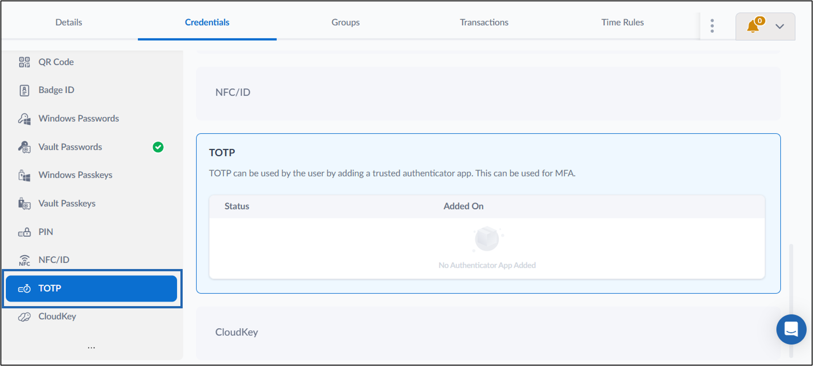

#### CloudKey Tab

To use CloudKey credential, configure **CloudKey** option. The CloudKey tab allows you to manage the user's CloudKey configuration.

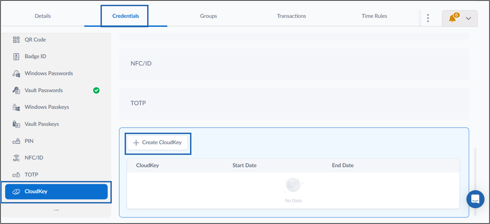

**Create CloudKey:** Select the option to create CloudKey. For more information, see **[How to add CloudKey as credential to users](/platform/tenant-admin-portal/how-to-add-cloudkey-as-credential-to-users)**

### Configure Groups Tab

The Groups tab allows the Tenant Admin to add users to a Group. For more information, refer to **[Tenant Admin Portal - How to Map User to a Group](/platform/tenant-admin-portal/tenant-admin-portal-how-to-map-user-to-a-group)**

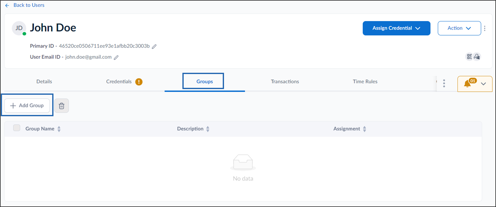

### Configure Transactions Tab

The Transactions tab allows you to view the transaction history of the user.

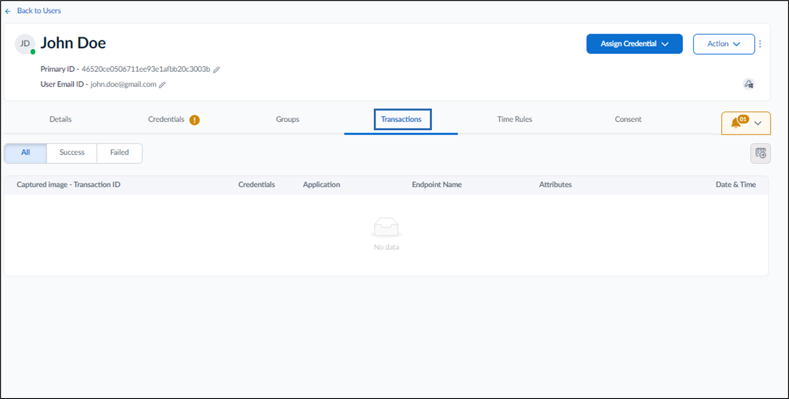

### Configure Consent Tab

The **Consent** tab shows the user’s current consent status and their complete consent history.

<Note>
  **Note:** Consent Status are as follows:
</Note>

- Provided: User has provided consent for adding face
- Denied: User has rejected consent
- Pending: User has been sent the consent and user action is pending.
- Reconsent Pending: User had previously denied consent and was re-shared the consent and user action is pending.

Click the download icon to save consent file.

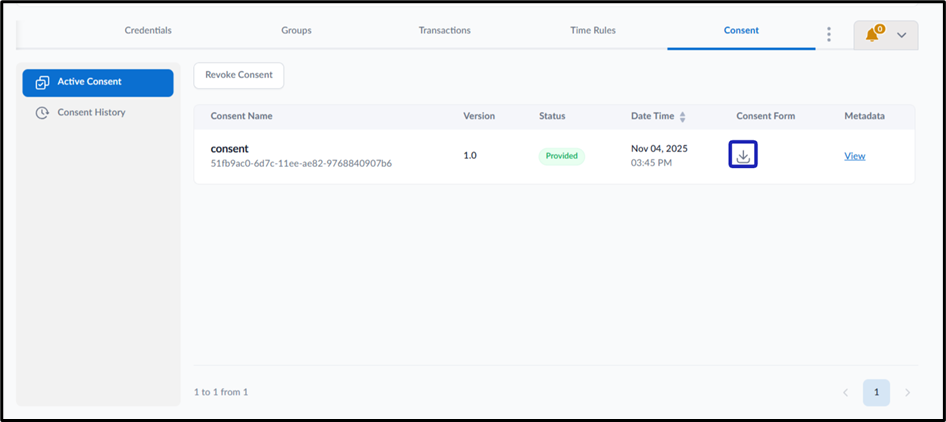

Select Consent History tab to view past consents and their status.

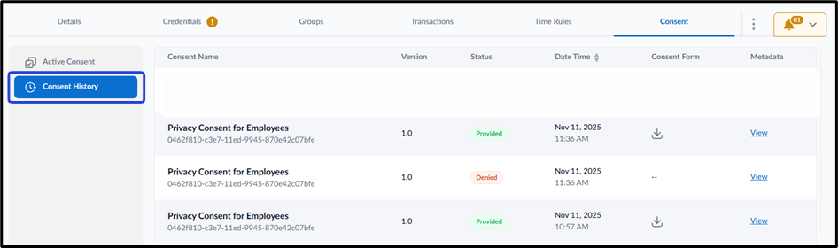
