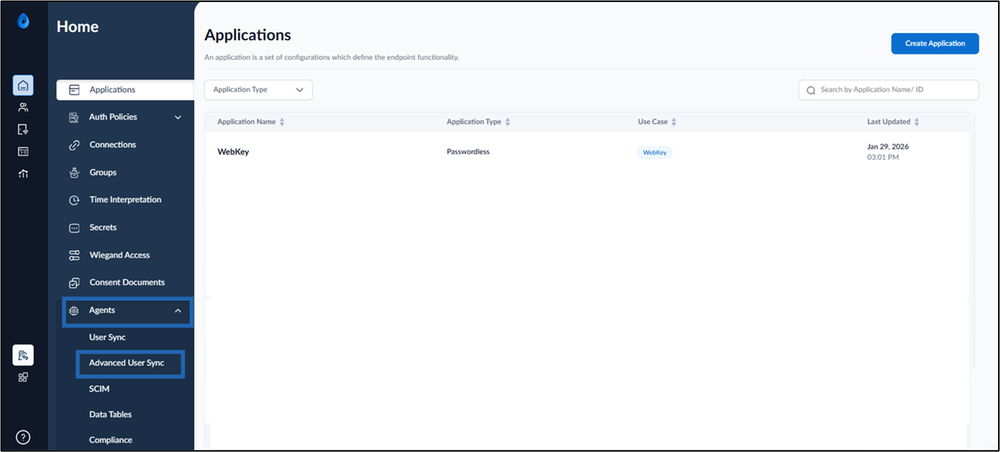
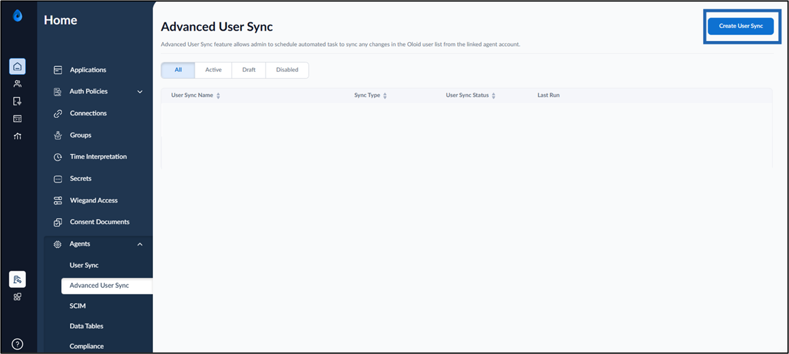
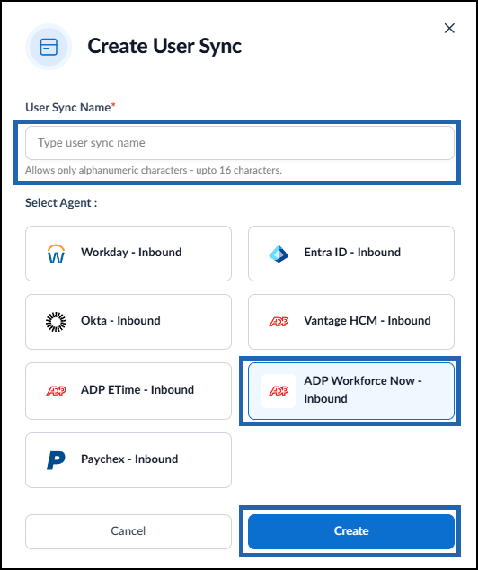
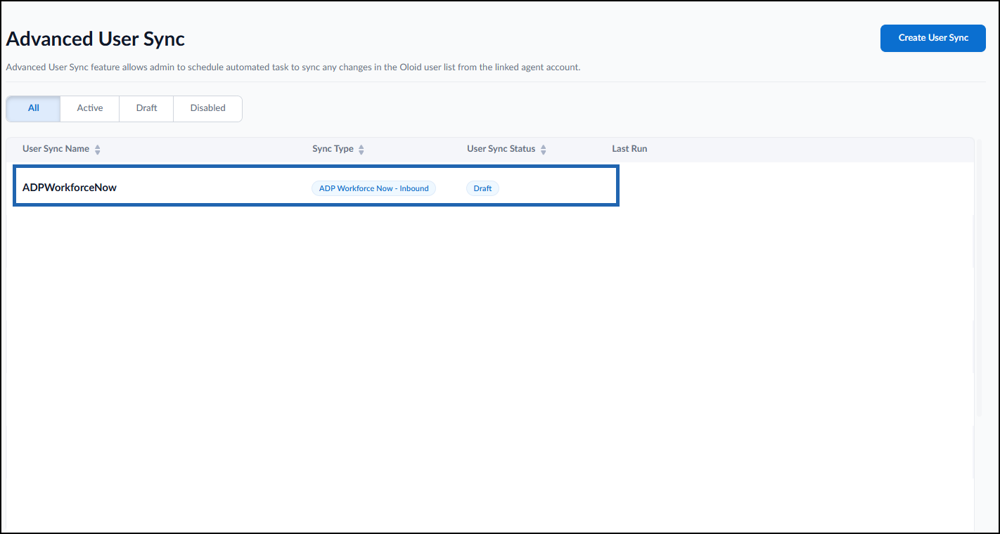

{/* Source: Intercom article 15201318 - https://oloid.help/en/articles/15201318-tenant-admin-portal-how-to-create-advanced-user-sync-for-adp-workforce-now-inbound */}
{/* Generated by intercom_to_mintlify.py - re-running overwrites this file. */}

## Introduction

The **Advanced User Sync** feature in the Tenant Admin Portal allows admin to create and manage user synchronization using supported agents such as ADP Workforce Now Inbound, ensuring accurate and consistent user data in the Oloid Tenant Admin Portal.

## Prerequisite

You must have access to the Tenant Admin Portal.

## Steps to Create Advanced User Sync

1. Log in to the **Tenant Admin Portal**.
2. Go to **Agents** tab > **Advanced User Sync**.

   

   The Advanced User Sync page is displayed.
3. Click **Create User Sync**.

   

   The **Create User Sync** pop-up box is displayed.
4. Do the following:
   1. Enter **User Sync Name**.
   2. Select **Agent**.

      <Note>
        **Note:** Select **ADP Workforce Now - Inbound a**s agent.
      </Note>

   3. Click **Create**.

      

      The advanced user sync for ADP Workforce Now Inbound is created successfully.

      
