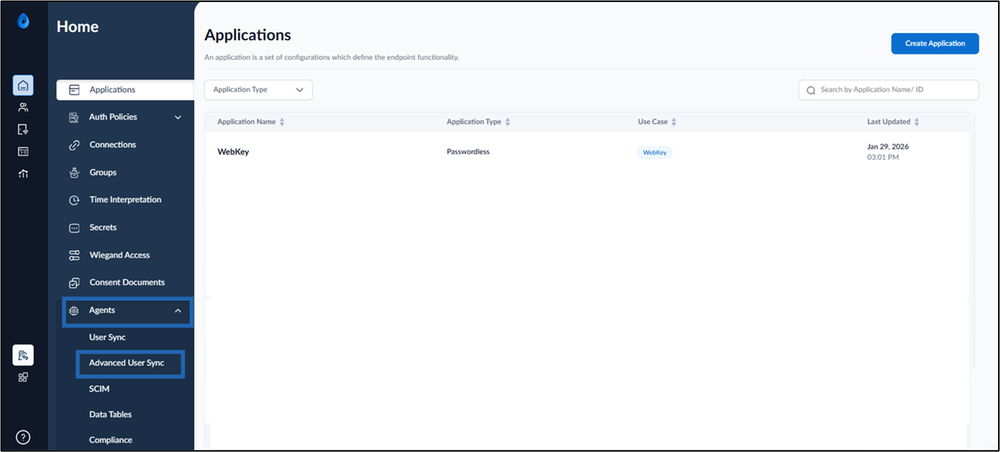
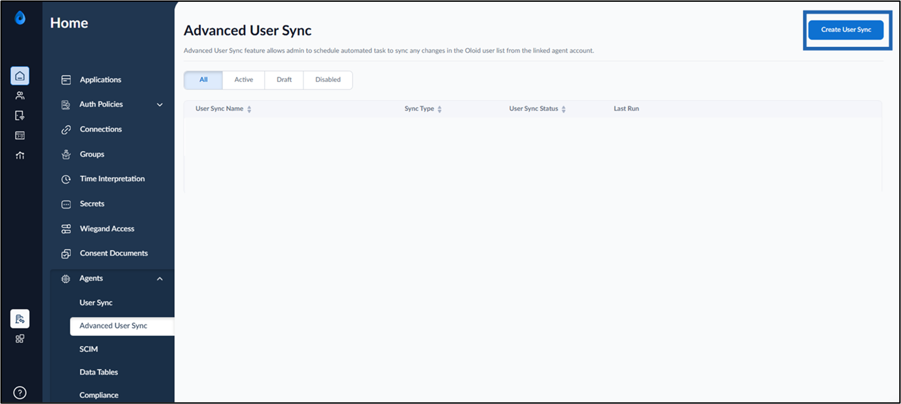
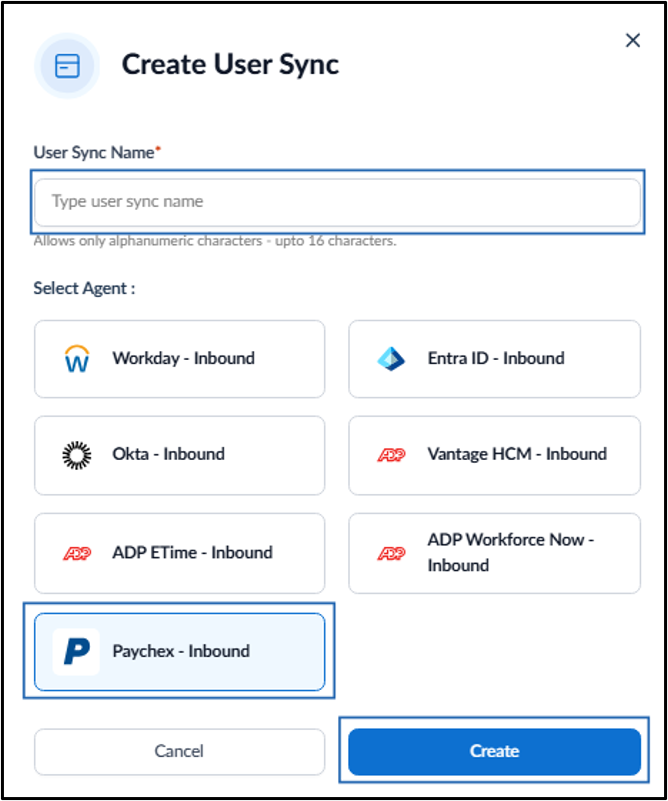
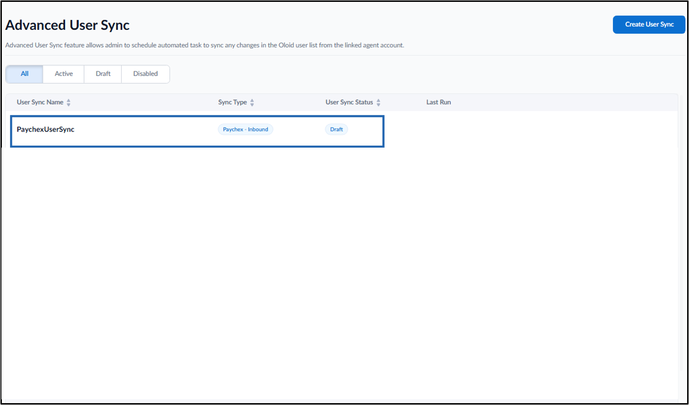

{/* Source: Intercom article 15886424 - https://oloid.help/en/articles/15886424-tenant-admin-portal-how-to-create-advanced-user-sync-for-paychex-inbound */}
{/* Generated by intercom_to_mintlify.py - re-running overwrites this file. */}

## Introduction

The **Advanced User Sync** feature allows admin to create and manage user synchronization using supported agents such as **Paychex Inbound**, ensuring accurate and consistent user data in the Tenant Admin Portal.

## Prerequisite

You must have **Admin access** to the Tenant Admin Portal.

## Steps to Create Advanced User Sync

1. Log in to the **Tenant Admin Portal**.
2. Go to **Agents** tab > **Advanced User Sync**.

   

   The Advanced User Sync page is displayed.
3. Click **Create User Sync**.

   

   The **Create User Sync** pop-up box is displayed.
4. Do the following:
   1. Enter **User Sync Name**.
   2. Select **Paychex - Inbound** as Agent.
   3. Click **Create**.

      

      The advanced user sync for Paychex - Inbound is created successfully.

      

---

##### Related Article

[Tenant Admin Portal - How to Configure Advanced User Sync for Paychex - Inbound](/platform/tenant-admin-portal/tenant-admin-portal-how-to-configure-advanced-user-sync-for-paychex)
