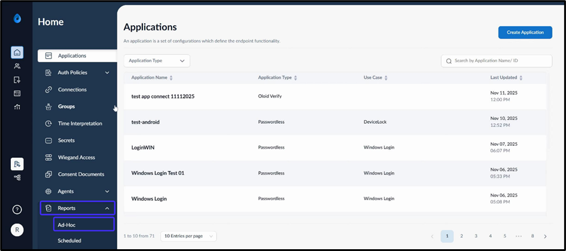
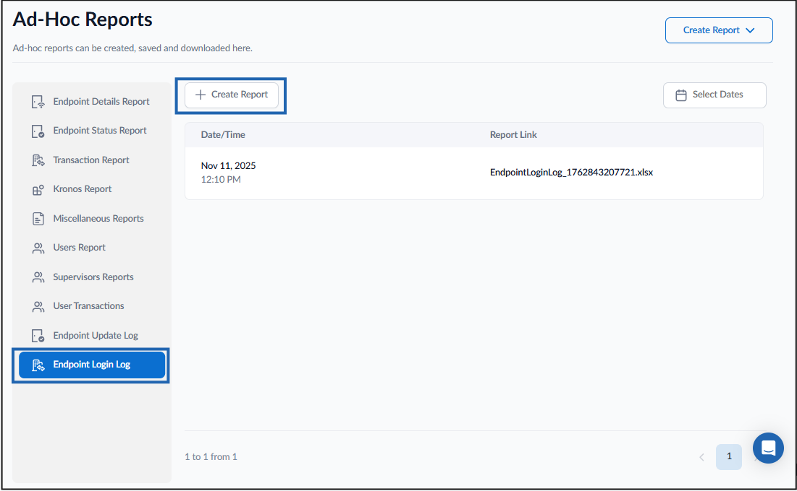
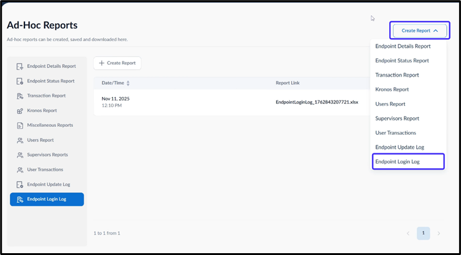
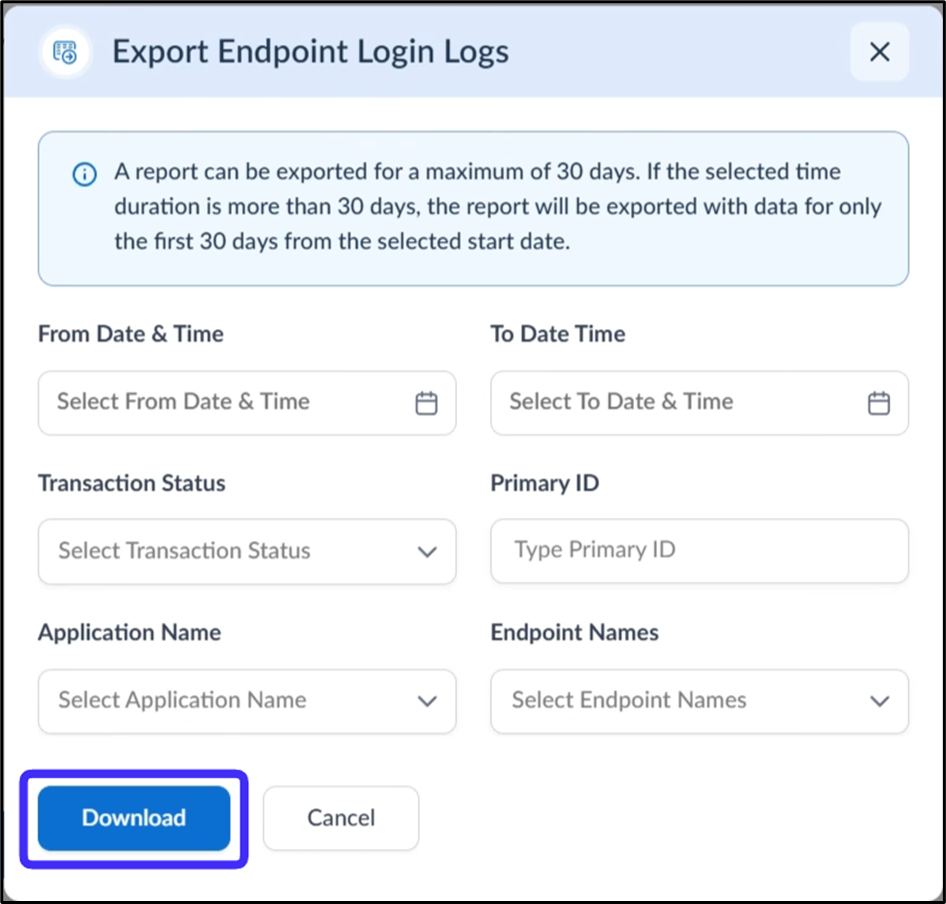
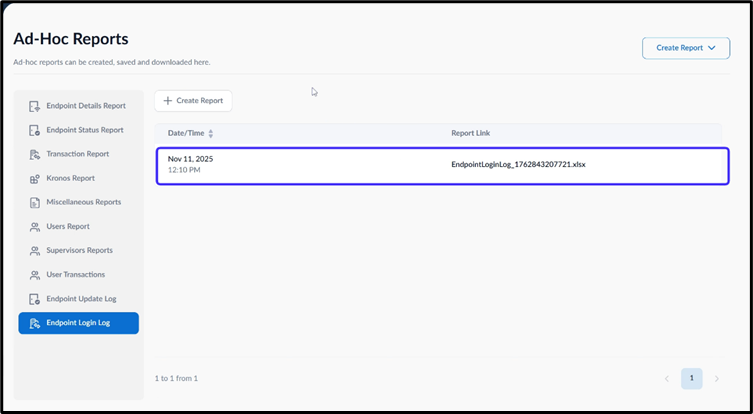

{/* Source: Intercom article 12807356 - https://oloid.help/en/articles/12807356-tenant-admin-portal-how-to-create-and-download-endpoint-login-log-report-ad-hoc */}
{/* Generated by intercom_to_mintlify.py - re-running overwrites this file. */}

## Introduction

An Endpoint Login Log provides details of all the logins made with the endpoints that are associated with the application.

## Prerequisite

You must have admin access to the Tenant Admin Portal.

## Steps to create & download Endpoint Login Log

1. Log in to the **Oloid Portal**.
2. On the homepage, click **Reports > Ad-Hoc** on the left menu panel.

   

   The **Ad-Hoc Reports** page is displayed.

   

3. Use one of the following methods to download the report:
   1. Select Endpoint Login Log from the left menu panel and then click **Create Report.**

      

      OR
   2. On the top right, click **Create Report** > **Endpoint Login Log**

      

      The **Create** Endpoint Login Log pop-up box is displayed.
4. On the pop-up box, do the following:
   a. Select the date and time from the calendar for **From Date & Time** (Mandatory) and **To Date Time.** (optional)
   b. Enter **Primary ID**.(optional)
   c. Select Transaction Status from **Transaction Status** drop-down list (optional)
   d. Select Application name(s) from **Application Names** drop-down list.(optional)
   e. Select Endpoint name(s) from **Endpoint Names** drop-down list.(optional)
   f. Click **Download**

   

The **Endpoint Login Log** is saved to the local device and listed on the **Ad-Hoc Reports** page under the Endpoint Login Log tab.

<Note>
  **Note:**

  - Ensure you have sufficient permissions as a **Tenant Admin** before attempting to create the report.
  - The downloaded file format for reports is XLSX.
  - A report can be exported for a maximum of 30 days. If the selected time duration is more than 30 days, the report will be exported with data for only the first 30 days from the selected start date.
  - If optional fields are not selected, all the endpoint login details in the system are downloaded to the file.
</Note>
